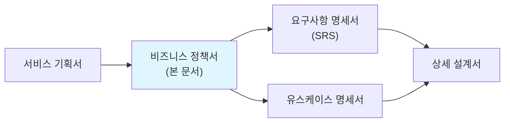
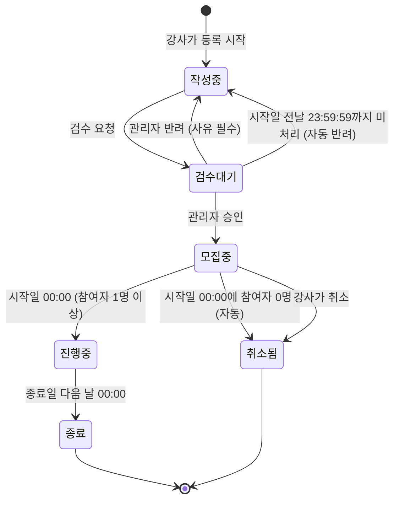
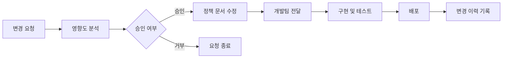

# 비즈니스 정책서 (Business Policy Document)

> 이 문서는 서비스의 비즈니스 동작 규칙을 독립적으로 정의하는 문서이다.
> "이런 상황에서 시스템은 어떻게 동작해야 하는가"를 **목적 / 규칙 / 예시** 구조로 명확히 기술하여, AI(Claude Code 등)가 바이브코딩 시 비즈니스 규칙을 정확히 구현하도록 한다.
> SRS의 기능 요구사항(FR)에 비즈니스 규칙이 흩어져 있으면 누락되기 쉬우므로, 이 문서에서 한곳에 모아 관리한다.
>
> 작성 근거: [서비스 기획서](서비스기획서.md)(SPD-CHUP-v0.1), 프로젝트 루트의 [PRD.md](../../PRD.md). 규칙 값(시간, 점수, 한도)은 초안 제안값이며 G0 검토에서 확정한다. 확정이 필요한 항목은 비고에 `미결`과 서비스 기획서의 DEC 번호를 적었다.

| 항목 | 내용 |
|------|------|
| **문서 ID** | BPD-CHUP-v0.2 |
| **프로젝트명** | 챌린지업 (ChallengeUp) — 온라인 강의 챌린지 플랫폼 |
| **문서 버전** | v0.2 |
| **작성일** | 2026-11-24 |
| **작성자** | Claude Code (초안) |
| **승인자** | 미정 (서비스 기획서 DEC-001) |
| **문서 상태** | 초안 |

---

## 변경 이력

| 버전 | 날짜 | 작성자 | 변경 내용 |
|------|------|--------|-----------|
| v0.1 | 2026-11-24 | Claude Code | 서비스 기획서·PRD 기반 초안 작성. 광고 정책 삭제, 챌린지·신청·인증·포인트·완주·피드 정책 추가 |
| v0.2 | 2026-11-24 | Claude Code | BP-PAY-005 정산식 변경, BP-PAY-006 운영 방식별 매출 배분(직접 운영형 20%, 기획 지원형 50%) 추가 |

---

## 목차

1. [문서 개요](#1-문서-개요)
2. [정책 목록 및 요약](#2-정책-목록-및-요약)
3. [인증/권한 정책](#3-인증권한-정책)
4. [과금/결제 정책](#4-과금결제-정책)
5. [콘텐츠 접근/해금 정책](#5-콘텐츠-접근해금-정책)
6. [알림/푸시 정책](#6-알림푸시-정책)
7. [데이터 리셋/날짜 변경 정책](#7-데이터-리셋날짜-변경-정책)
8. [오프라인/에러 처리 정책](#8-오프라인에러-처리-정책)
9. [통계/카운팅 정책](#9-통계카운팅-정책)
10. [챌린지 운영 정책](#10-챌린지-운영-정책)
11. [신청 정책](#11-신청-정책)
12. [미션 인증 정책](#12-미션-인증-정책)
13. [포인트·레벨·스트릭 정책](#13-포인트레벨스트릭-정책)
14. [완주 판정 정책](#14-완주-판정-정책)
15. [커뮤니티 피드 정책](#15-커뮤니티-피드-정책)
16. [MVP 정책 적용 범위](#16-mvp-정책-적용-범위)
17. [정책 변경 관리](#17-정책-변경-관리)

---

## 1. 문서 개요

### 1.1 목적

이 문서는 **챌린지업** 서비스의 비즈니스 동작 규칙을 한곳에 모아 정의한다. 특히 날짜에 따라 열리는 Day, 인증 마감, 포인트·스트릭, 완주 판정처럼 여러 화면과 정기 작업에 걸치는 규칙을 하나의 기준으로 맞춘다.

**이 문서가 필요한 이유:**

- SRS에 비즈니스 규칙이 기능별로 흩어져 있으면, AI 코딩 도구가 규칙을 누락하거나 잘못 해석하기 쉽다
- 비즈니스 규칙을 독립 문서로 관리하면 기획/개발/QA 모두 동일한 규칙을 참조할 수 있다
- "목적 / 규칙 / 예시" 구조는 AI가 가장 명확하게 이해하고 구현할 수 있는 형식이다

**이 문서의 대상 독자:**

| 독자 | 활용 방법 |
|------|-----------|
| AI 코딩 도구 (Claude Code 등) | 구현 시 비즈니스 규칙 참조. 예시의 "상황 -> 결과"를 테스트 케이스로 활용 |
| 개발팀 | 비즈니스 로직 구현의 기준 문서 |
| QA팀 | 테스트 케이스 도출의 기반. 예시를 경계값 테스트에 활용 |
| 기획팀 | 비즈니스 규칙 변경 관리의 단일 소스 |

### 1.2 정책 작성 가이드

> **모든 정책은 반드시 아래 4가지 요소를 포함해야 한다.**

| 요소 | 설명 | 작성 팁 |
|------|------|---------|
| **목적** | 이 정책이 존재하는 이유 | "왜 이 규칙이 필요한가"를 1~2문장으로 |
| **규칙** | 구체적인 동작 규칙 | 조건절 + 결과를 명확히. 모호한 표현("적절히", "필요 시") 금지 |
| **예시** | "상황 -> 결과" 형태의 구체적 시나리오 | 정상 케이스 + 경계 케이스 + 에러 케이스를 포함 |
| **변경이력** | 이 정책의 변경 기록 | 17장 통합 테이블에 기록. 정책별로도 주요 변경 기록 |

**예시 작성 형식:**

```
상황: [구체적 상황 설명]
결과: [시스템의 동작]
```

**이 문서에서 공통으로 쓰는 계산 기준** (모든 정책에 적용):

| 기준 | 정의 |
|------|------|
| 기준 시간대 | KST (UTC+9). 모든 날짜·시각 판단은 서버 시각 기준이며 사용자 기기 시각은 쓰지 않는다 |
| 종료일 | 시작일 + (기간 일수 − 1)일. 예) 12-01 시작 21일 챌린지의 종료일은 12-21 |
| Day N의 날짜 | 시작일 + (N − 1)일 |
| Day N의 마감 | Day N 날짜의 23:59:59 KST |
| 완주 필요 인증 수 | 올림(기간 일수 × 완주 조건 % ÷ 100) |

### 1.3 관련 문서

| 문서명 | 관계 |
|--------|------|
| [서비스 기획서](서비스기획서.md) | 사용자 문제, 서비스 목표, MVP 범위 (MVP-xxx, EX-xxx, DEC-xxx) |
| [PRD](../../PRD.md) | 기능 요구사항 초안 (AUTH-1, SUB-1 등) |
| [요구사항 명세서 (SRS)](../01-요구사항분석/요구사항명세서-SRS.md) | 요구사항의 출처에 개별 규칙 ID 기재 |
| [유스케이스 명세서](../01-요구사항분석/유스케이스명세서.md) | 정상·예외 흐름에 적용된 규칙 ID 참조 |



---

## 2. 정책 목록 및 요약

| 정책 ID | 정책 카테고리 | 핵심 규칙 요약 | MVP 적용 | 섹션 |
|---------|-------------|---------------|----------|------|
| BP-AUTH | 인증/권한 정책 | 이메일 가입, 역할은 학생·강사·관리자, 강사는 관리자 승인 후 활동 | Y | [3장](#3-인증권한-정책) |
| BP-PAY | 과금/결제 정책 | MVP는 전부 무료. v2 유료는 직접 운영형 20%, 기획 지원형 50%를 플랫폼이 가져감 | N | [4장](#4-과금결제-정책) |
| BP-CONTENT | 콘텐츠 접근/해금 정책 | 커리큘럼 내용은 신청자만, Day는 날짜가 되면 열림 | Y | [5장](#5-콘텐츠-접근해금-정책) |
| BP-NOTI | 알림/푸시 정책 | MVP는 화면 안내만. 이메일·알림톡은 v2 | N (화면 안내만 Y) | [6장](#6-알림푸시-정책) |
| BP-RESET | 데이터 리셋/날짜 변경 정책 | KST 00:00 기준으로 Day 열림·일일 한도 리셋 | Y | [7장](#7-데이터-리셋날짜-변경-정책) |
| BP-ERROR | 오프라인/에러 처리 정책 | 마감 판단은 서버 수신 시각, 작성 중 인증은 기기에 임시 저장 | Y | [8장](#8-오프라인에러-처리-정책) |
| BP-STAT | 통계/카운팅 정책 | 참여 인원·인증률·완주율 계산식과 표시 형식 | Y | [9장](#9-통계카운팅-정책) |
| BP-CHAL | 챌린지 운영 정책 | 상태 흐름, 등록 제한값, 검수, 공개 후 수정 범위 | Y | [10장](#10-챌린지-운영-정책) |
| BP-ENR | 신청 정책 | 모집 중에만 신청, 정원·중복·동시 참여 제한, 시작 전 취소 | Y | [11장](#11-신청-정책) |
| BP-SUB | 미션 인증 정책 | Day당 1건, 마감 전까지 제출·수정, 자동 인정 기본 | Y | [12장](#12-미션-인증-정책) |
| BP-POINT | 포인트·레벨·스트릭 정책 | 적립 점수표, 회수 규칙, 레벨 기준, 스트릭 계산 | Y | [13장](#13-포인트레벨스트릭-정책) |
| BP-DONE | 완주 판정 정책 | 종료 다음 날 00:10 자동 판정, 필요 인증 수 올림 계산 | Y | [14장](#14-완주-판정-정책) |
| BP-FEED | 커뮤니티 피드 정책 | 글 종류와 권한, 공지 고정 3개, 신고 처리 | Y | [15장](#15-커뮤니티-피드-정책) |

> 광고 정책(BP-AD)은 챌린지업이 광고 수익 모델이 아니므로 삭제했다.

---

## 3. 인증/권한 정책

### 3.1 목적

사용자의 신원을 확인하고, 학생·강사·관리자 역할에 따라 볼 수 있는 화면과 할 수 있는 행동을 구분한다. 특히 챌린지를 여는 강사 권한은 관리자 승인을 거쳐 품질을 관리한다.

### 3.2 규칙

#### BP-AUTH-001: 회원 가입

| 규칙 ID | 규칙 | 비고 |
|---------|------|------|
| BP-AUTH-001-1 | 이메일은 고유해야 한다. 이미 등록된 이메일로 가입 시도 시 "이미 가입된 이메일입니다" 메시지를 표시한다 | |
| BP-AUTH-001-2 | 비밀번호는 8자 이상 72자 이하이며, 영문과 숫자를 각각 1자 이상 포함해야 한다 | 72자: Supabase Auth(bcrypt) 상한 |
| BP-AUTH-001-3 | 가입 후 인증 메일의 링크를 눌러야 로그인할 수 있다. 인증 링크 유효 기간은 24시간이다 | 미결 — 메일 인증을 끌지 G0에서 결정. Supabase 기본값은 켜짐 |
| BP-AUTH-001-4 | 가입 시 이름(2~20자)을 필수로 받는다. 프로필 사진과 한 줄 소개(최대 60자)는 선택이다 | |
| BP-AUTH-001-5 | 구글 로그인을 지원한다. 같은 이메일로 이메일 가입 계정이 있으면 같은 계정으로 연결한다 | MVP P2 (MVP-015) |
| BP-AUTH-001-6 | 가입 시 이용약관·개인정보 수집 동의(필수)를 받는다. 동의하지 않으면 가입할 수 없다 | 약관 문안은 미결 |

#### BP-AUTH-002: 로그인 / 세션 관리

| 규칙 ID | 규칙 | 비고 |
|---------|------|------|
| BP-AUTH-002-1 | 로그인 실패 시 이메일·비밀번호 중 무엇이 틀렸는지 구분하지 않고 "이메일 또는 비밀번호가 올바르지 않습니다"를 표시한다 | |
| BP-AUTH-002-2 | 반복 로그인 시도 제한은 Supabase Auth의 기본 요청 제한을 따른다. MVP에서 별도 계정 잠금은 구현하지 않는다 | 미결 — 자체 잠금(예: 5회 실패 30분) 필요 여부 |
| BP-AUTH-002-3 | 세션 유지 시간과 토큰 갱신은 Supabase Auth 기본값을 따른다. 사용자가 로그아웃하기 전까지 로그인 상태를 유지한다 | |
| BP-AUTH-002-4 | 여러 기기 동시 로그인을 허용한다 | |
| BP-AUTH-002-5 | 비밀번호 재설정 링크 유효 기간은 1시간이다 | Supabase 설정값으로 지정 |

#### BP-AUTH-003: 역할 및 권한

| 역할 | 설명 | 주요 권한 | 비고 |
|------|------|-----------|------|
| 학생 (student) | 가입하면 기본으로 받는 역할 | 챌린지 탐색·신청, 신청한 챌린지의 커리큘럼·피드 이용, 미션 인증 | 기본 역할 |
| 강사 (instructor) | 강사 신청 후 관리자 승인을 받은 사용자 | 학생 권한 전부 + 챌린지 등록·운영, 자기 챌린지의 인증 확인·공지·글 숨김, 대시보드 | 학생 권한 유지 |
| 관리자 (admin) | 플랫폼 운영자 | 챌린지 검수, 강사 신청 승인, 신고 처리, 모든 챌린지 열람 | DB에서 직접 지정. 화면에서 부여 불가 |

#### BP-AUTH-004: 강사 신청

| 규칙 ID | 규칙 | 비고 |
|---------|------|------|
| BP-AUTH-004-1 | 학생은 신청 사유(20~500자)와 소개 링크(선택, 1개)를 입력해 강사를 신청한다 | |
| BP-AUTH-004-2 | 처리 대기 중인 신청이 있으면 새로 신청할 수 없다 | |
| BP-AUTH-004-3 | 관리자는 승인 또는 반려한다. 반려 시 사유(필수)를 남기고, 사용자는 반려일로부터 7일 뒤 다시 신청할 수 있다 | |
| BP-AUTH-004-4 | 관리자는 신청 후 2영업일 안에 처리하는 것을 목표로 한다 | 운영 목표, 시스템 강제 없음 |

#### BP-AUTH-005: 회원 탈퇴

| 규칙 ID | 규칙 | 비고 |
|---------|------|------|
| BP-AUTH-005-1 | MVP에서는 고객 문의(이메일)로 탈퇴를 접수하고 관리자가 처리한다. 접수 후 5영업일 안에 처리한다 | 수동 처리 (16.3) |
| BP-AUTH-005-2 | 탈퇴 시 계정 정보(이메일, 이름, 사진)는 삭제하고, 피드 글·댓글은 작성자를 "탈퇴한 사용자"로 바꿔 남긴다 | 보존 기간·법령 검토 미결 |
| BP-AUTH-005-3 | 진행 중이거나 모집 중인 챌린지를 가진 강사는 해당 챌린지가 종료·취소된 뒤 탈퇴할 수 있다 | |

### 3.3 예시

**정상 케이스:**

```
상황: 학생이 강사 신청을 하고 관리자가 승인한다
결과: 사용자 역할이 강사로 바뀌고, 다음 화면 로드부터 상단 메뉴에 "강사 스튜디오"가 보인다
```

**경계 케이스:**

```
상황: 비밀번호를 "abcdefg1"(8자, 영문+숫자)로 입력한다
결과: 가입 가능

상황: 비밀번호를 "abcdefgh"(8자, 숫자 없음)로 입력한다
결과: "비밀번호는 영문과 숫자를 모두 포함해야 합니다" 메시지를 표시하고 가입을 막는다
```

```
상황: 강사 신청이 11-20에 반려되었고, 사용자가 11-27 00:00에 다시 신청한다
결과: 신청 가능 (반려일로부터 7일 경과)
```

**에러 케이스:**

```
상황: 학생이 주소창에 /studio/new를 직접 입력한다
결과: 접근을 막고 "강사 승인 후 이용할 수 있습니다" 안내와 강사 신청 버튼을 표시한다
```

### 3.4 변경이력

| 날짜 | 규칙 ID | 변경 내용 | 변경 사유 |
|------|---------|-----------|-----------|
| 2026-11-24 | BP-AUTH 전체 | 초안 작성 | — |

---

## 4. 과금/결제 정책

> **MVP에서는 적용하지 않는다.** 모든 챌린지는 무료다 (서비스 기획서 EX-001, EX-002, EX-013). 아래 BP-PAY-002 이후는 v2 기획을 위한 초안이며, 환불 규칙은 관련 법령 검토 후 확정한다 (DEC-007).

### 4.1 목적

v2에서 유료·보증금형 챌린지를 도입할 때 가격, 결제, 환불, 정산 규칙을 미리 정해 두어 학생·강사와의 분쟁을 예방한다.

### 4.2 규칙

#### BP-PAY-001: 무료/유료 경계

| 규칙 ID | 규칙 | 비고 |
|---------|------|------|
| BP-PAY-001-1 | MVP: 모든 챌린지의 가격은 0원으로 고정한다. 등록 5단계의 가격 단계에는 "무료"만 표시한다 | MVP 적용 |
| BP-PAY-001-2 | v2: 강사는 챌린지마다 무료 / 유료 중 하나를 고른다. 유료이면 운영 방식(BP-PAY-006)도 고른다. 보증금형은 v3 이후 검토 | v2 |
| BP-PAY-001-3 | v2: 유료 가격은 1,000원 이상 1,000,000원 이하, 100원 단위로 정한다 | v2 초안 |
| BP-PAY-001-4 | 플랫폼 이용료(학생 구독, 강사 월 이용료)는 받지 않는다 | v3에서 강사 프로 플랜 검토 |

#### BP-PAY-002: 결제 처리 (v2)

| 규칙 ID | 규칙 | 비고 |
|---------|------|------|
| BP-PAY-002-1 | 결제는 토스페이먼츠를 통해 카드·간편결제로 받는다 | |
| BP-PAY-002-2 | 결제 완료가 확인된 뒤에만 신청을 확정한다. 결제 실패 시 신청을 만들지 않는다 | |
| BP-PAY-002-3 | 결제 화면에 들어가면 정원 1자리를 10분간 임시 확보한다. 10분 안에 결제하지 않으면 자리를 풀어 준다 | |
| BP-PAY-002-4 | 같은 사용자의 같은 챌린지 결제 요청이 진행 중이면 결제 버튼을 비활성화해 이중 결제를 막는다 | |

#### BP-PAY-003: 환불 정책 (v2 초안 — 법령 검토 필요)

| 규칙 ID | 규칙 | 비고 |
|---------|------|------|
| BP-PAY-003-1 | 시작일 전날 23:59:59까지 신청을 취소하면 전액 환불한다 | |
| BP-PAY-003-2 | 시작 후 환불은 진행된 Day 비율에 따라 부분 환불한다. 구체 비율은 법령 검토 후 확정한다 | 미결 (DEC-007) |
| BP-PAY-003-3 | 강사가 챌린지를 취소하면 신청자 전원에게 전액 환불한다 | |
| BP-PAY-003-4 | 환불은 승인 후 3~5영업일 안에 원래 결제 수단으로 처리한다 | 결제사 일정에 따름 |

#### BP-PAY-004: 보증금형 (v2 이후 초안)

| 규칙 ID | 규칙 | 비고 |
|---------|------|------|
| BP-PAY-004-1 | 완주자는 보증금 전액을, 미완주자는 인정된 인증 비율만큼 돌려받는다 | 미결 — 법률 검토 필요 |
| BP-PAY-004-2 | 환급은 완주 판정(BP-DONE-001) 후 7일 안에 처리한다 | |

#### BP-PAY-005: 정산 (v2)

| 규칙 ID | 규칙 | 비고 |
|---------|------|------|
| BP-PAY-005-1 | 배분 대상 매출 = 결제 금액 합계 − 환불액 | |
| BP-PAY-005-2 | 플랫폼 몫 = 배분 대상 매출 × 배분율(직접 운영형 20%, 기획 지원형 50%). 강사 정산액 = 배분 대상 매출 − 플랫폼 몫 | BP-PAY-006 |
| BP-PAY-005-3 | 결제 대행 수수료(PG)를 배분 전 매출에서 뺄지, 플랫폼 몫에서 낼지는 미결이다 | 미결 (DEC-006) |
| BP-PAY-005-4 | 원 단위 미만은 강사 정산액에서 버림하고, 그 차액은 플랫폼 몫에 더한다 | |
| BP-PAY-005-5 | 정산은 챌린지 종료일이 속한 달의 다음 달 10일에 한다. 정산 내역(매출, 환불, 배분율, 플랫폼 몫, 정산액)을 강사 스튜디오에 표시한다 | 초안 |

#### BP-PAY-006: 운영 방식과 매출 배분 (v2)

| 운영 방식 | 플랫폼 몫 | 강사 몫 | 플랫폼이 제공하는 것 |
|-----------|-----------|---------|----------------------|
| 강사 직접 운영형 | 20% | 80% | 서비스 기능, 결제·정산, 검수, 탐색 노출 |
| 플랫폼 기획 지원형 | 50% | 50% | 직접 운영형의 모든 것 + 커리큘럼·Day별 미션 설계, 소개 페이지(카피·썸네일) 제작, 출시 홍보, 운영 대행(공지, 이탈 위험 학생 관리) |

| 규칙 ID | 규칙 | 비고 |
|---------|------|------|
| BP-PAY-006-1 | 유료 챌린지는 반드시 두 운영 방식 중 하나를 가진다. 기본값은 직접 운영형이다. 무료 챌린지는 배분이 없다 | |
| BP-PAY-006-2 | 기획 지원형은 강사가 신청하고 관리자가 승인한 챌린지에만 지정할 수 있다. 강사가 스스로 기획 지원형을 고를 수는 없다 | 선정 기준 미결 (DEC-010) |
| BP-PAY-006-3 | 기획 지원형 챌린지는 플랫폼 운영자에게 해당 챌린지의 공동 편집·공지 작성 권한을 준다 | |
| BP-PAY-006-4 | 운영 방식과 배분율은 모집 중이 된 뒤에는 바꿀 수 없다. 바꾸려면 다음 기수로 새로 등록한다 | 신청자에게 고지된 조건 보호 |
| BP-PAY-006-5 | 기획 지원형은 별도 계약서로 지원 범위, 결과물(커리큘럼·소개 페이지)의 권리, 계약 해지 시 처리 방법을 정한다 | 계약서 양식 미결 (DEC-010) |
| BP-PAY-006-6 | 학생에게는 운영 방식을 표시하지 않는다. 가격과 챌린지 내용만 보여 준다 | 미결 — 기획 지원형을 "플랫폼 추천" 배지로 보여 줄지 검토 |

### 4.3 예시

**정상 케이스 (MVP):**

```
상황: 강사가 등록 5단계에서 가격 단계로 넘어간다
결과: "MVP 기간에는 모든 챌린지가 무료로 운영됩니다" 안내와 함께 가격 0원이 고정 표시된다. 다른 값은 입력할 수 없다
```

**경계 케이스 (v2):**

```
상황: 학생이 12-01 시작 유료 챌린지를 11-30 23:59:59에 취소한다
결과: 전액 환불 (시작일 전날 23:59:59까지)

상황: 같은 학생이 12-01 00:00:00에 취소한다
결과: 시작 후 환불 규칙(BP-PAY-003-2)을 적용한다
```

**에러 케이스 (v2):**

```
상황: 결제 요청 후 결제사 응답이 30초간 없다
결과: "결제 확인 중" 상태를 표시하고 결제 버튼을 비활성화한다. 서버가 결제사에 상태를 조회해 결과를 반영한다
```

### 4.4 변경이력

| 날짜 | 규칙 ID | 변경 내용 | 변경 사유 |
|------|---------|-----------|-----------|
| 2026-11-24 | BP-PAY 전체 | 초안 작성 (MVP는 무료 고정) | — |
| 2026-11-24 | BP-PAY-005, BP-PAY-006 | 단일 수수료(10~15%) → 운영 방식별 배분(20% / 50%) | 수익화 전략 변경 (서비스 기획서 v0.2) |

---

## 5. 콘텐츠 접근/해금 정책

### 5.1 목적

챌린지 커리큘럼(강의 링크·자료·미션)은 신청한 학생과 강사만 볼 수 있게 하고, Day는 날짜에 맞춰 열리게 해서 "매일 한 걸음씩"이라는 챌린지 구조를 지킨다.

### 5.2 규칙

#### BP-CONTENT-001: 콘텐츠 접근 등급

| 대상 | 비회원 | 로그인 · 미신청 | 신청자 (활성) | 해당 챌린지 강사 | 관리자 |
|------|--------|----------------|--------------|-----------------|--------|
| 탐색 목록, 소개 페이지 | O | O | O | O | O |
| 커리큘럼 Day 제목 목록 | O | O | O | O | O |
| Day 내용 (강의 링크, 자료, 미션 설명) | X | X | 열린 Day만 O | O (전체) | O (전체) |
| 피드, 리더보드, 멤버 | X | X | O | O | O |
| 미션 인증 제출 | X | X | 열린 Day, 마감 전 O | X | X |

| 규칙 ID | 규칙 | 비고 |
|---------|------|------|
| BP-CONTENT-001-1 | 접근 권한이 없는 사용자가 챌린지 홈 주소로 들어오면 소개 페이지로 이동시킨다 | |
| BP-CONTENT-001-2 | 신청을 취소한 사용자는 즉시 신청자 권한을 잃는다 | |
| BP-CONTENT-001-3 | 권한 확인은 화면이 아니라 DB의 행 단위 보안(RLS)으로 강제한다. 화면에서 버튼을 숨기는 것만으로 권한을 처리하지 않는다 | |

#### BP-CONTENT-002: Day 해금 조건

| 규칙 ID | 규칙 | 비고 |
|---------|------|------|
| BP-CONTENT-002-1 | 강사는 등록 시 열림 방식을 "매일 열림" 또는 "시작일에 전부 열림" 중 하나로 고른다. 기본값은 "매일 열림"이다 | |
| BP-CONTENT-002-2 | 매일 열림: Day N은 Day N 날짜의 00:00:00 KST에 열린다 | 1.2 공통 기준 |
| BP-CONTENT-002-3 | 전부 열림: 모든 Day가 시작일 00:00:00 KST에 열린다. 마감은 여전히 Day별 날짜 기준이다 (BP-SUB-002) | |
| BP-CONTENT-002-4 | 잠긴 Day는 제목과 "MM.DD(요일) 00:00에 열립니다" 문구, 잠금 아이콘을 표시한다 | |
| BP-CONTENT-002-5 | 한 번 열린 Day는 다시 잠기지 않는다. 챌린지 종료 후에도 신청자는 모든 Day 내용을 계속 볼 수 있다 | 종료 후 인증은 불가 |
| BP-CONTENT-002-6 | 해금은 순서대로만 일어나며, 학생이 앞 Day를 인증하지 않아도 다음 Day는 날짜가 되면 열린다 | 인증 여부와 해금은 무관 |

### 5.3 예시

```
상황: 12-01 시작, 매일 열림 챌린지. 신청자가 12-03 10:00에 커리큘럼을 연다
결과: Day 1~3은 내용이 보이고, Day 4는 "12.04(금) 00:00에 열립니다"와 잠금 아이콘이 표시된다
```

```
상황: 로그인했지만 신청하지 않은 사용자가 소개 페이지의 커리큘럼 미리보기를 본다
결과: Day 1~21 제목만 보이고, 누르면 "신청한 참여자만 볼 수 있습니다"와 신청 버튼을 표시한다
```

```
상황: 챌린지가 12-21에 종료되었고, 신청자가 12-25에 Day 5를 연다
결과: 강의 링크와 미션 설명은 보이지만 인증 버튼 대신 "종료된 챌린지입니다"를 표시한다
```

### 5.4 변경이력

| 날짜 | 규칙 ID | 변경 내용 | 변경 사유 |
|------|---------|-----------|-----------|
| 2026-11-24 | BP-CONTENT 전체 | 초안 작성 | — |

---

## 6. 알림/푸시 정책

> **MVP에서는 이메일·알림톡·푸시를 보내지 않는다** (서비스 기획서 EX-004). 계정 인증·비밀번호 재설정 메일만 Supabase Auth가 보낸다. 나머지는 v2 도입 시 적용할 초안이다.

### 6.1 목적

미션을 놓치지 않도록 필요한 순간에 알리되, 과도한 알림으로 피로해지지 않게 한다.

### 6.2 규칙

#### BP-NOTI-001: 알림 채널 및 유형

| 알림 유형 | 채널 | 발송 조건 | 사용자 설정 가능 | 적용 |
|-----------|------|-----------|-----------------|------|
| 가입 인증 | 이메일 | 회원 가입 시 | N (필수) | MVP |
| 비밀번호 재설정 | 이메일 | 재설정 요청 시 | N (필수) | MVP |
| 오늘의 미션 | 화면 안내 (카드) | 로그인 후 첫 화면에서 오늘 열린 Day가 있을 때 | N | MVP |
| 강사 신청·챌린지 검수 결과 | 화면 안내 (배너) | 결과 이후 첫 접속 시 1회 | N | MVP |
| 미션 열림 | 이메일 또는 알림톡 | 매일 열림 챌린지에서 Day가 열린 날 08:00 | Y | v2 |
| 마감 리마인드 | 이메일 또는 알림톡 | 그날 미인증 상태로 21:00이 될 때 | Y | v2 |
| 내 글에 댓글 | 화면 알림 | 댓글 작성 시 | Y | v2 |
| 챌린지 시작 하루 전 | 이메일 | 시작일 전날 18:00 | Y | v2 |

#### BP-NOTI-002: 알림 빈도 제한 (v2)

| 규칙 ID | 규칙 | 비고 |
|---------|------|------|
| BP-NOTI-002-1 | 한 사용자에게 보내는 이메일·알림톡은 챌린지 수와 관계없이 하루 최대 3건이다 | |
| BP-NOTI-002-2 | 같은 날 여러 챌린지의 미션 열림 알림은 1건으로 묶어 보낸다 | |
| BP-NOTI-002-3 | 21:00~08:00 사이에는 이메일·알림톡을 보내지 않는다 (21:00 마감 리마인드는 예외로 21:00 정각에 발송) | 야간 광고성 정보 전송 제한 규정 검토 필요 |
| BP-NOTI-002-4 | 사용자가 끈 알림 유형은 보내지 않는다. 필수 알림(가입 인증, 비밀번호 재설정)은 예외 | |

### 6.3 예시

```
상황 (MVP): 신청한 챌린지 2개가 모두 진행 중이고, 학생이 오늘 처음 접속한다
결과: 첫 화면 상단에 두 챌린지의 "오늘의 미션" 카드가 마감이 빠른 순으로 나란히 보인다
```

```
상황 (v2): 학생이 21:00까지 오늘 미션을 인증하지 않았고, 마감 리마인드를 켜 두었다
결과: 21:00에 "오늘 미션 마감까지 3시간 남았어요" 알림을 1건 보낸다. 이미 인증했다면 보내지 않는다
```

### 6.4 변경이력

| 날짜 | 규칙 ID | 변경 내용 | 변경 사유 |
|------|---------|-----------|-----------|
| 2026-11-24 | BP-NOTI 전체 | 초안 작성 (MVP는 화면 안내만) | — |

---

## 7. 데이터 리셋/날짜 변경 정책

### 7.1 목적

Day 열림, 인증 마감, 일일 한도, 리더보드 기간이 모두 같은 시간 기준으로 움직이게 해서, 사용자마다 날짜가 다르게 계산되는 일을 막는다.

### 7.2 규칙

#### BP-RESET-001: 리셋 기준

| 규칙 ID | 규칙 | 비고 |
|---------|------|------|
| BP-RESET-001-1 | 서비스 기준 시간대는 KST (UTC+9)다. DB에는 UTC로 저장하고 판단·표시할 때 KST로 바꾼다 | |
| BP-RESET-001-2 | 날짜가 바뀌는 시점은 매일 00:00:00 KST다 | |
| BP-RESET-001-3 | 주간·월간 단위 리셋은 없다. 리더보드의 7일·30일은 고정 주간이 아니라 "오늘 포함 최근 N일"로 계산한다 (BP-POINT-004) | |

#### BP-RESET-002: 리셋·전환 대상

| 대상 데이터 | 시점 | 내용 | 비고 |
|------------|-----------|-----------|------|
| Day 열림 | 매일 00:00:00 KST | 그날 날짜의 Day가 열린다 | BP-CONTENT-002 |
| 인증 마감 | 매일 23:59:59 KST | 그날 날짜 Day의 인증 제출을 닫는다 | BP-SUB-002 |
| 스트릭 끊김 판단 | 매일 00:00:00 KST | 전날 Day에 인정·대기 인증이 없으면 스트릭을 0으로 만든다 | BP-POINT-005 |
| 댓글 포인트 일일 한도 | 매일 00:00:00 KST | 사용자별 그날 댓글 적립 카운터를 0으로 | BP-POINT-001 |
| 챌린지 상태 전환 | 매일 00:00:00 KST | 시작일이 된 모집 중 → 진행 중, 종료일 다음 날이 된 진행 중 → 종료 | BP-CHAL-001 |
| 완주 판정 | 종료일 다음 날 00:10 KST | 완주 여부 확정 | BP-DONE-001 |

### 7.3 예시

```
상황: 학생이 23:59:58에 인증 버튼을 누르고, 요청이 서버에 00:00:01에 도착한다
결과: 서버 수신 시각이 마감 이후이므로 거절하고 "마감 시간이 지나 제출할 수 없습니다"를 표시한다 (BP-ERROR-003)
```

```
상황: 해외에 있는 학생의 기기 시각이 KST보다 14시간 늦다
결과: 학생 기기 시각과 무관하게 Day 열림과 마감은 KST 기준으로 동작한다. 화면의 마감 시각은 "23:59 (한국 시간)"으로 표시한다
```

### 7.4 변경이력

| 날짜 | 규칙 ID | 변경 내용 | 변경 사유 |
|------|---------|-----------|-----------|
| 2026-11-24 | BP-RESET 전체 | 초안 작성 | — |

---

## 8. 오프라인/에러 처리 정책

### 8.1 목적

네트워크 불안정이나 서버 오류가 있어도 작성 중인 인증 내용을 잃지 않게 하고, 마감 직전 제출처럼 시간이 중요한 상황의 판단 기준을 하나로 정한다.

### 8.2 규칙

#### BP-ERROR-001: 네트워크 오류 처리

| 규칙 ID | 규칙 | 비고 |
|---------|------|------|
| BP-ERROR-001-1 | 조회 요청이 실패하면 1초, 2초 간격으로 최대 2회 자동 재시도한다 | |
| BP-ERROR-001-2 | 제출·수정·삭제 요청(인증, 글, 신청)은 자동 재시도하지 않는다. 실패 시 "저장하지 못했습니다. 다시 시도해 주세요"와 다시 시도 버튼을 표시한다 | 중복 생성 방지 |
| BP-ERROR-001-3 | 오프라인이 감지되면 화면 상단에 "인터넷 연결이 끊겼습니다" 배너를 표시하고 제출 버튼을 비활성화한다 | |

#### BP-ERROR-002: 데이터 보존

| 규칙 ID | 규칙 | 비고 |
|---------|------|------|
| BP-ERROR-002-1 | 인증·피드 글 작성 중인 텍스트는 입력할 때마다 기기(브라우저 저장소)에 임시 저장한다. 제출에 성공하면 임시 저장본을 지운다 | |
| BP-ERROR-002-2 | 같은 Day 인증 화면을 다시 열었을 때 임시 저장본이 있으면 "작성 중이던 내용을 불러올까요?"를 묻는다 | |
| BP-ERROR-002-3 | 사진 업로드가 일부만 실패하면 실패한 사진만 표시하고 다시 올리게 한다. 사진이 모두 올라가기 전에는 인증을 제출할 수 없다 | |
| BP-ERROR-002-4 | 챌린지 등록 5단계는 단계를 넘어갈 때마다 서버에 임시 저장한다 | |

#### BP-ERROR-003: 마감 판단

| 규칙 ID | 규칙 | 비고 |
|---------|------|------|
| BP-ERROR-003-1 | 마감·정원·모집 기간 판단은 요청이 서버에 도착한 시각으로 한다. 기기 시각, 버튼을 누른 시각은 쓰지 않는다 | |
| BP-ERROR-003-2 | 마감 5분 전부터 인증 화면에 남은 시간을 초 단위로 표시한다 | |

#### BP-ERROR-004: 서버 오류 표시

| HTTP 상태 | 사용자 메시지 | 기술적 동작 |
|-----------|-------------|------------|
| 400 | "입력 내용을 확인해 주세요" + 항목별 사유 | 실패 필드와 사유를 응답에 포함 |
| 401 | "로그인이 필요합니다" | 로그인 페이지로 이동 후 원래 페이지로 복귀 |
| 403 | "이 챌린지에 참여한 사람만 볼 수 있습니다" 또는 "권한이 없습니다" | 소개 페이지 또는 이전 화면으로 이동 |
| 404 | "찾을 수 없는 페이지입니다" | 404 화면 + 탐색 화면으로 가는 링크 |
| 409 | "이미 신청한 챌린지입니다" / "정원이 마감되었습니다" / "이미 인증한 Day입니다" | 충돌 사유별 메시지 |
| 422 | "마감 시간이 지나 제출할 수 없습니다" / "모집이 끝난 챌린지입니다" / "현재 상태에서는 ○○을(를) 바꿀 수 없습니다" | 마감·모집 기간·상태 규칙 위반 (SRS 오류 코드 RULE_VIOLATION) |
| 429 | "요청이 너무 많습니다. 잠시 후 다시 시도해 주세요" | 요청 제한 초과 |
| 500 | "일시적인 오류가 발생했습니다" | 오류 기록 |
| 503 | "서비스 점검 중입니다" | 점검 종료 예정 시각 표시 |

### 8.3 예시

```
상황: 학생이 인증 텍스트를 500자 작성하던 중 지하철에서 연결이 끊긴다
결과: "인터넷 연결이 끊겼습니다" 배너가 뜨고 제출 버튼이 비활성화된다. 작성한 내용은 기기에 남아 있고,
      연결이 돌아오면 배너가 사라지고 제출할 수 있다
```

```
상황: 사진 3장 중 2번째 사진 업로드가 실패한다
결과: 2번째 사진에 "업로드 실패 · 다시 시도" 표시. 3장이 모두 올라가기 전에는 제출 버튼이 비활성화된다
```

### 8.4 변경이력

| 날짜 | 규칙 ID | 변경 내용 | 변경 사유 |
|------|---------|-----------|-----------|
| 2026-11-24 | BP-ERROR 전체 | 초안 작성 | — |

---

## 9. 통계/카운팅 정책

### 9.1 목적

카드, 소개 페이지, 강사 대시보드, KPI에 나오는 숫자를 같은 계산식으로 맞춘다. 화면마다 참여 인원이나 인증률이 다르게 보이면 신뢰가 떨어진다.

### 9.2 규칙

#### BP-STAT-001: 카운팅 기준

| 대상 | 카운팅 기준 | 중복 처리 | 갱신 주기 |
|------|------------|-----------|-----------|
| 참여 인원 | 활성 신청 수 (취소 제외) | 사용자당 1 | 실시간 |
| 남은 자리 | 정원 − 참여 인원 | — | 실시간 |
| 오늘 인증한 사람 수 | 오늘 날짜 Day에 인정·대기 상태 인증을 낸 참여자 수 | 사용자당 1 | 실시간 |
| 오늘 인증률 (강사 대시보드) | 오늘 인증한 사람 수 ÷ 참여 인원 | — | 실시간 |
| Day별 인증률 | Day N에 인정된 인증 수 ÷ Day N 날짜 기준 참여 인원 | 사용자당 1 | Day 마감 후 확정 |
| 이탈 위험 학생 | 마감이 지난 최근 3개 Day 모두 인정 인증이 없는 참여자 | — | 매일 00:00 |
| 완주율 | 완주자 수 ÷ 판정 시점 참여 인원 | — | 완주 판정 후 확정 (BP-DONE) |
| 좋아요 수 | 글당 좋아요한 고유 사용자 수 | 같은 사용자 1회 (다시 누르면 취소) | 실시간 |
| 댓글 수 | 삭제되지 않은 댓글 수 | — | 실시간 |

#### BP-STAT-002: 통계 표시 규칙

| 규칙 ID | 규칙 | 비고 |
|---------|------|------|
| BP-STAT-002-1 | 1,000 이상은 목록에서 "1.2천", 10,000 이상은 "1.2만"으로 줄여 표시한다(소수 첫째 자리, 버림). 상세 화면에서는 "1,234"처럼 그대로 표시한다 | |
| BP-STAT-002-2 | 비율은 소수 없이 반올림한 정수 %로 표시한다 (예: 78%) | |
| BP-STAT-002-3 | 완주율은 종료되어 판정이 끝난 챌린지에만 표시한다. 진행 중·모집 중 챌린지에는 표시하지 않는다 | 이전 기수 완주율 표시는 v2 (EX-011) |
| BP-STAT-002-4 | 값이 0이면 "0"으로 표시한다. 참여 인원이 0명인 챌린지의 비율은 "-"로 표시한다 | 0으로 나누기 방지 |

### 9.3 예시

```
상황: 정원 30명 챌린지에 31번째 학생이 신청하려 한다. 그 전에 1명이 취소했다
결과: 참여 인원은 29명이므로 신청 가능. 신청 후 참여 인원 30명, 남은 자리 0명, 신청 버튼은 "정원 마감"으로 바뀐다
```

```
상황: 참여 인원 27명, 오늘 Day에 인정 20건 + 강사 확인 대기 1건
결과: 오늘 인증한 사람 수 21명, 오늘 인증률 78% (21 ÷ 27 = 77.7%, 반올림)
```

### 9.4 변경이력

| 날짜 | 규칙 ID | 변경 내용 | 변경 사유 |
|------|---------|-----------|-----------|
| 2026-11-24 | BP-STAT 전체 | 초안 작성 | — |

---

## 10. 챌린지 운영 정책

### 10.1 목적

챌린지가 어떤 상태를 거쳐 공개·진행·종료되는지와, 각 상태에서 강사가 바꿀 수 있는 것을 정한다. 이미 신청한 학생이 약속받은 조건(기간, 시작일, 완주 조건)이 중간에 바뀌지 않게 한다.

### 10.2 규칙

#### BP-CHAL-001: 상태 흐름



| 규칙 ID | 규칙 | 비고 |
|---------|------|------|
| BP-CHAL-001-1 | 상태 전환은 위 다이어그램의 화살표만 허용한다. 진행 중 챌린지는 강사가 취소할 수 없다 | 진행 중 중단은 관리자 문의 |
| BP-CHAL-001-2 | 상태 전환(시작·종료·자동 취소·자동 반려)은 매일 00:00 KST 정기 작업이 처리한다 | BP-RESET-002 |
| BP-CHAL-001-3 | 작성 중인 챌린지는 강사 본인만 볼 수 있다. 검수 대기는 강사 본인과 관리자만 볼 수 있다 | |

#### BP-CHAL-002: 등록 입력 제한

| 항목 | 규칙 | 비고 |
|------|------|------|
| 제목 | 5~50자 | |
| 한 줄 소개 | 10~80자 | |
| 소개글 | 50~5,000자, 줄바꿈·이모지 허용, HTML 불허 | |
| 카테고리 | 개발 / 디자인 / 외국어 / 자기계발 / 운동 / 재테크 중 1개 | |
| 썸네일 | 필수. jpg·png·webp, 5MB 이하. 16:10 비율 권장, 다른 비율은 가운데를 잘라 표시 | DESIGN.md 카드 비율 |
| 기간 | 7~60일 (일 단위) | |
| 시작일 | 검수 요청일로부터 최소 3일 뒤 ~ 최대 90일 뒤 | 검수 2영업일 확보 |
| 모집 마감 | 시작일 전날 23:59:59 고정 | MVP 단순화 |
| 정원 | 1~300명 | |
| 열림 방식 | 매일 열림(기본) / 시작일에 전부 열림 | BP-CONTENT-002 |
| 완주 조건 | 50~100%, 10% 단위, 기본 80% | BP-DONE-001 |
| 인증 인정 방식 | 자동 인정(기본) / 강사 확인 | 강사 확인은 MVP P2 (MVP-018) |
| 가격 | 0원 고정 | BP-PAY-001-1 |
| Day 구성 | 기간 일수만큼 Day 1~N이 자동 생성되며, 모든 Day에 제목(2~40자)·미션 설명(10~2,000자)·인증 형식이 있어야 검수 요청할 수 있다. 강의 영상 링크(YouTube·Vimeo)와 자료 링크는 선택 | |
| 인증 형식 | Day마다 텍스트 / 사진 / 링크 / 체크 중 1개 | BP-SUB-001 |

#### BP-CHAL-003: 검수

| 규칙 ID | 규칙 | 비고 |
|---------|------|------|
| BP-CHAL-003-1 | 관리자는 검수 요청 후 2영업일 안에 승인 또는 반려한다 | 운영 목표 |
| BP-CHAL-003-2 | 반려 사유 유형: 정보 부족 / 부적절한 내용 / 저작권 의심 / 강의 링크 오류 / 기타. 사유 유형과 설명(10자 이상)을 함께 남긴다 | |
| BP-CHAL-003-3 | 반려된 챌린지는 작성 중으로 돌아가며, 강사는 수정 후 다시 검수를 요청할 수 있다. 횟수 제한은 없다 | |
| BP-CHAL-003-4 | 시작일 전날 23:59:59까지 검수가 끝나지 않으면 자동으로 작성 중으로 돌아가고, 강사는 시작일을 다시 정해야 한다 | |

#### BP-CHAL-004: 공개 후 수정 범위

| 항목 | 작성 중 | 검수 대기 | 모집 중 | 진행 중 | 종료·취소 |
|------|---------|-----------|---------|---------|-----------|
| 제목, 카테고리, 기간, 시작일, 열림 방식, 완주 조건, 인정 방식 | O | X | X | X | X |
| 정원 | O | X | 늘리기만 O | 늘리기만 O | X |
| 한 줄 소개, 소개글, 썸네일 | O | X | O | O | X |
| Day 제목·미션 설명·인증 형식 | O | X | O | 아직 열리지 않은 Day만 O | X |
| Day 강의·자료 링크 | O | X | O | O (열린 Day 포함) | X |

| 규칙 ID | 규칙 | 비고 |
|---------|------|------|
| BP-CHAL-004-1 | 위 표에서 X인 항목은 화면에서 비활성화하고, 서버에서도 거절한다 | |
| BP-CHAL-004-2 | 모집 중·진행 중 수정은 재검수 없이 바로 반영한다. 관리자는 신고가 들어오면 사후 확인한다 | MVP 단순화 |
| BP-CHAL-004-3 | 검수 대기 중 수정이 필요하면 강사가 "검수 요청 취소"를 눌러 작성 중으로 되돌린다 | |

#### BP-CHAL-005: 강사의 챌린지 취소

| 규칙 ID | 규칙 | 비고 |
|---------|------|------|
| BP-CHAL-005-1 | 강사는 모집 중 챌린지만 취소할 수 있다. 취소 사유(10자 이상)를 남긴다 | |
| BP-CHAL-005-2 | 취소되면 신청자 전원의 신청이 "챌린지 취소" 상태가 되고, 다음 접속 시 화면 안내로 알린다 | MVP는 이메일 없음 |

### 10.3 예시

**정상 케이스:**

```
상황: 강사가 11-24에 12-01 시작 21일 챌린지의 검수를 요청하고, 관리자가 11-25에 승인한다
결과: 11-25부터 모집 중으로 공개된다. 모집 마감은 11-30 23:59:59, 12-01 00:00에 진행 중, 종료일은 12-21, 12-22 00:00에 종료
```

**경계 케이스:**

```
상황: 강사가 11-24에 시작일을 11-27로 정해 검수를 요청한다
결과: 가능 (요청일로부터 3일 뒤). 11-26로 정하면 "시작일은 검수 요청일로부터 3일 이후여야 합니다"로 막는다
```

```
상황: 진행 중(오늘 Day 5) 챌린지에서 강사가 Day 5와 Day 6의 미션 설명을 고치려 한다
결과: Day 6은 저장된다. Day 5는 이미 열렸으므로 미션 설명 칸이 비활성화되고, 강의 링크만 고칠 수 있다
```

```
상황: 모집 중 정원 30명(참여 28명) 챌린지에서 강사가 정원을 25명으로 줄이려 한다
결과: "정원은 늘리기만 할 수 있습니다"로 막는다
```

**에러 케이스:**

```
상황: 12-01 시작 챌린지가 11-30 23:59:59까지 검수 대기 상태로 남아 있다
결과: 12-01 00:00 작업이 작성 중으로 되돌리고, 강사에게 "검수가 시작일 전에 끝나지 않아 다시 일정을 정해야 합니다" 안내를 표시한다
```

### 10.4 변경이력

| 날짜 | 규칙 ID | 변경 내용 | 변경 사유 |
|------|---------|-----------|-----------|
| 2026-11-24 | BP-CHAL 전체 | 초안 작성 | — |

---

## 11. 신청 정책

### 11.1 목적

정원, 중복, 기간 규칙을 지켜 공정하게 신청을 받고, 학생이 감당할 수 있는 범위에서 챌린지에 참여하게 한다.

### 11.2 규칙

#### BP-ENR-001: 신청 조건

| 규칙 ID | 규칙 | 비고 |
|---------|------|------|
| BP-ENR-001-1 | 로그인한 사용자만 신청할 수 있다. 비회원이 신청 버튼을 누르면 로그인 후 소개 페이지로 돌아온다 | |
| BP-ENR-001-2 | 모집 중 상태이고 모집 마감(시작일 전날 23:59:59) 전인 챌린지만 신청할 수 있다. 진행 중 신청(늦은 신청)은 MVP에서 받지 않는다 | EX-005, DEC-005 |
| BP-ENR-001-3 | 한 사용자는 같은 챌린지에 활성 신청을 1개만 가질 수 있다 | |
| BP-ENR-001-4 | 강사는 자기 챌린지에 신청할 수 없다 | |
| BP-ENR-001-5 | 한 사용자가 동시에 가질 수 있는 활성 신청(모집 중 + 진행 중 챌린지)은 최대 5개다 | 과도한 동시 참여로 인한 미완주 방지 |
| BP-ENR-001-6 | 참여 인원이 정원에 도달하면 신청을 받지 않는다. 마지막 자리에 동시에 요청이 오면 DB에 먼저 저장된 1건만 성공하고 나머지는 "정원이 마감되었습니다"를 받는다 | 트랜잭션으로 보장 |

#### BP-ENR-002: 신청 취소

| 규칙 ID | 규칙 | 비고 |
|---------|------|------|
| BP-ENR-002-1 | 학생은 시작일 전날 23:59:59까지 신청을 취소할 수 있다. 시작 후에는 취소 버튼을 표시하지 않는다 | MVP P2 (MVP-017) |
| BP-ENR-002-2 | 취소하면 자리가 바로 1개 늘어난다 | |
| BP-ENR-002-3 | 취소한 학생도 모집 마감 전이고 자리가 있으면 다시 신청할 수 있다 | |
| BP-ENR-002-4 | 시작 후 더 이상 참여하지 않으려는 학생은 "참여 중단"을 할 수 없다(MVP). 인증하지 않으면 미완주로 판정된다 | 중단 기능은 v2 검토 |

#### BP-ENR-003: 신청 상태

| 상태 | 의미 | 진입 조건 |
|------|------|-----------|
| 활성 | 참여 중 | 신청 성공 |
| 취소 | 학생이 시작 전 취소 | BP-ENR-002-1 |
| 챌린지 취소 | 강사 취소 또는 자동 취소 | BP-CHAL-005, BP-CHAL-001 |
| 완주 / 미완주 | 완주 판정 결과 | BP-DONE-001 |

### 11.3 예시

```
상황: 정원 30명 챌린지의 참여 인원이 29명일 때 학생 A와 B가 같은 순간 신청한다
결과: 먼저 저장된 A만 성공한다. B에게는 "정원이 마감되었습니다"를 표시하고 버튼을 "정원 마감"으로 바꾼다
```

```
상황: 진행 중 3개 + 모집 중 2개 챌린지에 신청한 학생이 6번째 챌린지를 신청한다
결과: "동시에 참여할 수 있는 챌린지는 최대 5개입니다"를 표시하고 막는다. 하나가 종료되면 다시 신청할 수 있다
```

```
상황: 12-01 시작 챌린지를 학생이 11-30 23:59:59에 취소한다
결과: 취소 성공. 12-01 00:00:00에 취소하려 하면 버튼이 사라져 있고, 직접 요청해도 "시작된 챌린지는 취소할 수 없습니다"로 거절한다
```

### 11.4 변경이력

| 날짜 | 규칙 ID | 변경 내용 | 변경 사유 |
|------|---------|-----------|-----------|
| 2026-11-24 | BP-ENR 전체 | 초안 작성 | — |

---

## 12. 미션 인증 정책

### 12.1 목적

학생이 매일 미션 결과를 제출하는 규칙을 정한다. 인증은 포인트, 스트릭, 완주 판정의 유일한 근거이므로 제출 조건과 인정 기준이 분명해야 한다.

### 12.2 규칙

#### BP-SUB-001: 인증 형식

| 형식 | 입력 | 제한 |
|------|------|------|
| 텍스트 | 본문 | 10~2,000자 |
| 사진 | 사진 + 설명(선택) | 1~3장, 장당 10MB 이하, jpg·png·webp / 설명 0~500자 |
| 링크 | URL + 설명(선택) | http(s) 주소 1개 / 설명 0~500자 |
| 체크 | "완료했어요" 버튼 + 한마디(선택) | 한마디 0~200자 |

#### BP-SUB-002: 제출 조건과 마감

| 규칙 ID | 규칙 | 비고 |
|---------|------|------|
| BP-SUB-002-1 | 활성 신청자만, 열린 Day에, 그 Day의 마감(Day 날짜 23:59:59 KST) 전에 제출할 수 있다 | BP-CONTENT-002 |
| BP-SUB-002-2 | 한 학생은 한 Day에 인증을 1건만 가진다. 이미 있으면 새로 제출하는 대신 수정 화면으로 연결한다 | 409 |
| BP-SUB-002-3 | 마감이 지난 Day에는 제출할 수 없다 (지각 인증 없음). "전부 열림" 챌린지에서도 미래 Day를 미리 인증할 수 있지만, 지난 Day는 인증할 수 없다 | EX-006 |
| BP-SUB-002-4 | 공개 범위는 "공개"(기본) 또는 "비공개"다. 공개 인증은 피드에 글로 올라가고, 비공개 인증은 본인·강사·관리자만 본다 | BP-FEED-001 |

#### BP-SUB-003: 수정과 삭제

| 규칙 ID | 규칙 | 비고 |
|---------|------|------|
| BP-SUB-003-1 | 마감 전까지 내용과 공개 범위를 수정할 수 있다. 수정해도 최초 제출 시각은 바뀌지 않는다 | 조기 인증 판단에 사용 |
| BP-SUB-003-2 | 마감 전까지 삭제할 수 있다. 삭제하면 그 인증으로 받은 포인트를 회수하고(BP-POINT-003), 같은 Day에 다시 제출할 수 있다 | |
| BP-SUB-003-3 | 마감 후에는 수정·삭제할 수 없다 | 기록 보존 |
| BP-SUB-003-4 | 인증과 연결된 피드 글을 지우면 인증도 함께 지워진다(마감 전). 마감 후에는 피드 글만 숨길 수 있고 인증 기록은 남는다 | |

#### BP-SUB-004: 인정

| 규칙 ID | 규칙 | 비고 |
|---------|------|------|
| BP-SUB-004-1 | 자동 인정 챌린지: 제출 즉시 "인정" 상태가 된다 | 기본값 |
| BP-SUB-004-2 | 강사 확인 챌린지: 제출 시 "대기" 상태가 되고, 강사가 "인정" 또는 "반려"한다. 반려 시 사유(5자 이상)를 남긴다 | MVP P2 (MVP-018) |
| BP-SUB-004-3 | 반려된 인증은 마감 전이면 학생이 수정해 다시 제출할 수 있다(상태가 다시 대기). 마감 후 반려는 그대로 확정된다 | |
| BP-SUB-004-4 | 강사는 마감 후에도 완주 판정 전까지 대기 인증을 처리할 수 있다. 판정 시점까지 대기인 인증은 자동 인정된다 | BP-DONE-001-3 |
| BP-SUB-004-5 | 포인트(+10, 조기 +5)는 "인정"이 되는 순간 적립한다 | BP-POINT-001 |
| BP-SUB-004-6 | 강사는 자기 챌린지에 인증을 제출하지 않는다. 관리자도 제출하지 않는다 | |

### 12.3 예시

**정상 케이스:**

```
상황: 자동 인정 챌린지에서 학생이 Day 3(12-03) 사진 인증을 12-03 19:30에 공개로 제출한다
결과: 즉시 인정. 피드에 인증 글이 올라가고 +10점, 마감 3시간 전(20:59:59) 이전이라 조기 인증 +5점, 스트릭 +1
```

**경계 케이스:**

```
상황: 학생이 Day 3 인증을 12-03 20:59:59에 처음 제출하고, 23:00에 내용을 수정한다
결과: 최초 제출 시각이 20:59:59이므로 조기 인증 +5점을 받는다. 수정은 점수에 영향이 없다

상황: 최초 제출이 21:00:00이다
결과: 조기 인증 보너스 없음 (+10점만)
```

```
상황: 강사 확인 챌린지에서 Day 3 인증이 12-03 22:00에 반려된다
결과: 학생은 23:59:59까지 수정해 다시 제출할 수 있다. 다시 제출하지 않으면 12-04 00:00에 반려가 확정된다
```

**에러 케이스:**

```
상황: 학생이 사진 형식 Day에 11MB 사진을 올린다
결과: "사진은 한 장당 10MB 이하만 올릴 수 있습니다"를 표시하고 업로드하지 않는다
```

```
상황: 이미 Day 3 인증이 있는 학생이 다른 기기에서 Day 3 인증을 새로 제출한다
결과: 409. "이미 인증한 Day입니다. 수정하시겠어요?"와 수정 버튼을 표시한다
```

### 12.4 변경이력

| 날짜 | 규칙 ID | 변경 내용 | 변경 사유 |
|------|---------|-----------|-----------|
| 2026-11-24 | BP-SUB 전체 | 초안 작성 | — |

---

## 13. 포인트·레벨·스트릭 정책

### 13.1 목적

매일 인증하고 서로 응원하는 행동을 보상해서 완주 동기를 만든다. 점수를 쉽게 부풀리지 못하게 하고, 취소된 행동의 점수는 정확히 회수한다.

### 13.2 규칙

#### BP-POINT-001: 적립 점수표

| 행동 | 점수 | 적립 시점 | 제한 |
|------|------|-----------|------|
| 미션 인증 | +10 | 인증이 인정될 때 | Day당 1회 |
| 조기 인증 | +5 | 인증이 인정될 때, 최초 제출 시각이 마감 3시간 전(Day 날짜 20:59:59) 이전이면 | Day당 1회 |
| 내 글이 받은 좋아요 | +1 (글 작성자에게) | 좋아요가 눌릴 때 | 좋아요 1개당. 본인 글에 본인 좋아요는 0점 |
| 댓글 작성 | +2 | 댓글 저장 시 | 하루 최대 5개(10점). 본인 글에 단 댓글은 0점 |
| 연속 인증 7의 배수 달성 (7, 14, 28, 35…일) | +30 | 스트릭이 해당 값이 될 때 | 같은 신청에서 각 값마다 1회 |
| 연속 인증 21의 배수 달성 (21, 42…일) | +100 | 스트릭이 해당 값이 될 때 | 이때는 7의 배수 보상(+30) 대신 지급 |

| 규칙 ID | 규칙 | 비고 |
|---------|------|------|
| BP-POINT-001-1 | 모든 적립·회수는 포인트 로그(point_logs)에 사용자, 챌린지, 사유, 점수, 원인 데이터 ID와 함께 한 줄씩 남긴다. 합계를 따로 저장하지 않고 로그를 더해 계산한다 | |
| BP-POINT-001-2 | 같은 원인 데이터(같은 인증, 같은 좋아요)로 같은 사유의 적립은 한 번만 일어난다 | 중복 적립 방지 |
| BP-POINT-001-3 | 강사·관리자가 자기 챌린지에서 한 행동(공지, 댓글)은 포인트를 받지 않는다 | |

#### BP-POINT-002: 레벨

| 레벨 | 1 | 2 | 3 | 4 | 5 | 6 | 7 | 8 | 9 |
|------|---|---|---|---|---|---|---|---|---|
| 누적 포인트 | 0 | 20 | 60 | 150 | 300 | 600 | 1,000 | 2,000 | 3,000 |

| 규칙 ID | 규칙 | 비고 |
|---------|------|------|
| BP-POINT-002-1 | 레벨은 모든 챌린지의 포인트를 합한 플랫폼 전체 누적 포인트로 정한다 | DEC-008 |
| BP-POINT-002-2 | 회수로 누적 포인트가 기준 아래로 내려가면 레벨도 내려간다 | 로그 합산 방식의 결과 |

#### BP-POINT-003: 회수

| 상황 | 회수 내용 |
|------|-----------|
| 인증 삭제(마감 전) | 그 인증의 +10, +5 회수. 스트릭 재계산, 이로 인해 달성이 취소된 연속 보상도 회수 |
| 좋아요 취소 | +1 회수 |
| 댓글 삭제 | +2 회수 (그날 일일 한도 카운터도 1 감소) |
| 관리자가 신고로 글·댓글을 숨김 | 그 글이 받은 좋아요 점수와 댓글 점수 회수 |

#### BP-POINT-004: 리더보드

| 규칙 ID | 규칙 | 비고 |
|---------|------|------|
| BP-POINT-004-1 | 리더보드는 챌린지별로 만들며, 그 챌린지에서 쌓은 포인트만 계산한다 | DEC-008 |
| BP-POINT-004-2 | 기간 탭: 7일(오늘 포함 최근 7일), 30일(오늘 포함 최근 30일), 전체. 날짜는 KST 기준 | BP-RESET-001-3 |
| BP-POINT-004-3 | 표시 항목: 순위, 프로필 사진·이름, 레벨(플랫폼 전체), 기간 포인트, 현재 스트릭 🔥 | |
| BP-POINT-004-4 | 점수가 같으면 같은 순위로 표시하고 다음 순위는 건너뛴다(1, 1, 3). 같은 순위 안에서는 그 점수에 먼저 도달한 사람을 위에 보여 준다 | |
| BP-POINT-004-5 | 포인트가 0인 참여자도 리더보드에 표시한다 | |

#### BP-POINT-005: 스트릭 (연속 인증)

| 규칙 ID | 규칙 | 비고 |
|---------|------|------|
| BP-POINT-005-1 | 스트릭은 신청(챌린지)마다 따로 센다 | |
| BP-POINT-005-2 | Day N 인증이 인정되면, Day N−1까지의 스트릭에 1을 더한다. Day 1은 0에서 시작한다 | |
| BP-POINT-005-3 | Day N 마감까지 인정 또는 대기 인증이 없으면, 다음 날 00:00에 스트릭을 0으로 만든다 | 대기는 끊긴 것으로 보지 않음 |
| BP-POINT-005-4 | 대기 인증이 나중에 반려 확정되면 스트릭을 처음부터 다시 계산한다 | |
| BP-POINT-005-5 | 프로필에는 진행 중 챌린지 중 가장 긴 현재 스트릭과 지금까지의 최장 스트릭을 표시한다 | |

### 13.3 예시

**정상 케이스:**

```
상황: 학생이 Day 1~7을 모두 마감 3시간 전에 인증한다
결과: 인증 7 × (10 + 5) = 105점 + 7일 연속 보상 30점 = 135점. 레벨 3 (누적 60 이상 150 미만)
```

**경계 케이스:**

```
상황: 21일 챌린지에서 Day 1~21을 모두 인증한다 (조기 인증 없음)
결과: 인증 210점 + 7일 30점 + 14일 30점 + 21일 100점(30점 대신) = 370점
```

```
상황: 학생이 하루에 댓글 6개를 단다. 그중 1개는 자기 글에 단 댓글이다
결과: 자기 글 댓글은 0점이고 카운트하지 않는다. 나머지 5개는 각 +2점으로 10점. 한도 도달
```

```
상황: Day 1~6 인증 후 Day 7을 놓치고 Day 8을 인증한다
결과: Day 7 마감 다음 날(Day 8 00:00)에 스트릭 0. Day 8 인정 시 스트릭 1. 7일 연속 보상은 받지 못한다
```

**에러 케이스:**

```
상황: 학생이 Day 7 인증으로 스트릭 7을 달성해 +30점을 받은 뒤, 마감 전에 Day 7 인증을 삭제한다
결과: Day 7의 +10(+5) 회수, 스트릭 6으로 재계산, 7일 연속 보상 +30도 회수. 마감 전에 다시 인증하면 다시 적립된다
```

### 13.4 변경이력

| 날짜 | 규칙 ID | 변경 내용 | 변경 사유 |
|------|---------|-----------|-----------|
| 2026-11-24 | BP-POINT 전체 | 초안 작성 (PRD 점수표 기준, 7·21의 배수 보상 규칙 구체화) | — |

---

## 14. 완주 판정 정책

### 14.1 목적

챌린지가 끝나면 사람의 판단 없이 인증 기록만으로 완주 여부를 정한다. 완주는 서비스의 핵심 성과 지표(KPI-001)이므로 계산이 한 가지로만 해석되어야 한다.

### 14.2 규칙

#### BP-DONE-001: 판정 기준과 시점

| 규칙 ID | 규칙 | 비고 |
|---------|------|------|
| BP-DONE-001-1 | 완주 필요 인증 수 = 올림(기간 일수 × 완주 조건 % ÷ 100) | 1.2 공통 기준 |
| BP-DONE-001-2 | 인정된 인증 수가 완주 필요 인증 수 이상이면 "완주", 미만이면 "미완주"다 | |
| BP-DONE-001-3 | 판정은 종료일 다음 날 00:10 KST에 자동 실행한다. 실행 직전에 대기 상태인 인증을 모두 인정 처리한다 | BP-SUB-004-4 |
| BP-DONE-001-4 | 판정 대상은 판정 시점에 활성 상태인 신청이다. 취소·챌린지 취소 상태는 제외한다 | |
| BP-DONE-001-5 | 판정 결과는 확정이며 MVP에서는 바꿀 수 없다. 오류가 있으면 관리자가 DB에서 직접 정정하고 기록을 남긴다 | 정정 절차는 수동 (16.3) |
| BP-DONE-001-6 | 판정 작업이 실패하면 1시간 간격으로 최대 3회 다시 실행한다. 판정 전까지 화면에는 "결과 집계 중"을 표시한다 | |

#### BP-DONE-002: 결과 표시

| 규칙 ID | 규칙 | 비고 |
|---------|------|------|
| BP-DONE-002-1 | 판정 후 학생의 다음 접속 때 결과 화면("완주했어요! 인증 18/21")을 1회 보여 준다 | |
| BP-DONE-002-2 | 완주한 챌린지는 프로필·마이페이지에 완주 배지로 표시한다 | MVP P3 (MVP-020) |
| BP-DONE-002-3 | 강사는 대시보드에서 완주자·미완주자 목록과 완주율(BP-STAT-001)을 본다 | |
| BP-DONE-002-4 | 미완주자에게는 "다음 챌린지에서 다시 도전해요" 문구와 함께 탐색 화면 링크를 보여 준다 | |

### 14.3 예시

```
상황: 21일 챌린지, 완주 조건 80%
결과: 완주 필요 인증 수 = 올림(21 × 0.8) = 올림(16.8) = 17. 인정 17건이면 완주, 16건이면 미완주
```

```
상황: 7일 챌린지, 완주 조건 100%. 학생이 6건 인정, 1건은 강사 확인 대기 상태로 종료일이 지난다
결과: 판정 직전 대기 1건을 자동 인정해 7건. 완주
```

```
상황: 10일 챌린지, 완주 조건 50%
결과: 완주 필요 인증 수 = 올림(5.0) = 5
```

```
상황: 판정 시각 00:10에 DB 연결 오류로 판정이 실패한다
결과: 01:10, 02:10, 03:10에 다시 실행한다. 그 사이 화면에는 "결과 집계 중"을 표시한다. 3회 모두 실패하면 관리자 확인이 필요하다는 오류 기록을 남긴다
```

### 14.4 변경이력

| 날짜 | 규칙 ID | 변경 내용 | 변경 사유 |
|------|---------|-----------|-----------|
| 2026-11-24 | BP-DONE 전체 | 초안 작성 | — |

---

## 15. 커뮤니티 피드 정책

### 15.1 목적

챌린지 참여자끼리 인증을 보고 응원하는 공간을 만들되, 공지는 눈에 잘 띄게 하고 부적절한 글은 빠르게 숨길 수 있게 한다.

### 15.2 규칙

#### BP-FEED-001: 글 종류와 권한

| 글 종류 | 작성자 | 작성 방법 | 비고 |
|---------|--------|-----------|------|
| 인증 | 학생 | 공개 인증 제출 시 자동 생성 | 직접 작성 불가 |
| 질문 | 학생, 강사 | 직접 작성 | |
| 자유 | 학생, 강사 | 직접 작성 | |
| 공지 | 해당 챌린지 강사 | 직접 작성 | 맨 위 고정 가능 |

| 규칙 ID | 규칙 | 비고 |
|---------|------|------|
| BP-FEED-001-1 | 피드는 그 챌린지의 활성 신청자, 강사, 관리자만 보고 쓸 수 있다 | BP-CONTENT-001 |
| BP-FEED-001-2 | 직접 작성하는 글 본문은 1~2,000자, 사진은 최대 3장(장당 10MB)이다 | |
| BP-FEED-001-3 | 댓글은 1~500자이며, 대댓글은 없다(한 단계만) | |
| BP-FEED-001-4 | 정렬은 최신순이다. 고정된 공지는 맨 위에 최대 3개까지 보여 주며, 4번째를 고정하려 하면 가장 오래된 고정을 풀지 묻는다 | |
| BP-FEED-001-5 | 종료된 챌린지의 피드는 읽기 전용이 된다. 새 글·댓글·좋아요를 받지 않는다 | |

#### BP-FEED-002: 수정·삭제·숨김

| 규칙 ID | 규칙 | 비고 |
|---------|------|------|
| BP-FEED-002-1 | 작성자는 자기 글·댓글을 언제든 수정·삭제할 수 있다(진행 중). 인증 글은 BP-SUB-003을 따른다 | |
| BP-FEED-002-2 | 강사는 자기 챌린지의 글·댓글을 "숨김" 처리할 수 있다. 숨긴 글은 작성자 본인에게만 "숨겨진 글"로 보인다 | |
| BP-FEED-002-3 | 수정한 글에는 "수정됨"을 표시한다 | |

#### BP-FEED-003: 신고

| 규칙 ID | 규칙 | 비고 |
|---------|------|------|
| BP-FEED-003-1 | 참여자는 다른 사람의 글·댓글을 신고할 수 있다. 사유: 욕설·비방 / 광고·도배 / 음란물 / 개인정보 노출 / 기타 | MVP P3 (MVP-019) |
| BP-FEED-003-2 | 같은 사람이 같은 글을 두 번 신고할 수 없다 | |
| BP-FEED-003-3 | 신고는 관리자 화면에 모이고, 관리자가 확인 후 숨김 또는 유지로 처리한다. 1영업일 안에 처리하는 것을 목표로 한다 | |
| BP-FEED-003-4 | 신고가 3건 이상 쌓인 글은 관리자 처리 전까지 자동으로 임시 숨김한다 | |

### 15.3 예시

```
상황: 학생이 Day 4 인증을 비공개로 제출한다
결과: 피드에 글이 올라가지 않는다. 강사 대시보드의 인증 목록과 학생 본인의 인증 기록에만 보인다
```

```
상황: 강사가 공지를 이미 3개 고정한 상태에서 새 공지를 고정하려 한다
결과: "고정 공지는 최대 3개입니다. 가장 오래된 'OT 안내'의 고정을 풀까요?"를 묻는다
```

```
상황: 한 글이 서로 다른 참여자 3명에게 신고된다
결과: 3번째 신고 순간 임시 숨김. 관리자가 "유지"로 처리하면 다시 보인다. "숨김"으로 처리하면 그 글이 받은 좋아요·댓글 점수를 회수한다 (BP-POINT-003)
```

### 15.4 변경이력

| 날짜 | 규칙 ID | 변경 내용 | 변경 사유 |
|------|---------|-----------|-----------|
| 2026-11-24 | BP-FEED 전체 | 초안 작성 | — |

---

## 16. MVP 정책 적용 범위

### 16.1 MVP에서 적용하는 정책

| 정책 ID | 정책명 | MVP 적용 범위 | 간소화 사항 |
|---------|--------|-------------|------------|
| BP-AUTH | 인증/권한 | 부분 적용 | 구글 로그인 P2, 자체 계정 잠금 없음(Supabase 기본), 탈퇴는 문의로 수동 처리 |
| BP-PAY | 과금/결제 | BP-PAY-001-1만 | 가격 0원 고정. 나머지는 v2 |
| BP-CONTENT | 콘텐츠 접근/해금 | 전체 적용 | — |
| BP-NOTI | 알림/푸시 | 화면 안내만 | 이메일·알림톡은 v2 (계정 인증 메일 제외) |
| BP-RESET | 데이터 리셋/날짜 변경 | 전체 적용 | — |
| BP-ERROR | 오프라인/에러 | 전체 적용 | — |
| BP-STAT | 통계/카운팅 | 전체 적용 | 이전 기수 완주율은 v2 |
| BP-CHAL | 챌린지 운영 | 전체 적용 | 모집 마감은 시작일 전날로 고정, 공개 후 수정은 재검수 없음 |
| BP-ENR | 신청 | 부분 적용 | 늦은 신청·참여 중단 없음. 신청 취소는 P2 |
| BP-SUB | 미션 인증 | 부분 적용 | 강사 확인 방식(BP-SUB-004-2~4)은 P2. 지각 인증 없음 |
| BP-POINT | 포인트·레벨·스트릭 | 전체 적용 | — |
| BP-DONE | 완주 판정 | 부분 적용 | 완주 배지 표시는 P3, 판정 정정은 관리자 수동 |
| BP-FEED | 커뮤니티 피드 | 부분 적용 | 신고(BP-FEED-003)는 P3 |

| 적용 규칙 ID | 대상·시행 시점 | 경계·예외·승인자 | 기존 데이터·진행 중 건 처리 | 관련 MVP·FR·TC |
| --- | --- | --- | --- | --- |
| BP-SUB-002-1 | 모든 진행 중 챌린지 / MVP 출시일부터, KST | 마감 시각 23:59:59 포함, 00:00:00부터 거절 / 예외 없음 / 승인자 미정 | 출시 전 데이터 없음 | MVP-009 / FR 미정 / TC 미정 |
| BP-CONTENT-002-2 | 매일 열림 챌린지 / 출시일부터, KST | Day 날짜 00:00:00 포함 / 예외 없음 | 해당 없음 | MVP-008 / FR 미정 / TC 미정 |
| BP-ENR-001-6 | 모든 모집 중 챌린지 / 출시일부터 | 정원 도달 시 거절, 동시 요청은 먼저 저장된 1건 / 예외 없음 | 해당 없음 | MVP-007 / FR 미정 / TC 미정 |
| BP-POINT-001 | 모든 신청 / 출시일부터 | 점수값은 G0 확정 전까지 초안 / 승인자 미정 | 점수 변경 시 과거 로그는 소급하지 않음 | MVP-011 / FR 미정 / TC 미정 |
| BP-DONE-001 | 출시 이후 종료되는 모든 챌린지 / 종료일 다음 날 00:10 KST | 올림 계산, 대기 인증 자동 인정 / 정정은 관리자 | 해당 없음 | MVP-012 / FR 미정 / TC 미정 |

### 16.2 MVP에서 제외하는 정책

| 정책 ID | 정책명 | 제외 근거 | 도입 시점 |
|---------|--------|-----------|-----------|
| BP-PAY-002~006 | 결제·환불·보증금·정산·운영 방식별 배분 | MVP는 무료로 완주 가설만 검증한다 (EX-001, EX-002) | v2 — Phase 0 조건 충족 후 |
| BP-NOTI-001 (v2 항목), BP-NOTI-002 | 이메일·알림톡 알림과 빈도 제한 | 외부 발송 연동과 수신 동의 관리 필요 (EX-004) | 일일 인증률 70% 미만 시 우선 도입 |
| BP-ENR-002-4 (참여 중단) | 시작 후 참여 중단 | 완주율 분모 정의가 복잡해짐 | v2 검토 |
| — (광고) | 광고 정책 | 광고 수익 모델이 아님 | 도입 계획 없음 |

### 16.3 MVP 정책 간소화 가이드

| 간소화 유형 | 설명 | 이 프로젝트의 적용 |
|------------|------|------|
| 수동 처리로 대체 | 자동화 대신 관리자가 수동으로 처리 | 회원 탈퇴: 고객 문의 이메일 접수 → 관리자가 Supabase에서 처리, 5영업일 안에, 처리 내역은 관리자 메모에 기록 / 완주 판정 정정: 관리자가 DB에서 직접 수정 후 변경 내역 기록 |
| 단순 규칙 적용 | 복잡한 조건 분기 대신 단일 규칙 적용 | 모집 마감을 시작일 전날로 고정, 늦은 신청·지각 인증 없음, 공개 후 수정 재검수 없음 |
| 기능 제한 안내 | 미구현 기능에 대한 안내 메시지 표시 | 가격 단계: "MVP 기간에는 모든 챌린지가 무료로 운영됩니다" |

---

## 17. 정책 변경 관리

### 17.1 정책 변경 프로세스



### 17.2 정책 변경 시 확인 사항

- [ ] 변경되는 정책의 영향 범위(관련 기능, 화면, 정기 작업)를 파악했는가
- [ ] 진행 중인 챌린지와 기존 포인트 로그에 미치는 영향을 분석했는가 (소급 여부 명시)
- [ ] SRS의 관련 기능 요구사항과 테스트 케이스를 함께 업데이트했는가
- [ ] 변경 내용을 개발팀과 QA팀에 전달했는가
- [ ] 변경 이력 테이블에 기록했는가

### 17.3 통합 변경 이력

| 날짜 | 정책 ID | 규칙 ID | 변경 전 | 변경 후 | 변경 사유 | 승인자 |
|------|---------|---------|---------|---------|-----------|--------|
| 2026-11-24 | 전체 | — | 템플릿 | 초안 v0.1 | 최초 작성 | 미정 |
| 2026-11-24 | BP-PAY | BP-PAY-005, BP-PAY-006 | 플랫폼 수수료 10~15% | 직접 운영형 20%, 기획 지원형 50% | 수익화 전략 변경 | 미정 |

---

## 부록

### A. 정책 ID 체계

정책 분류는 BP-CHAL, 묶음은 BP-CHAL-002, 세부 규칙은 BP-CHAL-002-1처럼 표시한다. 표 형식으로 정리된 묶음(예: BP-CHAL-002 등록 입력 제한, BP-POINT-001 점수표)은 묶음 ID와 항목 이름으로 참조한다(예: "BP-CHAL-002 기간"). SRS·유스케이스·RTM에는 동작을 결정하는 가장 구체적인 ID를 기록한다.

| 접두사 | 의미 | 예시 |
|--------|------|------|
| BP-AUTH | 인증/권한 정책 | BP-AUTH-004-3 |
| BP-PAY | 과금/결제 정책 | BP-PAY-001-1 |
| BP-CONTENT | 콘텐츠 접근/해금 정책 | BP-CONTENT-002-2 |
| BP-NOTI | 알림/푸시 정책 | BP-NOTI-002-1 |
| BP-RESET | 데이터 리셋/날짜 변경 정책 | BP-RESET-001-2 |
| BP-ERROR | 오프라인/에러 처리 정책 | BP-ERROR-003-1 |
| BP-STAT | 통계/카운팅 정책 | BP-STAT-002-4 |
| BP-CHAL | 챌린지 운영 정책 | BP-CHAL-004-1 |
| BP-ENR | 신청 정책 | BP-ENR-001-6 |
| BP-SUB | 미션 인증 정책 | BP-SUB-002-1 |
| BP-POINT | 포인트·레벨·스트릭 정책 | BP-POINT-005-3 |
| BP-DONE | 완주 판정 정책 | BP-DONE-001-1 |
| BP-FEED | 커뮤니티 피드 정책 | BP-FEED-003-4 |

### B. 용어 정의

| 용어 | 정의 |
|------|------|
| 비즈니스 정책 | 서비스의 동작 규칙을 정의하는 비즈니스 수준의 규칙 |
| KST | 한국 표준시 (UTC+9). 이 서비스의 모든 날짜 판단 기준 |
| Day N 날짜 | 시작일 + (N − 1)일 |
| 마감 | Day N 날짜의 23:59:59 KST |
| 활성 신청 | 취소되지 않은 신청. 참여 인원 계산과 권한 판단의 기준 |
| 인정 / 대기 / 반려 | 인증의 상태. 인정만 포인트·완주에 반영된다 |
| 스트릭 | 한 신청 안에서 인정(또는 대기) 인증이 끊기지 않고 이어진 Day 수 |
| 완주 필요 인증 수 | 올림(기간 일수 × 완주 조건 % ÷ 100) |
| 포인트 로그 | 포인트 적립·회수를 한 줄씩 남기는 기록. 모든 합계는 이 로그로 계산한다 |
| RLS | Row Level Security. Supabase(Postgres)의 행 단위 접근 제어 |
| 정기 작업 | 매일 00:00, 00:10 KST에 상태 전환·스트릭·완주 판정을 처리하는 서버 작업 |

### C. 승인

| 역할 | 이름 | 서명 | 날짜 |
|------|------|------|------|
| 기획 책임자 | 미정 | | |
| 개발 리드 | 미정 | | |
| QA 리드 | 미정 | | |
