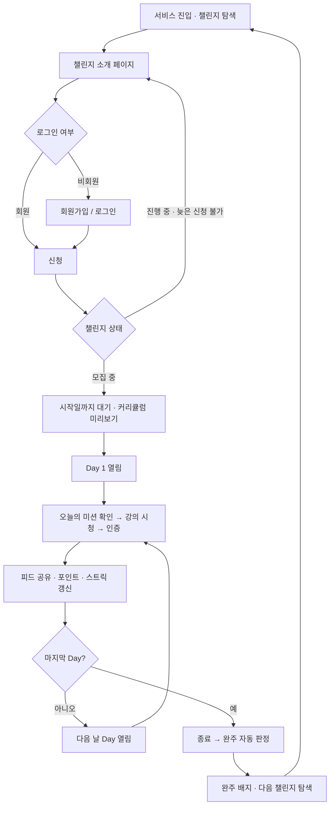
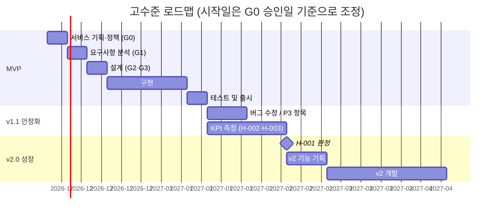
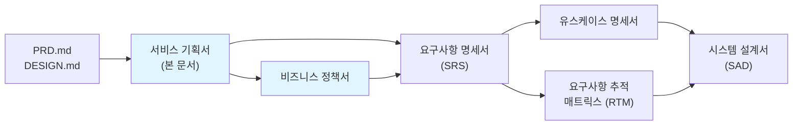

# 서비스 기획서 (Service Planning Document)

> 이 문서는 SRS(요구사항 명세서) 작성 이전에 "왜 이 서비스를 만드는가", "핵심 가치는 무엇인가", "MVP에 무엇을 포함/제외하는가"를 정의하는 선행 기획 문서이다.
> SRS가 "무엇을 만들 것인가(What)"에 집중한다면, 이 문서는 "왜 만드는가(Why)"와 "어디까지 만드는가(Scope)"에 집중한다.
>
> 작성 근거: 프로젝트 루트의 [PRD.md](../../PRD.md)(Skool 레퍼런스 분석 포함), [DESIGN.md](../../DESIGN.md)(콜로소 디자인 분석), [CLAUDE.md](../../CLAUDE.md). 사용자 조사는 아직 하지 않았으므로 사용자 문제는 모두 **가정** 상태이며, 검증 방법을 함께 적었다. 미결 항목은 7.3에 모았다.

| 항목 | 내용 |
|------|------|
| **문서 ID** | SPD-CHUP-v0.3 |
| **프로젝트명** | 챌린지업 (ChallengeUp) — 온라인 강의 챌린지 플랫폼 |
| **문서 버전** | v0.3 |
| **작성일** | 2026-11-24 |
| **작성자** | Claude Code (초안) |
| **승인자** | 미정 — 프로젝트 기획 책임자 지정 필요 (DEC-001) |
| **문서 상태** | 초안 |

---

## 변경 이력

| 버전 | 날짜 | 작성자 | 변경 내용 |
|------|------|--------|-----------|
| v0.1 | 2026-11-24 | Claude Code | PRD.md 기반 초안 작성 |
| v0.2 | 2026-11-24 | Claude Code | 수익화 전략을 매출 배분 2가지 운영 방식(강사 직접 운영형 20%, 플랫폼 기획 지원형 50%)으로 변경 |
| v0.3 | 2026-11-25 | Claude Code | 문서 간 불일치 정리: 운영 방식 선정 규칙(BP-PAY-006-2)과 맞춤, 정기 작업을 pg_cron으로 확정, 문구 해요체 규칙 추가 |

---

## 목차

1. [서비스 개요](#1-서비스-개요)
2. [핵심 메커니즘](#2-핵심-메커니즘)
3. [콘텐츠/기능 전략](#3-콘텐츠기능-전략)
4. [수익화 전략](#4-수익화-전략)
5. [MVP 스코프 정의](#5-mvp-스코프-정의)
6. [KPI 가설 검증 프레임워크](#6-kpi-가설-검증-프레임워크)
7. [다음 단계](#7-다음-단계)
8. [관련 문서](#8-관련-문서)

---

## 1. 서비스 개요

### 1.1 서비스명 및 컨셉

| 항목 | 내용 |
|------|------|
| 서비스명 | 챌린지업 (ChallengeUp) — 임시 이름 (DEC-002) |
| 한 줄 설명 | 강사가 기간이 정해진 강의 챌린지를 열고, 학생은 매일 강의를 듣고 미션을 인증하면서 동료와 함께 끝까지 완주하는 플랫폼 |
| 서비스 유형 | 웹 서비스 (2면 플랫폼: 강사 ↔ 학생) |
| 대상 플랫폼 | Web (데스크톱 + 모바일 반응형). 앱은 v3 이후 |

**서비스 컨셉 설명:**

온라인 강의를 산 학생은 혼자 듣다가 중간에 멈추는 경우가 많다. 반대로 챌린지를 운영하고 싶은 강사는 단톡방·노션·구글폼을 섞어 쓰면서 인증 확인과 출석 집계를 손으로 한다. 챌린지업은 Skool처럼 **강의실 + 커뮤니티 + 포인트·순위**를 한 공간에 모으되, 기한 없는 커뮤니티 대신 **시작일과 종료일이 있는 기수제 챌린지**로 바꾼다. 학생은 매일 열리는 Day 미션을 인증하고, 인증은 자동으로 피드에 공유되어 서로 응원한다. 기간이 끝나면 시스템이 인증 기록으로 완주 여부를 자동 판정한다.

**배경 및 동기:**

- 온라인 강의는 구매 후 끝까지 듣지 않는 비율이 높다는 인식이 널리 퍼져 있다. 이 프로젝트에서는 아직 수치로 확인하지 않았다 (OBJ-001 검증 필요).
- Skool은 커뮤니티 + 강의 + 게이미피케이션 조합으로 성장했지만, 기한이 없는 월 구독 모델이라 "끝까지 해낸다"는 목표 지점이 없다 (2026-11-24 skool.com 탐색·소개 페이지 확인).
- 국내 인강 플랫폼(콜로소 등)은 강의 판매·시청 중심이고, 기수별 함께 듣기와 매일 인증 기능은 기본 제공하지 않는다 (2026-11-24 coloso.co.kr 메인·카테고리·상세 페이지 확인).
- Supabase·Next.js·Vercel 조합으로 인증, DB, 파일 저장, 배포를 작은 팀이 빠르게 만들 수 있다.

#### 사용자 문제와 근거

| 문제 ID | 사용자·상황·겪는 문제 | 현재 대안과 한계 | 관찰 근거 | 확인 상태·다음 검증 |
| --- | --- | --- | --- | --- |
| OBJ-001 | 학생 / 온라인 강의를 산 뒤 혼자 들을 때 / 3~5강 안에 멈추고 끝까지 듣지 못한다 | 스스로 계획표 작성, 스터디 단톡방 / 강제력이 없고 혼자 하면 의지가 꺾임 | PRD 페르소나(김지은) 설정. 실제 인터뷰·데이터 없음 | **가정** / 학생 10명 인터뷰 + 설문(강의 완강 경험) — DEC-003 |
| OBJ-002 | 강사 / 21일 챌린지를 직접 운영할 때 / 인증 확인·출석 집계·독려에 매일 1시간 이상을 쓴다 | 단톡방 + 구글 시트 + 노션 / 수작업, 인증 누락, 기수마다 다시 세팅 | PRD 페르소나(박민호) 설정. 실제 인터뷰 없음 | **가정** / 챌린지 운영 경험이 있는 강사 5명 인터뷰 — DEC-003 |
| OBJ-003 | 학생 / 챌린지를 고를 때 / 끝까지 따라갈 수 있는 챌린지인지 판단할 근거가 없다 | 강사 소개글, 지인 추천 / 완주율·참여 분위기를 알 수 없음 | Skool은 멤버 수·평점·유지 기간만 표시 (관찰) | **가정** / MVP 운영 후 "완주율 표시"가 신청 전환에 영향을 주는지 비교 |

### 1.2 핵심 가치 제안 (Value Proposition)

| 항목 | 내용 |
|------|------|
| 핵심 가치 | 혼자서는 끝까지 못 듣던 강의를, 기간·매일 미션·함께하는 동료 덕분에 완주하게 된다 |
| 차별점 | 강의(커리큘럼) + 매일 인증 + 커뮤니티 피드 + 완주 자동 판정이 하나의 챌린지 안에 묶여 있다 |
| 대안 대비 우위 | 단톡방·시트 수작업 대비 강사의 운영 시간이 줄고, 인강 플랫폼 대비 학생이 날마다 해야 할 일과 동료의 진행이 보인다 |

**가치 제안 캔버스:**

| 구분 | 내용 |
|------|------|
| 사용자의 할 일 (Jobs) | 학생: 정해진 기간 안에 강의를 끝내고 결과물을 만든다 / 강사: 수강생이 끝까지 따라오게 만들고 다음 기수를 연다 |
| 사용자의 고통 (Pains) | 학생: 의지 부족, 혼자라는 느낌, 밀린 강의에 대한 부담 / 강사: 인증 확인·집계 수작업, 이탈자 파악 어려움 |
| 사용자의 이득 (Gains) | 학생: 완주 경험, 동료의 응원, 눈에 보이는 진행(스트릭·레벨) / 강사: 운영 자동화, 완주율이라는 성과 지표 |
| 고통 해결제 (Pain Relievers) | Day별로 열리는 커리큘럼, "오늘의 미션" 카드, 마감 시간, 인증 자동 집계, 이탈 위험 학생 목록 |
| 이득 생성제 (Gain Creators) | 인증 피드와 좋아요·댓글, 포인트·레벨·리더보드, 연속 인증 보너스, 완주 배지 |

### 1.3 타겟 사용자 정의

#### 1.3.1 주요 사용자 페르소나

**페르소나 1: 끝까지 못 듣는 학생**

| 항목 | 내용 |
|------|------|
| 이름 | 김지은 (가상) |
| 연령/직업 | 22세 / 대학생 |
| 기술 수준 | 중급 (웹 서비스 사용에 익숙, 개발은 초급) |
| 핵심 목표 | 파이썬 기초 강의를 끝까지 듣고 과제 결과물을 만든다 |
| 핵심 불편 | 인강을 두 번 샀지만 둘 다 3강에서 멈췄다. 혼자 하면 미루게 된다 |
| 사용 시나리오 | 저녁에 접속해 "오늘의 미션"을 확인하고, 20분짜리 강의를 본 뒤 결과 화면을 캡처해 인증한다. 피드에서 다른 사람 인증에 좋아요를 누른다 |
| 성공 기준 | 21일째 "완주" 배지를 받는 순간. 7일 연속 인증 보너스를 받았을 때 |

**페르소나 2: 챌린지를 직접 운영하던 강사**

| 항목 | 내용 |
|------|------|
| 이름 | 박민호 (가상) |
| 연령/직업 | 31세 / 현업 개발자 겸 온라인 강사 |
| 기술 수준 | 고급 |
| 핵심 목표 | 21일 코딩 챌린지를 기수마다 운영하고 완주율을 높인다 |
| 핵심 불편 | 단톡방 인증 사진 확인과 출석표 정리에 매일 1시간을 쓴다. 누가 빠졌는지 늦게 안다 |
| 사용 시나리오 | 등록 화면에서 Day 1~21 강의 링크와 미션을 입력한다. 진행 중에는 대시보드에서 오늘 인증률과 3일 연속 미인증 학생을 확인하고 공지를 올린다 |
| 성공 기준 | 인증 집계를 손으로 하지 않아도 되고, 기수가 끝나면 완주자 목록이 자동으로 나올 때 |

**페르소나 3: 플랫폼 운영자 (관리자)**

| 항목 | 내용 |
|------|------|
| 이름 | 운영 담당 (가상) |
| 연령/직업 | 프로젝트 팀원 |
| 기술 수준 | 중급 |
| 핵심 목표 | 품질이 낮거나 부적절한 챌린지가 공개되지 않게 한다 |
| 핵심 불편 | 검수 기준과 신고 처리 절차가 없으면 판단이 매번 달라진다 |
| 사용 시나리오 | 관리자 화면에서 검수 대기 챌린지를 승인·반려하고, 강사 신청과 신고된 글을 처리한다 |
| 성공 기준 | 검수 요청 후 2영업일 안에 처리가 끝날 때 |

#### 1.3.2 사용자 세그먼트

| 세그먼트 | 설명 | 규모 추정 | 우선순위 | MVP 포함 |
|----------|------|-----------|----------|----------|
| 자기계발형 대학생·사회초년생 | 개발·디자인·외국어를 단기간에 익히려는 학생 | 미측정 (DEC-003에서 추정) | P1 | Y |
| 소규모 개인 강사 | 수강생 10~100명 규모로 챌린지를 직접 운영해 본 강사 | 미측정 | P1 | Y |
| 직장인 학습자 | 퇴근 후 짧게 학습하려는 직장인 | 미측정 | P2 | Y (기능 차이 없음) |
| 기업·기관 교육 담당자 | 사내 교육을 기수제로 운영하려는 조직 | 미측정 | P3 | N |

#### 1.3.3 비사용자 (Anti-Persona)

| 비사용자 | 이유 | 대안 |
|----------|------|------|
| 기한 없이 강의를 언제든 보고 싶은 학습자 | 챌린지업은 기간·마감이 핵심이라 자유 시청 수요와 맞지 않는다 | 클래스101, 콜로소 같은 VOD 인강 플랫폼 |
| 대규모(수천 명) 강의를 판매하려는 기업형 강사 | MVP는 정원 최대 300명, 결제·정산이 없다 | 기존 인강 판매 플랫폼 |
| 실시간 화상 수업 중심 강사 | 화상 수업 기능을 만들지 않는다 (EX-008) | Zoom·Google Meet + 기존 LMS |
| 운동·식단 등 강의 없는 습관 챌린지만 원하는 사용자 | 강의(커리큘럼)가 중심인 구조라 맞지 않는다 | 습관 형성 앱 (예: 챌린저스) |

---

## 2. 핵심 메커니즘

### 2.1 서비스 작동 원리

**핵심 루프 (Core Loop):**

학생이 매일 반복하는 행동은 "오늘의 미션 확인 → 강의 시청 → 인증 → 반응 확인"이다.

1. 학생이 접속하면 시스템이 "Day N / 전체 · 오늘의 미션 · 마감 23:59" 카드를 보여 준다.
2. 학생이 강의를 보고 미션 결과(텍스트·사진·링크)를 인증한다.
3. 시스템이 인증을 저장하고 피드에 자동 공유하며, 포인트와 연속 인증(스트릭)을 갱신한다.
4. 다른 참여자의 좋아요·댓글과 리더보드 순위 변화가 다음 날 다시 접속할 이유가 된다.

강사의 루프는 "대시보드 확인 → 인증 확인·피드백 → 공지·독려"이다.

**이론적 근거:**

- **공개 약속과 사회적 증거:** 인증이 피드에 공개되고 다른 사람의 인증이 보이면 계속할 동기가 생긴다.
- **손실 회피:** 연속 인증(스트릭)이 끊기면 0으로 돌아가므로 하루를 빠지지 않으려 한다.
- **목표 기울기 효과:** "Day 15 / 21"처럼 끝이 보이면 막바지에 노력이 커진다.
- 위 원리는 일반적인 행동 설계 원리이며, 이 서비스에서의 효과는 H-001~H-003으로 검증한다.

### 2.2 전체 서비스 플로우

### 2.3 핵심 사용자 여정 (Key User Journey)

#### 여정 1: 학생의 첫 신청부터 Day 1 인증까지

| 단계 | 사용자 행동 | 시스템 반응 | 감정 목표 | 핵심 지표 |
|------|------------|------------|-----------|-----------|
| 1. 진입 | 메인에서 챌린지 카드를 본다 | 기간·시작일·참여 인원·상태 배지가 있는 카드 목록 | 호기심 | 소개 페이지 진입률 |
| 2. 탐색 | 소개 페이지에서 커리큘럼과 완주 조건을 본다 | Day별 제목(내용은 잠김), 남은 자리, 시작까지 남은 날 | 기대 | 신청 전환율 |
| 3. 신청 | 신청 버튼을 누른다 | 즉시 챌린지 홈으로 이동, 내 챌린지에 추가 | 소속감 | 신청 완료 수 |
| 4. 첫 인증 | 시작일에 Day 1 강의를 보고 인증한다 | 인증이 피드에 올라가고 +10점, 스트릭 1 | 성취감 | Day 1 인증률 |
| 5. 재방문 | 다음 날 다시 접속한다 | 내 인증에 달린 좋아요·댓글, Day 2 미션 카드 | 기대감 | Day 2 인증률 |

#### 여정 2: 학생의 완주

| 단계 | 사용자 행동 | 시스템 반응 | 감정 목표 | 핵심 지표 |
|------|------------|------------|-----------|-----------|
| 1 | 매일 인증을 이어 간다 | 7일 연속 시 +30점 보너스, 리더보드 순위 변화 | 몰입 | 일일 인증률 |
| 2 | 하루를 놓친다 | 스트릭 0으로 리셋, 완주 조건까지 남은 인증 수 표시 | 아쉬움 → 재도전 | 미인증 다음 날 복귀율 |
| 3 | 마지막 Day를 인증한다 | "Day 21 / 21 완료" 표시 | 뿌듯함 | 마지막 Day 인증률 |
| 4 | 종료 다음 날 접속한다 | 완주 판정 결과와 완주 배지 | 성취 | 완주율 |

#### 여정 3: 강사의 첫 챌린지 운영

| 단계 | 사용자 행동 | 시스템 반응 | 감정 목표 | 핵심 지표 |
|------|------------|------------|-----------|-----------|
| 1 | 강사 신청 | 관리자 승인 후 강사 스튜디오 메뉴가 열림 | 기대 | 강사 승인 소요 시간 |
| 2 | 등록 5단계 입력 | 단계마다 임시 저장, 미리보기 | 통제감 | 등록 완료율 |
| 3 | 검수 요청 | 관리자 승인 → 모집 중 공개 | 안도 | 검수 처리 시간 |
| 4 | 진행 중 운영 | 대시보드: 오늘 인증률, Day별 그래프, 이탈 위험 학생 | 효율 | 강사 대시보드 주간 방문 수 |
| 5 | 종료 | 완주자 목록 자동 생성 | 성과 확인 | 강사 재개설률 |

---

## 3. 콘텐츠/기능 전략

### 3.1 핵심 기능 방향

| 기능 영역 | 전략 방향 | 우선순위 | MVP 포함 | 비고 |
|-----------|-----------|----------|----------|------|
| 챌린지 탐색·소개 | Skool Discovery·About 구조를 따르되, 기간·시작일·완주율을 앞세운다 | P1 | Y | OBJ-003 |
| 기수제 챌린지 운영 | 시작일·종료일·정원이 있는 챌린지. 상태 흐름: 작성 중 → 검수 대기 → 모집 중 → 진행 중 → 종료 | P1 | Y | OBJ-001, OBJ-002 |
| Day 커리큘럼·미션 | 날짜에 따라 Day가 열리고, 각 Day에 강의 링크·미션·인증 형식·마감이 있다 | P1 | Y | OBJ-001 |
| 미션 인증·피드 | 인증이 자동으로 피드 글이 되고, 좋아요·댓글로 응원한다 | P1 | Y | OBJ-001 |
| 포인트·레벨·리더보드 | 매일 인증과 연속 인증을 보상한다 | P1 | Y | OBJ-001 |
| 강사 운영 대시보드 | 인증 집계·이탈 위험 파악을 자동화한다 | P1 | Y | OBJ-002 |
| 완주 판정 | 종료 후 인증 기록으로 자동 판정 | P1 | Y | OBJ-001 |
| 결제·매출 배분 | 유료 챌린지 판매, 운영 방식(직접 운영형 20% / 기획 지원형 50%)별 매출 배분과 정산 | P3 | N | v2 (EX-001, EX-013) |
| 플랫폼 기획 지원 | 강의 기획·커리큘럼 설계·소개 페이지 제작·홍보·운영 대행을 플랫폼이 지원 | P3 | N | Phase 0 시범 운영은 서비스 밖에서 수동, v2에서 운영 방식 선택 기능 (EX-013) |
| 보증금형 | 완주 시 환급되는 보증금형 챌린지 | P3 | N | v3 이후 (EX-002) |
| 알림(이메일·알림톡) | 미션 열림, 마감 리마인드 | P3 | N | v2 (EX-004) |

**기능 방향 의사결정 기록:**

| 항목 | A안 | B안 | 선택 | 근거 |
|------|-----|-----|------|------|
| 챌린지 기간 모델 | Skool처럼 기한 없는 커뮤니티 + 월 구독 | 시작일·종료일이 있는 기수제 | B | "완주"라는 목표 지점이 있어야 OBJ-001을 해결할 수 있다 |
| 인증 공개 방식 | 인증은 강사만 본다 | 인증이 기본 공개로 피드에 올라가고, 비공개 선택 가능 | B | 공개 약속·사회적 증거 효과(2.1). 민감한 내용은 비공개로 회피 |
| 인증 인정 방식 | 강사가 모두 확인 | 기본 자동 인정, 강사가 원하면 확인 방식 | B | 강사 수작업을 줄이는 것이 OBJ-002의 핵심. 확인 방식은 P2 |
| 늦은 신청 | 진행 중에도 신청 가능 | MVP에서는 모집 중에만 신청 | B | 완주 기준 계산이 단순해진다. 늦은 신청은 DEC-005에서 재검토 |
| 화면 디자인 | Skool 스타일(흰 바탕) | 콜로소 분석(DESIGN.md) 기준 어두운 테마 | B | 사전에 DESIGN.md로 합의된 기준이 있음 |

### 3.2 보상/게이미피케이션 체계

#### 3.2.1 진행 시스템

| 요소 | 설명 | 목적 | MVP 포함 |
|------|------|------|----------|
| 레벨 (Lv1~9) | 플랫폼 전체 누적 포인트로 결정 | 여러 챌린지에 걸친 지속 동기 | Y |
| 포인트 | 인증·조기 인증·좋아요·댓글·연속 인증으로 적립 | 매일 행동 보상 | Y |
| 연속 인증 (스트릭) | 인정된 인증이 끊기지 않고 이어진 Day 수 | 손실 회피로 하루 빠짐 방지 | Y |
| 리더보드 | 챌린지별 7일 / 30일 / 전체 순위 | 동료 비교와 경쟁 | Y |
| 완주 배지 | 완주 조건을 채운 챌린지마다 프로필에 표시 | 성취감, 다음 챌린지 신청 유도 | Y (P2) |
| 레벨 잠금 콘텐츠 | 특정 레벨 이상만 보는 보너스 강의 | 장기 동기 | N (v2, EX-007) |

#### 3.2.2 보상 구조

상세 점수와 중복 처리 규칙은 [비즈니스 정책서](비즈니스정책서.md) BP-POINT에서 정의한다.

| 보상 유형 | 획득 조건 | 보상 내용 | 빈도 |
|-----------|-----------|-----------|------|
| 일일 보상 | 그날 미션 인증 (인정 기준) | +10점, 스트릭 +1 | 매일 1회 |
| 조기 인증 보상 | 마감 3시간 전까지 인증 | +5점 | 매일 1회 |
| 반응 보상 | 내 글이 좋아요를 받음 / 댓글 작성 | 좋아요 1개당 +1점 / 댓글 +2점(하루 최대 10점) | 수시 |
| 마일스톤 보상 | 연속 인증 7일, 21일 달성 | +30점 / +100점 | 달성 시 |
| 완주 보상 | 완주 조건 충족 | 완주 배지 | 챌린지 종료 시 |

### 3.3 콘텐츠 전략

| 항목 | 내용 |
|------|------|
| 콘텐츠 유형 | 강의 영상(외부 링크: YouTube·Vimeo), 자료 링크, 미션 설명 텍스트, 학생 인증(텍스트·사진·링크) |
| 콘텐츠 생산 방식 | 강의·미션은 강사가 생산, 인증·피드 글은 학생이 생산(UGC) |
| 콘텐츠 큐레이션 | 카테고리 기반(개발, 디자인, 외국어, 자기계발, 운동, 재테크) + 상태(모집 중·진행 중) + 정렬(인기순·마감 임박순·최신순) |
| 콘텐츠 갱신 주기 | 챌린지 진행 중 매일 Day 1개 열림, 피드는 실시간 |
| 품질 관리 | 챌린지 공개 전 관리자 검수, 피드 글 신고 → 관리자 숨김 처리 |

### 3.4 브랜드/톤앤매너

| 항목 | 내용 |
|------|------|
| 브랜드 톤 | 친근하지만 진지한 코치. 다그치기보다 응원한다 |
| 커뮤니케이션 스타일 | 해요체(…어요/…예요)로 통일한다. 문구는 토스 UX 라이팅 원칙(UX 검토서 6.7: 다음 행동 알려 주기, 짧게, 쉬운 말, 강요 대신 권유, 감정 헤아리기)을 따른다. 섹션 제목·배지에 이모지를 아이콘처럼 쓴다 (예: 🔥 연속 인증) |
| 시각적 아이덴티티 | [DESIGN.md](../../DESIGN.md) 기준: 어두운 바탕(#121212), 회색 단계로 층 구분, 빨강 강조(#ED2040)는 인기·마감 임박에만, Spoqa Han Sans Neo, 카드 모서리 10px |
| 캐릭터/마스코트 | 없음 |

---

## 4. 수익화 전략

### 4.1 수익 모델 선택

챌린지업은 유료 챌린지 매출을 강사와 나누는 **수익 배분형**이다. 유료 챌린지는 아래 두 가지 운영 방식 중 하나로 운영한다. 기본은 강사 직접 운영형이고, 플랫폼 기획 지원형은 강사가 신청하고 플랫폼이 선정한 챌린지에만 지정한다 (BP-PAY-006-2).

| 운영 방식 | 강사가 하는 일 | 플랫폼이 하는 일 | 매출 배분 (플랫폼 : 강사) |
|-----------|----------------|------------------|---------------------------|
| **A. 강사 직접 운영형** | 강의 기획, 커리큘럼·미션 구성, 영상 제작, 소개 페이지 작성, 진행 중 운영(공지·피드백)을 모두 직접 한다 | 플랫폼 제공(등록·신청·인증·피드·완주 판정), 결제·정산, 검수, 탐색 노출 | **20 : 80** |
| **B. 플랫폼 기획 지원형** | 강의 내용 전문성 제공, 영상 촬영·출연, 진행 중 피드백 | A안의 모든 것 + 강의 기획 지원: 커리큘럼·Day별 미션 설계, 소개 페이지(카피·썸네일) 제작, 출시 홍보, 운영 대행(공지 작성, 이탈 위험 학생 관리) | **50 : 50** |

| 항목 | 내용 |
|------|------|
| 주요 수익 모델 | 유료 챌린지 매출 배분 — 직접 운영형 20%, 기획 지원형 50% (v2부터) |
| 보조 수익 모델 | 보증금형 챌린지, 강사 프로 플랜 — v3 이후 검토 |
| 무료/유료 경계 | MVP: 모든 챌린지 무료, 매출 배분 없음. v2: 강사가 챌린지마다 무료·유료를 고른다. 유료는 기본이 A(직접 운영형)이고, B(기획 지원형)는 신청 후 선정된 경우에만 적용한다. 무료 챌린지는 운영 방식과 관계없이 수수료가 없다 |
| 매출 기준 | 배분 대상 매출 = 결제 금액 합계 − 환불액. 결제 대행 수수료(PG) 부담 주체는 미결 (DEC-006) |
| 가격 전략 | 가격은 강사가 정한다. 기획 지원형은 플랫폼과 강사가 협의해 정한다 |
| 기획 지원형 선정 | 강사가 신청하면 플랫폼이 심사해 선정한다. 선정 기준(전문성, 수요, 지원 가능 인력)과 월 지원 가능 건수는 미결 (DEC-010) |

#### 수익 모델 비교

| 기준 | 모델 A: 학생 월 구독 (Skool형) | 모델 B: 수익 배분 2가지 운영 방식 | 모델 C: 단일 수수료 (10~15%) |
|------|----------------------|----------------------|----------------------|
| 사용자 경험 영향 | 챌린지마다 결제할 필요는 없지만, 기수제와 맞지 않음 | 학생은 챌린지마다 가격을 보고 고름. 강사는 직접 할지 도움을 받을지 고름 | 학생 경험은 B와 같음. 기획 역량이 없는 강사는 시작하기 어려움 |
| 예상 수익 | 미추정 | 미추정 (기획 지원형 비중이 클수록 건당 수익 높음) | 미추정 (건당 수익 낮음) |
| 구현 복잡도 | 중간 | 중간 (결제·환불·정산 + 운영 방식별 배분율) | 중간 (결제·환불·정산) |
| 운영 부담 | 낮음 | 기획 지원형은 플랫폼 인력 필요 | 낮음 |
| MVP 적합성 | N | N (v2) | N |
| **선택** | | **[선택됨 — v2]** | |

**선택 근거:** 기수제 챌린지는 상품 단위가 명확해서 챌린지별 판매가 자연스럽다. 운영 방식을 둘로 나누면, 이미 챌린지를 운영해 본 강사(페르소나 2)는 낮은 수수료로 직접 운영하고, 전문성은 있지만 기획·홍보가 어려운 강사는 플랫폼의 도움을 받아 시작할 수 있다. 기획 지원형은 플랫폼이 직접 품질을 관리하는 대표 챌린지가 되어 초기 콘텐츠 공급 문제(부록 A 약점)도 줄인다. MVP에서는 결제를 붙이지 않고 "등록 → 신청 → 매일 인증 → 완주" 흐름이 작동하는지부터 검증한다.

### 4.2 단계별 수익화 계획

| 단계 | 시점 / 조건 | 수익화 방식 | 목표 |
|------|------------|------------|------|
| Phase 0: PMF 검증 | MVP 출시 ~ 종료된 챌린지 5개 이상, 평균 완주율 60% 이상 (H-001) | 없음 (완전 무료). 기획 지원형은 매출 없이 1~2건 시범 운영해 지원 범위와 소요 인력을 측정 | 핵심 루프와 완주율 검증, 기획 지원 비용 파악 |
| Phase 1: 초기 수익화 | Phase 0 조건 충족 + 유료 개설 의사가 있는 강사 3명 이상 | 유료 챌린지 판매 — 직접 운영형 20%, 기획 지원형 50% | 첫 유료 챌린지 판매, 운영 방식별 완주율·매출 비교 (H-006) |
| Phase 2: 수익 최적화 | 유료 챌린지 월 10개 이상 | 기획 지원형 확대(지원 인력 충원), 보증금형 챌린지 검토 | 플랫폼 매출과 완주율 동시 개선 |
| Phase 3: 수익 다각화 | 활동 강사 30명 이상 | 강사 프로 플랜(정원 확대, 상세 통계, 수료증 디자인) | 강사 측 반복 매출 |

### 4.3 과금 정책 요약

> 상세한 과금·정산 규칙은 [비즈니스 정책서](비즈니스정책서.md) BP-PAY에서 정의한다. MVP에서는 적용하지 않는다.

| 항목 | 정책 방향 |
|------|-----------|
| 무료 체험 | MVP 기간 전체 무료. v2 이후 무료 챌린지도 계속 허용 (수수료 없음) |
| 매출 배분 | 직접 운영형: 플랫폼 20% / 강사 80%. 기획 지원형: 플랫폼 50% / 강사 50%. 챌린지 공개 후에는 운영 방식을 바꿀 수 없다 |
| 환불 정책 | 시작 전 전액 환불, 시작 후 진행률에 따른 부분 환불 방향. 전자상거래 관련 법령 검토 후 확정 (DEC-007). 환불액은 배분 대상 매출에서 뺀다 |
| 정산 | 챌린지 종료 후 정산. 기획 지원형은 플랫폼과 강사가 별도 계약서를 쓴다 |
| 구독 갱신 | 해당 없음 (챌린지 단건 결제 모델) |
| 결제 수단 | 토스페이먼츠 연동 예정 (카드, 간편결제) |

---

## 5. MVP 스코프 정의

### 5.1 MVP 정의 기준

| 항목 | 내용 |
|------|------|
| MVP 목표 | "기간이 정해진 챌린지에서 매일 인증과 동료 피드가 있으면 학생이 끝까지 완주한다"는 가설을 검증한다 |
| MVP 기간 | 개발 4주 (설계 이후). 전체 일정은 7.2 참조 |
| MVP 성공 기준 | 종료된 챌린지 5개 이상에서 평균 완주율 60% 이상, 평균 일일 인증률 70% 이상 (H-001, H-002) |
| MVP 실패 시 대응 | 완주율 40% 미만이면 Day별 이탈 지점을 분석하고, 알림(EX-004) 우선 도입 또는 미션 분량 가이드 개선으로 2차 검증 |

### 5.2 포함 항목 (In-Scope)

> - **P1 (Must Have):** MVP에 반드시 포함. 이것 없이는 서비스가 성립하지 않음
> - **P2 (Should Have):** MVP에 포함 권장. 핵심 경험을 위해 필요하지만 최소 기능은 아님
> - **P3 (Nice to Have):** MVP에서 시간이 허용되면 포함. 없어도 핵심 가치 검증 가능

| ID | 기능/항목 | 설명 | 우선순위 | 예상 공수 | 비고 |
|----|-----------|------|----------|-----------|------|
| MVP-001 | 회원가입·로그인·프로필 | 이메일 가입·로그인, 이름·사진·한 줄 소개 | P1 | 2일 | 공통 · PRD AUTH-1, AUTH-3 |
| MVP-002 | 강사 신청·승인 | 학생이 강사 신청 → 관리자 승인 후 강사 스튜디오 사용 | P1 | 1일 | OBJ-002 · PRD AUTH-4 |
| MVP-003 | 챌린지 등록 5단계 | 기본 정보 → 일정 → 커리큘럼 → 운영 규칙 → 가격(무료 고정), 단계별 임시 저장, 미리보기 | P1 | 4일 | OBJ-002 · PRD STU-1, STU-2 |
| MVP-004 | 관리자 검수 | 검수 대기 챌린지 승인(모집 중 전환)·반려(사유 기록) | P1 | 1일 | 품질 관리 · PRD ADM-1, ADM-2 |
| MVP-005 | 챌린지 탐색 | 카드 목록, 카테고리 필터 | P1 | 2일 | OBJ-003 · PRD DISC-1, 2, 5 |
| MVP-006 | 챌린지 소개 페이지 | 기본 정보, 소개글, 커리큘럼 미리보기(잠김), 요약 카드 + 신청 버튼 | P1 | 2일 | OBJ-003 · PRD ABOUT-1~4 |
| MVP-007 | 무료 신청 | 모집 중 챌린지 신청, 중복·정원 초과 방지 | P1 | 1일 | OBJ-001 · PRD ENR-1, 2 |
| MVP-008 | Day 커리큘럼·오늘의 미션 | 날짜에 따라 Day 열림, 강의 페이지, 오늘의 미션 카드 | P1 | 3일 | OBJ-001 · PRD CUR-1~4 |
| MVP-009 | 미션 인증 | 텍스트·사진·링크·체크 인증, 마감, 피드 자동 공유, 비공개 선택 | P1 | 3일 | OBJ-001 · PRD SUB-1~3 |
| MVP-010 | 인증 피드 | 글 목록(공지 고정), 질문·자유글 작성, 좋아요·댓글 | P1 | 3일 | OBJ-001 · PRD FEED-1~3 |
| MVP-011 | 포인트·레벨·리더보드 | 포인트 적립 로그, 레벨 1~9, 챌린지별 7일/30일/전체 순위, 스트릭 | P1 | 3일 | OBJ-001 · PRD PT-1~3 |
| MVP-012 | 완주 자동 판정 | 종료 다음 날 인증 기록으로 완주 여부 저장 | P1 | 1일 | OBJ-001 · PRD DONE-1, 2 |
| MVP-013 | 강사 운영 대시보드 | 참여 인원, 오늘 인증률, Day별 인증률, 이탈 위험 학생, 공지 작성 | P1 | 3일 | OBJ-002 · PRD STU-3, STU-5 |
| MVP-014 | 마이페이지 | 내 챌린지(진행 중·완료), 포인트·레벨, 완주 배지 | P2 | 1일 | |
| MVP-015 | 구글 로그인 | 구글 계정으로 가입·로그인 | P2 | 0.5일 | PRD AUTH-2 |
| MVP-016 | 정렬·검색 | 인기순·마감 임박순·최신순, 제목·강사명 검색 | P2 | 1일 | PRD DISC-3, 4 |
| MVP-017 | 신청 취소 | 시작 전 취소 | P2 | 0.5일 | PRD ENR-3 |
| MVP-018 | 인증 수정·삭제, 강사 확인 방식 | 마감 전 수정·삭제, 강사 승인·반려·피드백 | P2 | 2일 | PRD SUB-4, SUB-5, STU-4 |
| MVP-019 | 멤버 탭, 피드 종류 필터, 신고 | 참여자 진행률 목록, 인증/질문/공지 필터, 글 신고 → 관리자 숨김 | P3 | 2일 | 시간 허용 시 · PRD FEED-4, FEED-6, ADM-3 |
| MVP-020 | 완주 배지 표시 | 프로필·리더보드에 완주 배지 | P3 | 0.5일 | 시간 허용 시 · PRD DONE-3 |

P1 합계 약 29일, P2까지 약 34일로 4주(1인 기준 20일)를 넘는다. 인원과 기간에 맞춰 G0 검토에서 포함 범위를 확정한다 (DEC-004).

### 5.3 제외 항목 (Out-of-Scope) + 제외 근거

| ID | 제외 항목 | 제외 근거 | 대안 (MVP에서는 대신 무엇을 하는가) | v2 진입 조건 |
|----|-----------|-----------|--------------------------------------|-------------|
| EX-001 | 유료 결제 | 결제·환불·정산 구현과 법령 검토 부담이 크고, 핵심 가설(완주) 검증에 필요 없다 | 모든 챌린지 무료 | Phase 0 조건 충족 + 유료 개설 희망 강사 3명 이상 |
| EX-002 | 보증금형 챌린지·자동 환급 | 환급 계산·법률 검토가 필요하고 결제(EX-001)가 먼저 있어야 한다 | 없음 (완주 배지로 동기 부여) | 유료 결제 안정화 후 |
| EX-003 | 수료증 PDF | 완주 판정이 먼저 검증되어야 의미가 있다 | 완주 배지와 마이페이지 완주 목록 | 완주자 100명 이상 또는 수료증 요청 20건 이상 |
| EX-004 | 이메일·알림톡·푸시 알림 | 외부 발송 서비스 연동과 수신 동의 관리가 필요하다 | 로그인 시 "오늘의 미션" 카드와 마감 시간 표시 | 일일 인증률 70% 미만이거나 "알림이 없어 놓쳤다" 피드백 10건 이상 |
| EX-005 | 진행 중(늦은) 신청 | 완주 기준 계산이 복잡해진다 (DEC-005) | 모집 중에만 신청 | 강사 요청 5건 이상 |
| EX-006 | 마감 지난 미션 제출(지각 인증) | 포인트·스트릭 규칙이 복잡해진다 | 마감 후 제출 불가 | 완주율 목표 미달 원인이 "하루 놓침"으로 확인될 때 |
| EX-007 | 레벨 잠금 콘텐츠 | 레벨 체계가 먼저 자리 잡아야 한다 | 레벨은 표시만 | 레벨 5 이상 사용자 50명 이상 |
| EX-008 | 라이브·캘린더·화상 수업 | 외부 회의 도구로 대체 가능하고 구현 범위가 크다 | 강사가 피드 공지로 라이브 링크 안내 | 라이브 공지 사용 챌린지 비율 50% 이상 |
| EX-009 | 영상 직접 업로드 | 저장 용량·인코딩 비용이 크다 | YouTube·Vimeo 링크 | 링크 방식에 대한 강사 불만 10건 이상 |
| EX-010 | 후기·별점, 찜 | 완주자가 생긴 뒤에야 의미가 있다 | 없음 | 종료된 챌린지 5개 이상 |
| EX-011 | 다음 기수 복제, 이탈 학생 일괄 메시지 | 첫 기수 운영 검증이 먼저다 | 강사가 새로 등록 / 공지 작성 | 2기 개설 강사 3명 이상 |
| EX-012 | 모바일 앱, AI 기능 | 웹 반응형으로 핵심 가설 검증 가능 | 모바일 반응형 웹 | v3 로드맵 |
| EX-013 | 운영 방식(직접 운영형 / 기획 지원형) 선택·배분 기능 | 매출 배분은 결제(EX-001)가 있어야 의미가 있다 | 기획 지원형 시범 운영은 운영자가 강사와 서비스 밖에서 협업하고, 결과물은 일반 등록으로 올린다 | EX-001과 함께 도입 |

### 5.4 MVP 기능 범위 다이어그램

```mermaid
flowchart LR
    subgraph MVP["MVP (v1.0)"]
        direction TB
        F1["챌린지 등록·검수·탐색·신청"]
        F2["Day 커리큘럼·오늘의 미션"]
        F3["미션 인증·피드"]
        F4["포인트·레벨·리더보드·스트릭"]
        F5["완주 판정·강사 대시보드"]
    end

    subgraph V2["v2.0 (조건 충족 시)"]
        direction TB
        F6["유료 결제·매출 배분(20% / 50%)"]
        F7["이메일·알림톡 알림"]
        F8["수료증 PDF·후기"]
        F9["기수 복제·늦은 신청"]
    end

    subgraph FUTURE["장기 로드맵"]
        direction TB
        F10["보증금형 챌린지"]
        F11["강사 프로 플랜"]
        F12["모바일 앱·AI 인증 요약"]
    end

    MVP --> V2
    V2 --> FUTURE
```

### 5.5 기술적 MVP 결정사항

| 결정 항목 | MVP 선택 | 근거 | v2에서 전환 가능 |
|-----------|----------|------|------------------|
| 인프라 | Vercel | Next.js 배포가 가장 단순, 미리보기 배포 지원 | Y |
| 프론트엔드 | Next.js (App Router) + Tailwind + shadcn/ui | 서버 컴포넌트로 목록·상세를 빠르게 렌더링, DESIGN.md 토큰을 Tailwind 설정으로 옮기기 쉬움 | N (유지) |
| 백엔드 | Next.js 서버 액션 + Supabase | 별도 API 서버 없이 시작. 완주 판정 같은 정기 작업은 Supabase pg_cron이 DB 함수를 직접 실행 (DDS ASM-05, 배포계획서 DEP-DEC-02) | Y |
| 데이터베이스 | Supabase Postgres + RLS | 인증·DB·파일 저장소 통합, 행 단위 보안으로 참여자 전용 데이터 보호 | Y |
| 파일 저장 | Supabase Storage | 인증 사진, 썸네일 | Y |

---

## 6. KPI 가설 검증 프레임워크

### 6.1 검증할 가설 목록

| ID | 가설 | 검증 방법 | 성공 기준 | 실패 시 대응 | 우선순위 |
|----|------|-----------|-----------|-------------|----------|
| H-001 | 만약 기간·매일 미션·인증 피드가 있으면, 신청자의 60% 이상이 완주할 것이다 | 종료된 챌린지의 완주자 ÷ 신청자 | 종료 챌린지 5개 이상에서 평균 60% 이상 | Day별 이탈 지점 분석 → 알림(EX-004) 도입 또는 미션 분량 가이드 | P1 |
| H-002 | 만약 오늘의 미션 카드와 마감 시간이 보이면, 참여자의 70% 이상이 매일 인증할 것이다 | 일별 인증 참여자 ÷ 전체 참여자 | 진행 중 챌린지 평균 70% 이상 | 접속하지 않아서인지, 접속하고 안 하는지 구분 → 알림 또는 미션 개선 | P1 |
| H-003 | 만약 인증이 피드에 공개되면, 인증 1건당 평균 3개 이상 반응(좋아요+댓글)이 생길 것이다 | 인증글의 좋아요+댓글 합 ÷ 인증글 수 | 평균 3개 이상 | 피드 노출 방식 개선(오늘 인증 모아 보기), 강사 응원 댓글 가이드 | P2 |
| H-004 | 만약 운영이 자동화되면, 첫 기수를 마친 강사의 50% 이상이 다음 기수를 열 것이다 | 2기 개설 강사 ÷ 1기 종료 강사 | 50% 이상 | 강사 인터뷰로 불편 지점 파악 | P2 |
| H-005 | 만약 챌린지를 완주하면, 완주자의 30% 이상이 다른 챌린지를 신청할 것이다 | 종료 후 30일 내 다른 챌린지 신청자 ÷ 완주자 | 30% 이상 | 완주 후 추천 영역 추가, 챌린지 공급(강사) 확대 | P2 |
| H-006 | 만약 플랫폼이 기획을 지원하면, 기획 지원형 챌린지의 완주율이 직접 운영형보다 10%p 이상 높을 것이다 | 운영 방식별 평균 완주율 비교 | 차이 10%p 이상 (방식별 종료 챌린지 3개 이상) | 50% 배분의 근거 재검토, 지원 범위 축소 또는 배분율 조정 | P3 (v2) |

### 6.2 핵심 지표 (Key Metrics)

| 구분 | 지표명 | 정의 | 목표값 | 측정 방법 | 측정 주기 |
|------|--------|------|--------|-----------|-----------|
| **North Star** | 주간 완주자 수 | 그 주에 완주 판정을 받은 학생 수 | 미설정 (첫 4주 기준값 측정 후 설정) | enrollments.completed 집계 | 주간 |
| 획득 (Acquisition) | 신규 가입자 수 | 기간 내 가입한 계정 수 | 미설정 | users.created_at 집계 | 주간 |
| 활성화 (Activation) | Day 1 인증률 | Day 1에 인증한 참여자 ÷ 신청자 | 80% 이상 | submissions 집계 | 챌린지별 |
| 유지 (Retention) | 일일 인증률 | 그날 인증한 참여자 ÷ 진행 중 참여자 | 70% 이상 | submissions 집계 | 일간 |
| 수익 (Revenue) | 해당 없음 (MVP 무료) | — | — | — | — |
| 추천 (Referral) | 재신청률 | 완주자 중 30일 내 다른 챌린지 신청 비율 | 30% 이상 | enrollments 집계 | 월간 |

| KPI ID·가설 ID | 산식·분모 | 기준값·목표값 | 측정 대상·기간·최소 표본 | 데이터 출처·담당자·판정일 |
| --- | --- | --- | --- | --- |
| KPI-001 / H-001 | 완주자 수 ÷ 신청자 수 (취소자 제외) | 미측정 / 60% | 종료된 챌린지 / 출시 후 8주 / 챌린지 5개, 신청자 50명 | enrollments 테이블 / 담당 미정 / 출시 +8주 |
| KPI-002 / H-002 | Σ(일별 인증 참여자) ÷ Σ(일별 진행 중 참여자) | 미측정 / 70% | 진행 중 챌린지 / 출시 후 4주 / 참여자-일 500건 | submissions 테이블 / 담당 미정 / 출시 +4주 |
| KPI-003 / H-003 | (인증글 좋아요 + 댓글) ÷ 인증글 수 | 미측정 / 3.0 | 공개 인증글 / 출시 후 4주 / 인증글 300건 | posts·likes·comments / 담당 미정 / 출시 +4주 |
| KPI-004 / H-004 | 2기 개설 강사 ÷ 1기 종료 강사 | 미측정 / 50% | 1기 종료 강사 / 출시 후 12주 / 강사 5명 | challenges 테이블 / 담당 미정 / 출시 +12주 |
| KPI-005 / H-005 | 30일 내 재신청 완주자 ÷ 완주자 | 미측정 / 30% | 완주자 / 출시 후 12주 / 완주자 30명 | enrollments / 담당 미정 / 출시 +12주 |

### 6.3 가설 검증 매트릭스

| 가설 ID | 결과 시나리오 | 판단 | 다음 액션 |
|---------|--------------|------|-----------|
| H-001 | 평균 완주율 60% 이상 | 가설 검증 완료 | Phase 1(유료화) 조건 검토 시작 |
| H-001 | 40~59%, 기수가 지날수록 상승 | 추가 관찰 필요 | 4주 추가 관찰 후 재판단 |
| H-001 | 40% 미만 | 가설 기각 | Day별 이탈 분석 → 알림 도입 또는 챌린지 기간 가이드(7·14일) 개선 후 2차 검증 |
| H-001 | 종료 챌린지 5개 또는 신청자 50명 미만 | 판단 보류 | 강사 모집 확대 후 표본 충족 시 재판정 |
| H-002 | 평균 70% 이상 | 가설 검증 완료 | 현행 유지 |
| H-002 | 70% 미만 | 가설 기각 | EX-004(알림) 우선 도입 |
| H-003 | 평균 3.0 이상 | 가설 검증 완료 | 현행 유지 |
| H-003 | 3.0 미만 | 가설 기각 | 피드 정렬·강사 응원 가이드 개선 |

### 6.4 데이터 수집 계획

| 데이터 항목 | 수집 이벤트 | 수집 도구 | 용도 | MVP 필수 |
|------------|------------|-----------|------|----------|
| 가입·신청·취소 | DB 행 생성·변경 시 | Supabase (자체 테이블) | KPI-001, KPI-005 | Y |
| 미션 인증 | 인증 제출·인정 시 | Supabase (submissions) | KPI-002, 스트릭 | Y |
| 좋아요·댓글 | 생성 시 | Supabase (likes, comments) | KPI-003 | Y |
| 완주 판정 | 판정 작업 실행 시 | Supabase (enrollments) | KPI-001, North Star | Y |
| 페이지 방문 | 페이지 로드 시 | Vercel Web Analytics | 소개 페이지 → 신청 전환 | Y |
| 이탈 이벤트 | 세션 종료 시 | 미정 | 이탈 원인 분석 | N (v2) |

---

## 7. 다음 단계

### 7.1 기획 완료 체크리스트

- [x] 서비스 컨셉이 한 문장으로 명확히 정의되었는가
- [x] 타겟 사용자가 구체적으로 정의되었는가 (비사용자 포함)
- [x] 핵심 가치 제안이 경쟁 대비 차별화되었는가
- [x] 핵심 메커니즘(Core Loop)이 명확한가
- [x] 수익 모델이 선택되고 근거가 있는가
- [x] MVP 포함/제외 항목이 모두 정의되었는가
- [x] **제외 항목에 "왜 제외하는가"와 "대안"이 모두 기록되었는가**
- [x] 검증할 가설이 정량적 성공 기준과 함께 정의되었는가
- [x] 가설 실패 시 대응 방안이 사전에 정의되었는가
- [x] 비즈니스 동작 규칙이 비즈니스정책서에 독립적으로 정의되었는가
- [ ] 이해관계자 리뷰가 완료되었는가 — 승인자 지정 필요 (DEC-001)
- [ ] 사용자 문제(OBJ-001~003) 근거가 인터뷰로 확인되었는가 (DEC-003)

### 7.2 v2+ 로드맵

| 버전 | 진입 조건 | 주요 기능 | 목표 |
|------|-----------|-----------|------|
| v1.0 (MVP) | - | 5.2절 참조 | 완주 가설(H-001, H-002) 검증 |
| v1.1 | MVP 출시 후 2주 | 버그 수정, P3 항목(MVP-019, MVP-020) | 안정화 |
| v2.0 | H-001 검증 완료 + 유료 개설 희망 강사 3명 이상 | EX-001 유료 결제, EX-013 운영 방식별 매출 배분, EX-004 알림, EX-003 수료증, EX-010 후기, EX-011 기수 복제 | 첫 매출, 강사 재개설 |
| v3.0 | 유료 챌린지 월 10개 이상 | EX-002 보증금형, 강사 프로 플랜, EX-012 앱·AI | 수익 다각화 |

### 7.3 가정·의존성·미결 결정

| ID | 확인할 내용·근거 | 범위·일정 영향 | 담당자·결정 기한 | 상태·결정 기록 |
| --- | --- | --- | --- | --- |
| DEC-001 | 기획 승인자(G0) 지정 | 승인 전에는 SRS 확정 불가 | 프로젝트 팀 / 2026-11-28 | 미결 |
| DEC-002 | 서비스 이름 확정 ("챌린지업"은 임시) | 화면 문구, 도메인 | 기획 담당 / 출시 2주 전 | 미결 |
| DEC-003 | 학생 10명·강사 5명 인터뷰로 OBJ-001~003 확인 | 문제가 확인되지 않으면 MVP 범위 재검토 | 기획 담당 / 2026-12-05 | 미결 — 현재 모두 가정 |
| DEC-004 | 개발 인원·기간에 맞춘 MVP 포함 범위 (P1 합계 약 29일) | MVP-014~020 포함 여부 | 기획·개발 담당 / G0 검토 시 | 미결 |
| DEC-005 | 늦은 신청 허용 시 완주 기준 (전체 Day 기준 vs 신청 이후 Day 기준) | EX-005, BP-ENR | 기획 담당 / v2 기획 시 | 미결 — MVP는 늦은 신청 불가로 결정 |
| DEC-006 | 결제 대행 수수료(PG) 부담 주체 — 배분 전 매출에서 뺄지, 플랫폼 몫에서 낼지 | v2 정산 (BP-PAY-005) | 기획 책임자 / v2 기획 시 | 미결. 배분율(20% / 50%)은 2026-11-24 결정 |
| DEC-010 | 기획 지원형 선정 기준, 월 지원 가능 건수, 지원 범위 계약서 양식 | v2, Phase 0 시범 운영 | 기획 책임자 / Phase 0 시범 운영 전 | 미결 |
| DEC-007 | 유료·보증금형의 환불 규칙과 관련 법령 검토 | EX-001, EX-002, BP-PAY | 기획 책임자 + 법률 자문 / v2 개발 전 | 미결 |
| DEC-008 | 포인트 범위 (리더보드는 챌린지별, 레벨은 플랫폼 전체 합산) | BP-POINT | 기획 담당 / G0 검토 시 | 제안안 작성됨, 승인 대기 |
| DEC-009 | 인증 사진 반복 업로드 등 부정 인증 대응 | BP-SUB | 기획 담당 / v1.1 | 미결 — MVP는 신고로 대응 |

비용 제약: Supabase·Vercel 무료 요금제 한도 안에서 MVP를 운영하는 것을 가정한다. 한도 초과 시 유료 요금제 전환 여부를 결정해야 한다. G0 검토 결과와 승인된 기획 버전은 [단계별 검토 체크리스트](../08-검토/단계별검토-체크리스트.md#phase-0-기획-검토)에 연결한다.

---

## 8. 관련 문서

### 8.1 문서 간 관계

### 8.2 SRS와의 역할 분담

| 항목 | 서비스 기획서 (본 문서) | SRS |
|------|----------------------|-----|
| 관점 | 비즈니스/사용자 관점 | 시스템/구현 관점 |
| 범위 정의 | "왜 이것을 만드는가" + "왜 이것을 안 만드는가" | "무엇을 만드는가" (기능/비기능 요구사항) |
| 비즈니스 목표 | 상세 기술 (배경, 동기, 가설) | SRS 1.2절에서 요약 참조 |
| 사용자 정의 | 페르소나 + 비사용자 + 감정 목표 | 사용자 특성 테이블 (기술 수준, 사용 빈도) |
| 우선순위 | P1/P2/P3 + 제외 근거 + v2 진입 조건 | SRS 우선순위 |
| 수익화 | 전략 방향 + 단계별 계획 | 해당 없음 (SRS 범위 아님) |
| KPI/가설 | 검증 프레임워크 전체 | 해당 없음 (SRS 범위 아님) |
| 비즈니스 규칙 | "비즈니스정책서 참조" 안내 | FR별 비즈니스 규칙 요약 (BP-xxx-nnn 참조) |

> **작성 순서:** 서비스 기획서 → 비즈니스정책서 → SRS
> SRS 작성 시 본 문서의 1.1절(서비스 컨셉)과 5.2절(MVP 포함 항목)을 기반으로 기능 요구사항을 도출한다. PRD.md의 기능 ID(AUTH-1, SUB-1 등)는 5.2절 비고에 연결해 두었다.

### 8.3 참조 문서 목록

| 문서명 | 위치 | 관계 |
|--------|------|------|
| PRD | `../../PRD.md` | 기능 요구사항 초안, Skool 레퍼런스 분석 |
| 디자인 가이드 | `../../DESIGN.md` | 화면 스타일 기준 (콜로소 분석) |
| 비즈니스 정책서 | `00-기획/비즈니스정책서.md` | 본 문서의 비즈니스 규칙을 상세 정의 |
| 요구사항 명세서 (SRS) | `01-요구사항분석/요구사항명세서-SRS.md` | 본 문서의 MVP 스코프를 시스템 요구사항으로 구체화 |
| 유스케이스 명세서 | `01-요구사항분석/유스케이스명세서.md` | 핵심 사용자 여정을 유스케이스로 상세화 |
| 요구사항 추적 매트릭스 | `01-요구사항분석/요구사항추적매트릭스-RTM.md` | 요구사항 추적 |

---

## 부록

### A. 경쟁 분석

> Skool·콜로소는 2026-11-24에 공개 페이지를 직접 확인했다. 챌린저스는 공개적으로 알려진 서비스 구성 기준이며 이번에 직접 확인하지 않았다.

| 항목 | Skool | 콜로소 | 챌린저스 | 챌린지업 (우리) |
|------|----------|----------|----------|------------|
| 서비스 유형 | 커뮤니티 + 강의실 플랫폼 | VOD 인강 판매 | 습관 형성 챌린지 앱 | 강의 기반 기수제 챌린지 |
| 주요 기능 | 피드, 강의실, 캘린더, 리더보드·레벨 | 강의 판매·시청, 카테고리 탐색 | 매일 사진 인증, 참가비 환급 | Day 커리큘럼, 매일 인증, 피드, 리더보드, 완주 판정 |
| 가격 | 커뮤니티별 월 구독 (예: $9~$349/월) | 강의별 판매 (예: 27만 원대) | 참가비(보증금)형 | MVP 무료, v2 챌린지별 판매 (플랫폼 몫 20% 또는 50%) |
| 강점 | 커뮤니티 + 게이미피케이션 조합 | 고품질 강의, 강력한 이미지 진열 | 돈을 건 강한 동기 | 강의와 매일 인증이 하나로 묶임 |
| 약점 | 기한이 없어 완주 목표가 없음, 영어권 중심 | 함께 듣기·인증 기능 없음 | 강의(학습 콘텐츠) 없음 | 초기 강사·콘텐츠 공급이 없음 |
| 타겟 사용자 | 크리에이터·코치와 그 팬 | 실무 역량을 키우려는 성인 | 습관을 만들려는 일반인 | 강의를 끝까지 듣고 싶은 학생 + 챌린지를 운영하는 강사 |
| **차별화 포인트** | | | | 강의(무엇을 배울지) + 기간(언제까지) + 인증·피드(누구와 함께) + 자동 완주 판정 |

### B. 용어 정의

| 용어 | 정의 |
|------|------|
| MVP | Minimum Viable Product. 핵심 가설을 검증할 수 있는 최소 기능 제품 |
| PMF | Product-Market Fit. 제품이 시장의 수요를 충족하는 상태 |
| North Star Metric | 서비스의 핵심 가치를 대표하는 단일 지표 |
| Core Loop | 사용자가 반복적으로 수행하는 핵심 행동 흐름 |
| Retention | 사용자가 서비스를 재방문하는 비율 |
| UGC | User Generated Content. 사용자 생성 콘텐츠 |
| 챌린지 | 강사가 개설한, 시작일·종료일·정원이 있는 강의 프로그램 한 기수 |
| Day | 챌린지 안의 하루 단위. Day N은 시작일로부터 N-1일 뒤의 날짜에 열린다 |
| 미션 | 각 Day에 학생이 수행하고 인증해야 하는 과제 |
| 인증 | 미션 수행 결과를 제출하는 행위와 그 기록 (submission) |
| 인정 | 인증이 완주·포인트 계산에 반영되는 상태 (자동 인정 또는 강사 승인) |
| 스트릭 | 인정된 인증이 하루도 빠지지 않고 이어진 Day 수 |
| 완주 | 인정된 인증 수가 강사가 정한 완주 조건(기본 80%) 이상인 상태 |
| 검수 | 챌린지 공개 전 관리자가 내용을 확인하고 승인·반려하는 절차 |

### C. 승인

| 역할 | 이름 | 서명 | 날짜 |
|------|------|------|------|
| 기획 책임자 | 미정 (DEC-001) | | |
| 프로젝트 스폰서 | 미정 (DEC-001) | | |
| 기술 책임자 | 미정 (DEC-001) | | |
