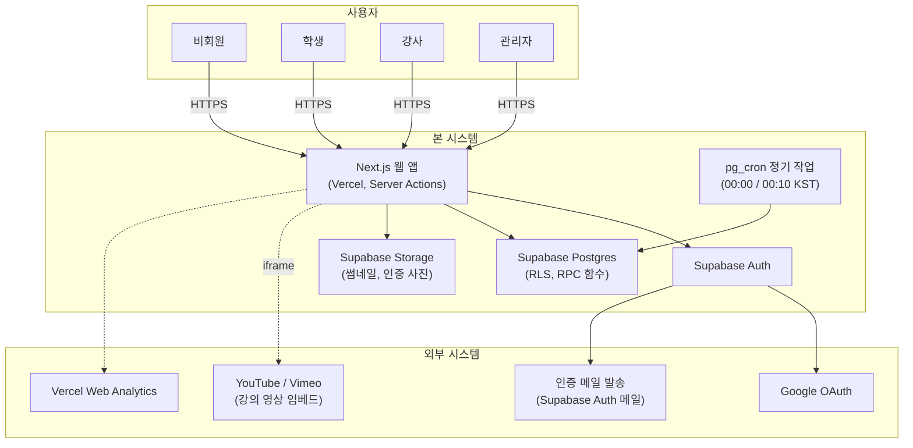
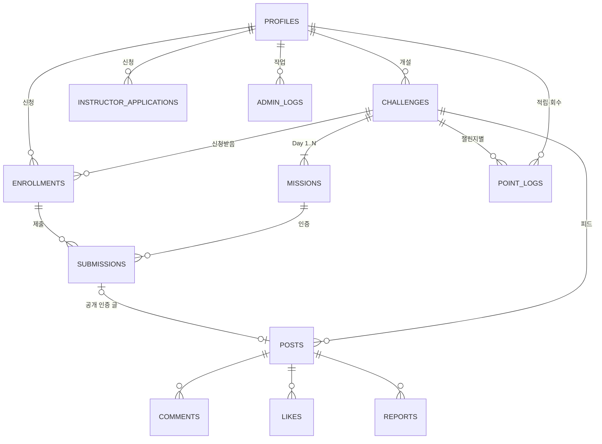

# 소프트웨어 요구사항 명세서 (SRS)

> Software Requirements Specification
>
> 작성 근거: [서비스 기획서](../00-기획/서비스기획서.md) SPD-CHUP-v0.2, [비즈니스 정책서](../00-기획/비즈니스정책서.md) BPD-CHUP-v0.2. 각 요구사항의 "출처"에 MVP-ID와 개별 정책 규칙 ID를 적었다. 기획서·정책서가 아직 승인 전(초안)이므로 이 문서도 초안이며, G0 승인 후 기준선을 확정한다.

---

## 문서 정보

| 항목 | 내용 |
|------|------|
| 프로젝트명 | 챌린지업 (ChallengeUp) — 온라인 강의 챌린지 플랫폼 |
| 문서 번호 | SRS-CHUP-v0.1 |
| 버전 | 0.1 |
| 작성일 | 2026-11-24 |
| 작성자 | Claude Code (초안) |
| 보안 등급 | 내부 공개 |

---

## 변경 이력

| 버전 | 날짜 | 변경 내용 | 작성자 | 승인자 |
|------|------|-----------|--------|--------|
| 0.1 | 2026-11-24 | 서비스 기획서 v0.2·비즈니스 정책서 v0.2 기반 초안 작성 | Claude Code | - |

---

## 목차

1. [문서 개요](#1-문서-개요)
2. [전체 시스템 설명](#2-전체-시스템-설명)
3. [기능 요구사항](#3-기능-요구사항)
4. [비기능 요구사항](#4-비기능-요구사항)
5. [외부 인터페이스 요구사항](#5-외부-인터페이스-요구사항)
6. [데이터 요구사항](#6-데이터-요구사항)
7. [제약 조건](#7-제약-조건)
8. [승인 내역](#8-승인-내역)

---

## 1. 문서 개요

### 1.1 목적

본 문서는 **챌린지업** 시스템의 소프트웨어 요구사항을 정의한다. 개발팀, 기획팀, QA팀, 운영팀이 시스템에 대해 같은 이해를 가지도록 하는 것을 목적으로 한다.

본 문서는 다음 용도로 활용된다:

- 개발 범위 및 기능의 명확한 정의
- 설계, 구현, 테스트의 기준 문서
- 요구사항 추적(RTM)의 기반 문서
- 이해관계자 간 합의 및 승인의 근거

### 1.2 범위

- **포함 범위** (서비스 기획서 5.2 MVP-001~020): 회원가입·로그인·프로필, 강사 신청·승인, 챌린지 등록 5단계·검수·수정·취소, 챌린지 상태 자동 전환, 탐색·소개 페이지, 무료 신청·취소, Day 커리큘럼·오늘의 미션, 미션 인증, 강사 인증 확인, 인증 피드, 포인트·레벨·리더보드·스트릭, 완주 자동 판정, 강사 운영 대시보드, 마이페이지, 신고 처리
- **제외 범위** (서비스 기획서 5.3 EX-001~013): 유료 결제·운영 방식별 매출 배분(직접 운영형 20% / 기획 지원형 50%), 보증금형, 수료증 PDF, 이메일·알림톡·푸시 알림, 늦은 신청, 지각 인증, 레벨 잠금 콘텐츠, 라이브·캘린더, 영상 직접 업로드, 후기·찜, 기수 복제, 모바일 앱·AI 기능

시스템의 주요 목표:

1. 기간이 정해진 챌린지에서 학생이 매일 인증하고 끝까지 완주하게 한다 (KPI-001 완주율 60%, KPI-002 일일 인증률 70%)
2. 강사가 인증 집계·이탈 파악을 손으로 하지 않고 챌린지를 운영하게 한다 (OBJ-002)
3. 학생이 챌린지를 고를 때 기간·시작일·참여 인원·완주율을 보고 판단하게 한다 (OBJ-003)

### 1.3 용어 정의

| 용어 | 정의 |
|------|------|
| SRS | Software Requirements Specification. 소프트웨어 요구사항 명세서 |
| RTM | Requirements Traceability Matrix. 요구사항 추적 매트릭스 |
| FR / NFR | 기능 / 비기능 요구사항 |
| UC | Use Case. 유스케이스 |
| RLS | Row Level Security. Postgres 행 단위 접근 제어 |
| RPC | Supabase에서 호출하는 Postgres 함수 |
| Server Action | Next.js App Router에서 폼·버튼이 직접 호출하는 서버 함수 |
| KST | 한국 표준시 (UTC+9). 모든 날짜 판단 기준 |
| 챌린지 | 강사가 개설한, 시작일·종료일·정원이 있는 강의 프로그램 한 기수 |
| Day N | 챌린지 안의 N번째 날. 날짜 = 시작일 + (N − 1)일 |
| 미션 / 인증 | Day마다 수행할 과제 / 그 결과 제출과 기록 |
| 인정·대기·반려 | 인증 상태. 인정만 포인트·완주에 반영 |
| 스트릭 | 인정 인증이 끊기지 않고 이어진 Day 수 |
| 완주 필요 인증 수 | 올림(기간 일수 × 완주 조건 % ÷ 100) |
| 활성 신청 | 취소되지 않은 신청 |

### 1.4 참고 문서

| 문서명 | 버전 | 비고 |
|--------|------|------|
| [서비스 기획서](../00-기획/서비스기획서.md) | v0.2 (초안) | 문제·목표·MVP 범위 |
| [비즈니스 정책서](../00-기획/비즈니스정책서.md) | v0.2 (초안) | 적용할 규칙과 예외 |
| [유스케이스 명세서](유스케이스명세서.md) | v0.1 | UC 상세 시나리오 |
| [요구사항 추적 매트릭스 (RTM)](요구사항추적매트릭스-RTM.md) | v0.1 | 요구사항 추적 |
| [상세 설계서](../03-상세설계/상세설계서.md) | v0.1 | 구현 수준 설계 |
| [PRD](../../PRD.md), [DESIGN.md](../../DESIGN.md) | - | 기능 초안, 화면 스타일 기준 |

### 1.5 우선순위 정의

포함 범위의 우선순위는 서비스 기획서와 같은 P1–P3를 사용한다. 제외한 항목을 SRS에 남길 때는 P4로 기록하고 해당 EX-ID를 참조한다.

| 등급 | 라벨 | 정의 |
|------|------|------|
| P1 | 필수 (Must) | 반드시 구현해야 하는 핵심 기능. 미구현 시 시스템 출시 불가 |
| P2 | 권장 (Should) | 구현이 강력히 권장되는 기능. 일정에 따라 조정 가능 |
| P3 | 선택 (Could) | 구현하면 좋으나 필수는 아닌 기능. 후속 릴리스로 이관 가능 |
| P4 | 제외 (Won't) | 현재 범위에서 명시적으로 제외하는 기능 |

---

## 2. 전체 시스템 설명

### 2.1 시스템 관점도

### 2.2 사용자 유형 및 특성

| Actor ID | 사용자 유형 | 설명 | 권한 수준 | 사용 빈도 | 기술 숙련도 |
|----------|-------------|------|-----------|-----------|-------------|
| ACT-01 | 비회원 | 로그인하지 않은 방문자. 탐색·소개 페이지만 본다 | 최소 | 비정기 | 초~중급 |
| ACT-02 | 학생 | 가입한 기본 역할. 신청·수강·인증·피드 활동 | 기본 | 매일 (진행 중) | 초~중급 |
| ACT-03 | 강사 | 관리자 승인을 받은 사용자. 학생 권한 + 챌린지 등록·운영 | 운영 | 매일 (진행 중) | 중~고급 |
| ACT-04 | 관리자 | 플랫폼 운영자. 검수, 강사 승인, 신고 처리 | 관리 | 매일 | 중급 |
| ACT-05 | 스케줄러 | 매일 00:00·00:10 KST에 상태 전환·스트릭·완주 판정을 실행하는 정기 작업 | 시스템 | 매일 | - |

### 2.3 운영 환경

#### 2.3.1 하드웨어 환경

| 구분 | 사양 | 비고 |
|------|------|------|
| Application Server | Vercel 관리형 함수 (Fluid Compute) | 서버 직접 관리 없음 |
| Database Server | Supabase 관리형 Postgres | 요금제는 미결 (ISSUE-04) |
| Cache Server | 해당 없음 | MVP 규모에서 별도 캐시 없음 |
| CDN | Vercel Edge Network | 정적 자산, 이미지 |

#### 2.3.2 소프트웨어 환경

| 구분 | 기술 스택 | 버전 | 비고 |
|------|-----------|------|------|
| Runtime | Node.js | 24 LTS | Vercel 기본 |
| Framework | Next.js (App Router) + TypeScript | 개발 착수 시 최신 안정판 | Server Components, Server Actions |
| UI | Tailwind CSS + shadcn/ui | 착수 시 최신 | DESIGN.md 토큰 반영 |
| Database | PostgreSQL (Supabase) | Supabase 제공 버전 | RLS, pg_cron |
| 인증 | Supabase Auth | - | 이메일, Google |
| 파일 저장 | Supabase Storage | - | |
| Cache / Message Queue / Container | 해당 없음 | - | MVP 범위에서 불필요 |
| CI/CD | GitHub + Vercel 자동 배포 | - | 저장소: lucyjeremy/learning-challenge-platform |

#### 2.3.3 클라이언트 환경

| 구분 | 지원 범위 | 비고 |
|------|-----------|------|
| 데스크톱 브라우저 | Chrome, Edge, Safari, Firefox 최신 2버전 | |
| 모바일 브라우저 | iOS Safari 16+, Android Chrome 최신 2버전 | |
| 최소 해상도 | 너비 360px | 반응형 웹 (DESIGN.md 기준점 600·960·1120px) |
| 모바일 앱 | 미지원 | EX-012 |

### 2.4 제약사항

1. 기술적 제약 — Next.js + Supabase + Vercel 조합으로 구현한다 (서비스 기획서 5.5).
2. 조직적 제약 — 소규모 팀(인원 미정)이 4주 안에 구현한다. P1 합계 공수가 약 29일이라 범위 조정이 필요할 수 있다 (DEC-004).
3. 법적 제약 — 개인정보 보호법에 따라 수집 항목 동의, 탈퇴 처리 절차를 둔다 (7.4).
4. 일정 제약 — MVP 개발 4주 + 테스트·출시 1주 (서비스 기획서 7.2).

### 2.5 가정 및 전제 조건

1. 사용자는 인터넷이 연결된 환경에서 사용한다. 오프라인 작성은 기기 임시 저장까지만 지원한다 (BP-ERROR-002).
2. MVP 기간 동시 접속은 최대 200명, 전체 가입자는 1,000명 이하로 예상한다 (근거 없음, 출시 후 측정).
3. 강의 영상은 강사가 YouTube·Vimeo에 올리고 링크만 등록한다 (EX-009).
4. Supabase·Vercel 서비스의 가용성은 각 사업자의 기본 수준을 따른다.
5. 기획서·정책서의 제안값(기간 7~60일, 정원 300명 등)은 G0에서 바뀔 수 있으며, 바뀌면 본 문서를 함께 갱신한다.

---

## 3. 기능 요구사항

### 3.1 기능 요구사항 요약 목록

| FR-ID | 기능명 | 설명 | 우선순위 | 관련 UC | 상태 |
|-------|--------|------|----------|---------|------|
| FR-001 | 회원가입 | 이메일·비밀번호·이름으로 가입, 약관 동의, 인증 메일 | P1 필수 | UC-001 | 초안 |
| FR-002 | 로그인/로그아웃 | 이메일 로그인, 구글 로그인(P2), 비밀번호 재설정 | P1 필수 | UC-002 | 초안 |
| FR-003 | 프로필 관리 | 이름·사진·한 줄 소개 조회·수정 | P1 필수 | UC-003 | 초안 |
| FR-004 | 역할·권한 제어 | 학생·강사·관리자 역할과 RLS 기반 접근 제어 | P1 필수 | 전체 | 초안 |
| FR-005 | 강사 신청·승인 | 학생의 강사 신청, 관리자 승인·반려 | P1 필수 | UC-004 | 초안 |
| FR-006 | 챌린지 등록 | 5단계 입력, 단계별 임시 저장, 미리보기, 검수 요청 | P1 필수 | UC-005 | 초안 |
| FR-007 | 챌린지 검수 | 관리자 승인(모집 중)·반려(사유) | P1 필수 | UC-006 | 초안 |
| FR-008 | 챌린지 상태 자동 전환 | 시작·종료·자동 취소·자동 반려 | P1 필수 | UC-016 | 초안 |
| FR-009 | 챌린지 수정·취소 | 상태별 수정 가능 항목 제한, 모집 중 취소 | P1 필수 | UC-007 | 초안 |
| FR-010 | 챌린지 탐색 | 카드 목록, 카테고리 필터, 정렬·검색(P2) | P1 필수 | UC-008 | 초안 |
| FR-011 | 챌린지 소개 페이지 | 기본 정보, 소개글, 커리큘럼 미리보기, 신청 카드 | P1 필수 | UC-008 | 초안 |
| FR-012 | 챌린지 신청·취소 | 무료 신청, 정원·중복·동시 참여 제한, 시작 전 취소(P2) | P1 필수 | UC-009 | 초안 |
| FR-013 | 커리큘럼·Day 열람 | 날짜에 따른 Day 열림, Day 상세(영상·자료·미션) | P1 필수 | UC-010 | 초안 |
| FR-014 | 오늘의 미션 | 첫 화면의 오늘의 미션 카드 | P1 필수 | UC-010 | 초안 |
| FR-015 | 미션 인증 | 형식별 제출, 마감, 공개·비공개, 수정·삭제 | P1 필수 | UC-011 | 초안 |
| FR-016 | 강사 인증 확인 | 강사 확인 방식 챌린지의 인정·반려 | P2 권장 | UC-012 | 초안 |
| FR-017 | 인증 피드 | 글 목록·작성, 공지 고정, 좋아요·댓글, 숨김 | P1 필수 | UC-013 | 초안 |
| FR-018 | 포인트·레벨 | 점수표에 따른 적립·회수, 레벨 계산 | P1 필수 | UC-011, UC-013 | 초안 |
| FR-019 | 리더보드·스트릭 | 챌린지별 7일·30일·전체 순위, 스트릭 계산 | P1 필수 | UC-014 | 초안 |
| FR-020 | 완주 자동 판정 | 종료 다음 날 00:10 판정, 결과 표시 | P1 필수 | UC-016 | 초안 |
| FR-021 | 강사 운영 대시보드 | 참여 인원, 인증률, 이탈 위험 학생, 공지 | P1 필수 | UC-015 | 초안 |
| FR-022 | 마이페이지 | 내 챌린지, 포인트·레벨, 완주 배지 | P2 권장 | UC-003 | 초안 |
| FR-023 | 신고 처리 | 글·댓글 신고, 3건 자동 임시 숨김, 관리자 처리 | P3 선택 | UC-017 | 초안 |
| FR-024 | 유료 결제·매출 배분 | 유료 판매, 직접 운영형 20% / 기획 지원형 50% 배분·정산 | P4 제외 | - | 제외 (EX-001, EX-013) |
| FR-025 | 외부 알림 발송 | 이메일·알림톡 미션 알림 | P4 제외 | - | 제외 (EX-004) |

---

### 3.2 FR-001: 회원가입

| 항목 | 내용 |
|------|------|
| **FR-ID** | FR-001 |
| **기능명** | 회원가입 |
| **설명** | 비회원이 이메일·비밀번호·이름을 입력하고 약관에 동의해 가입한다. 인증 메일의 링크를 누르면 로그인할 수 있다. 가입하면 학생 역할을 받는다 |
| **우선순위** | P1 필수 |
| **연관 기능** | FR-002, FR-003, FR-004 |
| **관련 UC** | UC-001 |
| **출처** | MVP-001, BP-AUTH-001-1~4, BP-AUTH-001-6, PRD AUTH-1 |
| **담당·의존성** | 미정 / 메일 인증 사용 여부 결정 (ISSUE-01) |

**입력:**

| 필드명 | 타입 | 필수 여부 | 유효성 검증 규칙 |
|--------|------|-----------|------------------|
| 이메일 | String (email) | 필수 | 이메일 형식, 가입된 이메일 중복 불가 |
| 비밀번호 | String | 필수 | 8~72자, 영문 1자 이상 + 숫자 1자 이상 |
| 비밀번호 확인 | String | 필수 | 비밀번호와 일치 |
| 이름 | String | 필수 | 2~20자, 앞뒤 공백 제거 |
| 이용약관 동의 | Boolean | 필수 | true |
| 개인정보 수집·이용 동의 | Boolean | 필수 | true |

**처리 로직:**

1. 입력값을 검증한다.
2. Supabase Auth에 가입을 요청한다 (비밀번호 해시는 Auth가 처리).
3. 가입 직후 프로필(profiles) 행을 만든다: 이름, 역할 = 학생, 약관 동의 시각.
4. 인증 메일을 보낸다 (링크 유효 24시간).
5. 링크를 누르면 계정이 인증되고 로그인 상태로 탐색 화면에 들어간다.

**출력:**

| 상황 | 응답 | HTTP Status |
|------|------|-------------|
| 성공 | "인증 메일을 보냈습니다" 안내 화면 | 200 |
| 이메일 중복 | "이미 가입된 이메일입니다" + 로그인 링크 | 409 |
| 유효성 실패 | 항목별 오류 메시지 | 400 |

**수용 기준**

| 기준 ID | 사전 조건 | 사용자 행동 또는 사건 | 관찰 가능한 기대 결과 |
| --- | --- | --- | --- |
| FR-001-AC1 | 가입되지 않은 이메일, 비밀번호 "abcdefg1" | 필수 항목을 모두 입력하고 가입 | 인증 메일 안내 화면. profiles에 역할 학생 행 생성 |
| FR-001-AC2 | 비밀번호 "abcdefgh" (숫자 없음) | 가입 | "비밀번호는 영문과 숫자를 모두 포함해야 합니다", 계정 미생성 |
| FR-001-AC3 | 이미 가입된 이메일 | 가입 | 409, "이미 가입된 이메일입니다" |
| FR-001-AC4 | 약관 동의 체크 해제 | 가입 | 가입 버튼 비활성 또는 400, 계정 미생성 |

**비고**

- 인증 메일 재발송은 Supabase Auth 기본 제한(요청 간격)을 따른다.

---

### 3.3 FR-002: 로그인/로그아웃

| 항목 | 내용 |
|------|------|
| **FR-ID** | FR-002 |
| **기능명** | 로그인/로그아웃 |
| **설명** | 이메일·비밀번호 또는 구글 계정으로 로그인하고, 로그아웃한다. 비밀번호를 잊으면 재설정 메일을 받는다 |
| **우선순위** | P1 필수 (구글 로그인은 P2, MVP-015) |
| **연관 기능** | FR-001, FR-004 |
| **관련 UC** | UC-002 |
| **출처** | MVP-001, MVP-015, BP-AUTH-001-5, BP-AUTH-002-1~5, PRD AUTH-1·2 |
| **담당·의존성** | 미정 / 자체 계정 잠금 필요 여부 (ISSUE-02) |

**입력:**

| 필드명 | 타입 | 필수 여부 | 유효성 검증 규칙 |
|--------|------|-----------|------------------|
| 이메일 | String (email) | 필수 | 이메일 형식 |
| 비밀번호 | String | 필수 | 빈 값 불가 |
| 구글 로그인 | OAuth | 선택 | Google OAuth 2.0 |

**처리 로직:**

1. Supabase Auth로 인증한다. 세션은 HttpOnly 쿠키로 유지한다.
2. 구글 로그인 시 같은 이메일의 기존 계정이 있으면 연결하고, 없으면 FR-001 3단계처럼 프로필을 만든다 (약관 동의 화면을 먼저 보여 준다).
3. 로그인 후 원래 가려던 페이지(없으면 탐색 화면)로 이동한다.
4. 로그아웃하면 세션 쿠키를 지우고 탐색 화면으로 이동한다.
5. 비밀번호 재설정 링크 유효 기간은 1시간이다.

**출력:**

| 상황 | 응답 | HTTP Status |
|------|------|-------------|
| 로그인 성공 | 이전 페이지 또는 탐색 화면 | 200 / 리다이렉트 |
| 인증 실패 | "이메일 또는 비밀번호가 올바르지 않습니다" | 401 |
| 메일 미인증 | "이메일 인증을 완료해 주세요" + 재발송 버튼 | 403 |
| 요청 과다 | "요청이 너무 많습니다. 잠시 후 다시 시도해 주세요" | 429 |

**수용 기준**

| 기준 ID | 사전 조건 | 사용자 행동 또는 사건 | 관찰 가능한 기대 결과 |
| --- | --- | --- | --- |
| FR-002-AC1 | 인증된 계정 | 올바른 이메일·비밀번호로 로그인 | 로그인 상태로 이전 페이지 이동, 새로고침해도 유지 |
| FR-002-AC2 | 인증된 계정 | 틀린 비밀번호로 로그인 | 401, 이메일·비밀번호 구분 없는 메시지 |
| FR-002-AC3 | 로그인 상태 | 로그아웃 | 탐색 화면, 챌린지 홈 주소 접근 시 소개 페이지로 이동 |
| FR-002-AC4 | 이메일 가입 계정과 같은 구글 계정 | 구글 로그인 | 같은 profiles 행으로 로그인 (중복 계정 없음) |

---

### 3.4 FR-003: 프로필 관리

| 항목 | 내용 |
|------|------|
| **FR-ID** | FR-003 |
| **기능명** | 프로필 관리 |
| **설명** | 로그인한 사용자가 이름·프로필 사진·한 줄 소개를 보고 고친다. 프로필은 피드·리더보드·멤버 목록에 표시된다 |
| **우선순위** | P1 필수 |
| **연관 기능** | FR-017, FR-019, FR-022 |
| **관련 UC** | UC-003 |
| **출처** | MVP-001, BP-AUTH-001-4, PRD AUTH-3 |
| **담당·의존성** | 미정 / - |

**입력:**

| 필드명 | 타입 | 필수 여부 | 유효성 검증 규칙 |
|--------|------|-----------|------------------|
| 이름 | String | 필수 | 2~20자 |
| 프로필 사진 | File (image) | 선택 | jpg·png·webp, 5MB 이하 |
| 한 줄 소개 | String | 선택 | 0~60자 |

**처리 로직:**

1. 본인 프로필만 수정할 수 있다 (RLS).
2. 사진은 Storage `avatars/{userId}/` 경로에 올리고 URL을 저장한다. 이전 사진은 지운다.

**출력:**

| 상황 | 응답 | HTTP Status |
|------|------|-------------|
| 수정 성공 | 수정된 프로필, "저장했습니다" | 200 |
| 유효성 실패 | 항목별 오류 | 400 |

**수용 기준**

| 기준 ID | 사전 조건 | 사용자 행동 또는 사건 | 관찰 가능한 기대 결과 |
| --- | --- | --- | --- |
| FR-003-AC1 | 로그인 | 이름을 "김지은"으로 바꿔 저장 | 피드·리더보드에 새 이름 표시 |
| FR-003-AC2 | 로그인 | 6MB 사진 업로드 | "사진은 5MB 이하만 올릴 수 있습니다", 기존 사진 유지 |
| FR-003-AC3 | 사용자 A 로그인 | 사용자 B의 프로필 수정 요청을 직접 보냄 | 403, B의 프로필 변경 없음 |

**비고**

- 회원 탈퇴는 MVP에서 고객 문의로 수동 처리한다 (BP-AUTH-005-1). 화면에는 문의 안내만 둔다.

---

### 3.5 FR-004: 역할·권한 제어

| 항목 | 내용 |
|------|------|
| **FR-ID** | FR-004 |
| **기능명** | 역할·권한 제어 |
| **설명** | 학생·강사·관리자 역할과 챌린지 참여 여부에 따라 화면 접근과 데이터 읽기·쓰기를 제어한다. 모든 권한은 DB의 RLS 정책으로 강제한다 |
| **우선순위** | P1 필수 |
| **연관 기능** | 전체 |
| **관련 UC** | 전체 |
| **출처** | BP-AUTH-003, BP-CONTENT-001, BP-CONTENT-001-1~3, BP-FEED-001-1 |
| **담당·의존성** | 미정 / - |

**역할 정의:**

| 역할 ID | 역할명 | 부여 방법 | 주요 권한 |
|---------|--------|-----------|-----------|
| ROLE-01 | 비회원 | - | 탐색, 소개 페이지, Day 제목 목록 |
| ROLE-02 | 학생 (student) | 가입 시 기본 | 신청, 신청한 챌린지의 열린 Day·피드·리더보드, 인증 |
| ROLE-03 | 강사 (instructor) | 강사 신청 승인 (FR-005) | 학생 권한 + 챌린지 등록·운영, 자기 챌린지 전체 열람·숨김·인증 확인 |
| ROLE-04 | 관리자 (admin) | DB에서 직접 지정 | 검수, 강사 승인, 신고 처리, 모든 챌린지 열람 |

**처리 로직:**

1. 페이지 요청 시 서버에서 세션과 역할을 확인하고, 권한이 없으면 BP-CONTENT-001-1대로 이동시킨다.
2. 모든 테이블에 RLS를 켜고, 비즈니스 정책서 5.2 접근 표를 정책으로 구현한다.
3. 화면의 버튼 숨김은 편의 기능일 뿐이며, 권한 판단의 근거로 쓰지 않는다.

**출력:**

| 상황 | 응답 | HTTP Status |
|------|------|-------------|
| 권한 있음 | 요청 결과 | 200 |
| 로그인 필요 | 로그인 페이지로 이동 | 401 |
| 권한 부족 | 소개 페이지 이동 또는 "권한이 없습니다" | 403 |

**수용 기준**

| 기준 ID | 사전 조건 | 사용자 행동 또는 사건 | 관찰 가능한 기대 결과 |
| --- | --- | --- | --- |
| FR-004-AC1 | 챌린지 X에 신청하지 않은 학생 | X의 피드 주소 접근 | 소개 페이지로 이동 |
| FR-004-AC2 | 위와 같은 학생 | Supabase 클라이언트로 X의 posts를 직접 조회 | 0건 반환 (RLS) |
| FR-004-AC3 | 학생 | /studio/new 접근 | "강사 승인 후 이용할 수 있습니다" + 강사 신청 버튼 |
| FR-004-AC4 | 신청 취소한 학생 | 취소 직후 X의 Day 상세 접근 | 소개 페이지로 이동 (BP-CONTENT-001-2) |

---

### 3.6 FR-005: 강사 신청·승인

| 항목 | 내용 |
|------|------|
| **FR-ID** | FR-005 |
| **기능명** | 강사 신청·승인 |
| **설명** | 학생이 신청 사유와 소개 링크로 강사를 신청하고, 관리자가 승인·반려한다. 승인되면 역할이 강사로 바뀐다 |
| **우선순위** | P1 필수 |
| **연관 기능** | FR-004, FR-006 |
| **관련 UC** | UC-004 |
| **출처** | MVP-002, BP-AUTH-004-1~4, PRD AUTH-4·ADM-2 |
| **담당·의존성** | 미정 / - |

**입력:**

| 필드명 | 타입 | 필수 여부 | 유효성 검증 규칙 |
|--------|------|-----------|------------------|
| 신청 사유 | String | 필수 | 20~500자 |
| 소개 링크 | URL | 선택 | http(s) 1개 |
| (관리자) 처리 결과 | Enum | 필수 | 승인 / 반려 |
| (관리자) 반려 사유 | String | 반려 시 필수 | 10자 이상 |

**처리 로직:**

1. 대기 중 신청이 있거나, 마지막 반려일로부터 7일이 지나지 않았으면 신청을 막는다.
2. 신청은 "대기" 상태로 저장한다.
3. 관리자가 승인하면 같은 트랜잭션에서 신청 상태 = 승인, 사용자 역할 = 강사로 바꾸고 관리자 작업 로그(NFR-006)를 남긴다.
4. 반려하면 사유를 저장한다. 결과는 사용자의 다음 접속 때 배너로 1회 안내한다 (BP-NOTI-001).

**출력:**

| 상황 | 응답 | HTTP Status |
|------|------|-------------|
| 신청 성공 | "신청했습니다. 2영업일 안에 결과를 알려 드려요" | 200 |
| 대기 중 신청 있음 | "처리 대기 중인 신청이 있습니다" | 409 |
| 재신청 제한 | "MM.DD 이후에 다시 신청할 수 있습니다" | 409 |

**수용 기준**

| 기준 ID | 사전 조건 | 사용자 행동 또는 사건 | 관찰 가능한 기대 결과 |
| --- | --- | --- | --- |
| FR-005-AC1 | 학생, 신청 이력 없음 | 사유 20자 이상으로 신청 | 대기 상태 신청 생성, 관리자 목록에 표시 |
| FR-005-AC2 | 대기 중 신청 | 관리자가 승인 | 역할 강사, 다음 화면부터 "강사 스튜디오" 메뉴 표시 |
| FR-005-AC3 | 11-20 반려 | 11-26 23:59에 재신청 | 409. 11-27 00:00 이후에는 성공 |
| FR-005-AC4 | 대기 중 신청 | 같은 사용자가 다시 신청 | 409 |

---

### 3.7 FR-006: 챌린지 등록

| 항목 | 내용 |
|------|------|
| **FR-ID** | FR-006 |
| **기능명** | 챌린지 등록 (5단계) |
| **설명** | 강사가 ① 기본 정보 ② 일정 ③ 커리큘럼 ④ 운영 규칙 ⑤ 가격 순서로 입력해 챌린지를 만들고, 미리본 뒤 검수를 요청한다. 단계를 넘어갈 때마다 서버에 임시 저장한다 |
| **우선순위** | P1 필수 |
| **연관 기능** | FR-007, FR-009 |
| **관련 UC** | UC-005 |
| **출처** | MVP-003, BP-CHAL-002, BP-CHAL-001-3, BP-CONTENT-002-1, BP-PAY-001-1, BP-ERROR-002-4, PRD STU-1·STU-2 |
| **담당·의존성** | 미정 / FR-005 (강사 역할) |

**입력:** (제한값은 BP-CHAL-002)

| 단계 | 필드명 | 타입 | 필수 여부 | 유효성 검증 규칙 |
|------|--------|------|-----------|------------------|
| ① | 제목 | String | 필수 | 5~50자 |
| ① | 한 줄 소개 | String | 필수 | 10~80자 |
| ① | 소개글 | Text | 필수 | 50~5,000자, HTML 불허 |
| ① | 카테고리 | Enum | 필수 | 개발·디자인·외국어·자기계발·운동·재테크 |
| ① | 썸네일 | File (image) | 필수 | jpg·png·webp, 5MB 이하 |
| ② | 시작일 | Date | 필수 | 검수 요청일 + 3일 ~ + 90일 |
| ② | 기간 | Integer | 필수 | 7~60 |
| ② | 열림 방식 | Enum | 필수 | 매일 열림(기본) / 시작일에 전부 열림 |
| ③ | Day N 제목 | String | 필수 | 2~40자, Day 1~기간 모두 |
| ③ | Day N 미션 설명 | Text | 필수 | 10~2,000자 |
| ③ | Day N 인증 형식 | Enum | 필수 | 텍스트 / 사진 / 링크 / 체크 |
| ③ | Day N 강의 영상 링크 | URL | 선택 | YouTube 또는 Vimeo 주소 |
| ③ | Day N 자료 링크 | URL | 선택 | http(s), 최대 3개 |
| ④ | 정원 | Integer | 필수 | 1~300 |
| ④ | 완주 조건 | Integer | 필수 | 50~100, 10 단위, 기본 80 |
| ④ | 인증 인정 방식 | Enum | 필수 | 자동(기본) / 강사 확인 (FR-016 구현 전에는 자동만 표시) |
| ⑤ | 가격 | Integer | 고정 | 0 (MVP 무료) |

**처리 로직:**

1. 강사가 "새 챌린지"를 누르면 상태 "작성 중" 챌린지를 만든다.
2. 각 단계 저장 시 해당 단계 필드만 검증하고 저장한다.
3. ② 기간이 정해지거나 바뀌면 Day 1~N 행을 맞춰 만들거나 지운다 (줄일 때는 뒤쪽 Day부터 지우며, 내용이 있으면 확인을 받는다).
4. ③ 커리큘럼은 Day 복사(이전 Day 내용 복사)와 드래그로 순서 바꾸기를 지원한다.
5. 미리보기는 학생에게 보일 소개 페이지(FR-011)를 강사만 보는 모드로 보여 준다.
6. 검수 요청 시 전체 필드를 다시 검증하고, 시작일 조건을 요청 시각 기준으로 확인한 뒤 상태를 "검수 대기"로 바꾼다.

**출력:**

| 상황 | 응답 | HTTP Status |
|------|------|-------------|
| 단계 저장 성공 | 다음 단계 화면 | 200 |
| 검수 요청 성공 | "검수를 요청했습니다" + 내 챌린지 목록 | 200 |
| 미입력 Day 있음 | "Day 5, 12의 미션 설명을 입력해 주세요" | 400 |
| 시작일 조건 위반 | "시작일은 검수 요청일로부터 3일 이후여야 합니다" | 400 |

**수용 기준**

| 기준 ID | 사전 조건 | 사용자 행동 또는 사건 | 관찰 가능한 기대 결과 |
| --- | --- | --- | --- |
| FR-006-AC1 | 강사 | 기간 21일 저장 | Day 1~21 입력 칸 생성 |
| FR-006-AC2 | ③까지 입력 후 브라우저 닫음 | 다시 등록 화면 열기 | ③까지의 입력이 그대로 남아 있음 |
| FR-006-AC3 | 11-24 요청, 시작일 11-26 | 검수 요청 | 400, 시작일 오류. 11-27이면 검수 대기 |
| FR-006-AC4 | Day 1개 미션 설명 비어 있음 | 검수 요청 | 400, 비어 있는 Day 번호 표시, 상태 유지 |
| FR-006-AC5 | ⑤ 가격 단계 | 화면 확인 | 0원 고정, "MVP 기간에는 모든 챌린지가 무료로 운영됩니다" |

---

### 3.8 FR-007: 챌린지 검수

| 항목 | 내용 |
|------|------|
| **FR-ID** | FR-007 |
| **기능명** | 챌린지 검수 |
| **설명** | 관리자가 검수 대기 챌린지를 확인하고 승인(모집 중으로 공개)하거나 사유와 함께 반려(작성 중으로 되돌림)한다 |
| **우선순위** | P1 필수 |
| **연관 기능** | FR-006, FR-008 |
| **관련 UC** | UC-006 |
| **출처** | MVP-004, BP-CHAL-003-1~3, BP-CHAL-004-3, PRD ADM-1 |
| **담당·의존성** | 미정 / - |

**입력:**

| 필드명 | 타입 | 필수 여부 | 유효성 검증 규칙 |
|--------|------|-----------|------------------|
| 처리 결과 | Enum | 필수 | 승인 / 반려 |
| 반려 사유 유형 | Enum | 반려 시 필수 | 정보 부족 / 부적절한 내용 / 저작권 의심 / 강의 링크 오류 / 기타 |
| 반려 설명 | String | 반려 시 필수 | 10자 이상 |

**처리 로직:**

1. 관리자 검수 목록은 검수 대기 챌린지를 요청 시각 순으로 보여 준다.
2. 승인 시 상태를 "모집 중"으로 바꾸고 공개 시각을 기록한다. 탐색 목록에 바로 나타난다.
3. 반려 시 상태를 "작성 중"으로 바꾸고 사유를 저장한다. 강사 스튜디오에 사유를 표시한다.
4. 강사가 "검수 요청 취소"를 누르면 작성 중으로 되돌린다.
5. 승인·반려는 관리자 작업 로그에 남긴다.

**출력:**

| 상황 | 응답 | HTTP Status |
|------|------|-------------|
| 승인 | 목록에서 제거, "공개했습니다" | 200 |
| 반려 | 목록에서 제거, 사유 저장 | 200 |
| 이미 처리됨 | "이미 처리된 챌린지입니다" | 409 |

**수용 기준**

| 기준 ID | 사전 조건 | 사용자 행동 또는 사건 | 관찰 가능한 기대 결과 |
| --- | --- | --- | --- |
| FR-007-AC1 | 검수 대기 챌린지 | 관리자 승인 | 상태 모집 중, 비회원 탐색 목록에 카드 표시 |
| FR-007-AC2 | 검수 대기 챌린지 | 사유 없이 반려 | 400, 상태 유지 |
| FR-007-AC3 | 반려된 챌린지 | 강사가 스튜디오 확인 | 반려 사유 유형과 설명 표시, 수정 가능 |
| FR-007-AC4 | 학생 | 관리자 검수 화면 접근 | 403 |

---

### 3.9 FR-008: 챌린지 상태 자동 전환

| 항목 | 내용 |
|------|------|
| **FR-ID** | FR-008 |
| **기능명** | 챌린지 상태 자동 전환 |
| **설명** | 매일 00:00 KST 정기 작업이 시작·종료·자동 취소·검수 자동 반려를 처리한다 |
| **우선순위** | P1 필수 |
| **연관 기능** | FR-012, FR-019, FR-020 |
| **관련 UC** | UC-016 |
| **출처** | BP-CHAL-001, BP-CHAL-001-1·2, BP-CHAL-003-4, BP-RESET-001-2, BP-RESET-002 |
| **담당·의존성** | 미정 / pg_cron 사용 가능 여부 (ISSUE-04) |

**처리 로직:** (매일 00:00:00 KST 실행, 기준일 D = 실행 시점의 KST 날짜)

1. 검수 대기 & 시작일 ≤ D → 작성 중으로 되돌리고 사유 "검수가 시작일 전에 끝나지 않음" 기록.
2. 모집 중 & 시작일 ≤ D → 활성 신청이 1명 이상이면 진행 중, 0명이면 취소됨. (≤로 판단해 작업이 하루 빠져도 다음 실행에서 처리된다)
3. 진행 중 & 종료일 < D → 종료.
4. 진행 중 챌린지의 활성 신청마다 전날 Day의 스트릭 끊김을 처리한다 (FR-019).
5. 각 단계는 대상 행만 바꾸는 멱등 작업이며, 같은 날 두 번 실행돼도 결과가 같다.
6. 실행 결과(대상 건수, 실패)를 작업 로그에 남긴다.

**출력:** 화면 출력 없음. 상태 변경 결과는 각 화면에 반영된다.

**수용 기준**

| 기준 ID | 사전 조건 | 사용자 행동 또는 사건 | 관찰 가능한 기대 결과 |
| --- | --- | --- | --- |
| FR-008-AC1 | 모집 중, 시작일 12-01, 활성 신청 5명 | 12-01 00:00 작업 실행 | 진행 중, Day 1 열림 |
| FR-008-AC2 | 모집 중, 시작일 12-01, 활성 신청 0명 | 12-01 00:00 작업 실행 | 취소됨, 탐색 목록에서 사라짐 |
| FR-008-AC3 | 진행 중, 종료일 12-21 | 12-22 00:00 작업 실행 | 종료, 인증 버튼 대신 "종료된 챌린지입니다" |
| FR-008-AC4 | 검수 대기, 시작일 12-01 | 12-01 00:00 작업 실행 | 작성 중, 강사에게 일정 재설정 안내 |
| FR-008-AC5 | AC1 처리 완료 | 같은 날 작업을 다시 실행 | 상태·로그 변화 없음 (멱등) |

---

### 3.10 FR-009: 챌린지 수정·취소

| 항목 | 내용 |
|------|------|
| **FR-ID** | FR-009 |
| **기능명** | 챌린지 수정·취소 |
| **설명** | 강사가 상태에 따라 허용된 항목만 수정하고, 모집 중 챌린지는 사유를 남겨 취소할 수 있다 |
| **우선순위** | P1 필수 |
| **연관 기능** | FR-006, FR-012 |
| **관련 UC** | UC-007 |
| **출처** | BP-CHAL-004 (수정 범위 표), BP-CHAL-004-1·2, BP-CHAL-005-1·2, BP-ENR-003 |
| **담당·의존성** | 미정 / - |

**처리 로직:**

1. 수정 화면은 비즈니스 정책서 BP-CHAL-004 표에서 X인 항목을 비활성화한다.
2. 서버는 저장 요청마다 현재 상태와 바뀐 필드를 비교해 허용되지 않은 필드가 있으면 거절한다.
3. 진행 중에는 Day 날짜가 오늘 이후인 Day의 제목·미션 설명·인증 형식만 고칠 수 있다. 강의·자료 링크는 열린 Day도 고칠 수 있다.
4. 정원은 늘리기만 허용한다.
5. 취소는 모집 중에만 가능하다. 사유(10자 이상)를 받고, 상태 = 취소됨, 활성 신청 전부 = 챌린지 취소로 바꾼다. 신청자에게는 다음 접속 때 안내 배너를 보여 준다.

**출력:**

| 상황 | 응답 | HTTP Status |
|------|------|-------------|
| 수정 성공 | "저장했습니다" | 200 |
| 허용되지 않은 필드 | "현재 상태에서는 ○○을(를) 바꿀 수 없습니다" | 422 |
| 진행 중 취소 시도 | "진행 중인 챌린지는 취소할 수 없습니다. 관리자에게 문의해 주세요" | 422 |

**수용 기준**

| 기준 ID | 사전 조건 | 사용자 행동 또는 사건 | 관찰 가능한 기대 결과 |
| --- | --- | --- | --- |
| FR-009-AC1 | 진행 중, 오늘 Day 5 | Day 6 미션 설명 수정 | 저장됨 |
| FR-009-AC2 | 진행 중, 오늘 Day 5 | Day 5 미션 설명 수정 요청을 직접 보냄 | 422, 변경 없음 |
| FR-009-AC3 | 모집 중, 정원 30, 참여 28 | 정원 25로 변경 | 422 "정원은 늘리기만 할 수 있습니다" |
| FR-009-AC4 | 모집 중, 활성 신청 3명 | 사유를 입력해 취소 | 챌린지 취소됨, 3명의 신청 = 챌린지 취소, 다음 접속 시 배너 |

---

### 3.11 FR-010: 챌린지 탐색

| 항목 | 내용 |
|------|------|
| **FR-ID** | FR-010 |
| **기능명** | 챌린지 탐색 |
| **설명** | 모집 중·진행 중 챌린지를 카드 목록으로 보여 주고, 카테고리로 거른다. 정렬과 검색은 P2 |
| **우선순위** | P1 필수 (정렬·검색 P2, MVP-016) |
| **연관 기능** | FR-011 |
| **관련 UC** | UC-008 |
| **출처** | MVP-005, MVP-016, BP-STAT-001 (참여 인원), BP-STAT-002-1·3, PRD DISC-1~5 |
| **담당·의존성** | 미정 / - |

**입력:**

| 필드명 | 타입 | 필수 여부 | 유효성 검증 규칙 |
|--------|------|-----------|------------------|
| 카테고리 | Enum | 선택 | 전체 또는 6개 중 1개 |
| 정렬 | Enum | 선택 | 인기순(참여 인원) / 마감 임박순(시작일 가까운 모집 중) / 최신순(공개 시각) |
| 검색어 | String | 선택 | 1~50자, 제목·강사명 부분 일치 |
| 페이지 | Integer | 선택 | 한 번에 12개, "더 보기" |

**처리 로직:**

1. 상태가 모집 중·진행 중인 챌린지만 보여 준다. 기본 정렬은 모집 중 먼저, 그다음 최신순.
2. 카드 표시 항목: 썸네일, 제목, 강사 이름, 기간("21일"), 시작일, 참여 인원/정원, 가격("무료"), 상태 배지("모집중", "D-3", "진행중"), 완주율(종료 챌린지만 해당하므로 MVP 카드에는 표시하지 않음).
3. 정원이 찬 모집 중 챌린지는 "정원 마감" 배지를 붙인다.

**출력:**

| 상황 | 응답 | HTTP Status |
|------|------|-------------|
| 조회 성공 | 카드 목록 | 200 |
| 결과 없음 | "조건에 맞는 챌린지가 없습니다" | 200 |

**수용 기준**

| 기준 ID | 사전 조건 | 사용자 행동 또는 사건 | 관찰 가능한 기대 결과 |
| --- | --- | --- | --- |
| FR-010-AC1 | 모집 중 2개, 작성 중 1개, 종료 1개 | 비회원이 탐색 화면 열기 | 모집 중 2개만 표시 |
| FR-010-AC2 | 시작일까지 3일 남은 모집 중 | 카드 확인 | "D-3" 배지 |
| FR-010-AC3 | 개발 2개, 외국어 1개 | "외국어" 칩 선택 | 1개만 표시 |
| FR-010-AC4 | 정원 30명, 참여 30명 | 카드 확인 | "정원 마감" 배지 |

---

### 3.12 FR-011: 챌린지 소개 페이지

| 항목 | 내용 |
|------|------|
| **FR-ID** | FR-011 |
| **기능명** | 챌린지 소개 페이지 |
| **설명** | 챌린지의 기본 정보, 소개글, 커리큘럼 미리보기, 요약 카드(참여 인원, 남은 자리, 시작까지 남은 날, 신청 버튼)를 보여 준다 |
| **우선순위** | P1 필수 |
| **연관 기능** | FR-010, FR-012, FR-013 |
| **관련 UC** | UC-008 |
| **출처** | MVP-006, BP-CONTENT-001, BP-CONTENT-002-4, BP-STAT-001·002, PRD ABOUT-1~4 |
| **담당·의존성** | 미정 / - |

**처리 로직:**

1. 기본 정보: 제목, 강사(이름·사진·한 줄 소개), 카테고리, 기간, 시작일~종료일, 정원, 가격, 완주 조건("21일 중 17일 인증하면 완주").
2. 소개글은 줄바꿈과 이모지를 그대로 보여 주고, HTML은 글자로 표시한다.
3. 커리큘럼 미리보기는 Day 제목만 보여 준다. 누르면 "신청한 참여자만 볼 수 있습니다".
4. 요약 카드의 버튼 상태: 비회원 → "로그인하고 신청하기", 신청 가능 → "신청하기", 이미 신청 → "챌린지 홈으로", 정원 마감 → 비활성 "정원 마감", 모집 마감·진행 중·종료 → 비활성 "모집이 끝났습니다", 본인 챌린지(강사) → "운영 대시보드로".
5. 종료된 챌린지는 완주율을 표시한다 (BP-STAT-002-3).
6. 작성 중·검수 대기 챌린지는 강사 본인과 관리자만 볼 수 있다.

**출력:**

| 상황 | 응답 | HTTP Status |
|------|------|-------------|
| 조회 성공 | 소개 페이지 | 200 |
| 공개되지 않은 챌린지 | "찾을 수 없는 페이지입니다" | 404 |

**수용 기준**

| 기준 ID | 사전 조건 | 사용자 행동 또는 사건 | 관찰 가능한 기대 결과 |
| --- | --- | --- | --- |
| FR-011-AC1 | 모집 중, 21일, 완주 80% | 비회원이 열기 | 기본 정보, Day 1~21 제목, "21일 중 17일", "로그인하고 신청하기" |
| FR-011-AC2 | 작성 중 챌린지 | 다른 사용자가 주소로 접근 | 404 |
| FR-011-AC3 | 이미 신청한 학생 | 열기 | "챌린지 홈으로" 버튼 |
| FR-011-AC4 | 소개글에 `<script>` 포함 | 열기 | 글자로 표시, 실행되지 않음 |

---

### 3.13 FR-012: 챌린지 신청·취소

| 항목 | 내용 |
|------|------|
| **FR-ID** | FR-012 |
| **기능명** | 챌린지 신청·취소 |
| **설명** | 로그인한 사용자가 모집 중 챌린지에 무료로 신청한다. 시작 전에는 취소할 수 있다(P2) |
| **우선순위** | P1 필수 (취소는 P2, MVP-017) |
| **연관 기능** | FR-008, FR-011, FR-013 |
| **관련 UC** | UC-009 |
| **출처** | MVP-007, MVP-017, BP-ENR-001-1~6, BP-ENR-002-1~4, BP-ENR-003, BP-ERROR-003-1, PRD ENR-1~3 |
| **담당·의존성** | 미정 / - |

**처리 로직:**

1. 신청은 하나의 DB 트랜잭션(RPC)으로 처리한다: 챌린지 행을 잠그고 → 상태 모집 중·모집 마감 전 확인 → 본인 챌린지 아님 → 같은 챌린지 활성 신청 없음 → 내 활성 신청 5개 미만 → 활성 신청 수 < 정원 → 신청 생성.
2. 판단 시각은 서버 수신 시각이다.
3. 성공하면 챌린지 홈으로 이동한다. 시작 전이면 "MM.DD 시작" 안내와 커리큘럼 제목을 보여 준다.
4. 취소는 시작일 전날 23:59:59까지 가능하다. 취소하면 상태 = 취소, 자리가 1개 늘어난다. 같은 챌린지에 다시 신청할 수 있다.

**출력:**

| 상황 | 응답 | HTTP Status |
|------|------|-------------|
| 신청 성공 | 챌린지 홈 | 200 |
| 이미 신청 | "이미 신청한 챌린지입니다" | 409 |
| 정원 마감 | "정원이 마감되었습니다" | 409 |
| 동시 참여 초과 | "동시에 참여할 수 있는 챌린지는 최대 5개입니다" | 422 |
| 모집 기간 아님 | "모집이 끝난 챌린지입니다" | 422 |
| 시작 후 취소 | "시작된 챌린지는 취소할 수 없습니다" | 422 |

**수용 기준**

| 기준 ID | 사전 조건 | 사용자 행동 또는 사건 | 관찰 가능한 기대 결과 |
| --- | --- | --- | --- |
| FR-012-AC1 | 정원 30, 참여 29 | 학생 A·B가 동시에 신청 (병렬 요청 2건) | 정확히 1건 성공, 1건 409. 참여 30 |
| FR-012-AC2 | 활성 신청 5개 | 6번째 신청 | 422, 신청 미생성 |
| FR-012-AC3 | 강사 본인 챌린지 | 신청 요청을 직접 보냄 | 422, 신청 미생성 |
| FR-012-AC4 | 12-01 시작 | 11-30 23:59:59에 취소 | 취소 성공, 남은 자리 +1 |
| FR-012-AC5 | 12-01 시작 | 12-01 00:00:00에 취소 요청 | 422 |
| FR-012-AC6 | 11-30 23:59:59 이후 (모집 마감) | 신청 | 422 "모집이 끝난 챌린지입니다" |

---

### 3.14 FR-013: 커리큘럼·Day 열람

| 항목 | 내용 |
|------|------|
| **FR-ID** | FR-013 |
| **기능명** | 커리큘럼·Day 열람 |
| **설명** | 신청자가 커리큘럼 탭에서 Day 목록과 상태를 보고, 열린 Day의 강의 영상·자료·미션 설명을 본다 |
| **우선순위** | P1 필수 |
| **연관 기능** | FR-014, FR-015 |
| **관련 UC** | UC-010 |
| **출처** | MVP-008, BP-CONTENT-001, BP-CONTENT-002-1~6, BP-RESET-002, PRD CUR-1~3 |
| **담당·의존성** | 미정 / - |

**처리 로직:**

1. Day N 날짜 = 시작일 + (N − 1)일. 열림 여부: 매일 열림이면 Day N 날짜 00:00 KST ≤ 현재, 전부 열림이면 시작일 00:00 KST ≤ 현재.
2. Day 목록 상태: 잠김(제목 + "MM.DD(요일) 00:00에 열립니다") / 진행 가능 / 완료 ✔(인정) / 대기 / 반려 / 놓침(마감 지남, 인정 없음).
3. Day 상세: YouTube·Vimeo 링크는 임베드 플레이어로, 자료 링크는 새 창 링크로, 미션 설명, 인증 영역(FR-015).
4. 잠긴 Day 상세 요청은 서버에서 거절한다 (RLS 또는 서버 확인).
5. 종료 후에도 신청자는 모든 Day를 볼 수 있으며 인증 영역은 "종료된 챌린지입니다"로 바뀐다.

**출력:**

| 상황 | 응답 | HTTP Status |
|------|------|-------------|
| 열린 Day | Day 상세 | 200 |
| 잠긴 Day | "MM.DD 00:00에 열립니다" | 403 |

**수용 기준**

| 기준 ID | 사전 조건 | 사용자 행동 또는 사건 | 관찰 가능한 기대 결과 |
| --- | --- | --- | --- |
| FR-013-AC1 | 매일 열림, 시작 12-01, 현재 12-03 10:00 | 커리큘럼 열기 | Day 1~3 진행 가능/완료, Day 4 "12.04(금) 00:00에 열립니다" |
| FR-013-AC2 | 위와 같음 | Day 4 상세 요청을 직접 보냄 | 403, 미션 설명 미노출 |
| FR-013-AC3 | 전부 열림, 시작일 당일 | 커리큘럼 열기 | 모든 Day 열림 |
| FR-013-AC4 | 종료된 챌린지 신청자 | Day 5 열기 | 내용 표시, 인증 버튼 없음 |

---

### 3.15 FR-014: 오늘의 미션

| 항목 | 내용 |
|------|------|
| **FR-ID** | FR-014 |
| **기능명** | 오늘의 미션 카드 |
| **설명** | 로그인 후 첫 화면 상단에 진행 중인 챌린지마다 "Day N / 전체 · 오늘의 미션 · 마감 23:59 (한국 시간)" 카드를 보여 준다 |
| **우선순위** | P1 필수 |
| **연관 기능** | FR-013, FR-015 |
| **관련 UC** | UC-010 |
| **출처** | MVP-008, BP-NOTI-001 (오늘의 미션 화면 안내), BP-RESET-001-1, PRD CUR-4 |
| **담당·의존성** | 미정 / - |

**처리 로직:**

1. 대상: 내 활성 신청 중 진행 중인 챌린지에서 오늘 날짜의 Day.
2. 카드 내용: 챌린지 제목, "Day 7 / 21", Day 제목, 마감 시각, 내 인증 상태(미인증 / 인정 / 대기 / 반려), 바로가기 버튼.
3. 여러 개면 미인증 → 반려 → 대기 → 인정 순, 같은 상태 안에서는 챌린지 시작일 순으로 정렬한다.
4. 진행 중 챌린지가 없으면 카드 대신 "참여 중인 챌린지가 없습니다" + 탐색 버튼.

**수용 기준**

| 기준 ID | 사전 조건 | 사용자 행동 또는 사건 | 관찰 가능한 기대 결과 |
| --- | --- | --- | --- |
| FR-014-AC1 | 진행 중 2개, 하나만 오늘 인증 | 첫 화면 열기 | 카드 2장, 미인증 카드가 먼저 |
| FR-014-AC2 | 모집 중 챌린지만 신청 | 첫 화면 열기 | 오늘의 미션 카드 없음, 시작일 안내 |

---

### 3.16 FR-015: 미션 인증

| 항목 | 내용 |
|------|------|
| **FR-ID** | FR-015 |
| **기능명** | 미션 인증 |
| **설명** | 신청자가 열린 Day에 마감 전까지 강사가 정한 형식으로 인증을 제출·수정·삭제한다. 공개 인증은 피드 글로 자동 공유된다 |
| **우선순위** | P1 필수 (수정·삭제는 P2, MVP-018) |
| **연관 기능** | FR-013, FR-016, FR-017, FR-018, FR-019 |
| **관련 UC** | UC-011 |
| **출처** | MVP-009, MVP-018, BP-SUB-001, BP-SUB-002-1~4, BP-SUB-003-1~4, BP-SUB-004-1·5·6, BP-ERROR-002-1~3, BP-ERROR-003-1·2, PRD SUB-1~4 |
| **담당·의존성** | 미정 / FR-013 |

**입력:**

| 형식 | 필드명 | 타입 | 필수 여부 | 유효성 검증 규칙 |
|------|--------|------|-----------|------------------|
| 텍스트 | 본문 | String | 필수 | 10~2,000자 |
| 사진 | 사진 | File[] | 필수 | 1~3장, 장당 10MB 이하, jpg·png·webp |
| 사진 | 설명 | String | 선택 | 0~500자 |
| 링크 | URL | URL | 필수 | http(s) 1개 |
| 링크 | 설명 | String | 선택 | 0~500자 |
| 체크 | 한마디 | String | 선택 | 0~200자 |
| 공통 | 공개 범위 | Enum | 필수 | 공개(기본) / 비공개 |

**처리 로직:**

1. 제출 조건 확인: 활성 신청, Day 열림, 서버 수신 시각 < Day 날짜 다음 날 00:00:00 KST, 같은 Day 인증 없음, 강사·관리자 아님.
2. 사진은 먼저 Storage `submissions/{challengeId}/{userId}/` 에 올린다. 모든 사진이 올라가야 제출 버튼이 켜진다.
3. 인증을 저장한다: 최초 제출 시각, 상태 = 자동 인정 챌린지면 인정, 강사 확인이면 대기.
4. 공개이면 같은 트랜잭션에서 피드 글(종류: 인증)을 만든다.
5. 인정이면 포인트(FR-018)와 스트릭(FR-019)을 갱신한다.
6. 작성 중 텍스트는 기기에 임시 저장하고, 성공하면 지운다. 마감 5분 전부터 남은 시간을 초 단위로 보여 준다.
7. 수정: 마감 전까지 내용·공개 범위를 고친다. 최초 제출 시각은 그대로다. 공개 ↔ 비공개를 바꾸면 피드 글을 만들거나 지운다. 반려된 인증을 고치면 다시 대기가 된다.
8. 삭제: 마감 전까지. 인증·연결된 피드 글을 지우고, 받은 포인트를 회수하고, 스트릭을 다시 계산한다.

**출력:**

| 상황 | 응답 | HTTP Status |
|------|------|-------------|
| 제출 성공 | Day 상세에 내 인증 표시, "+10점" 안내(인정 시) | 200 |
| 이미 인증 | "이미 인증한 Day입니다. 수정하시겠어요?" | 409 |
| 마감 지남 | "마감 시간이 지나 제출할 수 없습니다" | 422 |
| 잠긴 Day | "아직 열리지 않은 Day입니다" | 403 |
| 사진 용량 초과 | "사진은 한 장당 10MB 이하만 올릴 수 있습니다" | 400 |

**수용 기준**

| 기준 ID | 사전 조건 | 사용자 행동 또는 사건 | 관찰 가능한 기대 결과 |
| --- | --- | --- | --- |
| FR-015-AC1 | 자동 인정, Day 3(12-03) 사진 형식 | 12-03 19:30 사진 1장 공개 제출 | 인정, 피드에 인증 글, +10 +5, 스트릭 갱신 |
| FR-015-AC2 | 위와 같음 | 12-03 23:59:59에 제출 (서버 수신 기준) | 성공 |
| FR-015-AC3 | 위와 같음 | 서버 수신 12-04 00:00:00 | 422, 인증 미생성 |
| FR-015-AC4 | Day 3 인증 있음 | 다른 기기에서 Day 3 새로 제출 | 409, 기존 인증 1건 유지 |
| FR-015-AC5 | 비공개 선택 | 제출 | 피드 글 없음. 본인·강사·관리자만 인증 조회 가능 |
| FR-015-AC6 | 인정 인증, 마감 전 | 삭제 | 인증·피드 글 삭제, +10(+5) 회수 로그, 스트릭 재계산 |
| FR-015-AC7 | 마감 지난 인증 | 수정 요청을 직접 보냄 | 422, 변경 없음 |
| FR-015-AC8 | 텍스트 500자 입력 중 연결 끊김 | 화면 확인 | 오프라인 배너, 제출 버튼 비활성, 입력 내용 유지 |

---

### 3.17 FR-016: 강사 인증 확인

| 항목 | 내용 |
|------|------|
| **FR-ID** | FR-016 |
| **기능명** | 강사 인증 확인 |
| **설명** | 인정 방식이 "강사 확인"인 챌린지에서 강사가 대기 인증을 인정하거나 사유와 함께 반려한다 |
| **우선순위** | P2 권장 |
| **연관 기능** | FR-015, FR-018, FR-019, FR-020, FR-021 |
| **관련 UC** | UC-012 |
| **출처** | MVP-018, BP-SUB-004-2~5, BP-POINT-005-4, PRD SUB-5·STU-4 |
| **담당·의존성** | 미정 / FR-016 구현 전에는 등록 ④단계에서 "자동"만 선택 가능 |

**입력:**

| 필드명 | 타입 | 필수 여부 | 유효성 검증 규칙 |
|--------|------|-----------|------------------|
| 결과 | Enum | 필수 | 인정 / 반려 |
| 피드백 | String | 반려 시 필수 | 반려 5자 이상, 인정 시 선택 0~500자 |

**처리 로직:**

1. 대시보드 인증 목록에서 Day·상태별로 대기 인증을 거른다.
2. 인정: 상태 = 인정, 포인트 적립(최초 제출 시각 기준 조기 보너스 포함), 스트릭 재계산.
3. 반려: 상태 = 반려, 사유 저장. 마감 전이면 학생이 고쳐 다시 제출할 수 있다.
4. 완주 판정 전까지 처리할 수 있다. 판정 시점의 대기는 자동 인정된다 (FR-020).

**수용 기준**

| 기준 ID | 사전 조건 | 사용자 행동 또는 사건 | 관찰 가능한 기대 결과 |
| --- | --- | --- | --- |
| FR-016-AC1 | 대기 인증 (최초 제출 19:00) | 강사가 22:00에 인정 | 인정, +10 +5 적립, 스트릭 +1 |
| FR-016-AC2 | 대기 인증 | 사유 없이 반려 | 400 |
| FR-016-AC3 | 22:00 반려 | 학생이 23:00에 수정 제출 | 상태 대기 |
| FR-016-AC4 | 다른 강사의 챌린지 인증 | 인정 요청을 직접 보냄 | 403 |

---

### 3.18 FR-017: 인증 피드

| 항목 | 내용 |
|------|------|
| **FR-ID** | FR-017 |
| **기능명** | 인증 피드 |
| **설명** | 챌린지 참여자·강사가 인증·질문·자유·공지 글을 보고 쓰며, 좋아요와 댓글로 응원한다. 강사는 공지를 3개까지 고정하고, 글을 숨길 수 있다 |
| **우선순위** | P1 필수 (종류 필터는 P3, MVP-019) |
| **연관 기능** | FR-015, FR-018, FR-023 |
| **관련 UC** | UC-013 |
| **출처** | MVP-010, MVP-019, BP-FEED-001-1~5, BP-FEED-002-1~3, BP-SUB-002-4, BP-STAT-001 (좋아요·댓글 수), PRD FEED-1~4 |
| **담당·의존성** | 미정 / - |

**입력:**

| 필드명 | 타입 | 필수 여부 | 유효성 검증 규칙 |
|--------|------|-----------|------------------|
| 글 종류 | Enum | 필수 | 질문 / 자유 / 공지(강사만) |
| 본문 | String | 필수 | 1~2,000자 |
| 사진 | File[] | 선택 | 최대 3장, 장당 10MB |
| 댓글 | String | 필수 | 1~500자 |

**처리 로직:**

1. 목록: 고정 공지(최대 3개, 고정 시각 최신순) → 나머지 최신순, 20개씩 무한 스크롤.
2. 인증 글은 Day 번호 배지와 인증 형식(사진·텍스트·링크·체크)을 함께 보여 준다.
3. 좋아요는 사용자당 글마다 1회, 다시 누르면 취소. 댓글은 한 단계만.
4. 작성자는 자기 글·댓글을 수정(“수정됨” 표시)·삭제한다. 인증 글 삭제는 FR-015 삭제 규칙을 따른다.
5. 강사는 자기 챌린지의 글·댓글을 숨길 수 있다. 숨긴 글은 작성자에게만 "숨겨진 글"로 보인다.
6. 공지 4번째 고정 시 "가장 오래된 '○○'의 고정을 풀까요?"를 묻는다.
7. 종료된 챌린지 피드는 읽기 전용이다.

**출력:**

| 상황 | 응답 | HTTP Status |
|------|------|-------------|
| 글 작성 | 목록 맨 위(고정 공지 아래)에 표시 | 200 |
| 종료된 챌린지에 작성 | "종료된 챌린지에는 글을 쓸 수 없습니다" | 422 |
| 학생이 공지 작성 요청 | 403 | 403 |

**수용 기준**

| 기준 ID | 사전 조건 | 사용자 행동 또는 사건 | 관찰 가능한 기대 결과 |
| --- | --- | --- | --- |
| FR-017-AC1 | 참여 학생 | 질문 글 작성 | 목록에 표시, 다른 참여자에게도 보임 |
| FR-017-AC2 | 남의 글 | 좋아요 → 다시 누름 | 좋아요 수 +1 → 원래대로 |
| FR-017-AC3 | 고정 공지 3개 | 강사가 새 공지 고정 | 확인 질문, 수락 시 가장 오래된 고정 해제 |
| FR-017-AC4 | 강사가 학생 글 숨김 | 다른 학생이 피드 확인 | 글이 보이지 않음. 작성자에게는 "숨겨진 글" |
| FR-017-AC5 | 종료된 챌린지 | 댓글 작성 요청 | 422 |

---

### 3.19 FR-018: 포인트·레벨

| 항목 | 내용 |
|------|------|
| **FR-ID** | FR-018 |
| **기능명** | 포인트·레벨 |
| **설명** | 비즈니스 정책서 BP-POINT-001 점수표에 따라 포인트를 적립·회수하고, 모든 기록을 포인트 로그에 남긴다. 레벨은 플랫폼 전체 누적 포인트로 계산한다 |
| **우선순위** | P1 필수 |
| **연관 기능** | FR-015, FR-016, FR-017, FR-019 |
| **관련 UC** | UC-011, UC-013, UC-014 |
| **출처** | MVP-011, BP-POINT-001 (점수표), BP-POINT-001-1~3, BP-POINT-002 (레벨표), BP-POINT-002-1·2, BP-POINT-003, BP-FEED-003 (숨김 시 회수), PRD PT-1·2 |
| **담당·의존성** | 미정 / 점수값 G0 확정 (DEC-008) |

**처리 로직:**

1. 적립 사유와 점수: 인증 인정 +10, 조기 인증 +5(최초 제출 < Day 날짜 21:00:00 KST), 받은 좋아요 +1(본인 좋아요 제외), 댓글 +2(본인 글 댓글 제외, 하루 5개까지), 연속 7의 배수 +30, 연속 21의 배수 +100(이때 +30 대신).
2. 강사·관리자가 자기 챌린지에서 한 행동은 적립하지 않는다.
3. 모든 적립은 포인트 로그 한 줄로 남기며, (사유, 원인 데이터 ID) 조합이 같으면 다시 적립하지 않는다 (멱등).
4. 회수는 원래 로그를 지우지 않고 음수 로그를 추가한다. 회수 대상: 인증 삭제, 좋아요 취소, 댓글 삭제, 숨김 처리(신고), 스트릭 재계산으로 취소된 연속 보상.
5. 레벨: 누적 합계로 계산 (0 / 20 / 60 / 150 / 300 / 600 / 1,000 / 2,000 / 3,000 → Lv1~9). 회수로 내려갈 수 있다.
6. 포인트가 바뀌는 행동 직후 화면에 "+10점"처럼 짧게 안내한다.

**수용 기준**

| 기준 ID | 사전 조건 | 사용자 행동 또는 사건 | 관찰 가능한 기대 결과 |
| --- | --- | --- | --- |
| FR-018-AC1 | Day 1~7 모두 21:00 전 인정 | 7번째 인정 | 누적 135점, 레벨 3 |
| FR-018-AC2 | 하루 댓글 5개(10점) 적립 | 6번째 댓글 | 댓글 저장, 포인트 미적립 |
| FR-018-AC3 | 본인 글 | 본인이 좋아요 | 좋아요 수 +1, 포인트 0 |
| FR-018-AC4 | 같은 인정 이벤트가 두 번 처리됨 (재시도) | 포인트 로그 확인 | 해당 인증의 +10 로그 1건 |
| FR-018-AC5 | 누적 62점(Lv3) | 인증 삭제로 −10 | 52점, Lv2 |

---

### 3.20 FR-019: 리더보드·스트릭

| 항목 | 내용 |
|------|------|
| **FR-ID** | FR-019 |
| **기능명** | 리더보드·스트릭 |
| **설명** | 챌린지별로 7일·30일·전체 기간의 포인트 순위를 보여 주고, 신청마다 연속 인증 일수(스트릭)를 계산한다 |
| **우선순위** | P1 필수 |
| **연관 기능** | FR-008, FR-018 |
| **관련 UC** | UC-014 |
| **출처** | MVP-011, BP-POINT-004-1~5, BP-POINT-005-1~5, BP-RESET-001-3, BP-RESET-002, PRD PT-3 |
| **담당·의존성** | 미정 / - |

**처리 로직:**

1. 리더보드 점수 = 해당 챌린지 포인트 로그 중 기간 안의 합계. 7일 = 오늘 포함 최근 7일, 30일 = 오늘 포함 최근 30일 (KST 날짜).
2. 표시: 순위, 사진·이름, 레벨, 기간 포인트, 현재 스트릭 🔥. 0점 참여자도 표시. 동점은 같은 순위(1, 1, 3), 같은 순위 안에서는 그 점수에 먼저 도달한 사람이 위.
3. 내 순위는 목록 위에 고정으로 한 줄 더 보여 준다.
4. 스트릭 계산: Day 순서대로 인정은 +1, 대기는 끊지도 더하지도 않음, 인정·대기가 없고 마감이 지난 Day(또는 반려 확정)는 0으로 리셋.
5. 스트릭은 인증 인정·삭제·반려 확정 시, 그리고 매일 00:00 정기 작업(전날 Day 마감 처리)에서 다시 계산한다.
6. 연속 보상은 지금까지의 최장 스트릭 기준으로 받아야 할 보상 목록(7, 14, 21…)과 실제 적립을 맞춘다 (모자라면 적립, 넘치면 회수).
7. 프로필에는 진행 중 챌린지 중 가장 긴 현재 스트릭과 최장 스트릭을 보여 준다.

**수용 기준**

| 기준 ID | 사전 조건 | 사용자 행동 또는 사건 | 관찰 가능한 기대 결과 |
| --- | --- | --- | --- |
| FR-019-AC1 | Day 1~6 인정, Day 7 미인증 | Day 8 00:00 작업 | 스트릭 0 |
| FR-019-AC2 | Day 1~21 모두 인정 | 21번째 인정 | 연속 보상 7일 +30, 14일 +30, 21일 +100 (21일 +30 없음) |
| FR-019-AC3 | A 50점, B 50점(먼저 도달), C 40점 | 리더보드 열기 | B 1위, A 1위, C 3위 순서로 표시 |
| FR-019-AC4 | Day 7 인정으로 7일 보상 적립 | 마감 전 Day 7 인증 삭제 | 스트릭 6, 7일 보상 회수 로그 |
| FR-019-AC5 | 강사 확인, Day 3 대기 | Day 4 00:00 작업 | 스트릭 유지 (끊기지 않음) |

---

### 3.21 FR-020: 완주 자동 판정

| 항목 | 내용 |
|------|------|
| **FR-ID** | FR-020 |
| **기능명** | 완주 자동 판정 |
| **설명** | 종료일 다음 날 00:10 KST에 종료된 챌린지의 활성 신청마다 완주 여부를 판정해 저장하고, 학생·강사 화면에 결과를 보여 준다 |
| **우선순위** | P1 필수 (완주 배지 표시는 P3, MVP-020) |
| **연관 기능** | FR-008, FR-016, FR-021, FR-022 |
| **관련 UC** | UC-016 |
| **출처** | MVP-012, MVP-020, BP-DONE-001-1~6, BP-DONE-002-1~4, BP-STAT-001 (완주율), BP-SUB-004-4, PRD DONE-1~3 |
| **담당·의존성** | 미정 / FR-008 |

**처리 로직:**

1. 대상: 상태 종료이고 판정 시각이 비어 있는 챌린지.
2. 챌린지마다 하나의 트랜잭션으로: 대기 인증을 모두 인정(포인트 포함) → 활성 신청마다 인정 인증 수 계산 → 필요 수 = 올림(기간 × 완주 조건 ÷ 100) → 신청 상태 = 완주 / 미완주 → 챌린지 판정 시각·완주율 저장.
3. 실패하면 01:10, 02:10, 03:10에 다시 실행한다 (판정 시각이 비어 있는 챌린지만 처리하므로 중복 판정 없음). 3회 모두 실패하면 오류 로그를 남긴다.
4. 판정 전 화면: "결과 집계 중". 판정 후 학생의 다음 접속 때 결과 화면 1회("완주했어요! 인증 18/21" 또는 다시 도전 안내).
5. 판정 결과는 화면에서 바꿀 수 없다. 정정은 관리자가 DB에서 하고 작업 로그를 남긴다.

**수용 기준**

| 기준 ID | 사전 조건 | 사용자 행동 또는 사건 | 관찰 가능한 기대 결과 |
| --- | --- | --- | --- |
| FR-020-AC1 | 21일·80%, 인정 17건 | 00:10 판정 | 완주 |
| FR-020-AC2 | 21일·80%, 인정 16건 | 00:10 판정 | 미완주 |
| FR-020-AC3 | 7일·100%, 인정 6 + 대기 1 | 00:10 판정 | 대기 1건 인정, 완주 |
| FR-020-AC4 | 판정 완료된 챌린지 | 01:10 재실행 | 변화 없음 |
| FR-020-AC5 | 신청 10명 중 완주 7명 | 소개 페이지 확인 | 완주율 70% |
| FR-020-AC6 | 판정 직후 학생 첫 접속 | 홈 열기 | 결과 화면 1회, 다음 접속부터는 표시 안 함 |

---

### 3.22 FR-021: 강사 운영 대시보드

| 항목 | 내용 |
|------|------|
| **FR-ID** | FR-021 |
| **기능명** | 강사 운영 대시보드 |
| **설명** | 강사가 자기 챌린지의 참여 인원, 오늘 인증률, Day별 인증률, 이탈 위험 학생, 인증 목록, 완주 결과를 보고, 공지를 작성한다 |
| **우선순위** | P1 필수 |
| **연관 기능** | FR-016, FR-017, FR-020 |
| **관련 UC** | UC-015 |
| **출처** | MVP-013, BP-STAT-001 (오늘 인증률, Day별 인증률, 이탈 위험 학생), BP-STAT-002-2·4, BP-DONE-002-3, PRD STU-3·STU-5 |
| **담당·의존성** | 미정 / - |

**처리 로직:**

1. 상단 지표: 참여 인원 / 정원, 오늘 인증한 사람 수와 오늘 인증률, 지금까지 평균 Day별 인증률.
2. Day별 인증률 막대 그래프 (마감이 지난 Day만 확정 값, 오늘은 진행 중 표시).
3. 이탈 위험 학생: 마감이 지난 최근 3개 Day에 인정 인증이 없는 참여자 목록 (이름, 마지막 인증 Day).
4. 인증 목록: Day·상태로 거르기. 비공개 인증도 보인다. 강사 확인 방식이면 인정·반려 버튼 (FR-016).
5. 공지 작성 버튼은 피드 공지 작성(FR-017)으로 연결한다.
6. 종료 후: 완주자·미완주자 목록과 완주율.
7. 비율은 반올림 정수 %, 참여 인원 0명이면 "-".

**수용 기준**

| 기준 ID | 사전 조건 | 사용자 행동 또는 사건 | 관찰 가능한 기대 결과 |
| --- | --- | --- | --- |
| FR-021-AC1 | 참여 27명, 오늘 인정 20 + 대기 1 | 대시보드 열기 | 오늘 인증 21명, 78% |
| FR-021-AC2 | 학생 A가 Day 3·4·5 미인증, 오늘 Day 6 | 대시보드 열기 | 이탈 위험 목록에 A |
| FR-021-AC3 | 다른 강사 | 대시보드 주소 접근 | 403 |
| FR-021-AC4 | 참여 0명 | 대시보드 열기 | 비율 "-" |

---

### 3.23 FR-022: 마이페이지

| 항목 | 내용 |
|------|------|
| **FR-ID** | FR-022 |
| **기능명** | 마이페이지 |
| **설명** | 내 챌린지(모집 전·진행 중·완료), 누적 포인트·레벨, 최장 스트릭, 완주 배지를 보여 준다 |
| **우선순위** | P2 권장 (완주 배지 P3) |
| **연관 기능** | FR-003, FR-018, FR-019, FR-020 |
| **관련 UC** | UC-003 |
| **출처** | MVP-014, MVP-020, BP-DONE-002-2, BP-POINT-005-5 |
| **담당·의존성** | 미정 / - |

**처리 로직:**

1. 탭: 진행 중(진행률 "Day 7/21 · 인증 6"), 시작 전(시작일, 취소 버튼), 끝난 챌린지(완주 / 미완주 / 챌린지 취소).
2. 상단: 프로필, 레벨과 다음 레벨까지 남은 포인트, 현재·최장 스트릭, 완주 배지 수.

**수용 기준**

| 기준 ID | 사전 조건 | 사용자 행동 또는 사건 | 관찰 가능한 기대 결과 |
| --- | --- | --- | --- |
| FR-022-AC1 | 누적 135점 | 마이페이지 | Lv3, "Lv4까지 15점" |
| FR-022-AC2 | 완주 1건, 미완주 1건 | 끝난 챌린지 탭 | 완주 배지 1개, 두 챌린지 결과 표시 |

---

### 3.24 FR-023: 신고 처리

| 항목 | 내용 |
|------|------|
| **FR-ID** | FR-023 |
| **기능명** | 신고 처리 |
| **설명** | 참여자가 다른 사람의 글·댓글을 사유와 함께 신고하고, 3건이 쌓이면 자동 임시 숨김한다. 관리자가 숨김 또는 유지로 처리한다 |
| **우선순위** | P3 선택 |
| **연관 기능** | FR-017, FR-018 |
| **관련 UC** | UC-017 |
| **출처** | MVP-019, BP-FEED-003-1~4, BP-POINT-003 (숨김 시 회수), PRD FEED-6·ADM-3 |
| **담당·의존성** | 미정 / - |

**처리 로직:**

1. 사유: 욕설·비방 / 광고·도배 / 음란물 / 개인정보 노출 / 기타(설명 필수). 같은 사람이 같은 글을 두 번 신고할 수 없고, 자기 글은 신고할 수 없다.
2. 서로 다른 신고자가 3명이 되는 순간 임시 숨김.
3. 관리자 신고 목록에서 "숨김"(글 숨김, 그 글의 좋아요·댓글 포인트 회수) 또는 "유지"(임시 숨김 해제)로 처리하고 작업 로그를 남긴다.

**수용 기준**

| 기준 ID | 사전 조건 | 사용자 행동 또는 사건 | 관찰 가능한 기대 결과 |
| --- | --- | --- | --- |
| FR-023-AC1 | 신고 2건 | 세 번째 다른 사용자가 신고 | 임시 숨김, 관리자 목록에 표시 |
| FR-023-AC2 | 같은 사용자가 이미 신고 | 다시 신고 | 409 |
| FR-023-AC3 | 임시 숨김 | 관리자가 "유지" | 다시 보임 |
| FR-023-AC4 | 좋아요 4개 받은 글 | 관리자가 "숨김" | 작성자 포인트 −4 로그 |

---

### 3.25 제외 기능 (P4)

| FR-ID | 기능명 | 제외 근거 | 출처 | 도입 조건 |
|-------|--------|-----------|------|-----------|
| FR-024 | 유료 결제·매출 배분 | 핵심 가설(완주) 검증에 불필요. 결제·환불·정산과 운영 방식별 배분(직접 운영형 플랫폼 20%, 기획 지원형 플랫폼 50%)은 v2에서 구현 | EX-001, EX-013, BP-PAY-002~006 | Phase 0 조건 충족 + 유료 개설 희망 강사 3명 이상 |
| FR-025 | 외부 알림 발송 (이메일·알림톡) | 외부 연동과 수신 동의 관리 필요 | EX-004, BP-NOTI-001 (v2 항목), BP-NOTI-002 | 일일 인증률 70% 미만 |

MVP 구현 시 FR-024에 대비해 챌린지 테이블에 가격(0 고정)만 두고, 운영 방식·배분율 필드는 만들지 않는다 (v2에서 마이그레이션).

---

## 4. 비기능 요구사항

| NFR-ID·출처 | 측정 대상·조건 | 합격 기준 | 검증 방법·담당 |
| --- | --- | --- | --- |
| NFR-001 / PRD 비기능 | 탐색·챌린지 홈·Day 상세 첫 화면, 모바일 4G 가정, 데이터 100개 챌린지 | LCP 3초 이하 (p75) | Vercel Speed Insights, Lighthouse / 개발 담당 미정 |
| NFR-003 / BP-DONE-001-3 | 완주 판정 작업, 종료 챌린지 20개·신청 6,000건 | 10분 안에 완료 | 시드 데이터로 판정 함수 실행 시간 측정 / 미정 |
| NFR-012 / BP-RESET-001-1, BP-ERROR-003-1 | 마감 경계 요청 | 23:59:59.999 수신 허용, 00:00:00.000 거절 | 서버 시각 고정 테스트 / 미정 |

### 4.1 비기능 요구사항 요약 목록

| NFR-ID | 분류 | 요구사항명 | 목표 수치 | 우선순위 |
|--------|------|-----------|-----------|----------|
| NFR-001 | 성능 | 페이지 응답 | LCP p75 ≤ 3초, 서버 액션 p95 ≤ 800ms | P1 필수 |
| NFR-002 | 성능 | 동시 사용자 | 동시 200명에서 NFR-001 유지 | P2 권장 |
| NFR-003 | 성능 | 정기 작업 처리 시간 | 00:00 작업 5분, 00:10 판정 10분 안 | P1 필수 |
| NFR-004 | 보안 | 인증·인가 | Supabase Auth + 전 테이블 RLS | P1 필수 |
| NFR-005 | 보안 | 데이터 보호 | HTTPS, 비공개 인증 사진은 서명 URL | P1 필수 |
| NFR-006 | 보안 | 관리자 작업 로그 | 관리자·정기 작업 변경 전수 기록 | P1 필수 |
| NFR-007 | 가용성 | 서비스 가용성 | 월 99.5% (사업자 기본 수준) | P2 권장 |
| NFR-008 | 가용성 | 백업·복구 | 일 1회 백업, RPO 24시간 | P2 권장 |
| NFR-009 | 확장성 | 증가 대응 | 가입자 10,000명까지 구조 변경 없이 | P3 선택 |
| NFR-010 | 호환성 | 브라우저·화면 | 2.3.3 범위, 360~1440px | P1 필수 |
| NFR-011 | 접근성 | 웹 접근성 | 명도 대비 4.5:1, 키보드 조작 | P2 권장 |
| NFR-012 | 정확성 | 시간 기준 | KST·서버 시각 기준 판단 | P1 필수 |
| NFR-013 | 유지보수성 | 코드 품질 | TypeScript strict, 린트 오류 0, 핵심 도메인 함수 테스트 | P2 권장 |
| NFR-014 | 법규 | 개인정보 보호 | 동의·탈퇴·보관 기간 | P1 필수 |

---

### 4.2 성능 요구사항

#### NFR-001: 페이지 응답

| 항목 | 내용 |
|------|------|
| **NFR-ID** | NFR-001 |
| **분류** | 성능 |
| **요구사항** | 주요 화면과 서버 액션 응답 시간 |
| **우선순위** | P1 필수 |

| 요청 유형 | 목표 | 측정 |
|-----------|------|------|
| 탐색·소개 페이지 (서버 렌더링) | LCP p75 ≤ 3초 | Vercel Speed Insights |
| 챌린지 홈·Day 상세 | LCP p75 ≤ 3초 | Vercel Speed Insights |
| 서버 액션 (신청, 인증 제출, 좋아요) | p95 ≤ 800ms (사진 업로드 제외) | 서버 로그 |
| 인증 사진 업로드 | 10MB 1장 ≤ 10초 (일반 4G) | 수동 측정 |

#### NFR-002: 동시 사용자

| 지표 | 목표 수치 | 비고 |
|------|-----------|------|
| 정상 동시 사용자 | 200명 | 2.5 가정 2. 마감 직전(23:00~23:59) 부하 기준 |

#### NFR-003: 정기 작업 처리 시간

| 작업 | 목표 | 비고 |
|------|------|------|
| 00:00 상태 전환·스트릭 | 5분 안 | FR-008 |
| 00:10 완주 판정 | 10분 안 | FR-020, 재시도 01:10 |

---

### 4.3 보안 요구사항

#### NFR-004: 인증 및 인가

| 항목 | 요구 수준 | 구현 방법 |
|------|-----------|-----------|
| 인증 방식 | 세션 쿠키 기반 | Supabase Auth (@supabase/ssr), HttpOnly 쿠키 |
| 인가 방식 | 역할 + 참여 여부 | 전 테이블 RLS, 서버에서 service role 키는 정기 작업·관리자 작업에만 사용 |
| 비밀번호 정책 | 8~72자, 영문+숫자 | BP-AUTH-001-2 |
| 비밀번호 저장 | 단방향 해시 | Supabase Auth (bcrypt) |
| 다중 인증 | 미지원 | MVP 범위 외 |
| 계정 잠금 | Supabase 기본 요청 제한 | 자체 잠금은 ISSUE-02 |
| 비밀 키 관리 | 서버 전용 환경 변수 | service role 키를 클라이언트 번들에 포함하지 않음 |

#### NFR-005: 데이터 보호

| 구분 | 요구 수준 | 구현 방법 |
|------|-----------|-----------|
| 전송 중 암호화 | TLS 1.2 이상 | Vercel·Supabase HTTPS |
| 저장 시 암호화 | 사업자 기본 디스크 암호화 | Supabase 제공 |
| 인증 사진 | 비공개 버킷 | 열람 권한 확인 후 만료 1시간 서명 URL 발급 |
| 썸네일·프로필 사진 | 공개 버킷 | 개인정보가 아닌 이미지 |
| 입력 출력 | XSS 방지 | 사용자 입력은 글자로 렌더링, HTML 미허용 |

#### NFR-006: 관리자 작업 로그

| 이벤트 유형 | 기록 항목 | 보관 기간 |
|------------|-----------|-----------|
| 강사 신청 처리 | 처리자, 대상, 결과, 사유, 시각 | 2년 |
| 챌린지 검수 | 처리자, 챌린지, 결과, 사유, 시각 | 2년 |
| 신고 처리 | 처리자, 대상 글, 결과, 시각 | 2년 |
| 정기 작업 실행 | 작업명, 대상 건수, 결과, 오류 | 1년 |
| 완주 판정 정정 | 처리자, 신청, 변경 전/후, 사유 | 2년 |

- 로그는 추가만 가능하고 수정·삭제할 수 없다 (RLS로 update·delete 차단).

---

### 4.4 가용성 요구사항

#### NFR-007: 서비스 가용성

| 지표 | 목표 | 비고 |
|------|------|------|
| 월간 가용성 | 99.5% | Vercel·Supabase 사업자 기본 수준을 따른다. SLA 계약 없음 |
| 계획된 점검 | 마감 시간대(21:00~00:30) 피함 | 사전 공지 |

#### NFR-008: 백업·복구

| 지표 | 목표 | 비고 |
|------|------|------|
| 백업 주기 | 일 1회 | Supabase 요금제에 따라 다름 (ISSUE-04) |
| RPO | 24시간 | |
| RTO | 4시간 | 수동 복구 |

---

### 4.5 확장성 요구사항

#### NFR-009: 증가 대응

- 가입자 10,000명, 동시 진행 챌린지 100개까지 테이블 구조와 인덱스 변경 없이 운영할 수 있어야 한다.
- 리더보드·통계는 조회 시 계산을 기본으로 하되, 응답이 NFR-001을 넘으면 집계 뷰(materialized view)로 바꾼다.

---

### 4.6 호환성 요구사항

#### NFR-010: 브라우저 및 화면

| 구분 | 범위 | 비고 |
|------|------|------|
| 브라우저 | 2.3.3 표 | IE 미지원 |
| Mobile | 360px ~ 599px | DESIGN.md 모바일 헤더 |
| Tablet | 600px ~ 959px | |
| Desktop | 960px ~ | 본문 최대 1120px, 넓은 영역 1440px |

---

### 4.7 접근성·정확성·유지보수성

#### NFR-011: 웹 접근성

- 본문 글자와 배경 명도 대비 4.5:1 이상 (DESIGN.md 어두운 테마 기준 확인).
- 모든 버튼·입력은 키보드로 조작할 수 있고 포커스가 보인다.
- 이미지에는 대체 텍스트를 둔다 (인증 사진은 "Day N 인증 사진").

#### NFR-012: 시간 기준

- 모든 날짜 판단(Day 열림, 마감, 모집 마감, 상태 전환, 리더보드 기간)은 서버 시각과 KST로 한다. 클라이언트 시각은 남은 시간 표시에만 쓴다.
- DB에는 UTC timestamptz로 저장한다.

#### NFR-013: 코드 품질

| 지표 | 목표 | 도구 |
|------|------|------|
| 타입 검사 | TypeScript strict, 오류 0 | tsc |
| 린트 | 오류 0 | ESLint |
| 도메인 함수 테스트 | Day 계산, 마감, 완주 필요 수, 스트릭, 포인트 규칙 100% 테스트 | Vitest |
| RLS 테스트 | 접근 표(BP-CONTENT-001)의 각 칸 1건 이상 | SQL 테스트 또는 통합 테스트 |

#### NFR-014: 개인정보 보호

- 수집 항목: 이메일, 이름, 프로필 사진(선택), 한 줄 소개(선택), 인증 내용. 가입 시 수집·이용 동의를 받는다.
- 탈퇴 요청은 5영업일 안에 처리한다 (BP-AUTH-005).
- 보관 기간과 파기 절차는 7.4 RC-01에서 확정한다.

---

## 5. 외부 인터페이스 요구사항

### 5.1 사용자 인터페이스 (UI)

#### 5.1.1 UI 일반 원칙

| 항목 | 요구사항 |
|------|----------|
| 디자인 시스템 | [DESIGN.md](../../DESIGN.md) (콜로소 분석) 토큰을 Tailwind 설정에 반영 + shadcn/ui |
| 접근성 | NFR-011 |
| 국제화 | 한국어 단일 |
| 테마 | 어두운 테마 기본. 카테고리 목록 등 밝은 화면은 DESIGN.md 밝은 모드 규칙 |
| 로딩 상태 | 모든 비동기 작업에 로딩 표시, 제출 버튼은 처리 중 비활성 |
| 오류 표시 | BP-ERROR-004 메시지 사용, 기술 정보 미노출 |
| 시간 표시 | "23:59 (한국 시간)" 형식 |

#### 5.1.2 주요 화면 목록

| 화면 ID | 화면명 | 경로 | 관련 FR |
|---------|--------|------|---------|
| SCR-01 | 탐색(메인) + 오늘의 미션 | `/` | FR-010, FR-014 |
| SCR-02 | 로그인 / 회원가입 / 비밀번호 재설정 | `/login`, `/signup`, `/reset-password` | FR-001, FR-002 |
| SCR-03 | 챌린지 소개 | `/c/[id]` | FR-011, FR-012 |
| SCR-04 | 챌린지 홈 · 피드 | `/c/[id]/feed` | FR-017 |
| SCR-05 | 챌린지 홈 · 커리큘럼 | `/c/[id]/curriculum` | FR-013 |
| SCR-06 | Day 상세 + 인증 | `/c/[id]/day/[n]` | FR-013, FR-015 |
| SCR-07 | 챌린지 홈 · 리더보드 | `/c/[id]/leaderboard` | FR-019 |
| SCR-08 | 챌린지 홈 · 멤버 | `/c/[id]/members` | FR-019 (P3) |
| SCR-09 | 마이페이지 / 프로필 수정 | `/me`, `/me/profile` | FR-003, FR-022 |
| SCR-10 | 강사 신청 | `/me/instructor-apply` | FR-005 |
| SCR-11 | 강사 스튜디오 · 내 챌린지 | `/studio` | FR-006, FR-009 |
| SCR-12 | 강사 스튜디오 · 등록·수정 (5단계) | `/studio/new`, `/studio/[id]/edit/[step]` | FR-006, FR-009 |
| SCR-13 | 강사 스튜디오 · 대시보드 | `/studio/[id]` | FR-016, FR-021 |
| SCR-14 | 관리자 (검수 / 강사 신청 / 신고) | `/admin/reviews`, `/admin/instructors`, `/admin/reports` | FR-005, FR-007, FR-023 |

### 5.2 API 인터페이스

#### 5.2.1 API 일반 규격

| 항목 | 내용 |
|------|------|
| 방식 | 화면 데이터는 Server Components에서 Supabase로 직접 조회, 쓰기는 Server Actions. 트랜잭션이 필요한 쓰기는 Postgres RPC 함수 |
| 프로토콜 | HTTPS |
| 인증 | Supabase 세션 쿠키 |
| 외부 공개 REST API | 없음 (MVP) |
| 응답 형식 | Server Action은 `{ ok: true, data }` 또는 `{ ok: false, error: { code, message, fields? } }` |

#### 5.2.2 Server Action·RPC 목록

| 구분 | 이름 | 설명 | 인증 | 관련 FR |
|------|------|------|------|---------|
| Action | `signUp`, `signIn`, `signOut`, `requestPasswordReset` | 계정 | 불필요/필수 | FR-001, FR-002 |
| Action | `updateProfile` | 프로필 수정 | 필수 | FR-003 |
| Action | `applyInstructor`, `reviewInstructorApplication` | 강사 신청·처리 | 필수 / 관리자 | FR-005 |
| Action | `createChallengeDraft`, `saveChallengeStep`, `requestReview`, `cancelReviewRequest` | 등록 | 강사 | FR-006 |
| Action | `reviewChallenge` | 검수 | 관리자 | FR-007 |
| Action | `updateChallenge`, `cancelChallenge` | 수정·취소 | 강사 | FR-009 |
| RPC | `enroll_challenge(challenge_id)`, `cancel_enrollment(enrollment_id)` | 신청·취소 (트랜잭션) | 필수 | FR-012 |
| RPC | `submit_mission(mission_id, payload)`, `update_submission`, `delete_submission` | 인증 (포인트·스트릭 포함) | 필수 | FR-015, FR-018, FR-019 |
| RPC | `review_submission(submission_id, decision, feedback)` | 강사 확인 | 강사 | FR-016 |
| Action | `createPost`, `updatePost`, `deletePost`, `pinPost`, `hidePost`, `toggleLike`, `createComment`, `deleteComment` | 피드 | 필수 | FR-017, FR-018 |
| Action | `reportContent`, `resolveReport` | 신고 | 필수 / 관리자 | FR-023 |
| Cron RPC | `run_daily_transitions()` (00:00 KST) | 상태 전환·스트릭 | 스케줄러 | FR-008, FR-019 |
| Cron RPC | `run_completion_judgement()` (00:10~03:10 KST 매시) | 완주 판정 | 스케줄러 | FR-020 |

#### 5.2.3 공통 오류 코드

| 오류 코드 | HTTP Status | 설명 |
|-----------|-------------|------|
| VALIDATION_ERROR | 400 | 입력 유효성 오류 (fields에 항목별 사유) |
| UNAUTHORIZED | 401 | 로그인 필요 |
| FORBIDDEN | 403 | 권한 부족, 잠긴 Day |
| NOT_FOUND | 404 | 없음 또는 비공개 |
| CONFLICT | 409 | 중복 신청·인증·신고, 정원 마감, 이미 처리됨 |
| RULE_VIOLATION | 422 | 마감·모집 기간·상태 규칙 위반 |
| RATE_LIMITED | 429 | 요청 제한 |
| INTERNAL_ERROR | 500 | 서버 오류 |

### 5.3 외부 시스템 연동

| 연동 ID | 외부 시스템 | 연동 목적 | 프로토콜 | 인증 방식 | 비고 |
|---------|-------------|-----------|----------|-----------|------|
| EXT-01 | Supabase Auth 메일 | 가입 인증·비밀번호 재설정 메일 | Supabase 내장 | 프로젝트 키 | 발송 한도는 요금제 기준 (ISSUE-04) |
| EXT-02 | Google OAuth | 구글 로그인 | OAuth 2.0 | Client ID/Secret | P2 |
| EXT-03 | YouTube / Vimeo | 강의 영상 재생 | iframe 임베드 | 없음 | 링크 형식 검증만, 영상 내용 검증 없음 |
| EXT-04 | Vercel Web Analytics / Speed Insights | 방문·성능 측정 | 스크립트 | 프로젝트 | KPI 수집 (서비스 기획서 6.4) |

---

## 6. 데이터 요구사항

### 6.1 데이터 모델 개요

사용자(profiles)가 챌린지(challenges)를 열고, 챌린지는 Day별 미션(missions)을 가진다. 학생은 챌린지에 신청(enrollments)하고, 미션마다 인증(submissions)을 낸다. 공개 인증과 일반 글은 피드 글(posts)이 되며 댓글(comments)·좋아요(likes)·신고(reports)를 받는다. 모든 포인트 변화는 포인트 로그(point_logs)에 쌓인다.

### 6.2 주요 엔티티 설명

| 엔티티 | 설명 | 예상 레코드 수 (1년) | 증가율 |
|--------|------|---------------|--------|
| profiles | 사용자 프로필·역할 | 1,000 | 월 100 |
| instructor_applications | 강사 신청 | 100 | 월 10 |
| challenges | 챌린지 | 120 | 월 10 |
| missions | Day별 미션 | 3,000 | 월 250 |
| enrollments | 신청 | 3,000 | 월 250 |
| submissions | 인증 | 50,000 | 월 4,000 |
| posts / comments / likes | 피드 | 60,000 / 80,000 / 200,000 | 월 5천 / 7천 / 1.7만 |
| reports | 신고 | 200 | 월 20 |
| point_logs | 포인트 로그 | 400,000 | 월 3.3만 |
| admin_logs | 관리자·정기 작업 로그 | 2,000 | 월 160 |

수치는 2.5 가정 2 기준의 추정이며 근거 데이터는 없다.

### 6.3 데이터 보존 정책

| 데이터 유형 | 보존 기간 | 보존 후 처리 | 적용 근거·확인 기록 |
|------------|-----------|-------------|-----------|
| 사용자 계정 정보 | 탈퇴 처리 시까지 | 이메일·이름·사진 삭제, 글 작성자 "탈퇴한 사용자" | BP-AUTH-005-2 / 법령 검토 미결 (RC-01) |
| 인증·피드 글 | 서비스 운영 기간 | 탈퇴 시 작성자 익명화 | BP-AUTH-005-2 |
| 인증 사진 파일 | 인증 삭제 시 즉시, 그 외 운영 기간 | Storage 삭제 | - |
| 포인트 로그 | 운영 기간 | - | BP-POINT-001-1 (합계 계산 근거) |
| 관리자 작업 로그 | 2년 (정기 작업 1년) | 삭제 | NFR-006 |

### 6.4 백업 정책

| 항목 | 정책 | 비고 |
|------|------|------|
| 백업 대상 | Database, Storage | |
| 전체 백업 주기 | 일 1회 | Supabase 요금제 확인 필요 (ISSUE-04) |
| 백업 보관 기간 | 7일 이상 | 요금제 기준 |
| 복원 테스트 주기 | 출시 전 1회, 이후 분기 1회 | |
| 복원 목표 시간 | 4시간 | NFR-008 |

---

## 7. 제약 조건

### 7.1 기술적 제약

| 제약 ID | 내용 | 영향 범위 | 대응 방안 |
|---------|------|-----------|-----------|
| TC-01 | Next.js + Supabase + Vercel 고정 | 전체 | 서비스 기획서 5.5 결정 |
| TC-02 | Supabase 무료 요금제에는 일시 정지·백업 제한이 있을 수 있음 | 가용성·백업 | 출시 전 요금제 결정 (ISSUE-04) |
| TC-03 | 강의 영상은 외부 링크만 | 커리큘럼 | YouTube·Vimeo URL 검증, 영상이 지워지면 강사가 링크 수정 |

### 7.2 일정 제약

| 제약 ID | 내용 | 영향 범위 | 대응 방안 |
|---------|------|-----------|-----------|
| SC-01 | MVP 개발 4주 | 전체 | P1 우선 구현, P2·P3는 일정에 따라 v1.1로 이관 (DEC-004) |
| SC-02 | 기획서·정책서 G0 승인 전 | 요구사항 기준선 | 승인 후 본 문서 v1.0 확정 |

### 7.3 비용 제약

| 제약 ID | 내용 | 영향 범위 | 대응 방안 |
|---------|------|-----------|-----------|
| CC-01 | MVP는 무료 요금제 한도 안 운영 가정 | 인프라 | 한도 초과 시 유료 전환 결정 |
| CC-02 | 외부 메일 발송 서비스 미사용 | 알림 | FR-025 제외 |

### 7.4 법규 및 규정 제약

| 제약 ID | 법규/규정 | 요구사항 요약 | 영향 범위 | 준수 방안 |
|---------|-----------|-------------|-----------|-----------|
| RC-01 | 개인정보 보호법 | 수집·이용 동의, 목적 외 이용 금지, 파기 | 가입, 탈퇴, 보존 | 가입 동의(FR-001), 탈퇴 수동 처리, 보관 기간은 법률 검토 후 확정 (ISSUE-05) |
| RC-02 | 정보통신망법 (광고성 정보 전송) | 야간 광고성 정보 전송 제한 | 알림 | MVP는 외부 알림 없음. v2 BP-NOTI-002-3 검토 |
| RC-03 | 전자상거래법 등 (청약 철회·환불) | 유료 판매 시 환불 규정 | v2 결제 | MVP 무료, v2 전 검토 (DEC-007) |
| RC-04 | 저작권법 | 강사가 올린 강의·자료의 권리 | 등록, 검수 | 검수 반려 사유 "저작권 의심", 이용약관에 강사 책임 명시 |

---

## 8. 승인 내역

### 8.1 문서 검토

| 역할 | 이름 | 소속 | 검토일 | 의견 |
|------|------|------|--------|------|
| 작성자 | Claude Code (초안) | - | 2026-11-24 | - |
| 기술 검토 | 미정 | | | |
| QA 검토 | 미정 | | | |
| 보안 검토 | 미정 | | | |

### 8.2 최종 승인

| 역할 | 이름 | 소속 | 승인일 | 서명 |
|------|------|------|--------|------|
| 프로젝트 관리자 (PM) | 미정 | | | ________________ |
| 기술 리더 (Tech Lead) | 미정 | | | ________________ |
| 비즈니스 오너 | 미정 | | | ________________ |

---

## 부록

### 부록 A: 용어 사전 (확장)

| 용어 | 약어 | 정의 |
|------|------|------|
| 직접 운영형 | - | 강사가 기획·운영을 모두 하는 운영 방식. v2 유료 시 플랫폼 몫 20% (FR-024) |
| 기획 지원형 | - | 플랫폼이 기획·소개 페이지·홍보·운영 대행을 지원하는 운영 방식. v2 유료 시 플랫폼 몫 50% (FR-024) |
| 멱등 | - | 같은 요청을 여러 번 처리해도 결과가 한 번 처리한 것과 같은 성질 |
| 서명 URL | - | 일정 시간만 유효한 파일 접근 주소 |

### 부록 B: 참고 자료

- 서비스 기획서 SPD-CHUP-v0.2, 비즈니스 정책서 BPD-CHUP-v0.2
- PRD.md, DESIGN.md (프로젝트 루트)

### 부록 C: 이슈 및 미결정 사항

| 이슈 ID | 내용 | 담당자 | 목표 해결일 | 상태 |
|---------|------|--------|-----------|------|
| ISSUE-01 | 가입 시 이메일 인증을 켤지 (BP-AUTH-001-3) | 기획 담당 | G0 검토 시 | 미결 — 본 문서는 켜는 것으로 작성 |
| ISSUE-02 | 자체 계정 잠금(5회 실패 30분) 필요 여부 (BP-AUTH-002-2) | 개발 담당 | G1 검토 시 | 미결 — 본 문서는 Supabase 기본 제한 |
| ISSUE-03 | 개발 인원·기간에 맞춘 P2·P3 포함 범위 (DEC-004) | 기획·개발 | G0 검토 시 | 미결 |
| ISSUE-04 | Supabase 요금제 (pg_cron, 백업, 메일 발송 한도, 일시 정지) | 개발 담당 | 설계 착수 전 | 미결 |
| ISSUE-05 | 개인정보 보관 기간과 파기 절차 법률 검토 | 기획 책임자 | 출시 전 | 미결 |
| ISSUE-06 | 02-시스템설계 문서(SAD·DB·API·화면) 작성 | 설계 담당 | G2 전 | 미작성 — 상세 설계서가 가정으로 대신함 |

---

> **본 문서는 프로젝트 이해관계자의 승인을 통해 확정되며, 변경 시 변경 관리 절차에 따라 관리된다.**
