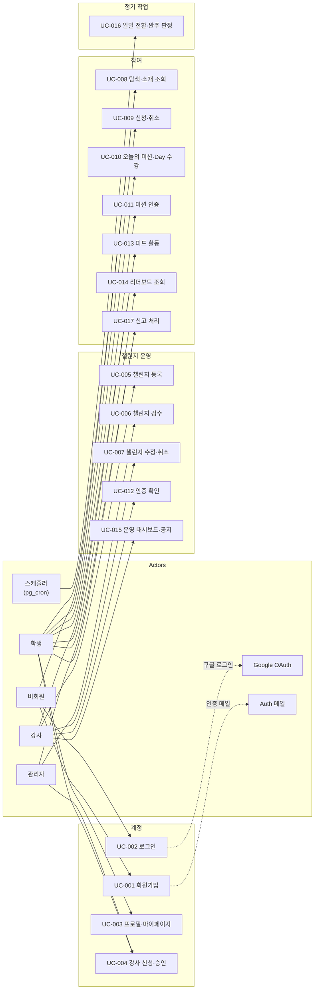
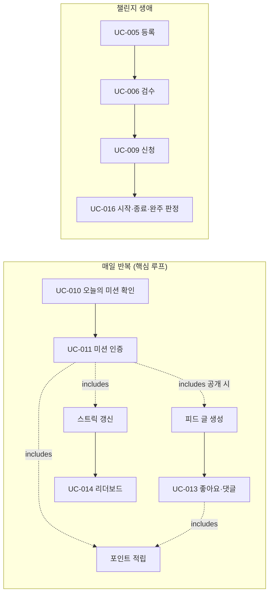
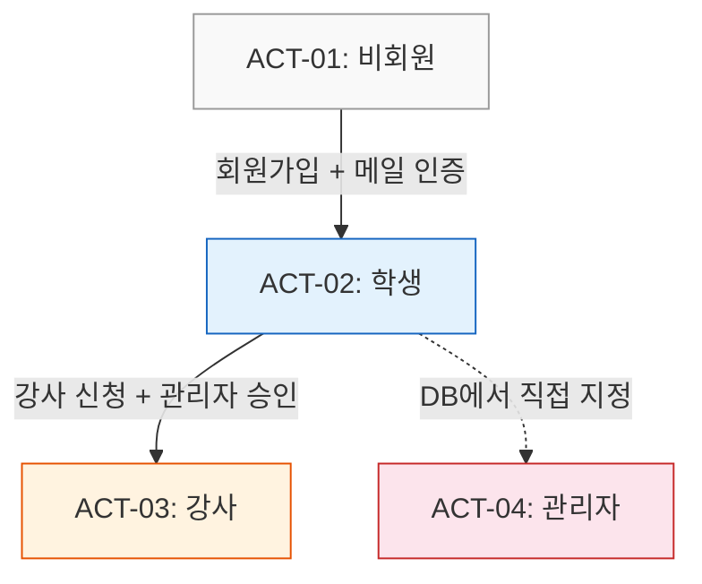

# 유스케이스 명세서

> Use Case Specification
>
> 작성 근거: [SRS](요구사항명세서-SRS.md) SRS-CHUP-v0.1, [비즈니스 정책서](../00-기획/비즈니스정책서.md) BPD-CHUP-v0.2. 규칙 값은 정책서를 따르며, 여기서는 흐름과 분기만 기술한다. 테스트 케이스는 아직 작성 전이므로 "관련 요구사항 ID" 표의 테스트케이스 칸은 "미작성"으로 둔다.

---

## 문서 정보

| 항목 | 내용 |
|------|------|
| 프로젝트명 | 챌린지업 (ChallengeUp) — 온라인 강의 챌린지 플랫폼 |
| 문서 번호 | UCS-CHUP-v0.2 |
| 버전 | 0.2 |
| 작성일 | 2026-11-24 |
| 작성자 | Claude Code (초안) |

---

## 변경 이력

| 버전 | 날짜 | 변경 내용 | 작성자 | 승인자 |
|------|------|-----------|--------|--------|
| 0.1 | 2026-11-24 | SRS v0.1 기반 초안 작성 | Claude Code | - |
| 0.2 | 2026-11-25 | 조기 인증 기준 표기, 리더보드 동점 기준, 화면 문구 해요체 통일 | Claude Code | - |

---

## 목차

1. [유스케이스 다이어그램](#1-유스케이스-다이어그램)
2. [액터 정의](#2-액터-정의)
3. [유스케이스 목록](#3-유스케이스-목록)
4. [유스케이스 상세 명세](#4-유스케이스-상세-명세)

---

## 1. 유스케이스 다이어그램

### 1.1 전체 시스템 유스케이스 다이어그램

### 1.2 기능 영역별 유스케이스 다이어그램

---

## 2. 액터 정의

### 2.1 주요 액터 (Primary Actors)

| Actor ID | 이름 | 설명 | 권한 수준 | 인증 여부 |
|----------|------|------|-----------|-----------|
| ACT-01 | 비회원 | 로그인하지 않은 방문자. 탐색·소개 페이지, 가입·로그인 | Level 0 | 미인증 |
| ACT-02 | 학생 | 가입한 기본 역할. 신청·수강·인증·피드·신고 | Level 1 | 인증됨 |
| ACT-03 | 강사 | 강사 승인을 받은 사용자. 학생 권한 + 자기 챌린지 등록·운영 | Level 2 | 인증됨 |
| ACT-04 | 관리자 | 검수, 강사 승인, 신고 처리 | Level 3 | 인증됨 |
| ACT-05 | 스케줄러 | 매일 00:00·00:10 KST 정기 작업 (pg_cron) | 시스템 | 서버 내부 |

### 2.2 보조 액터 (Secondary Actors)

| Actor ID | 이름 | 설명 | 연동 방식 |
|----------|------|------|-----------|
| ACT-S01 | Google OAuth | 구글 로그인 | OAuth 2.0 (Supabase Auth) |
| ACT-S02 | Auth 메일 | 가입 인증·비밀번호 재설정 메일 | Supabase Auth 내장 |
| ACT-S03 | 파일 스토리지 | 썸네일·프로필·인증 사진 | Supabase Storage |
| ACT-S04 | 영상 플랫폼 | 강의 영상 재생 | YouTube·Vimeo iframe |

### 2.3 액터 계층 구조

> 강사는 학생의 모든 권한을 포함한다(단, 자기 챌린지에는 신청·인증할 수 없다). 관리자는 학생 권한과 관리 권한을 가지며, 강사 권한(챌린지 등록)은 따로 받지 않으면 없다.

---

## 3. 유스케이스 목록

| UC-ID | 유스케이스명 | 주요 액터 | 우선순위 | 상태 | 관련 FR |
|-------|-------------|-----------|----------|------|---------|
| UC-001 | 회원가입 | 비회원 | P1 필수 | 초안 | FR-001, FR-004 |
| UC-002 | 로그인·로그아웃 | 비회원, 학생 | P1 필수 | 초안 | FR-002 |
| UC-003 | 프로필·마이페이지 관리 | 학생 | P1 필수 (마이페이지 P2) | 초안 | FR-003, FR-022 |
| UC-004 | 강사 신청·승인 | 학생, 관리자 | P1 필수 | 초안 | FR-005 |
| UC-005 | 챌린지 등록 | 강사 | P1 필수 | 초안 | FR-006 |
| UC-006 | 챌린지 검수 | 관리자 | P1 필수 | 초안 | FR-007 |
| UC-007 | 챌린지 수정·취소 | 강사 | P1 필수 | 초안 | FR-009 |
| UC-008 | 챌린지 탐색·소개 조회 | 모든 사용자 | P1 필수 | 초안 | FR-010, FR-011 |
| UC-009 | 챌린지 신청·취소 | 학생 | P1 필수 (취소 P2) | 초안 | FR-012 |
| UC-010 | 오늘의 미션 확인·Day 수강 | 학생 | P1 필수 | 초안 | FR-013, FR-014 |
| UC-011 | 미션 인증 | 학생 | P1 필수 | 초안 | FR-015, FR-018, FR-019 |
| UC-012 | 인증 확인 (강사 확인 방식) | 강사 | P2 권장 | 초안 | FR-016 |
| UC-013 | 피드 활동 | 학생, 강사 | P1 필수 | 초안 | FR-017, FR-018 |
| UC-014 | 리더보드 조회 | 학생, 강사 | P1 필수 | 초안 | FR-019 |
| UC-015 | 운영 대시보드 확인·공지 | 강사 | P1 필수 | 초안 | FR-021, FR-017 |
| UC-016 | 일일 상태 전환·완주 판정 | 스케줄러 | P1 필수 | 초안 | FR-008, FR-019, FR-020 |
| UC-017 | 신고 처리 | 학생, 관리자 | P3 선택 | 초안 | FR-023 |

**상태 정의:**

| 상태 | 설명 |
|------|------|
| 초안 | 최초 작성, 검토 필요 |
| 검토중 | 이해관계자 검토 진행 중 |
| 완료 | 검토 완료 및 승인됨 |
| 변경중 | 승인 후 변경 사항 발생 |

---

## 4. 유스케이스 상세 명세

---

### 4.1 UC-001: 회원가입

| 항목 | 내용 |
|------|------|
| **UC-ID** | UC-001 |
| **유스케이스명** | 회원가입 |
| **액터** | 비회원, Auth 메일 (Secondary) |
| **설명** | 비회원이 이메일·비밀번호·이름을 입력하고 약관에 동의해 가입한다. 인증 메일 링크를 눌러 학생으로 이용을 시작한다 |
| **우선순위** | P1 필수 |
| **트리거** | 사용자가 회원가입 화면에 들어오거나, 소개 페이지에서 "로그인하고 신청하기"를 눌러 가입을 고른다 |
| **관련 요구사항** | FR-001, FR-004 |

#### 사전 조건 (Pre-conditions)

1. 사용자는 로그인하지 않은 상태이다.
2. 사용자는 메일을 받을 수 있는 이메일 주소가 있다.

#### 기본 흐름 (Main Flow)

| 단계 | 액터 | 시스템 |
|------|------|--------|
| 1 | 회원가입 화면에 들어온다 | 이메일·비밀번호·비밀번호 확인·이름 입력란과 필수 동의 2개를 표시한다 |
| 2 | 항목을 입력한다 | 비밀번호 규칙(8~72자, 영문+숫자)과 일치 여부를 입력 중에 표시한다 |
| 3 | 필수 동의에 체크하고 [가입하기]를 누른다 | - |
| 4 | - | 입력값을 검증한다 |
| 5 | - | Supabase Auth에 계정을 만들고, 프로필(역할 학생, 동의 시각)을 만든다 |
| 6 | - | 인증 메일을 보내고 "인증 메일을 보냈어요. 메일의 링크를 누르면 가입이 끝나요" 화면을 표시한다 |
| 7 | 메일의 인증 링크를 누른다 | 링크를 확인하고 로그인 상태로 만든다 |
| 8 | - | 가입 전에 보던 소개 페이지(없으면 탐색 화면)로 이동한다 |

#### 대안 흐름 (Alternative Flow)

**AF-001-01: 인증 메일 재발송**

- 분기 시점: 단계 6 이후
- 사용자가 [인증 메일 다시 보내기]를 누른다. 시스템은 Supabase Auth의 재발송 제한 안에서 다시 보낸다.

**AF-001-02: 구글로 가입**

- 분기 시점: 단계 1
- 사용자가 [구글로 계속하기]를 누르면 UC-002 AF-002-01로 이동한다 (P2).

#### 예외 흐름 (Exception Flow)

**EF-001-01: 이메일 중복**

- 분기 시점: 단계 5
- 조건: 이미 가입된 이메일이다.
- 시스템은 "이미 가입한 이메일이에요. 로그인하거나 비밀번호를 찾아 주세요"와 로그인·비밀번호 재설정 링크를 표시한다. 유스케이스 종료.

**EF-001-02: 유효성 실패**

- 분기 시점: 단계 4
- 조건: 비밀번호 규칙 위반, 이름 길이 위반, 동의 누락 등.
- 시스템은 항목별 오류를 표시하고 단계 3으로 돌아간다.

**EF-001-03: 인증 링크 만료**

- 분기 시점: 단계 7
- 조건: 링크를 받은 지 24시간이 지났다.
- 시스템은 "인증 링크가 만료됐어요. 새 링크를 받아 주세요"와 재발송 버튼을 표시한다.

#### 사후 조건 (Post-conditions)

**성공 시:** Auth 계정과 프로필(역할 학생)이 있고, 사용자는 로그인 상태다.

**실패 시:** 계정이 만들어지지 않았거나, 인증 전 상태로 남아 로그인할 수 없다.

#### 비즈니스 규칙

| 규칙 ID | 내용 |
|---------|------|
| BP-AUTH-001-1 | 이메일은 고유하다 |
| BP-AUTH-001-2 | 비밀번호 8~72자, 영문·숫자 각 1자 이상 |
| BP-AUTH-001-3 | 인증 메일 링크를 눌러야 로그인할 수 있다 (유효 24시간) — 미결 ISSUE-01 |
| BP-AUTH-001-4 | 이름 2~20자 필수 |
| BP-AUTH-001-6 | 이용약관·개인정보 수집 동의 필수 |

#### UI 참조

| 화면 ID | 화면명 | 설명 |
|---------|--------|------|
| SCR-02 | 회원가입 | 입력 폼, 동의 |
| SCR-02 | 인증 메일 안내 | 재발송 버튼 |

#### 관련 요구사항 ID (RTM)

| 요구사항 ID | 설계 문서 | 테스트케이스 |
|------------|----------|-------------|
| FR-001 | DDS 5.1 AuthModule | 미작성 |
| NFR-004 | DDS 5.1, 7.5 | 미작성 |
| NFR-014 | DDS 5.1 | 미작성 |

---

### 4.2 UC-002: 로그인·로그아웃

| 항목 | 내용 |
|------|------|
| **UC-ID** | UC-002 |
| **유스케이스명** | 로그인·로그아웃 |
| **액터** | 비회원, 학생, Google OAuth (Secondary) |
| **설명** | 이메일·비밀번호 또는 구글 계정으로 로그인하고, 로그아웃한다. 비밀번호를 잊으면 재설정한다 |
| **우선순위** | P1 필수 (구글 로그인 P2) |
| **트리거** | 로그인 화면 진입, 또는 로그인이 필요한 행동(신청 등) 시도 |
| **관련 요구사항** | FR-002 |

#### 사전 조건 (Pre-conditions)

1. 인증된 계정이 있다 (구글 로그인은 계정이 없어도 된다).

#### 기본 흐름 (Main Flow)

| 단계 | 액터 | 시스템 |
|------|------|--------|
| 1 | 로그인 화면에서 이메일·비밀번호를 입력하고 [로그인]을 누른다 | - |
| 2 | - | Supabase Auth로 인증하고 세션 쿠키를 저장한다 |
| 3 | - | 로그인 전에 가려던 페이지(없으면 탐색 화면)로 이동한다 |
| 4 | 상단 프로필 메뉴에서 [로그아웃]을 누른다 | 세션 쿠키를 지우고 탐색 화면으로 이동한다 |

#### 대안 흐름 (Alternative Flow)

**AF-002-01: 구글 로그인 (P2)**

- 분기 시점: 단계 1
- 사용자가 [구글로 계속하기]를 누르고 구글 인증을 마친다.
- 같은 이메일 계정이 있으면 그 계정으로 로그인한다. 없으면 필수 동의 화면을 보여 주고 동의하면 프로필을 만든다.
- 단계 3으로 이동한다.

**AF-002-02: 비밀번호 재설정**

- 분기 시점: 단계 1
- [비밀번호를 잊으셨나요?] → 이메일 입력 → 재설정 메일(링크 1시간 유효) → 새 비밀번호 입력 → 로그인 상태로 탐색 화면.

#### 예외 흐름 (Exception Flow)

**EF-002-01: 인증 실패**

- 분기 시점: 단계 2 / 조건: 이메일 또는 비밀번호 불일치
- "이메일이나 비밀번호가 맞지 않아요"를 표시하고 단계 1로 돌아간다.

**EF-002-02: 메일 미인증**

- 분기 시점: 단계 2 / 조건: 인증 메일 링크를 누르지 않음
- "메일함에서 인증 링크를 눌러 주세요"와 재발송 버튼을 표시한다.

**EF-002-03: 요청 과다**

- 분기 시점: 단계 2 / 조건: Supabase Auth 요청 제한 초과
- "잠깐 뒤에 다시 해 주세요"를 표시한다.

#### 사후 조건 (Post-conditions)

**성공 시:** 세션이 유지되어 새로고침해도 로그인 상태다 / 로그아웃 후에는 로그인 전용 화면에 들어갈 수 없다.

**실패 시:** 로그인되지 않은 상태로 남는다.

#### 비즈니스 규칙

| 규칙 ID | 내용 |
|---------|------|
| BP-AUTH-002-1 | 실패 사유를 구분하지 않는다 |
| BP-AUTH-002-2 | 반복 시도는 Supabase 기본 제한 (자체 잠금 미결 ISSUE-02) |
| BP-AUTH-002-4 | 여러 기기 동시 로그인 허용 |
| BP-AUTH-002-5 | 재설정 링크 1시간 |
| BP-AUTH-001-5 | 같은 이메일의 구글 계정은 기존 계정에 연결 |

#### UI 참조

| 화면 ID | 화면명 | 설명 |
|---------|--------|------|
| SCR-02 | 로그인 / 비밀번호 재설정 | |

#### 관련 요구사항 ID (RTM)

| 요구사항 ID | 설계 문서 | 테스트케이스 |
|------------|----------|-------------|
| FR-002 | DDS 3.1, 5.1 | 미작성 |
| NFR-004 | DDS 5.1 | 미작성 |

---

### 4.3 UC-003: 프로필·마이페이지 관리

| 항목 | 내용 |
|------|------|
| **UC-ID** | UC-003 |
| **유스케이스명** | 프로필·마이페이지 관리 |
| **액터** | 학생 (강사 포함) |
| **설명** | 이름·사진·한 줄 소개를 고치고, 마이페이지에서 내 챌린지·포인트·레벨·스트릭·완주 배지를 본다 |
| **우선순위** | P1 필수 (마이페이지 P2, 완주 배지 P3) |
| **트리거** | 상단 프로필 메뉴에서 [마이페이지] 또는 [프로필 수정] |
| **관련 요구사항** | FR-003, FR-022 |

**사전 조건 (Pre-conditions):**

1. 로그인 상태이다.

**기본 흐름 (Main Flow):**

| 단계 | 액터 | 시스템 |
|------|------|--------|
| 1 | [마이페이지]를 연다 | 프로필, 레벨·다음 레벨까지 남은 점수, 현재·최장 스트릭, 완주 배지 수, 내 챌린지 탭(진행 중 / 시작 전 / 끝난 챌린지)을 표시한다 |
| 2 | [프로필 수정]을 누른다 | 이름·사진·한 줄 소개 입력 화면을 표시한다 |
| 3 | 값을 고치고 사진을 고른다 | 사진 형식·용량을 바로 검사한다 |
| 4 | [저장]을 누른다 | 사진을 Storage에 올리고 프로필을 저장한 뒤 "저장했어요"를 표시한다 |

**대안 흐름 (Alternative Flow):**

- **AF-003-01: 시작 전 챌린지 취소**
  - 분기 시점: 단계 1의 "시작 전" 탭
  - [신청 취소]를 누르면 UC-009 AF-009-01로 이동한다.

**예외 흐름 (Exception Flow):**

- **EF-003-01: 사진 형식·용량 오류**
  - 분기 시점: 단계 3 / 조건: 5MB 초과 또는 jpg·png·webp 아님
  - "5MB 이하의 jpg, png, webp 사진을 올려 주세요". 기존 사진 유지.
- **EF-003-02: 이름 길이 오류**
  - 분기 시점: 단계 4 / 조건: 2자 미만 또는 20자 초과
  - 항목 오류를 표시하고 저장하지 않는다.

**사후 조건 (Post-conditions):**

- 성공 시: 새 프로필이 피드·리더보드·멤버 목록에 반영된다.
- 실패 시: 기존 프로필이 유지된다.

**비즈니스 규칙:**

| 규칙 ID | 내용 |
|---------|------|
| BP-AUTH-001-4 | 이름 2~20자, 한 줄 소개 최대 60자 |
| BP-POINT-002-1 | 레벨은 플랫폼 전체 누적 포인트 |
| BP-POINT-005-5 | 진행 중 중 가장 긴 현재 스트릭과 최장 스트릭 표시 |
| BP-DONE-002-2 | 완주 배지 표시 |
| BP-AUTH-005-1 | 탈퇴는 고객 문의로 접수 (마이페이지에 안내만) |

**UI 참조:**

| 화면 ID | 화면명 | 설명 |
|---------|--------|------|
| SCR-09 | 마이페이지 / 프로필 수정 | |

**관련 요구사항 ID (RTM):**

| 요구사항 ID | 설계 문서 | 테스트케이스 |
|------------|----------|-------------|
| FR-003 | DDS 5.1 ProfileModule | 미작성 |
| FR-022 | DDS 5.1, 5.7 | 미작성 |

---

### 4.4 UC-004: 강사 신청·승인

| 항목 | 내용 |
|------|------|
| **UC-ID** | UC-004 |
| **유스케이스명** | 강사 신청·승인 |
| **액터** | 학생 (신청), 관리자 (처리) |
| **설명** | 학생이 강사를 신청하고, 관리자가 승인하면 역할이 강사로 바뀐다 |
| **우선순위** | P1 필수 |
| **트리거** | 학생이 마이페이지 또는 강사 스튜디오 안내 화면에서 [강사 신청]을 누른다 |
| **관련 요구사항** | FR-005 |

**사전 조건 (Pre-conditions):**

1. 신청자는 학생 역할이며 대기 중 신청이 없다.
2. 마지막 반려일로부터 7일이 지났다 (반려 이력이 있는 경우).

**기본 흐름 (Main Flow):**

| 단계 | 액터 | 시스템 |
|------|------|--------|
| 1 | 학생이 신청 사유(20~500자)와 소개 링크(선택)를 입력하고 [신청]을 누른다 | 조건을 확인하고 신청을 "대기"로 저장한다. "평일 기준 2일 안에 결과를 알려 드려요"를 표시한다 |
| 2 | 관리자가 강사 신청 목록을 연다 | 대기 신청을 신청 시각 순으로 표시한다 |
| 3 | 관리자가 신청 내용을 보고 [승인]을 누른다 | 신청 = 승인, 사용자 역할 = 강사로 한 트랜잭션에서 바꾸고 관리자 작업 로그를 남긴다 |
| 4 | 학생이 다음에 접속한다 | "강사로 승인됐어요" 배너를 1회 보여 주고 상단 메뉴에 "강사 스튜디오"를 표시한다 |

**대안 흐름 (Alternative Flow):**

- **AF-004-01: 반려**
  - 분기 시점: 단계 3
  - 관리자가 사유(10자 이상)를 입력하고 [반려]한다. 신청 = 반려, 사유 저장, 작업 로그.
  - 학생 다음 접속 때 사유와 "MM.DD부터 다시 신청할 수 있어요"를 1회 안내한다.

**예외 흐름 (Exception Flow):**

- **EF-004-01: 대기 중 신청 있음**
  - 분기 시점: 단계 1 / 조건: 처리되지 않은 신청이 있다
  - "이미 신청했어요. 결과가 나오면 알려 드릴게요". 유스케이스 종료.
- **EF-004-02: 재신청 제한**
  - 분기 시점: 단계 1 / 조건: 반려 후 7일 미경과
  - "MM.DD부터 다시 신청할 수 있어요". 유스케이스 종료.
- **EF-004-03: 동시 처리**
  - 분기 시점: 단계 3 / 조건: 다른 관리자가 먼저 처리했다
  - "이미 처리된 항목이에요. 목록을 새로 불러왔어요"를 표시하고 목록을 새로 고친다.

**사후 조건 (Post-conditions):**

- 성공 시: 역할이 강사이고, 강사 스튜디오에 들어갈 수 있다.
- 실패 시: 역할은 학생으로 유지된다.

**비즈니스 규칙:**

| 규칙 ID | 내용 |
|---------|------|
| BP-AUTH-004-1 | 사유 20~500자, 소개 링크 선택 1개 |
| BP-AUTH-004-2 | 대기 중 신청이 있으면 재신청 불가 |
| BP-AUTH-004-3 | 반려 사유 필수, 7일 뒤 재신청 |
| BP-AUTH-004-4 | 2영업일 처리 목표 |
| BP-NOTI-001 | 결과는 다음 접속 시 화면 배너로 1회 |

**UI 참조:**

| 화면 ID | 화면명 | 설명 |
|---------|--------|------|
| SCR-10 | 강사 신청 | |
| SCR-14 | 관리자 · 강사 신청 | |

**관련 요구사항 ID (RTM):**

| 요구사항 ID | 설계 문서 | 테스트케이스 |
|------------|----------|-------------|
| FR-005 | DDS 4.4, 5.2 | 미작성 |
| NFR-006 | DDS 5.10 | 미작성 |

---

### 4.5 UC-005: 챌린지 등록

| 항목 | 내용 |
|------|------|
| **UC-ID** | UC-005 |
| **유스케이스명** | 챌린지 등록 (5단계) |
| **액터** | 강사 |
| **설명** | 강사가 기본 정보 → 일정 → 커리큘럼 → 운영 규칙 → 가격을 입력하고, 미리본 뒤 검수를 요청한다 |
| **우선순위** | P1 필수 |
| **트리거** | 강사 스튜디오에서 [새 챌린지]를 누른다 |
| **관련 요구사항** | FR-006 |

#### 사전 조건 (Pre-conditions)

1. 사용자 역할이 강사다.

#### 기본 흐름 (Main Flow)

| 단계 | 액터 | 시스템 |
|------|------|--------|
| 1 | [새 챌린지]를 누른다 | "작성 중" 챌린지를 만들고 ① 기본 정보 화면을 연다. 상단에 단계 표시(1/5) |
| 2 | 제목·한 줄 소개·소개글·카테고리·썸네일을 입력하고 [다음]을 누른다 | ①단계 필드를 검증하고 저장한다 |
| 3 | 시작일·기간·열림 방식을 입력하고 [다음]을 누른다 | 저장하고 Day 1~N 행을 만든다. 각 Day의 날짜를 함께 보여 준다 |
| 4 | Day마다 제목·미션 설명·인증 형식, 선택으로 영상·자료 링크를 입력한다 | Day별로 자동 저장한다. 미입력 Day 수를 표시한다 |
| 5 | [다음]을 누른다 | 저장하고 ④ 운영 규칙 화면을 연다 |
| 6 | 정원·완주 조건·인정 방식을 정하고 [다음]을 누른다 | 저장한다. 완주 조건 옆에 "21일 중 17일 인증하면 완주"를 계산해 보여 준다 |
| 7 | ⑤ 가격 화면을 확인한다 | 0원 고정과 MVP 무료 안내를 표시한다 |
| 8 | [미리보기]를 누른다 | 학생이 볼 소개 페이지를 강사 전용 모드로 보여 준다 |
| 9 | [검수 요청]을 누른다 | 전체 필드와 시작일 조건(요청일 + 3일 ~ + 90일)을 확인하고 상태를 "검수 대기"로 바꾼다 |
| 10 | - | 내 챌린지 목록에 "검수 대기"로 표시하고 "검수를 요청했어요. 2일 안에 결과를 알려 드릴게요"를 표시한다 |

#### 대안 흐름 (Alternative Flow)

**AF-005-01: Day 복사·순서 바꾸기**

- 분기 시점: 단계 4
- [이전 Day 복사]로 앞 Day 내용을 복사하거나, 드래그로 Day 순서를 바꾼다. 순서가 바뀌면 Day 번호와 날짜를 다시 매긴다.

**AF-005-02: 중간 저장 후 이어 쓰기**

- 분기 시점: 단계 2~7 중 어디서든
- 화면을 닫았다가 내 챌린지 목록에서 다시 열면 마지막으로 저장된 단계부터 이어서 입력한다.

**AF-005-03: 기간 줄이기**

- 분기 시점: 단계 3 (다시 수정 시)
- 기간을 줄이면 뒤쪽 Day가 지워진다. 지워질 Day에 내용이 있으면 "기간을 줄이면 Day 15~21에 쓴 내용이 지워져요. 줄일까요?"를 묻는다.

**AF-005-04: 검수 요청 취소**

- 분기 시점: 단계 10 이후
- [검수 요청 취소]를 누르면 작성 중으로 돌아가 수정할 수 있다.

#### 예외 흐름 (Exception Flow)

**EF-005-01: 단계 입력 오류**

- 분기 시점: 단계 2·3·6 / 조건: 길이·범위 위반, 썸네일 형식·용량 오류
- 항목별 오류를 표시하고 그 단계에 머문다.

**EF-005-02: 미입력 Day**

- 분기 시점: 단계 9 / 조건: 제목·미션 설명·인증 형식이 빠진 Day가 있다
- "Day 5, 12의 미션 설명을 입력해 주세요"를 표시하고 ③ 화면의 해당 Day로 이동한다.

**EF-005-03: 시작일 조건 위반**

- 분기 시점: 단계 9 / 조건: 시작일이 요청일 + 3일보다 이르거나 + 90일보다 늦다
- "시작일은 검수 요청일 3일 뒤부터 90일 안에서 골라 주세요"를 표시하고 ② 화면으로 이동한다.

**EF-005-04: 영상 링크 형식 오류**

- 분기 시점: 단계 4 / 조건: YouTube·Vimeo 주소가 아니다
- "YouTube나 Vimeo 영상 주소를 넣어 주세요".

#### 사후 조건 (Post-conditions)

**성공 시:** 챌린지 상태가 "검수 대기"이고 Day 1~N이 모두 채워져 있다. 강사 본인과 관리자만 볼 수 있다.

**실패 시:** 챌린지는 "작성 중"으로 남고, 저장된 단계까지의 내용이 유지된다.

#### 비즈니스 규칙

| 규칙 ID | 내용 |
|---------|------|
| BP-CHAL-002 | 등록 입력 제한 (제목 5~50자, 기간 7~60일, 정원 1~300명, 완주 조건 50~100% 등) |
| BP-CHAL-002 시작일 | 검수 요청일 + 3일 ~ + 90일 |
| BP-CHAL-001-3 | 작성 중은 강사 본인만, 검수 대기는 강사·관리자만 볼 수 있다 |
| BP-CONTENT-002-1 | 열림 방식 기본값 "매일 열림" |
| BP-PAY-001-1 | 가격 0원 고정 |
| BP-ERROR-002-4 | 단계를 넘어갈 때마다 서버에 임시 저장 |

#### UI 참조

| 화면 ID | 화면명 | 설명 |
|---------|--------|------|
| SCR-11 | 강사 스튜디오 · 내 챌린지 | 상태별 목록 |
| SCR-12 | 등록 5단계 | 단계 표시, 미리보기 |

#### 관련 요구사항 ID (RTM)

| 요구사항 ID | 설계 문서 | 테스트케이스 |
|------------|----------|-------------|
| FR-006 | DDS 4.1, 5.3 ChallengeModule | 미작성 |

---

### 4.6 UC-006: 챌린지 검수

| 항목 | 내용 |
|------|------|
| **UC-ID** | UC-006 |
| **유스케이스명** | 챌린지 검수 |
| **액터** | 관리자 |
| **설명** | 관리자가 검수 대기 챌린지를 확인하고 승인(모집 중 공개) 또는 반려(작성 중으로 되돌림)한다 |
| **우선순위** | P1 필수 |
| **트리거** | 관리자가 검수 목록을 연다 |
| **관련 요구사항** | FR-007 |

**사전 조건 (Pre-conditions):**

1. 관리자로 로그인했다.
2. 검수 대기 챌린지가 있다.

**기본 흐름 (Main Flow):**

| 단계 | 액터 | 시스템 |
|------|------|--------|
| 1 | 검수 목록을 연다 | 검수 대기 챌린지를 요청 시각 순으로, 시작일까지 남은 날과 함께 표시한다 |
| 2 | 챌린지를 연다 | 소개 페이지 미리보기와 Day 1~N 전체 내용(영상 링크 포함)을 표시한다 |
| 3 | [승인]을 누른다 | 상태 = 모집 중, 공개 시각 기록, 작업 로그를 남긴다 |
| 4 | - | 목록에서 빼고 "공개했어요"를 표시한다. 탐색 목록에 바로 나타난다 |

**대안 흐름 (Alternative Flow):**

- **AF-006-01: 반려**
  - 분기 시점: 단계 3
  - 사유 유형(정보 부족 / 부적절한 내용 / 저작권 의심 / 강의 링크 오류 / 기타)과 설명(10자 이상)을 입력하고 [반려]한다.
  - 상태 = 작성 중, 사유 저장, 작업 로그. 강사 스튜디오에 사유가 표시된다.

**예외 흐름 (Exception Flow):**

- **EF-006-01: 이미 처리됨**
  - 분기 시점: 단계 3 / 조건: 다른 관리자가 처리했거나 강사가 검수 요청을 취소했다
  - "이미 처리된 항목이에요. 목록을 새로 불러왔어요"를 표시하고 목록을 새로 고친다.
- **EF-006-02: 반려 사유 누락**
  - 분기 시점: AF-006-01 / 조건: 사유 유형 또는 설명이 없다
  - 항목 오류를 표시한다.

**사후 조건 (Post-conditions):**

- 성공 시: 승인 → 모집 중 공개 / 반려 → 작성 중, 사유 기록.
- 실패 시: 검수 대기 유지.

**비즈니스 규칙:**

| 규칙 ID | 내용 |
|---------|------|
| BP-CHAL-003-1 | 2영업일 안 처리 목표 |
| BP-CHAL-003-2 | 반려 사유 유형 + 설명 10자 이상 |
| BP-CHAL-003-3 | 반려 후 재검수 횟수 제한 없음 |
| BP-CHAL-003-4 | 시작일 전날까지 미처리 시 자동 반려 (UC-016) |

**UI 참조:**

| 화면 ID | 화면명 | 설명 |
|---------|--------|------|
| SCR-14 | 관리자 · 검수 | |

**관련 요구사항 ID (RTM):**

| 요구사항 ID | 설계 문서 | 테스트케이스 |
|------------|----------|-------------|
| FR-007 | DDS 4.1, 5.3 | 미작성 |
| NFR-006 | DDS 5.10 | 미작성 |

---

### 4.7 UC-007: 챌린지 수정·취소

| 항목 | 내용 |
|------|------|
| **UC-ID** | UC-007 |
| **유스케이스명** | 챌린지 수정·취소 |
| **액터** | 강사 |
| **설명** | 공개된 챌린지에서 상태별로 허용된 항목만 고치고, 모집 중이면 사유를 남겨 취소한다 |
| **우선순위** | P1 필수 |
| **트리거** | 강사 스튜디오에서 챌린지의 [수정] 또는 [챌린지 취소] |
| **관련 요구사항** | FR-009 |

**사전 조건 (Pre-conditions):**

1. 강사 본인의 챌린지이며 상태가 작성 중·모집 중·진행 중 중 하나다.

**기본 흐름 (Main Flow):**

| 단계 | 액터 | 시스템 |
|------|------|--------|
| 1 | [수정]을 누른다 | 등록 5단계 화면을 열고, 현재 상태에서 바꿀 수 없는 항목을 비활성화하며 이유("모집 중에는 기간을 바꿀 수 없어요. 신청한 사람에게 안내한 조건이라서예요")를 표시한다 |
| 2 | 허용된 항목(예: 소개글, 아직 열리지 않은 Day의 미션 설명, 강의 링크)을 고친다 | - |
| 3 | [저장]을 누른다 | 바뀐 필드가 허용 범위인지 서버에서 다시 확인하고 저장한다 |
| 4 | - | "저장했어요". 학생 화면에 바로 반영된다 |

**대안 흐름 (Alternative Flow):**

- **AF-007-01: 정원 늘리기**
  - 분기 시점: 단계 2
  - 정원을 현재보다 큰 값으로 바꾼다. 남은 자리가 늘어난다.
- **AF-007-02: 챌린지 취소 (모집 중)**
  - 분기 시점: 단계 1 대신 [챌린지 취소]
  - 시스템이 "챌린지를 취소하면 신청한 N명에게 취소 안내가 보여요. 취소는 되돌릴 수 없어요"를 보여 주고 사유(10자 이상)를 받는다.
  - 상태 = 취소됨, 활성 신청 = 챌린지 취소. 신청자 다음 접속 때 배너로 안내한다.

**예외 흐름 (Exception Flow):**

- **EF-007-01: 허용되지 않은 필드**
  - 분기 시점: 단계 3 / 조건: 비활성 항목을 직접 요청으로 바꾸려 함, 또는 저장 사이에 Day가 열림
  - "지금은 ○○을(를) 바꿀 수 없어요. 신청한 사람에게 안내한 조건이라서예요", 변경 없음.
- **EF-007-02: 정원 줄이기**
  - 분기 시점: AF-007-01 / 조건: 현재 정원보다 작은 값
  - "정원은 늘릴 수만 있어요".
- **EF-007-03: 진행 중 취소**
  - 분기 시점: AF-007-02 / 조건: 상태가 진행 중
  - 취소 버튼이 없다. 직접 요청 시 "진행 중인 챌린지는 직접 취소할 수 없어요. 고객 문의로 알려 주시면 도와 드릴게요".

**사후 조건 (Post-conditions):**

- 성공 시: 허용된 항목만 바뀌었거나, 챌린지와 신청이 취소되었다.
- 실패 시: 변경 없음.

**비즈니스 규칙:**

| 규칙 ID | 내용 |
|---------|------|
| BP-CHAL-004 | 상태별 수정 가능 항목 표 |
| BP-CHAL-004-1 | 불가 항목은 화면·서버 모두 차단 |
| BP-CHAL-004-2 | 공개 후 수정은 재검수 없이 반영 |
| BP-CHAL-005-1·2 | 모집 중에만 취소, 사유 10자 이상, 신청 일괄 취소 |

**UI 참조:**

| 화면 ID | 화면명 | 설명 |
|---------|--------|------|
| SCR-11, SCR-12 | 내 챌린지, 등록·수정 | |

**관련 요구사항 ID (RTM):**

| 요구사항 ID | 설계 문서 | 테스트케이스 |
|------------|----------|-------------|
| FR-009 | DDS 4.1, 5.3 | 미작성 |

---

### 4.8 UC-008: 챌린지 탐색·소개 조회

| 항목 | 내용 |
|------|------|
| **UC-ID** | UC-008 |
| **유스케이스명** | 챌린지 탐색·소개 조회 |
| **액터** | 비회원, 학생, 강사 |
| **설명** | 탐색 화면에서 챌린지 카드를 보고, 소개 페이지에서 상세 정보와 커리큘럼 미리보기를 본다 |
| **우선순위** | P1 필수 (정렬·검색 P2) |
| **트리거** | 메인(`/`) 접속 |
| **관련 요구사항** | FR-010, FR-011 |

**사전 조건 (Pre-conditions):**

1. 없음 (비회원도 가능).

**기본 흐름 (Main Flow):**

| 단계 | 액터 | 시스템 |
|------|------|--------|
| 1 | 메인에 접속한다 | 로그인 상태면 오늘의 미션 카드(UC-010)를 위에, 그 아래 카테고리 칩과 모집 중·진행 중 챌린지 카드 12개를 표시한다 |
| 2 | 카테고리 칩을 누른다 | 해당 카테고리만 표시한다 |
| 3 | 카드를 누른다 | 소개 페이지를 표시한다: 기본 정보, 강사, 소개글, 완주 조건 문장, Day 제목 목록, 요약 카드(참여 인원/정원, 남은 자리, 시작까지 남은 날, 버튼) |
| 4 | 커리큘럼 Day 제목을 누른다 | "신청하면 Day별 강의와 미션을 볼 수 있어요"와 신청 버튼을 표시한다 |

**대안 흐름 (Alternative Flow):**

- **AF-008-01: 정렬·검색 (P2)**
  - 분기 시점: 단계 2
  - 정렬(인기순·마감 임박순·최신순)을 바꾸거나 검색어(제목·강사명)를 입력하면 목록을 다시 불러온다.
- **AF-008-02: 더 보기**
  - 분기 시점: 단계 1
  - 목록 끝의 [더 보기]로 12개씩 더 불러온다.
- **AF-008-03: 이미 신청한 사용자**
  - 분기 시점: 단계 3
  - 요약 카드 버튼이 "챌린지 홈으로"이다.

**예외 흐름 (Exception Flow):**

- **EF-008-01: 공개되지 않은 챌린지**
  - 분기 시점: 단계 3 / 조건: 작성 중·검수 대기, 또는 취소됨
  - 강사 본인·관리자가 아니면 404 화면.
- **EF-008-02: 결과 없음**
  - 분기 시점: 단계 2 / "조건에 맞는 챌린지를 찾지 못했어요. 필터를 바꿔 볼까요?".

**사후 조건 (Post-conditions):**

- 성공 시: 사용자가 챌린지 정보를 보고 신청 여부를 판단할 수 있다.

**비즈니스 규칙:**

| 규칙 ID | 내용 |
|---------|------|
| BP-CONTENT-001 | 비회원·미신청자는 Day 제목만 |
| BP-STAT-001 | 참여 인원 = 활성 신청 수, 남은 자리 = 정원 − 참여 인원 |
| BP-STAT-002-1 | 1,000 이상 약식 표시 |
| BP-STAT-002-3 | 완주율은 종료·판정된 챌린지에만 |

**UI 참조:**

| 화면 ID | 화면명 | 설명 |
|---------|--------|------|
| SCR-01 | 탐색 | DESIGN.md course-card |
| SCR-03 | 소개 | |

**관련 요구사항 ID (RTM):**

| 요구사항 ID | 설계 문서 | 테스트케이스 |
|------------|----------|-------------|
| FR-010 | DDS 5.3 | 미작성 |
| FR-011 | DDS 5.3 | 미작성 |
| NFR-001 | DDS 7.5 | 미작성 |

---

### 4.9 UC-009: 챌린지 신청·취소

| 항목 | 내용 |
|------|------|
| **UC-ID** | UC-009 |
| **유스케이스명** | 챌린지 신청·취소 |
| **액터** | 학생 (강사 포함) |
| **설명** | 모집 중인 챌린지에 무료로 신청하고, 시작 전에는 취소한다 |
| **우선순위** | P1 필수 (취소 P2) |
| **트리거** | 소개 페이지에서 [신청하기] |
| **관련 요구사항** | FR-012 |

#### 사전 조건 (Pre-conditions)

1. 로그인 상태이다 (아니면 로그인 후 소개 페이지로 돌아온다).
2. 챌린지가 모집 중이다.

#### 기본 흐름 (Main Flow)

| 단계 | 액터 | 시스템 |
|------|------|--------|
| 1 | [신청하기]를 누른다 | 버튼을 비활성화하고 `enroll_challenge` RPC를 호출한다 |
| 2 | - | 트랜잭션 안에서 챌린지 행을 잠그고 조건을 차례로 확인한다: 모집 중·모집 마감 전 → 본인 챌린지 아님 → 같은 챌린지 활성 신청 없음 → 내 활성 신청 5개 미만 → 참여 인원 < 정원 |
| 3 | - | 신청(활성)을 만든다 |
| 4 | - | 챌린지 홈으로 이동해 "MM.DD 시작"과 커리큘럼 제목을 보여 준다 |

#### 대안 흐름 (Alternative Flow)

**AF-009-01: 시작 전 취소 (P2)**

- 분기 시점: 신청 후 시작일 전날 23:59:59까지
- 마이페이지 또는 챌린지 홈에서 [신청 취소] → 확인 → 신청 = 취소, 남은 자리 +1. 소개 페이지로 이동한다.

**AF-009-02: 비회원 신청**

- 분기 시점: 단계 1
- 로그인·가입(UC-001·002)을 거쳐 소개 페이지로 돌아오고, 다시 [신청하기]를 누른다.

**AF-009-03: 취소 후 재신청**

- 분기 시점: AF-009-01 이후
- 모집 마감 전이고 자리가 있으면 기본 흐름으로 다시 신청할 수 있다.

#### 예외 흐름 (Exception Flow)

**EF-009-01: 정원 마감 (동시 신청 포함)**

- 분기 시점: 단계 2 / 조건: 참여 인원 = 정원 (다른 사용자가 먼저 저장)
- "정원이 다 찼어요. 비슷한 챌린지를 둘러볼까요?", 버튼을 "정원 마감"으로 바꾼다.

**EF-009-02: 중복 신청**

- 분기 시점: 단계 2 / "이미 신청한 챌린지예요" + 챌린지 홈 링크.

**EF-009-03: 동시 참여 초과**

- 분기 시점: 단계 2 / 조건: 활성 신청(모집 중 + 진행 중) 5개
- "챌린지는 동시에 5개까지 참여할 수 있어요. 진행 중인 챌린지가 끝나면 다시 신청할 수 있어요".

**EF-009-04: 모집 기간 아님**

- 분기 시점: 단계 2 / 조건: 모집 마감(시작일 전날 23:59:59) 지남, 진행 중, 종료, 취소됨
- "모집이 끝났어요. 지금 모집 중인 챌린지를 둘러볼까요?".

**EF-009-05: 본인 챌린지**

- 분기 시점: 단계 2 / 조건: 강사 본인 / 버튼은 "운영 대시보드로". 직접 요청 시 거절.

**EF-009-06: 시작 후 취소 시도**

- 분기 시점: AF-009-01 / 조건: 시작일 00:00 이후 / "챌린지가 시작돼서 신청을 취소할 수 없어요. 인증하지 않은 Day는 미완주로 기록돼요".

#### 사후 조건 (Post-conditions)

**성공 시:** 활성 신청이 1건 생기고 참여 인원이 1 늘었다 / 취소 시 신청 상태 = 취소, 참여 인원 −1.

**실패 시:** 신청이 만들어지지 않았다. 참여 인원은 정원을 넘지 않는다.

#### 비즈니스 규칙

| 규칙 ID | 내용 |
|---------|------|
| BP-ENR-001-1~6 | 로그인, 모집 중·마감 전, 중복 불가, 본인 챌린지 불가, 동시 5개, 정원·동시 요청 처리 |
| BP-ENR-002-1~3 | 시작 전날 23:59:59까지 취소, 자리 반환, 재신청 가능 |
| BP-ERROR-003-1 | 서버 수신 시각 기준 |

#### UI 참조

| 화면 ID | 화면명 | 설명 |
|---------|--------|------|
| SCR-03 | 소개 · 요약 카드 | 버튼 상태 |
| SCR-09 | 마이페이지 · 시작 전 | 취소 |

#### 관련 요구사항 ID (RTM)

| 요구사항 ID | 설계 문서 | 테스트케이스 |
|------------|----------|-------------|
| FR-012 | DDS 3.2, 4.2, 5.4 EnrollmentModule | 미작성 |
| NFR-012 | DDS 5.5 | 미작성 |

---

### 4.10 UC-010: 오늘의 미션 확인·Day 수강

| 항목 | 내용 |
|------|------|
| **UC-ID** | UC-010 |
| **유스케이스명** | 오늘의 미션 확인·Day 수강 |
| **액터** | 학생, 영상 플랫폼 (Secondary) |
| **설명** | 첫 화면에서 오늘의 미션 카드를 보고, 커리큘럼에서 열린 Day의 강의를 본다 |
| **우선순위** | P1 필수 |
| **트리거** | 로그인 후 메인 접속, 또는 챌린지 홈의 커리큘럼 탭 |
| **관련 요구사항** | FR-013, FR-014 |

**사전 조건 (Pre-conditions):**

1. 진행 중(또는 종료된) 챌린지의 활성 신청자다.

**기본 흐름 (Main Flow):**

| 단계 | 액터 | 시스템 |
|------|------|--------|
| 1 | 메인에 접속한다 | 진행 중 챌린지마다 "Day 7 / 21 · Day 제목 · 마감 23:59 (한국 시간) · 내 상태" 카드를 미인증 우선으로 표시한다 |
| 2 | 카드의 [미션하러 가기]를 누른다 | 오늘 Day 상세를 연다: 영상 플레이어(임베드), 자료 링크, 미션 설명, 인증 영역 |
| 3 | 강의를 본다 | - |
| 4 | 인증하러 간다 | UC-011로 이어진다 |

**대안 흐름 (Alternative Flow):**

- **AF-010-01: 커리큘럼에서 지난 Day 보기**
  - 분기 시점: 단계 2 대신 챌린지 홈 → 커리큘럼
  - Day 목록(잠김 / 진행 가능 / 완료 ✔ / 대기 / 반려 / 놓침)에서 열린 Day를 골라 본다. 마감이 지난 Day는 인증 영역에 "인증 마감이 지났어요"를 표시한다.
- **AF-010-02: 전부 열림 챌린지**
  - 분기 시점: AF-010-01
  - 모든 Day가 열려 있어 미래 Day도 보고 미리 인증할 수 있다 (UC-011).
- **AF-010-03: 진행 중 챌린지 없음**
  - 분기 시점: 단계 1
  - 카드 대신 "아직 참여한 챌린지가 없어요. 이번 주에 시작하는 챌린지를 둘러볼까요?" + 탐색 버튼. 시작 전 챌린지가 있으면 "MM.DD 시작" 안내.
- **AF-010-04: 종료된 챌린지**
  - 분기 시점: AF-010-01
  - 모든 Day 내용을 볼 수 있고 인증 영역은 "챌린지가 끝났어요. 강의와 미션은 계속 볼 수 있어요".

**예외 흐름 (Exception Flow):**

- **EF-010-01: 잠긴 Day 접근**
  - 분기 시점: AF-010-01 / 조건: 아직 열리지 않은 Day를 주소로 직접 연다
  - "MM.DD(요일) 00:00에 열려요", 내용 미노출.
- **EF-010-02: 영상 재생 불가**
  - 분기 시점: 단계 3 / 조건: 영상이 삭제·비공개됨
  - 플레이어 자리에 "영상을 불러오지 못했어요. 피드에 질문 글로 강사에게 알려 주세요"를 표시한다.

**사후 조건 (Post-conditions):**

- 성공 시: 학생이 오늘 할 일과 마감을 알고 강의를 봤다. (시청 여부는 기록하지 않는다)

**비즈니스 규칙:**

| 규칙 ID | 내용 |
|---------|------|
| BP-CONTENT-002-1~6 | 열림 방식, Day N 날짜 00:00 열림, 잠금 표시, 종료 후 열람 가능 |
| BP-NOTI-001 | 오늘의 미션은 화면 안내 카드 |
| BP-RESET-001-1 | KST 기준 |

**UI 참조:**

| 화면 ID | 화면명 | 설명 |
|---------|--------|------|
| SCR-01 | 탐색 + 오늘의 미션 | |
| SCR-05, SCR-06 | 커리큘럼, Day 상세 | |

**관련 요구사항 ID (RTM):**

| 요구사항 ID | 설계 문서 | 테스트케이스 |
|------------|----------|-------------|
| FR-013 | DDS 5.5 CurriculumModule | 미작성 |
| FR-014 | DDS 5.5 | 미작성 |

---

### 4.11 UC-011: 미션 인증

| 항목 | 내용 |
|------|------|
| **UC-ID** | UC-011 |
| **유스케이스명** | 미션 인증 |
| **액터** | 학생, 파일 스토리지 (Secondary) |
| **설명** | 열린 Day에 마감 전까지 강사가 정한 형식으로 인증을 제출하고, 필요하면 수정·삭제한다. 제출하면 포인트·스트릭·피드가 함께 갱신된다 |
| **우선순위** | P1 필수 (수정·삭제 P2) |
| **트리거** | Day 상세의 [인증하기] |
| **관련 요구사항** | FR-015, FR-018, FR-019, FR-017 |

#### 사전 조건 (Pre-conditions)

1. 진행 중 챌린지의 활성 신청자다 (강사·관리자 아님).
2. Day가 열려 있고 마감(Day 날짜 23:59:59 KST) 전이다.
3. 이 Day에 아직 인증이 없다.

#### 기본 흐름 (Main Flow)

| 단계 | 액터 | 시스템 |
|------|------|--------|
| 1 | [인증하기]를 누른다 | Day의 인증 형식(텍스트·사진·링크·체크)에 맞는 입력란과 공개 범위(기본 공개)를 표시한다. 기기에 임시 저장본이 있으면 불러올지 묻는다 |
| 2 | 내용을 입력한다 (사진이면 1~3장 선택) | 입력할 때마다 기기에 임시 저장한다. 사진은 고르는 즉시 Storage에 올리고 장마다 진행 상태를 표시한다 |
| 3 | [제출]을 누른다 (사진이 모두 올라간 뒤 활성화) | 버튼을 비활성화하고 `submit_mission` RPC를 호출한다 |
| 4 | - | 서버 수신 시각으로 마감·열림·중복·신청 상태를 확인한다 |
| 5 | - | 인증을 저장한다 (최초 제출 시각 기록, 자동 인정 챌린지는 "인정") |
| 6 | - | 공개면 같은 트랜잭션에서 피드 인증 글을 만든다 |
| 7 | - | 인정이면 포인트 로그(+10, 최초 제출이 21:00 이전이면 +5)를 남기고 스트릭과 연속 보상을 다시 계산한다 |
| 8 | - | 임시 저장본을 지우고 Day 상세에 내 인증과 "+15점 · 🔥 4일 연속"을 표시한다 |

#### 대안 흐름 (Alternative Flow)

**AF-011-01: 강사 확인 방식 챌린지**

- 분기 시점: 단계 5
- 상태를 "대기"로 저장하고 포인트는 적립하지 않는다(단계 7 생략). 화면에 "강사가 확인하고 있어요. 확인되면 점수가 들어와요"을 표시한다. 이후 UC-012.

**AF-011-02: 비공개 인증**

- 분기 시점: 단계 1에서 공개 범위 = 비공개
- 단계 6을 건너뛴다. 본인·강사·관리자만 볼 수 있다.

**AF-011-03: 마감 전 수정 (P2)**

- 분기 시점: 제출 후, 마감 전
- [수정] → 내용·공개 범위 변경 → 저장. 최초 제출 시각은 그대로다. 공개 → 비공개면 피드 글을 지우고, 비공개 → 공개면 만든다. 반려된 인증을 고치면 다시 "대기".

**AF-011-04: 마감 전 삭제 (P2)**

- 분기 시점: 제출 후, 마감 전
- [삭제] → 확인 → 인증·피드 글·사진 삭제, 받은 포인트 회수(음수 로그), 스트릭·연속 보상 재계산. 같은 Day에 다시 제출할 수 있다.

**AF-011-05: 전부 열림 챌린지에서 미리 인증**

- 분기 시점: 사전 조건 2
- 오늘 이후 Day도 열려 있으면 미리 인증할 수 있다. 마감은 각 Day 날짜 기준이다.

#### 예외 흐름 (Exception Flow)

**EF-011-01: 마감 지남**

- 분기 시점: 단계 4 / 조건: 서버 수신 시각 ≥ Day 날짜 다음 날 00:00:00 KST
- "아쉽지만 인증 마감(23:59)이 지났어요". 입력 내용은 기기에 남는다.

**EF-011-02: 이미 인증함 (다른 기기)**

- 분기 시점: 단계 4 / "이 Day는 이미 인증했어요. 내용을 고칠까요?" + [수정].

**EF-011-03: 사진 업로드 실패·용량 초과**

- 분기 시점: 단계 2 / 조건: 10MB 초과, 형식 오류, 네트워크 오류
- 해당 사진에 "올리지 못했어요 · 다시 올리기" 또는 용량 안내. 모든 사진이 올라가기 전에는 제출 불가.

**EF-011-04: 연결 끊김**

- 분기 시점: 단계 2~3 / 오프라인 배너, 제출 버튼 비활성, 입력 유지. 연결이 돌아오면 다시 제출할 수 있다. 제출 요청은 자동 재시도하지 않는다.

**EF-011-05: 형식 위반**

- 분기 시점: 단계 4 / 조건: 텍스트 10자 미만, 링크가 http(s) 아님 등 / 항목 오류.

**EF-011-06: 신청 상태 변경**

- 분기 시점: 단계 4 / 조건: 그사이 챌린지가 종료됨 / "챌린지가 끝났어요. 강의와 미션은 계속 볼 수 있어요".

#### 사후 조건 (Post-conditions)

**성공 시:** Day당 인증 1건, (공개면) 피드 글 1건, (인정이면) 포인트 로그와 갱신된 스트릭.

**실패 시:** 인증·피드 글·포인트 변화가 없다 (트랜잭션 전체 취소). 기기의 임시 저장본은 남는다.

#### 비즈니스 규칙

| 규칙 ID | 내용 |
|---------|------|
| BP-SUB-001 | 형식별 입력 제한 |
| BP-SUB-002-1~4 | 열린 Day·마감 전, Day당 1건, 지각 인증 없음, 공개·비공개 |
| BP-SUB-003-1~4 | 수정 시 최초 제출 시각 유지, 삭제 시 포인트 회수, 마감 후 수정·삭제 불가 |
| BP-SUB-004-1·2·5 | 자동 인정 / 강사 확인 대기, 인정 시점에 포인트 |
| BP-POINT-001 | +10, 조기 +5 (최초 제출이 Day 날짜 21:00:00 KST 전, 20:59:59.999까지) |
| BP-POINT-005-1~4 | 스트릭 계산 |
| BP-ERROR-002-1~3, BP-ERROR-003-1·2 | 임시 저장, 사진 업로드, 서버 수신 시각 |

#### UI 참조

| 화면 ID | 화면명 | 설명 |
|---------|--------|------|
| SCR-06 | Day 상세 + 인증 | 마감 5분 전 초 단위 카운트다운 |

#### 관련 요구사항 ID (RTM)

| 요구사항 ID | 설계 문서 | 테스트케이스 |
|------------|----------|-------------|
| FR-015 | DDS 3.3, 4.3, 5.6 SubmissionModule | 미작성 |
| FR-018 | DDS 5.8 PointModule | 미작성 |
| FR-019 | DDS 5.8 | 미작성 |
| NFR-005, NFR-012 | DDS 5.6, 5.5 | 미작성 |

---

### 4.12 UC-012: 인증 확인 (강사 확인 방식)

| 항목 | 내용 |
|------|------|
| **UC-ID** | UC-012 |
| **유스케이스명** | 인증 확인 |
| **액터** | 강사 |
| **설명** | 인정 방식이 "강사 확인"인 챌린지에서 대기 인증을 인정하거나 반려한다 |
| **우선순위** | P2 권장 |
| **트리거** | 대시보드 인증 목록에서 [대기] 필터 |
| **관련 요구사항** | FR-016 |

**사전 조건 (Pre-conditions):**

1. 강사 본인 챌린지이며 인정 방식이 강사 확인이다.
2. 완주 판정 전이다.

**기본 흐름 (Main Flow):**

| 단계 | 액터 | 시스템 |
|------|------|--------|
| 1 | 대기 인증 목록을 연다 | Day·제출 시각 순으로 인증 내용(텍스트·사진·링크)을 표시한다 |
| 2 | 인증을 보고 [인정]을 누른다 (피드백 선택) | `review_submission` RPC로 상태 = 인정, 포인트 적립(최초 제출 시각 기준 조기 보너스 포함), 스트릭 재계산 |
| 3 | - | 목록에서 빼고 다음 대기 인증을 보여 준다 |

**대안 흐름 (Alternative Flow):**

- **AF-012-01: 반려**
  - 분기 시점: 단계 2
  - 사유(5자 이상)를 입력하고 [반려]. 상태 = 반려. 학생 Day 상세와 커리큘럼에 사유가 표시된다.
  - 마감 전이면 학생이 고쳐 다시 제출할 수 있다(상태 대기). 마감 후 반려는 확정되고 스트릭을 다시 계산한다.

**예외 흐름 (Exception Flow):**

- **EF-012-01: 이미 처리됨·삭제됨**
  - 분기 시점: 단계 2 / "이미 처리했거나 학생이 지운 인증이에요. 목록을 새로 불러왔어요", 목록 새로 고침.
- **EF-012-02: 판정 완료**
  - 분기 시점: 단계 2 / 조건: 완주 판정이 끝났다 / "완주 판정이 끝나서 더는 바꿀 수 없어요".

**사후 조건 (Post-conditions):**

- 성공 시: 인증 상태가 인정 또는 반려이고, 포인트·스트릭이 그에 맞게 갱신되었다.

**비즈니스 규칙:**

| 규칙 ID | 내용 |
|---------|------|
| BP-SUB-004-2~5 | 대기 → 인정·반려, 반려 사유 5자 이상, 판정 전까지 처리, 인정 시 포인트 |
| BP-POINT-005-3·4 | 대기는 스트릭을 끊지 않음, 반려 확정 시 재계산 |

**UI 참조:**

| 화면 ID | 화면명 | 설명 |
|---------|--------|------|
| SCR-13 | 대시보드 · 인증 목록 | |

**관련 요구사항 ID (RTM):**

| 요구사항 ID | 설계 문서 | 테스트케이스 |
|------------|----------|-------------|
| FR-016 | DDS 4.3, 5.6 | 미작성 |

---

### 4.13 UC-013: 피드 활동

| 항목 | 내용 |
|------|------|
| **UC-ID** | UC-013 |
| **유스케이스명** | 피드 활동 |
| **액터** | 학생, 강사 |
| **설명** | 챌린지 피드에서 글을 보고 쓰며, 좋아요·댓글을 남긴다. 강사는 공지를 고정하고 글을 숨긴다 |
| **우선순위** | P1 필수 |
| **트리거** | 챌린지 홈의 피드 탭 |
| **관련 요구사항** | FR-017, FR-018 |

**사전 조건 (Pre-conditions):**

1. 해당 챌린지의 활성 신청자, 강사, 또는 관리자다.

**기본 흐름 (Main Flow):**

| 단계 | 액터 | 시스템 |
|------|------|--------|
| 1 | 피드 탭을 연다 | 고정 공지(최대 3개) → 나머지 글 최신순 20개. 인증 글에는 Day 배지 |
| 2 | 다른 사람 인증 글에 [좋아요]를 누른다 | 좋아요 수를 바로 +1 하고, 글 작성자에게 +1점 |
| 3 | 댓글(1~500자)을 쓴다 | 댓글 저장, 본인 글이 아니고 오늘 5개 미만이면 +2점 |
| 4 | [글쓰기]로 질문 글을 쓴다 (사진 최대 3장) | 저장하고 고정 공지 아래 맨 위에 표시한다 |

**대안 흐름 (Alternative Flow):**

- **AF-013-01: 좋아요 취소**
  - 분기 시점: 단계 2 이후 / 다시 누르면 취소, 작성자 −1점.
- **AF-013-02: 내 글·댓글 수정·삭제**
  - 수정하면 "수정됨" 표시. 댓글을 지우면 +2점 회수. 인증 글 삭제는 UC-011 AF-011-04를 따른다.
- **AF-013-03: 강사 공지 작성·고정**
  - 강사가 글 종류 "공지"로 작성하고 [고정]. 이미 3개면 "가장 오래된 '○○'의 고정을 풀까요?" 확인 후 교체.
- **AF-013-04: 강사 숨김**
  - 강사가 글·댓글의 [숨기기]. 작성자에게만 "숨겨진 글"로 보인다.
- **AF-013-05: 더 불러오기**
  - 스크롤 끝에서 다음 20개.

**예외 흐름 (Exception Flow):**

- **EF-013-01: 종료된 챌린지**
  - 조건: 챌린지 종료 / 글·댓글·좋아요 버튼이 없다. 직접 요청 시 "끝난 챌린지예요. 지난 글은 계속 볼 수 있어요".
- **EF-013-02: 학생의 공지 작성**
  - 조건: 학생이 공지 종류로 요청 / 403.
- **EF-013-03: 본인 좋아요**
  - 조건: 자기 글 / 좋아요는 되지만 포인트 0.

**사후 조건 (Post-conditions):**

- 성공 시: 글·댓글·좋아요가 저장되고 포인트 로그가 규칙대로 남았다.

**비즈니스 규칙:**

| 규칙 ID | 내용 |
|---------|------|
| BP-FEED-001-1~5 | 참여자 전용, 본문 1~2,000자, 대댓글 없음, 공지 고정 3개, 종료 시 읽기 전용 |
| BP-FEED-002-1~3 | 수정·삭제, 강사 숨김, "수정됨" |
| BP-POINT-001 | 좋아요 +1, 댓글 +2(하루 5개), 본인 제외 |
| BP-POINT-003 | 취소·삭제 시 회수 |

**UI 참조:**

| 화면 ID | 화면명 | 설명 |
|---------|--------|------|
| SCR-04 | 피드 | |

**관련 요구사항 ID (RTM):**

| 요구사항 ID | 설계 문서 | 테스트케이스 |
|------------|----------|-------------|
| FR-017 | DDS 5.7 FeedModule | 미작성 |
| FR-018 | DDS 5.8 | 미작성 |

---

### 4.14 UC-014: 리더보드 조회

| 항목 | 내용 |
|------|------|
| **UC-ID** | UC-014 |
| **유스케이스명** | 리더보드 조회 |
| **액터** | 학생, 강사 |
| **설명** | 챌린지별 7일·30일·전체 기간의 포인트 순위와 스트릭을 본다 |
| **우선순위** | P1 필수 |
| **트리거** | 챌린지 홈의 리더보드 탭 |
| **관련 요구사항** | FR-019 |

**사전 조건 (Pre-conditions):**

1. 해당 챌린지의 활성 신청자, 강사, 또는 관리자다.

**기본 흐름 (Main Flow):**

| 단계 | 액터 | 시스템 |
|------|------|--------|
| 1 | 리더보드 탭을 연다 | 기본 7일 탭. 내 순위 한 줄을 위에 고정하고, 순위·사진·이름·레벨·기간 포인트·현재 스트릭 🔥 목록을 표시한다 |
| 2 | 30일 또는 전체 탭을 누른다 | 해당 기간 합계로 다시 계산해 표시한다 |

**대안 흐름 (Alternative Flow):**

- **AF-014-01: 동점**
  - 같은 점수는 같은 순위(1, 1, 3). 같은 순위 안에서는 그 기간에 마지막으로 점수가 바뀐 시각이 이른 사람이 위.

**예외 흐름 (Exception Flow):**

- **EF-014-01: 참여자 0명** / "첫 참여자를 기다리고 있어요".

**사후 조건 (Post-conditions):**

- 조회만 하며 데이터는 바뀌지 않는다.

**비즈니스 규칙:**

| 규칙 ID | 내용 |
|---------|------|
| BP-POINT-004-1~5 | 챌린지별, 7일·30일 = 오늘 포함 최근 N일, 표시 항목, 동점 처리, 0점 표시 |
| BP-POINT-005 | 스트릭 |

**UI 참조:**

| 화면 ID | 화면명 | 설명 |
|---------|--------|------|
| SCR-07 | 리더보드 | |

**관련 요구사항 ID (RTM):**

| 요구사항 ID | 설계 문서 | 테스트케이스 |
|------------|----------|-------------|
| FR-019 | DDS 5.8 | 미작성 |
| NFR-009 | DDS 5.8 | 미작성 |

---

### 4.15 UC-015: 운영 대시보드 확인·공지

| 항목 | 내용 |
|------|------|
| **UC-ID** | UC-015 |
| **유스케이스명** | 운영 대시보드 확인·공지 |
| **액터** | 강사 |
| **설명** | 강사가 자기 챌린지의 지표와 이탈 위험 학생을 보고, 인증 목록을 확인하고, 공지를 올린다 |
| **우선순위** | P1 필수 |
| **트리거** | 강사 스튜디오에서 진행 중 챌린지를 연다 |
| **관련 요구사항** | FR-021, FR-017, FR-016 |

**사전 조건 (Pre-conditions):**

1. 강사 본인 챌린지다 (모집 중·진행 중·종료).

**기본 흐름 (Main Flow):**

| 단계 | 액터 | 시스템 |
|------|------|--------|
| 1 | 대시보드를 연다 | 참여 인원/정원, 오늘 인증 수·인증률, 평균 Day별 인증률, Day별 인증률 그래프를 표시한다 |
| 2 | 이탈 위험 학생 목록을 본다 | 마감 지난 최근 3개 Day에 인정 인증이 없는 참여자(이름, 마지막 인증 Day)를 표시한다 |
| 3 | [공지 쓰기]를 누른다 | 피드 공지 작성 화면(UC-013 AF-013-03)을 연다 |
| 4 | 공지를 쓰고 고정한다 | 피드 맨 위에 표시된다 |

**대안 흐름 (Alternative Flow):**

- **AF-015-01: 인증 목록 보기**
  - Day·상태로 거른 인증 목록(비공개 포함). 강사 확인 방식이면 UC-012로 이어진다.
- **AF-015-02: 종료 후 결과**
  - 완주 판정 후 완주자·미완주자 목록과 완주율을 표시한다. 판정 전이면 "완주 결과를 계산하고 있어요. 잠시 뒤에 다시 확인해 주세요".
- **AF-015-03: 모집 중**
  - 인증 지표 대신 참여 인원 추이와 시작까지 남은 날을 표시한다.

**예외 흐름 (Exception Flow):**

- **EF-015-01: 다른 강사의 챌린지** / 403.
- **EF-015-02: 참여자 0명** / 비율을 "-"로 표시.

**사후 조건 (Post-conditions):**

- 조회는 데이터를 바꾸지 않는다. 공지 작성 시 피드 글이 생긴다.

**비즈니스 규칙:**

| 규칙 ID | 내용 |
|---------|------|
| BP-STAT-001 | 오늘 인증 수(인정+대기), 오늘 인증률, Day별 인증률, 이탈 위험 학생 정의 |
| BP-STAT-002-2·4 | 반올림 정수 %, 0명이면 "-" |
| BP-DONE-002-3 | 종료 후 완주자 목록 |
| BP-FEED-001-4 | 공지 고정 3개 |

**UI 참조:**

| 화면 ID | 화면명 | 설명 |
|---------|--------|------|
| SCR-13 | 대시보드 | |

**관련 요구사항 ID (RTM):**

| 요구사항 ID | 설계 문서 | 테스트케이스 |
|------------|----------|-------------|
| FR-021 | DDS 5.9 DashboardModule | 미작성 |

---

### 4.16 UC-016: 일일 상태 전환·완주 판정

| 항목 | 내용 |
|------|------|
| **UC-ID** | UC-016 |
| **유스케이스명** | 일일 상태 전환·완주 판정 |
| **액터** | 스케줄러 (pg_cron) |
| **설명** | 매일 00:00 KST에 챌린지 상태 전환과 스트릭 끊김을 처리하고, 00:10 KST에 종료된 챌린지의 완주를 판정한다 |
| **우선순위** | P1 필수 |
| **트리거** | 00:00 KST(UTC 15:00) `run_daily_transitions`, 00:10·01:10·02:10·03:10 KST `run_completion_judgement` |
| **관련 요구사항** | FR-008, FR-019, FR-020 |

#### 사전 조건 (Pre-conditions)

1. pg_cron 작업이 등록되어 있고 DB가 정상이다.

#### 기본 흐름 (Main Flow) — 00:00 상태 전환

| 단계 | 액터 | 시스템 |
|------|------|--------|
| 1 | 스케줄러가 작업을 시작한다 | 기준일 D = 현재 KST 날짜. 작업 시작 로그 |
| 2 | - | 검수 대기 & 시작일 ≤ D → 작성 중 (자동 반려 사유 기록) |
| 3 | - | 모집 중 & 시작일 ≤ D → 활성 신청 ≥ 1이면 진행 중, 0이면 취소됨 |
| 4 | - | 진행 중 & 종료일 < D → 종료 |
| 5 | - | 진행 중 챌린지의 활성 신청마다 D − 1 날짜 Day(마감 지남)를 반영해 스트릭을 다시 계산한다 (인정·대기 없으면 0) |
| 6 | - | 대상 건수와 결과를 작업 로그에 남긴다 |

#### 기본 흐름 — 00:10 완주 판정

| 단계 | 액터 | 시스템 |
|------|------|--------|
| 7 | 스케줄러가 판정 작업을 시작한다 | 상태 종료 & 판정 시각 없음인 챌린지를 고른다 |
| 8 | - | 챌린지마다 트랜잭션: 대기 인증을 모두 인정(포인트 포함) |
| 9 | - | 활성 신청마다 인정 인증 수와 필요 수(올림(기간 × 완주 조건 ÷ 100))를 비교해 완주 / 미완주로 저장 |
| 10 | - | 챌린지에 판정 시각과 완주율을 저장하고 작업 로그를 남긴다 |

#### 대안 흐름 (Alternative Flow)

**AF-016-01: 재시도**

- 분기 시점: 단계 7 (01:10, 02:10, 03:10 실행)
- 판정 시각이 없는 챌린지만 처리하므로 이미 판정된 챌린지는 건너뛴다.

**AF-016-02: 같은 날 두 번 실행**

- 분기 시점: 단계 1
- 각 단계가 조건에 맞는 행만 바꾸므로 결과가 바뀌지 않는다 (멱등).

#### 예외 흐름 (Exception Flow)

**EF-016-01: 판정 실패**

- 분기 시점: 단계 8~10 / 조건: DB 오류
- 해당 챌린지 트랜잭션을 되돌리고 다음 챌린지를 계속 처리한다. 오류 로그. 다음 시각에 재시도. 03:10에도 실패하면 "관리자 확인 필요" 로그.

**EF-016-02: 작업 미실행**

- 조건: 스케줄러 장애로 00:00 작업이 실행되지 않았다
- 다음 실행 때 기준일 D로 조건을 다시 판단하므로(시작일 ≤ D, 종료일 < D) 밀린 전환이 처리된다. 수동 실행 절차는 운영 가이드에 둔다.

#### 사후 조건 (Post-conditions)

**성공 시:** 모든 챌린지 상태가 날짜와 맞고, 종료 챌린지의 신청마다 완주 여부가 저장되어 있다.

**실패 시:** 실패한 챌린지는 이전 상태로 남고 다음 재시도에서 처리된다. 화면에는 "완주 결과를 계산하고 있어요. 잠시 뒤에 다시 확인해 주세요".

#### 비즈니스 규칙

| 규칙 ID | 내용 |
|---------|------|
| BP-CHAL-001, BP-CHAL-001-2 | 상태 흐름, 00:00 정기 작업 |
| BP-CHAL-003-4 | 검수 미처리 자동 반려 |
| BP-RESET-002 | 리셋·전환 시점 |
| BP-POINT-005-3 | 마감 지난 Day 미인증 시 스트릭 0 |
| BP-DONE-001-1~6 | 필요 수 올림, 00:10 판정, 대기 자동 인정, 활성 신청 대상, 확정, 재시도 |

#### UI 참조

| 화면 ID | 화면명 | 설명 |
|---------|--------|------|
| SCR-01 | 결과 화면 1회 | 판정 후 학생 첫 접속 |
| SCR-13 | 대시보드 결과 | |

#### 관련 요구사항 ID (RTM)

| 요구사항 ID | 설계 문서 | 테스트케이스 |
|------------|----------|-------------|
| FR-008 | DDS 3.4, 4.1, 5.10 SchedulerModule | 미작성 |
| FR-019 | DDS 5.8 | 미작성 |
| FR-020 | DDS 3.5, 5.10 | 미작성 |
| NFR-003 | DDS 5.10 | 미작성 |

---

### 4.17 UC-017: 신고 처리

| 항목 | 내용 |
|------|------|
| **UC-ID** | UC-017 |
| **유스케이스명** | 신고 처리 |
| **액터** | 학생 (신고), 관리자 (처리) |
| **설명** | 참여자가 부적절한 글·댓글을 신고하고, 관리자가 숨김 또는 유지로 처리한다 |
| **우선순위** | P3 선택 |
| **트리거** | 글·댓글 메뉴의 [신고] |
| **관련 요구사항** | FR-023 |

**사전 조건 (Pre-conditions):**

1. 신고자는 해당 챌린지 참여자이며, 남의 글이다.

**기본 흐름 (Main Flow):**

| 단계 | 액터 | 시스템 |
|------|------|--------|
| 1 | [신고] → 사유 선택 (기타면 설명) → [신고하기] | 신고를 저장한다. "신고를 받았어요. 관리자가 확인할게요" |
| 2 | - | 서로 다른 신고자가 3명이 되면 글을 임시 숨김한다 |
| 3 | 관리자가 신고 목록을 연다 | 신고 수가 많은 순으로 글·사유를 표시한다 |
| 4 | 관리자가 [숨김] 또는 [유지]를 누른다 | 숨김: 글 숨김 + 그 글의 좋아요·댓글 포인트 회수 / 유지: 임시 숨김 해제. 작업 로그 |

**대안 흐름 (Alternative Flow):**

- 없음.

**예외 흐름 (Exception Flow):**

- **EF-017-01: 중복 신고** / "이미 신고한 글이에요".
- **EF-017-02: 자기 글 신고** / 신고 메뉴가 없다. 직접 요청 시 거절.

**사후 조건 (Post-conditions):**

- 성공 시: 신고 기록이 남고, 처리 결과에 따라 글이 보이거나 숨겨졌다.

**비즈니스 규칙:**

| 규칙 ID | 내용 |
|---------|------|
| BP-FEED-003-1~4 | 사유, 중복 불가, 1영업일 처리 목표, 3건 자동 임시 숨김 |
| BP-POINT-003 | 숨김 시 포인트 회수 |

**UI 참조:**

| 화면 ID | 화면명 | 설명 |
|---------|--------|------|
| SCR-04 | 피드 신고 메뉴 | |
| SCR-14 | 관리자 · 신고 | |

**관련 요구사항 ID (RTM):**

| 요구사항 ID | 설계 문서 | 테스트케이스 |
|------------|----------|-------------|
| FR-023 | DDS 5.7 | 미작성 |

---

## 부록

### 부록 A: 유스케이스 간 관계 요약

| 유스케이스 | 관계 유형 | 대상 유스케이스 | 설명 |
|-----------|-----------|---------------|------|
| UC-001 회원가입 | includes | 메일 인증 | 인증해야 로그인 가능 |
| UC-002 로그인 | extends | 구글 로그인, 비밀번호 재설정 | |
| UC-009 신청 | includes | UC-002 로그인 | 비회원은 로그인 후 신청 |
| UC-010 오늘의 미션 | precedes | UC-011 미션 인증 | 핵심 루프 |
| UC-011 미션 인증 | includes | 포인트 적립, 스트릭 갱신, (공개 시) 피드 글 생성 | 한 트랜잭션 |
| UC-012 인증 확인 | extends | UC-011 | 강사 확인 방식일 때만 |
| UC-013 피드 활동 | includes | 포인트 적립·회수 | 좋아요·댓글 |
| UC-015 대시보드 | extends | UC-013 공지, UC-012 인증 확인 | |
| UC-016 정기 작업 | triggers | UC-010 (Day 열림 표시), UC-014 (스트릭), 결과 화면 | |
| UC-017 신고 | includes | 포인트 회수 | 숨김 처리 시 |
| UC-007 챌린지 취소 | triggers | UC-009 신청 상태 변경 | 신청 일괄 챌린지 취소 |

### 부록 B: 비즈니스 규칙 종합 목록

| 규칙 ID | 관련 UC | 내용 |
|---------|---------|------|
| BP-AUTH-001-1~6 | UC-001, UC-002 | 가입 규칙, 메일 인증, 구글 연결, 필수 동의 |
| BP-AUTH-002-1~5 | UC-002 | 로그인 실패 메시지, 요청 제한, 재설정 1시간 |
| BP-AUTH-004-1~4 | UC-004 | 강사 신청 |
| BP-CHAL-001~005 | UC-005, UC-006, UC-007, UC-016 | 상태 흐름, 등록 제한, 검수, 수정 범위, 취소 |
| BP-CONTENT-001~002 | UC-008, UC-010 | 접근 등급, Day 해금 |
| BP-ENR-001~003 | UC-009 | 신청 조건, 취소, 상태 |
| BP-SUB-001~004 | UC-011, UC-012 | 인증 형식, 마감, 수정·삭제, 인정 |
| BP-POINT-001~005 | UC-011, UC-013, UC-014, UC-016 | 점수표, 레벨, 회수, 리더보드, 스트릭 |
| BP-DONE-001~002 | UC-016 | 완주 판정, 결과 표시 |
| BP-FEED-001~003 | UC-013, UC-017 | 피드 글, 숨김, 신고 |
| BP-STAT-001~002 | UC-008, UC-015 | 카운팅, 표시 형식 |
| BP-ERROR-001~004 | UC-011 등 | 오류·마감 판단 |
| BP-RESET-001~002 | UC-010, UC-016 | KST, 리셋 시점 |

---

> **본 문서는 요구사항 명세서(SRS)와 함께 관리되며, 요구사항 변경 시 동시에 갱신한다.**
