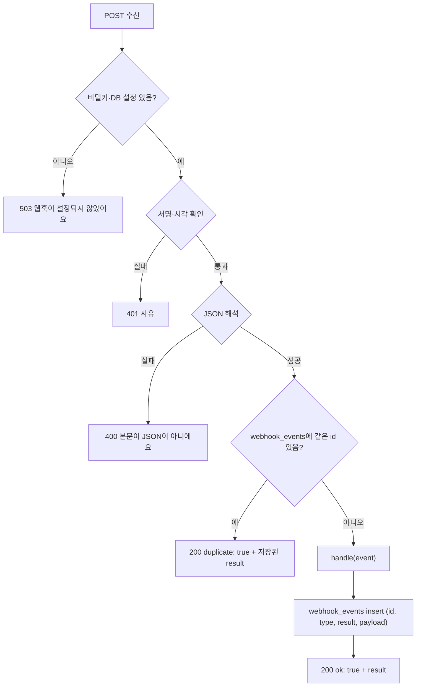

# API 설계서

> 챌린지업에는 공개 REST API가 없다. 화면이 부르는 Next.js 서버 액션(`web/src/server/actions.ts`)과 그로블 결제 웹훅(`POST /api/webhooks/groble`)만 있다. 이 문서는 두 가지를 코드 기준으로 정리했다. 실패 문구는 코드에 있는 그대로 인용했다.

| 항목 | 내용 |
|------|------|
| **문서 ID** | API-CHUP-v0.3 |
| **프로젝트명** | 챌린지업 (ChallengeUp) |
| **문서 버전** | 0.3 (구현 기준 재작성) |
| **작성일** | 2026-11-27 |
| **기준 커밋** | `f85c7de` |
| **작성자** | Claude Code |
| **승인자** | 미정 |
| **문서 상태** | 초안 |
| **근거** | `web/src/server/actions.ts`, `store.ts`, `session.ts`, `db.ts`, `groble.ts`, `web/src/lib/safe-action.ts`, `web/src/domain/validation.ts`, `web/src/app/api/webhooks/groble/route.ts` |

---

## 1. 공통 규격

### 1.1 호출 방식

| 항목 | 서버 액션 | 그로블 웹훅 |
|---|---|---|
| 호출 주체 | 브라우저(클라이언트 컴포넌트)·서버 컴포넌트 | 그로블 서버 |
| 전송 | Next.js 서버 액션(POST, 프레임워크 내부 형식) | `POST /api/webhooks/groble`, JSON 본문 |
| 인증 | 세션 쿠키 (DB 모드: Supabase Auth 쿠키 / 메모리 모드: `cu-session`) | `x-groble-signature` HMAC |
| 응답 | `Result` 객체 | JSON + HTTP 상태 코드 |
| 버전 | 없음 | 없음 |

### 1.2 Result 형식

```ts
type Result<T = undefined> =
  | { ok: true; value: T }
  | { ok: false; message: string }; // message는 화면에 그대로 보여 주는 해요체 문구
```

- 오류 코드(`code`)나 필드별 오류(`fields`)는 없다. SRS 5.2.1의 `{ ok, data } / { ok, error: { code, message, fields } }` 형식과 다르다.
- 서버 액션은 HTTP 상태 코드로 실패를 알리지 않는다. 규칙 실패도 정상 응답 안의 `ok: false`다.

### 1.3 공통 처리 순서 (쓰기 액션)

1. `currentUserId()`로 로그인 사용자를 확인한다. 없으면 바로 실패(문구는 액션마다 다름).
2. `mutate(규칙)`: DB 모드면 DB 상태를 새로 불러와 규칙을 실행하고, 성공하면 바뀐 부분만 저장한다(SAD 4.2). 메모리 모드면 규칙만 실행한다.
3. 규칙 함수(`store.ts`)가 권한·상태·입력을 확인하고 실패 문구를 돌려준다.

### 1.4 저장 단계 공통 실패 (DB 모드, 모든 쓰기 액션)

| 조건 | message |
|---|---|
| 정원 트리거 `CAPACITY_FULL` | "정원이 다 찼어요. 비슷한 챌린지를 둘러볼까요?" |
| 고유 인덱스 `one_active_enrollment` 위반 | "이미 신청한 챌린지예요" |
| 그 밖의 DB 오류 (서버 로그 "DB 저장 실패") | "저장하지 못했어요. 잠시 뒤 다시 해 주세요" |

### 1.5 연결 실패 (`safeAction`)

화면 쪽에서 서버 액션 호출을 `safeAction(...)`으로 감싸면, 요청 자체가 실패(연결 끊김·서버 예외)해도 다음 결과로 바뀐다.

| message |
|---|
| "연결이 불안정해서 보내지 못했어요. 쓴 내용은 그대로 있으니 다시 시도해 주세요" |

적용: `loginAction`, `signupAction`, `submitProofAction`, `createPostAction`, `editPostAction`. 미적용: `enrollAction`, `toggleLikeAction`, `deletePostAction` (이 경우 예외가 화면으로 올라감, 동작 확인은 미확인).

### 1.6 권한 용어

| 권한 | 판정 |
|---|---|
| 누구나 | 로그인 불필요 |
| 로그인 | `currentUserId()`가 있음 |
| 참여자 | 그 챌린지에 활성 신청이 있음 (`isMemberOf`) |
| 작성자 | 글의 `authorId`가 나 |
| 그 챌린지 강사 | `role = instructor` 이고 챌린지 강사 이름 = 내 이름 |

---

## 2. 서버 액션 목록

| ID | 이름 | 권한 | 관련 FR | 화면에서 호출 |
|---|---|---|---|---|
| ACT-01 | `currentUserId` | 누구나 | FR-004 | 서버 컴포넌트 다수 |
| ACT-02 | `loginAction` | 누구나 | FR-002 | SCR-AUTH-01 |
| ACT-03 | `signupAction` | 누구나 | FR-001 | SCR-AUTH-02 |
| ACT-04 | `logoutAction` | 누구나 | FR-002 | 헤더 "로그아웃" |
| ACT-05 | `enrollAction` | 로그인 | FR-012 | SCR-INT-01 |
| ACT-06 | `cancelEnrollmentAction` | 로그인 + 신청자 | FR-012 | 없음 |
| ACT-07 | `submitProofAction` | 로그인 + 참여자 | FR-015, FR-018, FR-019 | SCR-DAY-01 |
| ACT-08 | `createPostAction` | 로그인 + 참여자 또는 그 챌린지 강사 | FR-017 | SCR-FEED-01 |
| ACT-09 | `editPostAction` | 로그인 + 작성자 | FR-017 | SCR-FEED-01 |
| ACT-10 | `deletePostAction` | 로그인 + 작성자 또는 그 챌린지 강사 | FR-017, FR-018 | SCR-FEED-01 |
| ACT-11 | `toggleLikeAction` | 로그인 + 참여자 | FR-017, FR-018 | SCR-FEED-01 |
| ACT-12 | `addCommentAction` | 로그인 + 참여자 | FR-017, FR-018 | 없음 |

SRS 5.2.2에 있는 `requestPasswordReset`, `updateProfile`, 강사 신청·등록·검수·취소, `pinPost`, `hidePost`, `deleteComment`, 신고, RPC·정기 작업은 구현되지 않았다.

---

## 3. 서버 액션 상세

### 3.1 ACT-01 `currentUserId(): Promise<string | null>`

- 요청당 한 번 상태를 불러오고(`loadStore`, React `cache`) 로그인 사용자 id를 돌려준다.
- DB 모드: Supabase `auth.getUser()`(쿠키)의 id가 `profiles`에 있을 때만 그 id. 메모리 모드: 쿠키 `cu-session` 값이 데모 사용자에 있을 때만.
- 실패 없음. 없으면 `null`.

### 3.2 ACT-02 `loginAction(email, password)`

| 항목 | 내용 |
|---|---|
| 입력 | `email: string`, `password: string`. 이메일은 앞뒤 공백 제거·소문자로 바꿈 |
| 반환 | `Result<{ name: string }>` |
| 처리 | DB 모드: `auth.signInWithPassword` → 세션 쿠키 설정, `profiles.name` 조회. 메모리 모드: 데모 사용자 비밀번호 비교 후 `cu-session` 쿠키(httpOnly, lax, 7일) |

| 실패 조건 | message |
|---|---|
| 인자가 문자열이 아님 / 계정 없음 / 비밀번호 틀림 / Auth 오류 | "이메일이나 비밀번호가 맞지 않아요" |

이메일 없음과 비밀번호 틀림을 구분하지 않는다. 로그인 시도 횟수 제한은 앱 코드에 없다(Supabase Auth 자체 제한은 미확인).

### 3.3 ACT-03 `signupAction(input)`

| 항목 | 내용 |
|---|---|
| 입력 | `{ email, password, passwordConfirm, name, agreed }` (모두 필수, `agreed`는 boolean) |
| 반환 | `Result<{ name: string }>` |
| 처리 | `signupProblem`으로 타입·값 재검사 → DB 모드: `auth.admin.createUser`(`email_confirm: true`) → `profiles` insert(role student, `terms_agreed_at` 기록), 실패하면 만든 Auth 사용자 삭제 → 바로 로그인. 메모리 모드: 데모 사용자 추가 후 쿠키 |

| 실패 조건 | message |
|---|---|
| 객체가 아니거나 필드 타입이 틀림 | "입력값을 확인해 주세요" |
| `agreed`가 false | "필수 동의 항목에 체크해 주세요" |
| 이메일 형식 | "이메일 주소를 확인해 주세요" |
| 비밀번호 8~72자·영문+숫자 아님 | "영문과 숫자를 함께 넣어 주세요 (8~72자)" |
| 비밀번호 UTF-8 72바이트 초과 | "비밀번호가 너무 길어요. 한글·특수 문자는 1자를 2~4자로 계산해요 (72바이트까지)" |
| 비밀번호 확인 불일치 | "비밀번호가 서로 달라요" |
| 이름 2~20자 아님 | "이름은 2~20자로 적어 주세요" |
| 이미 가입한 이메일 | "이미 가입한 이메일이에요. 로그인하거나 비밀번호를 찾아 주세요" |
| Auth·프로필 저장 실패 (DB 모드) | "가입하지 못했어요. 잠시 뒤 다시 해 주세요" |

화면은 비밀번호 확인 칸이 없어 `passwordConfirm`에 같은 값을 보낸다.

### 3.4 ACT-04 `logoutAction(): Promise<void>`

- DB 모드면 `auth.signOut()`, 두 모드 모두 `cu-session` 쿠키 삭제 후 `/`로 redirect. 헤더의 `<form action={logoutAction}>`으로 호출.

### 3.5 ACT-05 `enrollAction(challengeId)`

| 항목 | 내용 |
|---|---|
| 입력 | `challengeId: string` (챌린지 slug, 예 `python-21`) |
| 반환 | `Result<{ enrollmentId: string }>` |
| 처리 | 규칙 통과 시 `enrollments` 행 추가(status active). DB 트리거가 정원을 한 번 더 확인 |

| 실패 조건 (확인 순서) | message |
|---|---|
| 로그인 안 함 | "로그인하면 신청할 수 있어요" |
| 없는 챌린지 | "찾을 수 없는 챌린지예요" |
| 모집 중 아님 (오늘 KST ≥ 시작일) | "모집이 끝났어요. 지금 모집 중인 챌린지를 둘러볼까요?" |
| 내가 연 챌린지 (강사 이름 = 내 이름) | "내가 연 챌린지에는 신청할 수 없어요" |
| 이미 활성 신청 | "이미 신청한 챌린지예요" |
| 끝나지 않은 활성 신청이 5개 이상 | "챌린지는 동시에 5개까지 참여할 수 있어요. 진행 중인 챌린지가 끝나면 다시 신청할 수 있어요" |
| 시드 인원 + 새 신청 ≥ 정원 | "정원이 다 찼어요. 비슷한 챌린지를 둘러볼까요?" |
| 저장 단계 | 1.4 |

### 3.6 ACT-06 `cancelEnrollmentAction(challengeId)`

| 항목 | 내용 |
|---|---|
| 입력 | `challengeId: string` |
| 반환 | `Result` |
| 처리 | 활성 신청을 `cancelled`로, DB에 `cancelled_at` 기록 |

| 실패 조건 | message |
|---|---|
| 로그인 안 함 | "로그인이 필요해요" |
| 챌린지 없음 / 활성 신청 없음 | "신청한 챌린지가 아니에요" |
| 시작일 당일 이후 | "챌린지가 시작돼서 신청을 취소할 수 없어요. 인증하지 않은 Day는 미완주로 기록돼요" |
| 저장 단계 | 1.4 |

### 3.7 ACT-07 `submitProofAction(challengeId, dayNo, payload)`

| 항목 | 내용 |
|---|---|
| 입력 | `challengeId: string`, `dayNo: number`, `payload: { body?, linkUrl?, photoPaths?, photoSizesBytes?, visibility: "public" \| "private" }` |
| 반환 | `Result<{ points: number; streak: number; status: "approved" \| "pending"; postId?: string }>` |
| 처리 | 인증 저장. 자동 인정 챌린지면 `approved`, 아니면 `pending`. 공개면 피드에 인증 글 생성. 인정이면 +10점, Day 날짜 21:00 KST 전이면 +5점. 스트릭 다시 계산 후 7·21일 보상 적립·회수 |

| 실패 조건 (확인 순서) | message |
|---|---|
| 로그인 안 함 | "로그인이 필요해요" |
| 없는 챌린지 | "찾을 수 없는 챌린지예요" |
| 활성 신청 없음 | "신청한 참여자만 인증할 수 있어요" |
| 진행 중 아님 | "진행 중인 챌린지에서만 인증할 수 있어요" |
| Day 범위 밖 | "없는 Day예요" |
| 아직 안 열린 Day | "아직 열리지 않은 Day예요" |
| 그 Day 마감(23:59 KST) 지남 | "아쉽지만 인증 마감(23:59)이 지났어요" |
| 이미 인증 | "이 Day는 이미 인증했어요. 내용을 고칠까요?" |
| 텍스트 10~2,000자 아님 | "10자 이상 2,000자 이하로 써 주세요" |
| 사진 1~3장 아님 | "사진은 1장에서 3장까지 올려 주세요" |
| 사진 10MB 초과 | "사진 한 장은 10MB까지 올릴 수 있어요" |
| 사진·링크 설명 500자 초과 | "설명은 500자 이하로 써 주세요" |
| 링크가 http/https 아님 | "http 또는 https 주소를 넣어 주세요" |
| 체크 한마디 200자 초과 | "한마디는 200자 이하로 써 주세요" |
| 저장 단계 | 1.4 |

검증 문구가 여럿이면 첫 번째만 돌려준다. 사진 업로드 경로는 없어서 사진 형식 챌린지는 화면에서 인증할 수 없다(화면 입력 칸 없음).

### 3.8 ACT-08 `createPostAction(challengeId, input, postId?)`

| 항목 | 내용 |
|---|---|
| 입력 | `challengeId: string`, `input: { kind: "질문" \| "자유"; title: string; body: string }`, `postId?: string` (UUID) |
| 반환 | `Result<string>` (글 id) |
| 멱등 | 화면이 글쓰기 창을 열 때 `crypto.randomUUID()`로 정한 `postId`를 보낸다. 같은 작성자가 같은 id로 다시 보내면 새로 만들지 않고 그 id를 돌려준다 |

| 실패 조건 (확인 순서) | message |
|---|---|
| 로그인 안 함 | "로그인이 필요해요" |
| `postId`가 UUID 형식 아님 / 같은 id 글의 작성자가 다름 | "글을 저장하지 못했어요. 새로 고친 뒤 다시 써 주세요" |
| 챌린지·사용자 없음 | "로그인하면 글을 쓸 수 있어요" |
| 끝난 챌린지 | "끝난 챌린지예요. 지난 글은 계속 볼 수 있어요" |
| 참여자도 그 챌린지 강사도 아님 | "신청한 참여자만 글을 쓸 수 있어요" |
| 제목 1~60자 아님 | "제목은 1자 이상 60자 이하로 써 주세요" |
| 본문 1~2,000자 아님 | "글은 1자 이상 2,000자 이하로 써 주세요" |
| 저장 단계 | 1.4 |

규칙 함수는 `공지` 종류도 받지만("공지는 강사만 올릴 수 있어요"), 서버 액션 입력 타입은 질문·자유만 허용한다. 서버 액션이 `kind` 값을 실행 중에 검사하지는 않는다.

### 3.9 ACT-09 `editPostAction(postId, input)`

| 항목 | 내용 |
|---|---|
| 입력 | `postId: string`, `input: { kind, title, body }` (3.8과 같음) |
| 반환 | `Result` |
| 처리 | 종류(공지 글은 유지)·제목·본문 수정, `edited_at` 기록 |

| 실패 조건 | message |
|---|---|
| 로그인 안 함 | "로그인이 필요해요" |
| 글 없음 | "글을 찾을 수 없어요" |
| 작성자 아님 | "내가 쓴 글만 고칠 수 있어요" |
| 인증 글 | "인증 글은 Day 화면에서 고칠 수 있어요" |
| 끝난 챌린지 | "끝난 챌린지의 글은 고칠 수 없어요" |
| 제목·본문 길이 | 3.8과 같음 |
| 저장 단계 | 1.4 |

### 3.10 ACT-10 `deletePostAction(postId)`

| 항목 | 내용 |
|---|---|
| 입력 | `postId: string` |
| 반환 | `Result` |
| 처리 | 이 글이 받은 좋아요 점수와 이 글 댓글 점수를 회수(음수 행 추가)한 뒤 글 삭제. DB에서 댓글·좋아요는 cascade로 함께 삭제 |

| 실패 조건 | message |
|---|---|
| 로그인 안 함 | "로그인이 필요해요" |
| 글 없음 | "이미 삭제된 글이에요" |
| 작성자도 그 챌린지 강사도 아님 | "내가 쓴 글만 삭제할 수 있어요" |
| 인증 글 | "인증 글은 Day 화면에서 관리해요" |
| 저장 단계 | 1.4 |

### 3.11 ACT-11 `toggleLikeAction(postId)`

| 항목 | 내용 |
|---|---|
| 입력 | `postId: string` |
| 반환 | `Result<{ liked: boolean; count: number }>` |
| 처리 | 좋아요 추가 시 글 작성자 +1점(본인 글 제외), 취소 시 회수 |

| 실패 조건 | message |
|---|---|
| 로그인 안 함 | "로그인이 필요해요" |
| 글 없음 | "글을 찾을 수 없어요" |
| 참여자 아님 | "신청한 참여자만 좋아요를 누를 수 있어요" |
| 저장 단계 | 1.4 |

그 챌린지 강사라도 참여자가 아니면 좋아요를 누를 수 없다. 끝난 챌린지 제한은 없다.

### 3.12 ACT-12 `addCommentAction(postId, body)`

| 항목 | 내용 |
|---|---|
| 입력 | `postId: string`, `body: string` |
| 반환 | `Result<string>` (댓글 id) |
| 처리 | 댓글 추가. 남의 글이면 +2점, 하루(KST) 5개까지 |

| 실패 조건 | message |
|---|---|
| 로그인 안 함 | "로그인이 필요해요" |
| 글 없음 | "글을 찾을 수 없어요" |
| 참여자 아님 | "신청한 참여자만 댓글을 쓸 수 있어요" |
| 끝난 챌린지 | "끝난 챌린지예요. 지난 글은 계속 볼 수 있어요" |
| 1~500자 아님 | "댓글은 1자 이상 500자 이하로 써 주세요" |
| 저장 단계 | 1.4 |

화면에서 호출하는 곳이 없다.

---

## 4. 그로블 결제 웹훅

### 4.1 개요

| 항목 | 내용 |
|---|---|
| ID | HOOK-01 |
| 메서드·경로 | `POST /api/webhooks/groble` |
| 목적 | 그로블 결제 완료 시 구매자 이메일의 회원을 연결된 챌린지에 자동 신청 |
| 관련 | FR-024(유료 결제, P4 제외)의 일부를 앞당겨 구현. SRS에는 이 연동이 없다 |
| 필요 환경 변수 | `GROBLE_WEBHOOK_SECRET`, DB 모드(`NEXT_PUBLIC_SUPABASE_URL`, `SUPABASE_SERVICE_ROLE_KEY`) |
| 근거 커밋 | `8310050` |

### 4.2 요청 헤더

| 헤더 | 필수 | 내용 |
|---|---|---|
| `x-groble-signature` | Y | HMAC-SHA256 16진수 문자열 |
| `x-groble-timestamp` | Y | 유닉스 시각(초), 숫자만 |
| `x-groble-idempotency-key` | N | 이벤트 id. 없으면 본문 `id` 사용 |
| `Content-Type` | - | 본문은 원문 그대로 읽어 서명을 확인한 뒤 JSON으로 해석 |

### 4.3 서명 확인

```text
signature = hex( HMAC_SHA256( key = GROBLE_WEBHOOK_SECRET 전체 문자열,
                              msg = `${timestamp}.${rawBody}` ) )
```

- `rawBody`는 `req.text()`로 받은 원본 본문(파싱 전).
- 현재 서버 시각과 `timestamp` 차이가 5분(300초)을 넘으면 거절.
- 비교는 `timingSafeEqual`(길이가 다르면 바로 거절).
- 단위 테스트: `web/src/server/groble.test.ts`.

### 4.4 본문 (사용하는 필드)

```json
{
  "id": "이벤트 id",
  "type": "payment.completed",
  "occurredAt": "…",
  "data": {
    "object": {
      "merchantUid": "…",
      "buyer": { "email": "구매자 이메일", "displayName": "…" },
      "content": { "id": "그로블 상품 id", "title": "…" },
      "pricing": { "finalAmount": 0, "currency": "…" }
    }
  }
}
```

실제로 쓰는 값은 `type`, `data.object.buyer.email`, `data.object.content.id`(+ 헤더가 없을 때 `id`)뿐이다. 나머지 필드 형식과 그로블이 보내는 다른 이벤트 종류 목록은 미확인(코드 주석에 `payment.cancel_requested` 예시만 있음).

### 4.5 처리 순서



`handle(event)`:

| 조건 | result |
|---|---|
| `type`이 `payment.completed`가 아님 | `recorded` |
| 구매자 이메일 또는 상품 id 없음 | `failed:구매자 이메일이나 상품 id가 없어요` |
| `challenges.groble_content_id`와 맞는 챌린지 없음 | `unmapped_product` |
| 그 이메일의 회원 없음 (`auth.admin.listUsers`, 최대 1000명 조회) | `unknown_buyer` |
| 신청 성공 (ACT-05와 같은 규칙 `enroll`) | `enrolled` |
| 이미 신청함 ("이미 신청한"으로 시작하는 실패) | `already_enrolled` |
| 그 밖의 신청 실패 (모집 마감·정원 등) | `failed:{ACT-05 실패 문구}` |

### 4.6 응답

| 상태 | 본문 | 조건 |
|---|---|---|
| 200 | `{ "ok": true, "result": "<result>" }` | 처리 완료 (신청 실패여도 200) |
| 200 | `{ "ok": true, "duplicate": true, "result": "<저장된 result>" }` | 이미 처리한 이벤트 id |
| 400 | `{ "error": "본문이 JSON이 아니에요" }` | 본문 JSON 해석 실패 |
| 401 | `{ "error": "서명 헤더가 없어요" }` | 서명·시각 헤더 없음, 시각이 숫자가 아님 |
| 401 | `{ "error": "요청 시각이 5분 넘게 차이 나요" }` | 시각 차이 300초 초과 |
| 401 | `{ "error": "서명이 맞지 않아요" }` | HMAC 불일치 |
| 503 | `{ "error": "웹훅이 설정되지 않았어요" }` | 비밀키 없음 또는 메모리 모드 |
| 500 | 미확인 | DB 조회 등에서 예외가 나는 경우. 라우트에 try/catch가 없어 Next.js 기본 처리 |

### 4.7 주의 사항 (코드 기준)

- 처리할 수 없는 경우도 200을 돌려주므로 그로블은 다시 보내지 않는다. 실패는 `webhook_events.result`에서만 보인다.
- 중복 확인과 기록 사이에 같은 이벤트가 동시에 오면 두 번 처리될 수 있다. 신청은 고유 인덱스가 막는다.
- `webhook_events` insert 결과를 확인하지 않는다. 기록 실패 시에도 200이 나간다.
- 회원 찾기가 `listUsers({ perPage: 1000 })` 첫 페이지만 본다. 회원이 1000명을 넘으면 `unknown_buyer`가 잘못 나올 수 있다.

---

## 5. 요구사항 대응

| FR | 액션·엔드포인트 | 비고 |
|---|---|---|
| FR-001 | ACT-03 | 인증 메일 없음 |
| FR-002 | ACT-02, ACT-04 | 구글 로그인·재설정 없음 |
| FR-004 | ACT-01, 각 액션 권한 확인 | 앱 코드에서 판정 |
| FR-012 | ACT-05, ACT-06, HOOK-01 | 취소는 화면 없음 |
| FR-015 | ACT-07 | 수정·삭제 없음 |
| FR-017 | ACT-08~12 | 고정·숨김·댓글 삭제 없음 |
| FR-018 | ACT-07, ACT-10~12 | 포인트 적립·회수 |
| FR-019 | ACT-07 | 스트릭 계산·보상 |

---

## 6. 미확인·확인 필요 사항

| 번호 | 내용 |
|---|---|
| 6-1 | 그로블 웹훅의 전체 본문 형식과 이벤트 종류(공식 문서 확인 필요) |
| 6-2 | 웹훅 처리 중 예외 발생 시 실제 응답 코드와 그로블 재전송 동작 |
| 6-3 | `safeAction`을 쓰지 않는 액션(신청·좋아요·삭제)의 연결 실패 시 화면 동작 |
| 6-4 | 서버 액션 응답 시간(NFR-001 p95 ≤ 800ms) 측정값 |
| 6-5 | Supabase Auth 로그인 시도 제한 설정 |
| 6-6 | 운영 웹훅 URL과 그로블 쪽 등록 상태 |
