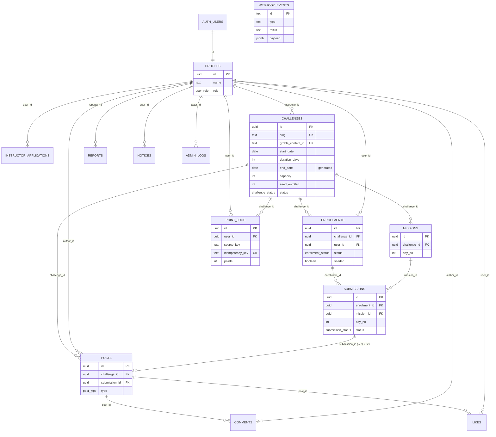

# 데이터베이스 설계서

> `supabase/migrations/0001~0004`에 실제로 있는 스키마를 정리했다. 앱이 각 테이블을 쓰는지 여부는 `web/src/server/db.ts`, `web/src/app/api/webhooks/groble/route.ts`, `web/scripts/seed.ts` 기준이다. 확인하지 못한 것은 "미확인"으로 적었다.

| 항목 | 내용 |
|------|------|
| **문서 ID** | DBS-CHUP-v0.3 |
| **프로젝트명** | 챌린지업 (ChallengeUp) |
| **문서 버전** | 0.3 (구현 기준 재작성) |
| **작성일** | 2026-11-27 |
| **기준 커밋** | `f85c7de` |
| **DBMS** | Supabase Postgres (프로젝트 `challengeup`, `ap-northeast-2`). Postgres 버전 미확인 |
| **작성자** | Claude Code |
| **승인자** | 미정 |
| **문서 상태** | 초안 |

---

## 1. 마이그레이션 목록

| 파일 | 내용 | 실행일(주석) |
|---|---|---|
| `0001_init.sql` | `pgcrypto`, 열거형 16개, 테이블 13개, 인덱스 | 2026-11-26 |
| `0002_app_adjust.sql` | `challenges`에 `slug`·`cohort_no`·`tone`·`seed_enrolled`, `enrollments.seeded`, `posts.title`, 전 테이블 RLS, `service_role` 권한 | 2026-11-26 |
| `0003_groble_webhook.sql` | `challenges.groble_content_id`, `webhook_events` 테이블 | 2026-11-26 |
| `0004_enroll_capacity.sql` | 함수 `check_enroll_capacity()`, 트리거 `enroll_capacity` | 2026-11-26 |

롤백 스크립트는 없다. 운영 DB에 네 파일이 모두 적용됐는지는 커밋 메시지(`748224c`, `8310050`, `18acf30`)로만 확인되며 DB 직접 확인은 미확인.

---

## 2. ER 다이어그램

`webhook_events`는 다른 테이블과 외래 키가 없다. `reports.target_id`는 `target_type`에 따라 `posts` 또는 `comments`를 가리키지만 외래 키는 없다.

---

## 3. 열거형

| 타입 | 값 |
|---|---|
| `user_role` | student, instructor, admin |
| `application_status` | pending, approved, rejected |
| `category` | dev, design, language, self_dev, fitness, finance |
| `challenge_status` | draft, in_review, recruiting, in_progress, ended, cancelled |
| `unlock_mode` | daily, all_at_start |
| `approval_mode` | auto, manual |
| `proof_type` | text, photo, link, check |
| `enrollment_status` | active, cancelled, challenge_cancelled, completed, incomplete |
| `submission_status` | pending, approved, rejected |
| `visibility` | public, private |
| `post_type` | proof, question, free, notice |
| `point_reason` | proof_approved, early_bonus, like_received, comment_written, streak_bonus, revoke |
| `report_reason` | abuse, spam, obscene, privacy, other |
| `report_status` | open, hidden, kept |
| `report_target` | post, comment |
| `notice_type` | instructor_result, challenge_rejected, challenge_cancelled, completion_result, review_auto_returned |

`challenge_status`에는 CLAUDE.md의 "정산 완료" 단계가 없고 `cancelled`가 있다. 상태 값을 바꾸는 코드는 없다(앱은 날짜로 모집 중·진행 중·종료를 계산, `store.ts` `stateOf`).

---

## 4. 테이블 명세

표기: PK 기본 키, FK 외래 키(→ 대상, 삭제 동작), UK 고유. 기본값이 없는 칸은 "-".

### 4.1 profiles — 사용자 프로필 (auth.users와 1:1)

| 컬럼 | 타입 | Null | 기본값 | 제약 |
|---|---|---|---|---|
| id | uuid | N | - | PK, FK → `auth.users(id)` cascade |
| name | text | N | - | 2~20자 |
| avatar_url | text | Y | - | |
| bio | text | Y | - | 60자 이하 |
| role | user_role | N | 'student' | |
| terms_agreed_at | timestamptz | Y | - | |
| created_at | timestamptz | N | now() | |

앱 사용: 가입 시 insert(`signupAction`), 상태 불러오기 select(`id, name, role`).

### 4.2 instructor_applications — 강사 신청

| 컬럼 | 타입 | Null | 기본값 | 제약 |
|---|---|---|---|---|
| id | uuid | N | gen_random_uuid() | PK |
| user_id | uuid | N | - | FK → profiles cascade |
| reason | text | N | - | 20~500자 |
| intro_url | text | Y | - | |
| status | application_status | N | 'pending' | |
| reviewed_by | uuid | Y | - | FK → profiles |
| reviewed_at | timestamptz | Y | - | |
| reject_reason | text | Y | - | |
| created_at | timestamptz | N | now() | |

인덱스: `one_pending_application` UNIQUE (user_id) WHERE status = 'pending'. 앱 사용: 없음.

### 4.3 challenges — 챌린지

| 컬럼 | 타입 | Null | 기본값 | 제약 |
|---|---|---|---|---|
| id | uuid | N | gen_random_uuid() | PK |
| instructor_id | uuid | N | - | FK → profiles |
| title | text | N | - | 5~50자 |
| summary | text | N | - | 10~80자 |
| description | text | N | - | 50~5000자 |
| category | category | N | - | |
| thumbnail_path | text | Y | - | |
| start_date | date | N | - | |
| duration_days | int | N | - | 7~60 |
| end_date | date | - | 생성 열 | `start_date + (duration_days - 1)` stored |
| unlock_mode | unlock_mode | N | 'daily' | |
| capacity | int | N | - | 1~300 |
| completion_rate | int | N | 80 | 50~100, 10 단위 |
| approval_mode | approval_mode | N | 'auto' | |
| price | int | N | 0 | `price = 0` (무료만) |
| status | challenge_status | N | 'draft' | |
| review_requested_at, published_at, judged_at | timestamptz | Y | - | |
| reject_reason_type, reject_reason, cancel_reason | text | Y | - | |
| completion_ratio | numeric | Y | - | |
| created_at | timestamptz | N | now() | |
| slug (0002) | text | Y | - | UK. 화면 주소의 id (예: `python-21`) |
| cohort_no (0002) | int | N | 1 | ≥ 1 |
| tone (0002) | text | Y | - | 썸네일 색 |
| seed_enrolled (0002) | int | N | 0 | ≥ 0. 시드 인원 |
| groble_content_id (0003) | text | Y | - | UK. 그로블 상품 id |

인덱스: `challenges_status_start` (status, start_date).
앱 사용: `id, slug` 조회로 slug ↔ uuid 연결(`loadMaps`), 웹훅에서 `groble_content_id`로 slug 찾기, 정원 트리거. 제목·기간·정원 등 화면 값은 `lib/data.ts`에서 읽는다(SAD 4.3). 행은 시드 스크립트가 넣는다(`seed_enrolled = c.enrolled`).

### 4.4 missions — Day별 미션

| 컬럼 | 타입 | Null | 기본값 | 제약 |
|---|---|---|---|---|
| id | uuid | N | gen_random_uuid() | PK |
| challenge_id | uuid | N | - | FK → challenges cascade |
| day_no | int | N | - | ≥ 1 |
| title | text | N | - | 2~40자 |
| description | text | N | - | 10~2000자 |
| proof_type | proof_type | N | - | |
| video_url | text | Y | - | |
| resource_urls | text[] | N | '{}' | 3개 이하 |

고유: (challenge_id, day_no). 앱 사용: (slug, day_no) → mission id 찾기(인증 저장 시).

### 4.5 enrollments — 신청

| 컬럼 | 타입 | Null | 기본값 | 제약 |
|---|---|---|---|---|
| id | uuid | N | gen_random_uuid() | PK |
| challenge_id | uuid | N | - | FK → challenges cascade |
| user_id | uuid | N | - | FK → profiles cascade |
| status | enrollment_status | N | 'active' | |
| current_streak, longest_streak, approved_count | int | N | 0 | |
| enrolled_at | timestamptz | N | now() | |
| cancelled_at | timestamptz | Y | - | |
| seeded (0002) | boolean | N | false | 시드 인원에 이미 포함된 신청 |

인덱스: `one_active_enrollment` UNIQUE (challenge_id, user_id) WHERE status = 'active'.
트리거: `enroll_capacity` BEFORE INSERT (5장).
앱 사용: insert(신청), status·cancelled_at update(취소). 앱은 `active`가 아닌 상태를 모두 `cancelled`로 읽는다. `current_streak`·`longest_streak`·`approved_count`는 앱이 쓰지 않는다(스트릭은 매번 계산).

### 4.6 submissions — 미션 인증

| 컬럼 | 타입 | Null | 기본값 | 제약 |
|---|---|---|---|---|
| id | uuid | N | gen_random_uuid() | PK |
| enrollment_id | uuid | N | - | FK → enrollments cascade |
| mission_id | uuid | N | - | FK → missions cascade |
| challenge_id | uuid | N | - | FK → challenges cascade |
| user_id | uuid | N | - | FK → profiles cascade |
| day_no | int | N | - | |
| body | text | Y | - | |
| link_url | text | Y | - | |
| photo_paths | text[] | N | '{}' | 3개 이하 |
| visibility | visibility | N | 'public' | |
| status | submission_status | N | 'approved' | |
| first_submitted_at, updated_at | timestamptz | N | now() | |
| reviewed_by | uuid | Y | - | FK → profiles |
| review_feedback | text | Y | - | |

고유: (enrollment_id, mission_id). 인덱스: `submissions_challenge_status` (challenge_id, status).
앱 사용: insert만(수정·삭제 없음). 앱은 `approved`가 아닌 상태를 `pending`으로 읽는다.

### 4.7 posts — 피드 글

| 컬럼 | 타입 | Null | 기본값 | 제약 |
|---|---|---|---|---|
| id | uuid | N | gen_random_uuid() | PK (앱이 id를 정해 넣음, API설계서 3.5) |
| challenge_id | uuid | N | - | FK → challenges cascade |
| author_id | uuid | N | - | FK → profiles cascade |
| type | post_type | N | - | |
| body | text | Y | - | 1~2000자 |
| photo_paths | text[] | N | '{}' | 3개 이하 |
| submission_id | uuid | Y | - | FK → submissions cascade |
| pinned_at, hidden_at, temp_hidden_at, edited_at | timestamptz | Y | - | |
| created_at | timestamptz | N | now() | |
| title (0002) | text | Y | - | null 또는 1~60자 |

인덱스: `posts_one_per_submission` UNIQUE (submission_id) WHERE submission_id IS NOT NULL.
앱 사용: insert·update(type, title, body, edited_at)·delete. 읽을 때 `hidden_at IS NULL`만. 공개 인증 1건 = 인증 글 1건.

### 4.8 comments — 댓글

| 컬럼 | 타입 | Null | 기본값 | 제약 |
|---|---|---|---|---|
| id | uuid | N | gen_random_uuid() | PK |
| post_id | uuid | N | - | FK → posts cascade |
| author_id | uuid | N | - | FK → profiles cascade |
| body | text | N | - | 1~500자 |
| hidden_at, edited_at | timestamptz | Y | - | |
| created_at | timestamptz | N | now() | |

앱 사용: insert(`addCommentAction`, 화면 호출 없음), 읽을 때 `hidden_at IS NULL`만.

### 4.9 likes — 좋아요

| 컬럼 | 타입 | Null | 기본값 | 제약 |
|---|---|---|---|---|
| id | uuid | N | gen_random_uuid() | PK |
| post_id | uuid | N | - | FK → posts cascade |
| user_id | uuid | N | - | FK → profiles cascade |
| created_at | timestamptz | N | now() | |

고유: (post_id, user_id). 앱 사용: insert·delete.

### 4.10 reports — 신고

| 컬럼 | 타입 | Null | 기본값 | 제약 |
|---|---|---|---|---|
| id | uuid | N | gen_random_uuid() | PK |
| target_type | report_target | N | - | |
| target_id | uuid | N | - | (외래 키 없음) |
| reporter_id | uuid | N | - | FK → profiles cascade |
| reason | report_reason | N | - | |
| detail | text | Y | - | |
| status | report_status | N | 'open' | |
| created_at | timestamptz | N | now() | |

고유: (target_type, target_id, reporter_id). 앱 사용: 없음.

### 4.11 point_logs — 포인트 원장 (추가 전용)

| 컬럼 | 타입 | Null | 기본값 | 제약 |
|---|---|---|---|---|
| id | uuid | N | gen_random_uuid() | PK |
| user_id | uuid | N | - | FK → profiles cascade |
| challenge_id | uuid | Y | - | FK → challenges cascade |
| reason | point_reason | N | - | |
| points | int | N | - | 음수면 회수 |
| source_key | text | N | - | 원인 키 |
| idempotency_key | text | N | - | UK |
| created_at | timestamptz | N | now() | |

인덱스: `point_logs_source`(source_key), `point_logs_challenge_time`(challenge_id, created_at), `point_logs_user`(user_id).

앱의 `source_key` 형식과 `reason` 대응 (`db.ts` `reasonOf`, `store.ts`):

| source_key | reason | 점수 (`domain/constants.ts`) |
|---|---|---|
| `proof:{submissionId}` | proof_approved | +10 |
| `early:{submissionId}` | early_bonus | +5 (Day 날짜 21:00 KST 전 최초 제출) |
| `like:{postId}:{userId}` | like_received | +1 (글 작성자, 본인 좋아요 제외) |
| `comment:{commentId}:{YYYY-MM-DD}` | comment_written | +2 (본인 글 제외, 하루 5개까지) |
| `streak:{enrollmentId}:{milestone}` | streak_bonus | 7의 배수 +30, 21의 배수 +100 |
| 음수 행 | revoke | 같은 원인 회수 |

`idempotency_key` = `{source_key}:{그 원인의 몇 번째 행인지(0부터)}`. 합계는 저장하지 않고 조회할 때 더한다. 앱은 update·delete를 하지 않는다(DB 제약으로 막혀 있지는 않음).

### 4.12 notices — 알림

| 컬럼 | 타입 | Null | 기본값 | 제약 |
|---|---|---|---|---|
| id | uuid | N | gen_random_uuid() | PK |
| user_id | uuid | N | - | FK → profiles cascade |
| type | notice_type | N | - | |
| payload | jsonb | N | '{}' | |
| seen_at | timestamptz | Y | - | |
| created_at | timestamptz | N | now() | |

앱 사용: 없음.

### 4.13 admin_logs — 관리자 작업 로그

| 컬럼 | 타입 | Null | 기본값 | 제약 |
|---|---|---|---|---|
| id | uuid | N | gen_random_uuid() | PK |
| actor_id | uuid | Y | - | FK → profiles |
| action | text | N | - | |
| target_type | text | Y | - | |
| target_id | uuid | Y | - | |
| detail | jsonb | N | '{}' | |
| created_at | timestamptz | N | now() | |

앱 사용: 없음.

### 4.14 webhook_events — 받은 웹훅 기록 (0003)

| 컬럼 | 타입 | Null | 기본값 | 제약·설명 |
|---|---|---|---|---|
| id | text | N | - | PK. 그로블 이벤트 id (`x-groble-idempotency-key` 헤더, 없으면 본문 `id`) |
| source | text | N | 'groble' | |
| type | text | N | - | `payment.completed` 등 |
| result | text | N | - | `enrolled` / `already_enrolled` / `unmapped_product` / `unknown_buyer` / `recorded` / `failed:{사유}` |
| payload | jsonb | N | - | 받은 본문 전체 |
| received_at | timestamptz | N | now() | |

RLS 활성, `service_role`에 all 권한. 같은 id가 이미 있으면 처리하지 않고 저장된 `result`를 돌려준다(API설계서 4장). `payload`에 구매자 이메일 등 개인정보가 들어가며 보관 기간 규칙은 미확인.

---

## 5. 트리거: check_enroll_capacity

| 항목 | 내용 |
|---|---|
| 함수 | `check_enroll_capacity() returns trigger`, plpgsql |
| 트리거 | `enroll_capacity` BEFORE INSERT ON enrollments FOR EACH ROW |
| 목적 | 마지막 자리에 동시 신청이 들어와도 정원을 넘지 않게 (TC-FN-ENR-001) |

처리 순서:

1. 새 행 `status`가 `active`가 아니면 그대로 통과.
2. `challenges`에서 그 챌린지의 `capacity`, `seed_enrolled`를 `FOR UPDATE`로 잠가 읽는다(같은 챌린지 신청은 순서대로 처리됨).
3. 그 챌린지의 `status = 'active'`이고 `seeded = false`인 신청 수(`added`)를 센다.
4. `seed_enrolled + added >= capacity`이면 `RAISE EXCEPTION 'CAPACITY_FULL'`.
5. 아니면 통과.

앱은 오류 문자열에 `CAPACITY_FULL`이 있으면 "정원이 다 찼어요. 비슷한 챌린지를 둘러볼까요?"로 바꾼다(`session.ts` `mutate`). 커밋 `18acf30`에서 변수 이름이 열 이름 `seeded`와 겹쳐 모든 신청이 실패하던 문제를 고쳤다(변수 이름 `seed_count`).

UPDATE로 `cancelled`를 `active`로 되돌리는 경우는 트리거가 확인하지 않는다(BEFORE INSERT만). 앱에 그런 경로는 없다.

---

## 6. 보안 설정

| 항목 | 내용 | 근거 |
|---|---|---|
| RLS | 14개 테이블 모두 `enable row level security` | 0002, 0003 |
| 정책 | 없음 → anon·authenticated 역할로는 행에 접근 불가 | 0002 주석 |
| 권한 | `service_role`에 schema usage, 모든 테이블·시퀀스 all, 기본 권한도 부여 | 0002 |
| 접근 주체 | 서버의 `SUPABASE_SERVICE_ROLE_KEY`만 | `db.ts` |
| 비밀번호 | Supabase Auth가 저장(`auth.users`). 앱 테이블에 없음 | `actions.ts` |

---

## 7. 앱 상태와 DB의 대응

`db.ts`는 DB 행을 앱 상태(`store.ts` `State`)로 바꿔 읽고, 차이를 다시 쓴다.

| 앱 상태 | DB | 바꾸는 방식 |
|---|---|---|
| `challengeId` (slug) | `challenges.id` (uuid) | `loadMaps` 캐시 (서버 인스턴스가 살아 있는 동안 유지) |
| `StorePost.kind` 인증·질문·자유·공지 | `posts.type` proof·question·free·notice | `KIND_TO_TYPE` |
| `Enrollment.status` active·cancelled | `enrollment_status` | active 외에는 모두 cancelled로 읽음 |
| `Submission.status` approved·pending | `submission_status` | approved 외에는 pending으로 읽음 (rejected 구분 없음) |
| `LedgerRow` | `point_logs` | `reason`은 source_key 앞부분으로 결정 |
| 챌린지·Day 제목 등 | `challenges`, `missions` | 읽지 않음. `lib/data.ts` 사용 |

`loadMaps`가 한 번 만든 slug·mission 대응표를 계속 쓰므로, 운영 중에 챌린지·미션 행을 새로 넣으면 서버가 다시 시작될 때까지 반영되지 않는다(코드 기준 추론, 실측 미확인).

---

## 8. 사용하지 않는 스키마

| 대상 | 상태 |
|---|---|
| `instructor_applications`, `reports`, `notices`, `admin_logs` | 테이블만 있음. 읽고 쓰는 코드 없음 |
| `challenges.status` 및 검수·취소 관련 열 | 앱이 갱신하지 않음 |
| `enrollments.current_streak`, `longest_streak`, `approved_count` | 앱이 갱신하지 않음 |
| `submissions.photo_paths`, `reviewed_by`, `review_feedback`, `updated_at` | 앱이 쓰지 않음 |
| `posts.photo_paths`, `temp_hidden_at`, `hidden_at` 쓰기 | 앱이 쓰지 않음(읽을 때 필터만) |

---

## 9. 미확인·확인 필요 사항

| 번호 | 내용 |
|---|---|
| 9-1 | Postgres 버전, 운영 DB에 0001~0004가 실제로 적용된 상태 |
| 9-2 | 백업 정책 (테스트 기록: Free 플랜, 복원 미실행) |
| 9-3 | `webhook_events.payload` 개인정보 보관 기간 |
| 9-4 | `lib/data.ts`와 DB `challenges`·`missions` 값이 어긋날 때의 기준(현재는 시드 스크립트로만 맞춤) |
| 9-5 | `persist`가 트랜잭션이 아니어서 중간 실패 시 일부만 저장될 수 있음. 실제 발생 기록은 미확인 |
| 9-6 | `point_logs`의 추가 전용 규칙을 DB가 강제하지 않음(update·delete 권한이 `service_role`에 있음) |
