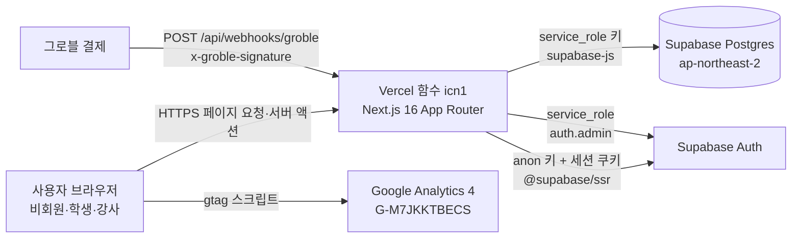
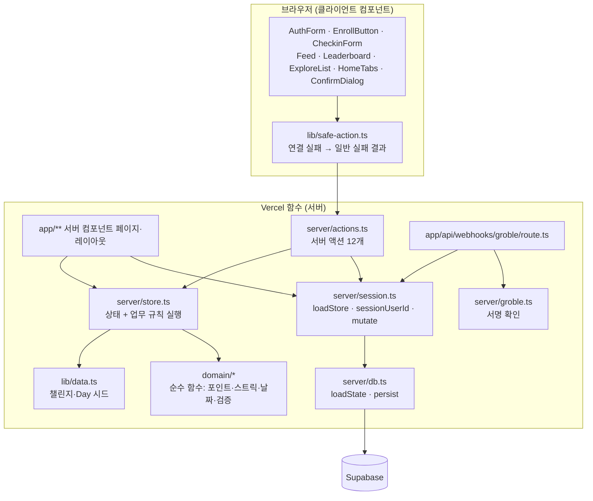
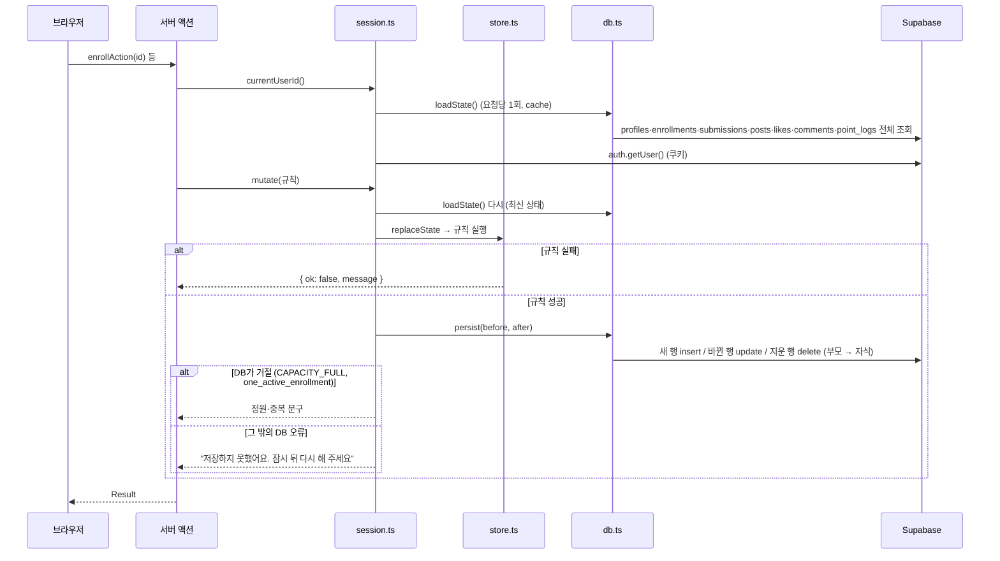

# 시스템 아키텍처 설계서 (SAD - System Architecture Document)

> 챌린지업의 현재 구현 구조를 코드·마이그레이션·커밋 기록 기준으로 정리했다. 계획만 있고 구현되지 않은 부분은 "미구현", 확인하지 못한 부분은 "미확인"으로 적었다.

| 항목 | 내용 |
|------|------|
| **문서 ID** | SAD-CHUP-v0.3 |
| **프로젝트명** | 챌린지업 (ChallengeUp) |
| **문서 버전** | 0.3 (구현 기준 재작성) |
| **작성일** | 2026-11-27 |
| **기준 커밋** | `f85c7de` |
| **작성자** | Claude Code |
| **승인자** | 미정 |
| **문서 상태** | 초안 |
| **근거** | `web/src/server/*`, `web/src/app/**`, `web/src/app/api/webhooks/groble/route.ts`, `web/vercel.json`, `web/package.json`, `web/.env.example`, `supabase/migrations/0001~0004`, 커밋 기록, CLAUDE.md, SRS-CHUP-v0.2 |

---

## 1. 아키텍처 개요

### 1.1 한 줄 요약

Vercel(서울 `icn1`)에서 도는 Next.js 16 App Router 앱 하나가 화면(서버 컴포넌트)과 쓰기(서버 액션), 결제 웹훅(라우트 핸들러)을 모두 맡는다. 데이터는 Supabase Postgres에, 로그인은 Supabase Auth에 둔다. DB 접근은 서버에서 `service_role` 키로만 하고, 브라우저는 DB에 직접 닿지 않는다.

### 1.2 아키텍처 스타일

| 항목 | 선택 | 근거 |
|---|---|---|
| 패턴 | 단일 Next.js 앱(모놀리식), 서버 렌더링 + 서버 액션 | `web/src/app`, `web/src/server/actions.ts` |
| 쓰기 방식 | 서버 액션(`"use server"`). 별도 REST API 없음 | `actions.ts`, SRS 5.2.1 "외부 공개 REST API 없음 (MVP)" |
| 외부 수신 | 라우트 핸들러 1개 `POST /api/webhooks/groble` | `app/api/webhooks/groble/route.ts` |
| 데이터 | Supabase Postgres + Supabase Auth | `server/db.ts`, `server/session.ts` |
| 배포 | Vercel, 함수 지역 `icn1` | `web/vercel.json`, 커밋 `242719c` |
| 실행 모드 | DB 모드(환경 변수 있음) / 메모리 모드(없음) | `db.ts` `dbEnabled` |

### 1.3 기술 스택 (확인된 버전)

| 영역 | 기술 | 버전 | 근거 |
|---|---|---|---|
| 프레임워크 | Next.js (App Router) | 16.4.6 | `package.json` |
| UI | React / React DOM | 19.3.0 | `package.json` |
| 스타일 | Tailwind CSS v4 (`@theme` 토큰) | 4.3.3 | `package.json`, `globals.css` |
| DB 클라이언트 | `@supabase/supabase-js` | ^2.119.2 | `package.json` |
| 세션 | `@supabase/ssr` (쿠키) | ^0.12.7 | `package.json` |
| 테스트 | Vitest | ^3.2.7 | `package.json` |
| 언어 | TypeScript | ^5 | `package.json` |
| 분석 | Google Analytics 4 (`G-M7JKKTBECS`) | - | `app/layout.tsx` |
| Postgres 버전 | - | 미확인 | - |

CLAUDE.md의 계획 스택 중 shadcn/ui는 설치되어 있지 않다(`package.json`에 없음).

---

## 2. 시스템 컨텍스트

| 외부 요소 | 역할 | 연결 방식 | 근거 |
|---|---|---|---|
| Supabase Postgres | 모든 업무 데이터 | 서버에서 `service_role` 키 | `db.ts` |
| Supabase Auth | 가입·로그인·세션 | 로그인·세션: anon 키 + 쿠키(`authClient`) / 가입·웹훅 회원 찾기: `auth.admin` | `session.ts`, `actions.ts`, `route.ts` |
| 그로블 | 결제 완료 알림 → 자동 신청 | 웹훅(HMAC 서명) | `groble.ts`, `route.ts` |
| Google Analytics 4 | 방문 측정 | `next/script` `afterInteractive` | `layout.tsx` |
| 메일 발송 | 없음. 가입 시 `email_confirm: true`로 바로 확인 처리 | - | `actions.ts` 주석 |

Supabase 프로젝트 이름 `challengeup`, 지역 `ap-northeast-2`는 마이그레이션 주석에 적혀 있다. 운영 URL·도메인은 미확인.

---

## 3. 구성 요소

### 3.1 코드 구조

| 모듈 | 책임 | 비고 |
|---|---|---|
| `app/**` | 화면. 서버 컴포넌트에서 `store.ts` 조회 함수를 직접 부른다 | 화면 목록은 화면설계서 |
| `server/actions.ts` | 서버 액션. 로그인 확인 후 `mutate()`로 규칙 실행 | API설계서 3장 |
| `server/session.ts` | 요청 단위 준비: 상태 불러오기(`cache`), 로그인 사용자 확인, 변경 저장 | |
| `server/store.ts` | 메모리 상태(`globalThis.__cuStore`)와 업무 규칙(신청·인증·글·좋아요·댓글·리더보드) | 규칙은 `domain/` 순수 함수 사용 |
| `server/db.ts` | DB → 상태 변환(`loadState`), 바뀐 부분만 DB에 쓰기(`persist`) | |
| `server/groble.ts` | HMAC-SHA256 서명·시각 확인 | 단위 테스트 `groble.test.ts` |
| `domain/*` | 포인트·레벨·스트릭·Day 날짜·입력 검증 | 단위 테스트 `domain.test.ts`, `signup.test.ts` |
| `lib/data.ts` | 챌린지 8개·Day 제목·미션 설명 시드 | DB 모드에서도 챌린지 정보는 여기서 읽음(4.3) |

### 3.2 라우트

| 경로 | 종류 | 접근 제어 위치 |
|---|---|---|
| `/` | 페이지 | 없음 |
| `/login`, `/signup` | 페이지 | 없음 |
| `/c/[id]` | 페이지 (`dynamicParams = false`) | 없음 |
| `/c/[id]/feed`, `/curriculum`, `/leaderboard`, `/day/[n]` | `(home)` 그룹 페이지 | `(home)/layout.tsx`: 참여자·그 챌린지 강사가 아니면 `/c/[id]`로 redirect |
| `/api/webhooks/groble` | 라우트 핸들러 (POST) | HMAC 서명 |
| `not-found.tsx`, `error.tsx` | 특수 파일 | - |

미들웨어(`middleware.ts`/`proxy.ts`)는 없다. 접근 제어는 레이아웃과 서버 액션·규칙 함수 안에서 한다.

---

## 4. 데이터 경계와 흐름

### 4.1 경계

| 경계 | 규칙 | 근거 |
|---|---|---|
| 브라우저 ↔ DB | 직접 접근 없음. 모든 테이블 RLS 켜고 정책 없음 → anon 키로는 읽기·쓰기 불가 | `0002_app_adjust.sql`, `0003` |
| 서버 ↔ DB | `SUPABASE_SERVICE_ROLE_KEY`로만. 클라이언트 번들에 넣지 않음 | `db.ts` 주석, `.env.example` |
| 서버 ↔ Auth | 세션 확인은 anon 키 + 쿠키(`authClient`). 데이터 조회에는 쓰지 않음 | `session.ts` 주석 |
| 권한 판정 | 앱 코드(`store.ts` 규칙, `(home)/layout.tsx`)가 한다. DB 정책은 없음 | ADR-002 |
| 브라우저 저장 | 인증 임시 글만 `localStorage`(`cu-draft-{id}-{day}`) | `CheckinForm.tsx` |

### 4.2 요청 처리 흐름 (DB 모드, 쓰기)

- 읽기: 페이지가 `currentUserId()`를 부르면 `loadStore()`가 그 요청에서 한 번 DB 전체 상태를 불러오고, 이후 `store.ts` 조회 함수는 메모리 상태를 읽는다.
- 쓰기: `persist`는 한 번에 여러 `insert/update`를 순서대로 보낸다. 하나의 DB 트랜잭션으로 묶이지 않는다(중간 실패 시 일부만 저장될 수 있음).
- 포인트 원장은 뒤에 붙은 행만 넣고, 멱등 키는 `"{source_key}:{같은 원인 몇 번째}"`.

### 4.3 챌린지 정보의 출처

DB 모드에서도 챌린지 제목·기간·정원·인증 형식·Day 제목은 `lib/data.ts`에서 읽는다(`findChallenge`). DB의 `challenges`·`missions` 행은 시드 스크립트(`web/scripts/seed.ts`)가 같은 데이터로 넣으며, 앱은 slug ↔ uuid 연결, 미션 id 찾기, 정원 트리거, 그로블 상품 연결에 쓴다. 두 곳의 값이 어긋나지 않게 하는 장치는 시드 스크립트뿐이다.

### 4.4 메모리 모드

`NEXT_PUBLIC_SUPABASE_URL`과 `SUPABASE_SERVICE_ROLE_KEY`가 없으면:

- 상태를 `globalThis.__cuStore`에만 둔다. 서버를 다시 켜면 시드 상태로 돌아간다.
- 로그인은 데모 쿠키 `cu-session`(httpOnly, sameSite=lax, 7일).
- 데모 계정: `student@demo.test`, `instructor@demo.test`, `admin@demo.test`, 비밀번호 `demo1234` (`store.ts`).
- 그로블 웹훅은 503을 돌려준다.

---

## 5. 배포 구성

| 항목 | 내용 | 근거 |
|---|---|---|
| 호스팅 | Vercel | `vercel.json`, 커밋 `bdcd8a7`, `242719c` |
| 함수 지역 | `icn1` (서울) | `vercel.json` |
| DB 지역 | Supabase `ap-northeast-2` (서울) | 마이그레이션 주석 |
| 환경 변수 | `NEXT_PUBLIC_SUPABASE_URL`, `NEXT_PUBLIC_SUPABASE_ANON_KEY`, `SUPABASE_SERVICE_ROLE_KEY`(서버 전용), `GROBLE_WEBHOOK_SECRET`(서버 전용) | `.env.example` |
| 빌드 | `npm run build --prefix web` | CLAUDE.md |
| 마이그레이션 적용 | `supabase/migrations/0001~0004` (실행 2026-11-26, 주석 기준). 적용 도구·절차 기록은 미확인 | |
| 운영 URL·도메인 | 미확인 | |
| 환경 구분(개발/스테이징) | 미확인. 로컬은 메모리 모드 또는 같은 Supabase 프로젝트 사용 기록 있음(테스트결과보고서 "로컬 :3123 + Supabase challengeup") | |
| 정기 작업(pg_cron) | 미구현 (0001 주석에 "후속 마이그레이션에서 추가") | |

---

## 6. 아키텍처 결정 기록 (ADR)

코드 주석·마이그레이션·커밋 메시지에서 이유를 확인할 수 있는 결정만 적었다. 결정자·승인 여부는 기록이 없어 "미확인"이다.

### ADR-001: 쓰기는 서버 액션으로, 공개 REST API는 두지 않는다

| 항목 | 내용 |
|---|---|
| 상태 | 구현됨 / 승인 미확인 |
| 근거 | SRS 5.2.1 "화면 데이터는 Server Components…, 쓰기는 Server Actions", "외부 공개 REST API 없음 (MVP)", `actions.ts` "서버 액션. 화면에서 직접 호출해요." |

- **결정**: 화면은 서버 컴포넌트에서 데이터를 읽고, 쓰기는 `"use server"` 함수로 한다. 외부에서 받는 것은 그로블 웹훅 하나뿐이다.
- **결과**: 서버 액션은 화면을 거치지 않고도 호출될 수 있어 입력 타입을 서버에서 다시 검사한다(`signupAction` 주석). 연결 실패는 `safeAction`으로 일반 실패 결과로 바꾼다(ADR-007).
- **SRS와 다른 점**: SRS는 신청·인증을 Postgres RPC(`enroll_challenge`, `submit_mission`)로 계획했지만 구현은 앱 코드 규칙 + `persist`다(ADR-004).

### ADR-002: DB는 서버의 service_role 키로만, RLS는 켜고 정책은 두지 않는다

| 항목 | 내용 |
|---|---|
| 상태 | 구현됨 |
| 근거 | `0002_app_adjust.sql` "정책이 없으므로 브라우저(anon 키)로는 접근할 수 없고, 서버의 service_role 키로만 읽고 쓴다 (BP-CONTENT-001-3)", `db.ts` "브라우저에는 절대 넘기지 않는다" |

- **결정**: 13개 테이블 + `webhook_events` 모두 RLS 활성, 정책 없음. `service_role`에만 권한 부여(새 테이블 자동 API 권한을 끈 프로젝트라서).
- **결과**: 브라우저가 anon 키로 테이블을 읽을 수 없다(FR-004-AC2의 "0건"과 같은 효과). 대신 사용자별 권한은 모두 앱 코드가 지켜야 하며, 서버 코드 실수는 DB가 막아 주지 않는다.

### ADR-003: Vercel 함수 지역을 서울(icn1)로 고정

| 항목 | 내용 |
|---|---|
| 상태 | 구현됨 (커밋 `242719c`) |
| 근거 | 커밋 메시지 "DB(Supabase 서울)와 같은 지역에서 실행해 왕복 지연을 줄임. 운영 QA에서 신청 15초 넘게 걸림을 발견" |

- **결과**: 바꾼 뒤 측정값 기록은 미확인. 요청마다 전체 상태를 읽는 구조(ADR-004)라 왕복 횟수가 많다.

### ADR-004: 메모리 상태 + 규칙 실행 + 차이 저장(store + persist diff)

| 항목 | 내용 |
|---|---|
| 상태 | 구현됨 (커밋 `748224c`) |
| 근거 | 커밋 "요청마다 DB에서 상태를 읽고 바뀐 부분만 저장(server/db.ts, session.ts). 키가 없으면 메모리 모드", `store.ts` "규칙은 src/domain 의 순수 함수를 그대로 써요. 시각은 항상 인자로 받아요(테스트 가능)." |

- **결정**: 먼저 만든 메모리 저장소의 규칙 코드를 그대로 두고, DB 모드에서는 요청마다 DB 전체를 메모리 상태로 불러와 규칙을 돌린 뒤 전후 차이만 DB에 쓴다.
- **장점**: 규칙 코드 하나로 메모리 모드·DB 모드·단위 테스트(`store.test.ts`)를 모두 쓴다.
- **단점(코드에서 확인)**:
  - 요청마다 여러 테이블을 전부 읽는다. 데이터가 늘면 느려진다. 규모별 측정은 미확인.
  - "불러오기 → 규칙 확인 → 저장" 사이에 다른 요청이 끼면 규칙 확인을 둘 다 통과할 수 있다(`0004` 주석). 정원은 ADR-005로, 중복 신청은 부분 고유 인덱스 `one_active_enrollment`로 DB가 한 번 더 막는다. 그 밖의 규칙(동시 참여 5개, 인증 중복 등)은 고유 제약 `submissions(enrollment_id, mission_id)` 외에 DB 보호가 없다.
  - `persist`가 트랜잭션이 아니다.
  - `persist`는 인증(`submissions`)의 수정·삭제를 반영하지 않는다(코드 주석 "수정·삭제는 아직 화면에 없음").

### ADR-005: 마지막 자리 동시 신청은 DB 트리거로 막는다

| 항목 | 내용 |
|---|---|
| 상태 | 구현됨 (`0004_enroll_capacity.sql`, 커밋 `c46a189`, 수정 `18acf30`) |
| 근거 | `0004` 주석 "신청 행을 넣기 직전에 챌린지 행을 잠그고 인원을 다시 세서, 정원이 찼으면 거절한다" |

- **결과**: 트리거가 `CAPACITY_FULL` 예외를 내면 `mutate`가 "정원이 다 찼어요. 비슷한 챌린지를 둘러볼까요?"로 바꾼다. 상세는 데이터베이스설계서 5장.

### ADR-006: 그로블 웹훅은 서명 확인 + 이벤트 id 멱등 + 처리 불가도 200

| 항목 | 내용 |
|---|---|
| 상태 | 구현됨 (커밋 `8310050`) |
| 근거 | `route.ts` 주석 "같은 이벤트는 한 번만 처리하고, 처리할 수 없는 경우도 기록한 뒤 200을 돌려준다(그로블이 재전송하지 않도록)" |

- **결과**: 실패 사유는 `webhook_events.result`에만 남는다. 운영자가 이 표를 확인하는 절차는 미확인. 중복 확인(select) 후 처리·기록(insert) 사이에 같은 이벤트가 동시에 오면 두 번 처리될 수 있다(신청은 `one_active_enrollment`가 막음).

### ADR-007: 서버 액션 연결 실패를 화면 오류로 번지지 않게 한다

| 항목 | 내용 |
|---|---|
| 상태 | 구현됨 (커밋 `4e55d62`) |
| 근거 | `lib/safe-action.ts` 주석, 커밋 "연결 실패가 오류 페이지로 번지지 않게 함" |

- **범위**: 로그인·가입·인증 제출·글쓰기/수정. 신청·좋아요·삭제는 감싸지 않았다.

### ADR-008: 새 글 id를 브라우저가 정해 재시도 중복을 막는다

| 항목 | 내용 |
|---|---|
| 상태 | 구현됨 (커밋 `d97ef43`, FEED-02) |
| 근거 | 커밋 "글쓰기 창을 열 때 글 id를 정해 보내고, 같은 작성자가 같은 id로 다시 보내면 새로 만들지 않음" |

### ADR-009: 가입 즉시 이메일 확인 처리

| 항목 | 내용 |
|---|---|
| 상태 | 구현됨 |
| 근거 | `actions.ts` "이메일 인증 메일 발송은 아직 연결하지 않아서, 가입과 동시에 확인된 계정으로 만들어요." |

- **SRS와 다른 점**: FR-001은 인증 메일을 요구한다. 메일 연결 시점은 미확인.

---

## 7. 비기능 요구사항 대응

| NFR | 대응 | 상태 |
|---|---|---|
| NFR-001 성능 | 함수·DB 같은 지역(ADR-003). 요청당 전체 상태 조회는 위험 요소 | 측정값 미확인 |
| NFR-004 인증·인가 | Supabase Auth + 전 테이블 RLS(정책 없음) + 앱 코드 권한 확인 | 구현 |
| NFR-005 데이터 보호 | HTTPS는 Vercel 기본. 비공개 인증 사진 서명 URL은 사진 기능이 없어 해당 없음 | 부분 |
| NFR-006 관리자 작업 로그 | `admin_logs` 테이블만 있고 쓰는 코드 없음 | 미구현 |
| NFR-008 백업 | Supabase Free 플랜, 복원 미실행 (TC-OP-BAK-001) | 미구현 |
| NFR-010 360~1440px | 반응형 구현, TC-CP-RES-001 부분 통과 | 부분 |
| NFR-011 접근성 | 대비 4.5:1, 포커스 표시, 44px 터치 | 부분 (화면설계서 2.3) |
| NFR-012 KST 기준 | 날짜 판정은 `domain/day-calendar.ts`의 KST 함수와 서버 시각 | 구현 |
| NFR-013 코드 품질 | TypeScript, Vitest 단위 테스트(`domain`, `store`, `groble`) | 부분 (CI 없음) |

---

## 8. 미확인·확인 필요 사항

| 번호 | 내용 |
|---|---|
| 8-1 | 운영 URL, Vercel 프로젝트 이름, 도메인 |
| 8-2 | Postgres 버전, Supabase 요금제(테스트 기록에는 Free) |
| 8-3 | 마이그레이션 적용 도구·절차와 운영 DB의 실제 적용 상태 |
| 8-4 | `icn1` 변경 후 응답 시간 측정값 |
| 8-5 | 데이터 규모가 늘 때 `loadState` 전체 조회의 성능 한계 |
| 8-6 | 미들웨어가 없을 때 Supabase 세션 토큰 갱신이 서버 컴포넌트 요청에서 제대로 되는지 (`authClient`는 서버 컴포넌트에서 쿠키를 쓰지 못하면 다음 서버 액션까지 미룸) |
| 8-7 | 그로블 웹훅 실패 기록을 누가 언제 확인하는지 |
| 8-8 | 각 ADR의 결정자·승인 여부 |
