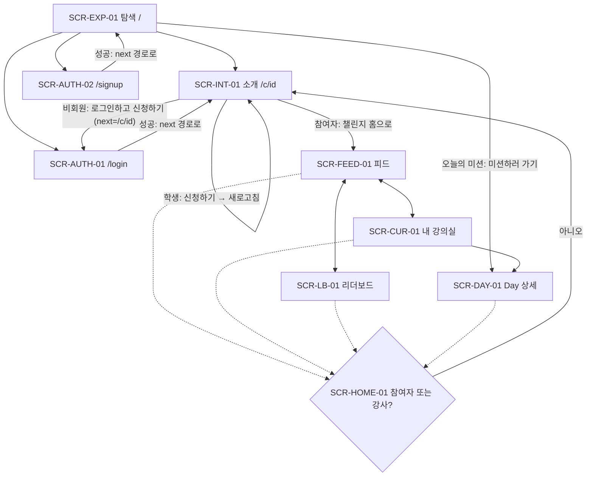

# 화면(UI/UX) 설계서

> 챌린지업 웹(`web/`)에 실제로 구현된 화면을 코드 기준으로 정리했다. 문구는 코드에 있는 그대로 인용했다. 코드나 기록에서 확인하지 못한 내용은 "미확인"으로 적었다.

| 항목 | 내용 |
|------|------|
| **문서 ID** | UIX-CHUP-v0.3 |
| **프로젝트명** | 챌린지업 (ChallengeUp) |
| **문서 버전** | 0.3 (구현 기준 재작성) |
| **작성일** | 2026-11-27 |
| **기준 커밋** | `f85c7de` |
| **작성자** | Claude Code |
| **승인자** | 미정 |
| **문서 상태** | 초안 |
| **근거** | `web/src/app/**`, `web/src/components/**`, `web/src/app/globals.css`, SRS-CHUP-v0.2 5.1, `챌린지업-화면설계/` |

---

## 1. 개요

### 1.1 범위

- 포함: 현재 코드에 라우트가 있는 화면 11개(공통 레이아웃 포함).
- 제외: SRS 5.1.2에 있지만 코드에 없는 화면 — 비밀번호 재설정(`/reset-password`), 멤버(`/c/[id]/members`), 마이페이지(`/me`), 강사 신청, 강사 스튜디오(`/studio/**`), 관리자(`/admin/**`), 완주 결과. 이 화면들은 시안만 있다(6장).

### 1.2 SRS 화면 ID 대응

이 문서는 화면별 ID를 새로 붙였다. 테스트 문서는 SRS의 SCR-01~14를 쓰므로 대응표를 둔다.

| 이 문서 ID | SRS ID | 경로 |
|---|---|---|
| SCR-EXP-01 | SCR-01 | `/` |
| SCR-AUTH-01 / SCR-AUTH-02 | SCR-02 | `/login`, `/signup` |
| SCR-INT-01 | SCR-03 | `/c/[id]` |
| SCR-HOME-01 (공통 틀) | SCR-04~07 공통 | `/c/[id]/(home)/layout.tsx` |
| SCR-FEED-01 | SCR-04 | `/c/[id]/feed` |
| SCR-CUR-01 | SCR-05 | `/c/[id]/curriculum` |
| SCR-DAY-01 | SCR-06 | `/c/[id]/day/[n]` |
| SCR-LB-01 | SCR-07 | `/c/[id]/leaderboard` |
| SCR-ERR-404 | 없음 | `not-found.tsx` |
| SCR-ERR-500 | 없음 | `error.tsx` |

### 1.3 접근 권한 용어

| 용어 | 코드상 판정 |
|---|---|
| 비회원 | `currentUserId()`가 `null` |
| 학생(참여자) | 로그인 + 그 챌린지에 활성 신청 있음 (`isMemberOf`) |
| 학생(미참여) | 로그인했지만 그 챌린지 신청 없음 |
| 강사 | `role === "instructor"`이고 챌린지의 강사 이름이 사용자 이름과 같음 (`isInstructorOf`). 강사-챌린지 연결이 이름 비교라는 점은 7장 참고 |
| 관리자 | 데모 계정 `admin`이 있지만 관리자 전용 화면은 없음 |

---

## 2. 공통 설계 기준

### 2.1 레이아웃·디자인 토큰

| 항목 | 구현 내용 | 근거 |
|---|---|---|
| 테마 | 기본 어두운 테마(`color-scheme: dark`, 배경 `grey-97 #121212`). 시스템이 라이트면 밝은 토큰으로 바뀜 | `globals.css` `@media (prefers-color-scheme: light)`, 커밋 `7da9354` |
| 글꼴 | Spoqa Han Sans Neo 400/500/700 (로컬 woff2) | `app/layout.tsx` |
| 본문 최대 폭 | `max-w-content` = 1120px, 헤더 `max-w-wide` = 1440px | `globals.css` `--container-*` |
| 주요 색 | 주 버튼 `blue-50 #4200ff`, 강조 글자 `accent-soft #f9858d`, 위험 버튼 `red-50 #e01c3a` | `globals.css` |
| 확인창 | 브라우저 기본 `confirm` 대신 `<dialog>` 자체 확인창. 왼쪽 버튼 기본 "닫기", 처음 포커스는 닫기 쪽 | `components/ConfirmDialog.tsx` |
| 토큰 원본 | `챌린지업-화면설계/ds/challengeup/tokens.json` (위치만 참조, 코드 값과의 일치 여부는 미확인) | - |

### 2.2 공통 영역

| 영역 | 구성 | 상태별 차이 |
|---|---|---|
| 헤더 (`Header.tsx`) | 로고 "챌린지업", 검색 폼(`/`로 `q` 전송, 최대 50자, `sm` 미만에서 숨김), 내 메뉴, 카테고리 줄("전체", "🔥 마감 임박", 카테고리 6개) | 비회원: "로그인", "회원가입" / 로그인: "내 챌린지"(sm 이상), 이름 첫 글자, `Lv{n}`, "로그아웃" |
| 푸터 (`Footer.tsx`) | "챌린지 둘러보기", "로그인", "회원가입" 링크, "모든 마감 시간은 한국 시간 기준이에요." | 없음 |
| 건너뛰기 링크 | "본문으로 건너뛰기" → `#main` | 없음 |

### 2.3 360px·키보드·대비 공통 기준

| 기준 | 구현 | 검증 기록 |
|---|---|---|
| 360px | 가로 목록은 카드 폭 78%로 넘겨 보기(`snap-x`), 헤더 검색은 `sm`(640px) 미만에서 숨김, "마감 임박순으로 보기"는 좁은 화면에서 "더 보기"로 줄임 | TC-CP-RES-001 부분 통과: 360·600·960·1440px × 화면 6개 가로 스크롤 없음 (`05-테스트/전체-테스트-실행-결과.md`). 화면별 결과는 미확인 |
| 터치 영역 | 주요 링크·버튼 `min-h-11`/`h-11`(44px) | 커밋 `ed20e48`, `c1e5432`, `f85c7de` |
| 키보드 | 모든 링크·버튼·입력·`summary`에 `:focus-visible` 2px 외곽선, 확인창 Esc = 닫기 | TC-AC-KBD-001 부분 통과(가입 흐름만 측정) |
| 대비 | 빨간 배지 흰 글자 4.78:1, 라이트 모드 보조 글자 5.2:1·강조 5.3:1 (코드 주석) | TC-AC-CLR-001 통과: axe 색 대비 화면 7개 위반 0건 |
| 화면 낭독 | 선택 버튼 `aria-pressed`, 탭 `aria-current="page"`, 진행률 `role="progressbar"`, 오류 `role="alert"`, 결과 `role="status"` | 화면 낭독기 실측 기록 미확인 |

### 2.4 로딩 상태 공통

- `loading.tsx`는 없다. 페이지 전환 중 로딩 화면은 따로 없다.
- 버튼 처리 중 문구와 비활성으로 표시한다(화면별 표 참고).
- 탐색 목록만 `Suspense` 대체 화면(모집 중 카드 목록)을 쓴다.

---

## 3. 화면 흐름

`next` 값은 `/`로 시작하고 `//`로 시작하지 않을 때만 쓴다(`AuthForm.tsx` `useNext`).

---

## 4. 화면 명세

### SCR-EXP-01 탐색(메인) + 오늘의 미션

| 항목 | 내용 |
|---|---|
| 경로 | `/` (`app/page.tsx`) |
| 접근 | 비회원·학생·강사 모두 |
| 관련 FR | FR-010, FR-014 |
| 대응 시안 | `Main.dc.html`, `M-Main.dc.html` |

**구성 요소**

| 순서 | 영역 | 내용 |
|---|---|---|
| 1-a | 비회원 히어로 | "혼자서는 끝까지 못 했던 공부, 같은 기수와 매일 인증하며 완주해요", 버튼 "무료로 시작하기"(`/signup`), "챌린지 둘러보기"(`/#explore`) |
| 1-b | 로그인 사용자 오늘 영역 | "{이름}님, 오늘도 한 걸음 가 볼까요?", 내 챌린지마다 `TodayMission` 카드(진행 중이고 오늘 미인증 먼저 → 시작 예정), 내 기록 카드(🔥 연속 일수, 인증 수, "완주까지", "챌린지 홈으로 →") |
| 2 | 이번 주에 시작해요 | 모집 중이고 7일 안에 시작하는 챌린지 가로 목록 |
| 3 | 지금 함께 달리는 중 | 진행 중 챌린지 가로 목록 |
| 4 | 모든 챌린지 (`ExploreList`) | 카테고리 버튼(전체 + 6개), 정렬(최신순·인기순·마감 임박순, URL `sort=popular|deadline`), 검색어 표시, 카드 12개씩 + "더 보기" |

탐색 목록은 모집 중 챌린지만 보여 준다. 검색은 제목·강사 이름 부분 일치.

**상태**

| 상태 | 표시 |
|---|---|
| 로그인했지만 신청 없음 | "아직 신청한 챌린지가 없어요. 아래에서 이번 주에 시작하는 챌린지를 골라 보세요." |
| 검색 중 | "‘{q}’ 검색 결과 {n}개" + "검색어 지우기" |
| 결과 없음 | "조건에 맞는 챌린지를 찾지 못했어요." / "필터를 바꿔 볼까요?" / 버튼 "전체 챌린지 보기" |
| 로딩 | `Suspense` 대체 화면: 모집 중 카드 목록 |
| 오늘의 미션 – 시작 전 | "시작까지 D-{n}", "{날짜}에 Day 1이 열려요", "첫 미션: {제목}" |
| 오늘의 미션 – 미인증 | "마감 23:59 (한국 시간)", 버튼 "미션하러 가기", "아직 인증하지 않았어요" |
| 오늘의 미션 – 인증 완료 | "✔ 오늘 인증을 마쳤어요" |
| 카드 배지 | 진행 중 / 정원 마감 / D-Day·D-{n}(7일 이내) / 모집 중 (`badgeOf`) |

**360px·키보드**: 가로 목록은 카드 폭 78%, 정렬 select에 숨김 라벨 "정렬", 목록 개수 변화는 `aria-live="polite"`로 "챌린지 {n}개" 안내.

---

### SCR-AUTH-01 로그인

| 항목 | 내용 |
|---|---|
| 경로 | `/login` (`app/login/page.tsx`, `LoginForm`) |
| 접근 | 누구나 (로그인 상태에서 들어와도 막지 않음) |
| 관련 FR | FR-002 |
| 대응 시안 | `Login.dc.html`, `M-Login.dc.html` |

**구성**: 제목 "로그인", "로그인하면 보던 화면으로 돌아와요.", 이메일·비밀번호 입력, "로그인" 버튼, 체험용 계정 안내("체험용 계정 (비밀번호 demo1234)", 학생·강사 이메일), "처음 왔나요? 회원가입".

**상태**

| 상태 | 표시 |
|---|---|
| 이메일 형식 오류(제출 후) | "이메일 주소를 확인해 주세요" |
| 비밀번호 비어 있음 | "비밀번호를 넣어 주세요" |
| 처리 중 | 버튼 "로그인하는 중", 비활성 |
| 서버 거절 | "이메일이나 비밀번호가 맞지 않아요" (`role="alert"`) |
| 연결 실패 | "연결이 불안정해서 보내지 못했어요. 쓴 내용은 그대로 있으니 다시 시도해 주세요" (`safeAction`) |
| 성공 | `next` 경로로 이동 후 새로고침 |

비밀번호 재설정 링크는 없다.

---

### SCR-AUTH-02 회원가입

| 항목 | 내용 |
|---|---|
| 경로 | `/signup` (`SignupForm`) |
| 접근 | 누구나 |
| 관련 FR | FR-001 |
| 대응 시안 | `Signup.dc.html` (모바일 시안 없음) |

**구성**: 이메일, 비밀번호(+ "보기"/"숨기기" 토글, 확인 칸 없음), 이름("피드와 순위표에 보이는 이름이에요"), 필수 동의 2개("이용약관에 동의해요", "개인정보 수집·이용에 동의해요"), "가입하기".

**상태**

| 상태 | 표시 |
|---|---|
| 동의 미체크 | 가입 버튼 비활성 |
| 입력 오류(제출 후) | 칸별 문구 + "표시한 {n}곳을 고쳐 주세요" |
| 비밀번호 규칙 | 안내 "영문과 숫자를 함께 넣어 주세요 (8~72자)", 72바이트 초과 시 "비밀번호가 너무 길어요. 한글·특수 문자는 1자를 2~4자로 계산해요 (72바이트까지)" |
| 이름 | "이름은 2~20자로 적어 주세요" |
| 처리 중 | "가입하는 중" |
| 중복 이메일 | "이미 가입한 이메일이에요. 로그인하거나 비밀번호를 찾아 주세요" |
| 서버 오류(DB 모드) | "가입하지 못했어요. 잠시 뒤 다시 해 주세요" |
| 성공 | 바로 로그인된 상태로 `next`(기본 `/`) 이동. 인증 메일 안내 화면은 없음(SRS FR-001-AC1과 다름) |

---

### SCR-INT-01 챌린지 소개

| 항목 | 내용 |
|---|---|
| 경로 | `/c/[id]` (`app/c/[id]/page.tsx`), `dynamicParams = false`라 시드에 없는 id는 404 |
| 접근 | 누구나 |
| 관련 FR | FR-011, FR-012 |
| 대응 시안 | `About.dc.html`, `M-About.dc.html` |

**구성**: 카테고리·제목·요약, 썸네일 색면, 강사 이름·소개, "챌린지 상세 정보"(기간, 완주 조건 "{days}일 중 {need}일 인증하면 완주", 인증 방법, 마감 "매일 23:59 (한국 시간)", 정원, 가격), "소개", "커리큘럼"(Day 1~7 미리보기, 비참여자는 자물쇠 아이콘 + "Day 8 ~ Day {n}까지 이어져요"), 오른쪽 신청 카드(배지, 가격, 참여 인원, 남은 자리, 시작까지/진행).

**신청 버튼 상태 (`Cta`)**

| 조건 | 버튼 |
|---|---|
| 참여자 | "챌린지 홈으로" → `/c/[id]/feed` |
| 모집 중 아님 | "모집이 끝났어요" (비활성) |
| 정원 참 | "정원 마감" (비활성) |
| 비회원 | "로그인하고 신청하기" → `/login?next=/c/[id]` |
| 신청 가능 | `EnrollButton` "신청하기" → 처리 중 "신청하는 중이에요", 아래 "{시작일} 0시에 Day 1이 열려요." |
| 신청 실패 | 서버 문구를 `role="alert"`로 표시 (API설계서 3.4 실패 문구) |
| 모집 중 안내 | "모집은 {시작 전날} 23:59 (한국 시간)에 마감돼요." |

참여 인원·남은 자리는 시드 값(`c.enrolled`)으로 계산한다. 화면 코드에는 새 신청을 더하는 부분이 없다(서버의 정원 판정은 `enrolledCount`로 새 신청을 더함). 7장 참고.

신청 취소 버튼은 없다(서버 액션만 있음).

---

### SCR-HOME-01 챌린지 홈 공통 틀

| 항목 | 내용 |
|---|---|
| 경로 | `/c/[id]/(home)/layout.tsx` — 피드·내 강의실·리더보드·Day에 공통 |
| 접근 | 그 챌린지 참여자 또는 그 챌린지 강사. 그 밖에는 `/c/[id]`로 `redirect` |
| 관련 FR | FR-004, FR-013, FR-019 |
| 대응 시안 | `Feed.dc.html` 등 챌린지 홈 시안의 공통 부분 |

**구성**: "{카테고리} · {강사}" 링크, 제목, 진행 표시(시작 전 "{날짜} 시작 · D-{n}", 진행 중 "Day {n} / {days} 진행 중", 끝 "종료된 챌린지"), 탭(`HomeTabs`: 피드 · 내 강의실 · 리더보드, Day 화면에서는 내 강의실 탭 활성), 오른쪽 요약.

| 요약 영역 | 참여자 | 강사 |
|---|---|---|
| 내 진행률 | "{done} / {need}일", "완주까지 {n}일 더", 진행률 막대 | "강사로 보고 있어요. 모든 Day를 볼 수 있고, 인증은 제출하지 않아요." |
| 오늘의 미션(compact) | 있음 | 없음 |
| 오늘 인증한 사람 | "{n}명", "{total}명 중 · {rate}%" | 같음 |
| 이번 주 순위 | 7일 기준 상위 5명 + "전체 보기" | 같음 |

---

### SCR-FEED-01 피드

| 항목 | 내용 |
|---|---|
| 경로 | `/c/[id]/feed` (`feed/page.tsx`, `Feed.tsx`) |
| 접근 | SCR-HOME-01과 같음 |
| 관련 FR | FR-017, FR-018 |
| 대응 시안 | `Feed.dc.html`, `M-Feed.dc.html` |

**구성**: 글쓰기 진입 카드("궁금한 점이나 오늘 이야기를 남겨 보세요", "글쓰기"), 종류 필터(전체·인증·질문·공지), 글 카드(작성자, "강사" 표시, 시각, " · 수정됨", "📌 공지"/종류, " · Day {n}", 좋아요 수, 댓글 수), 내 질문·자유 글의 "글 메뉴"(수정하기·삭제하기), 글쓰기/수정 모달(게시판 질문·자유, 제목, 본문, "Ctrl + Enter로 바로 올릴 수 있어요", "게시하기"/"저장하기").

python-21 챌린지는 시드 예시 글(`id`가 `seed-`로 시작)을 함께 보여 주며, 예시 글의 좋아요는 화면에서만 바뀐다.

**상태**

| 상태 | 표시 |
|---|---|
| 빈 목록 | "아직 {필터} 글이 없어요. 첫 글을 남겨 볼까요?" |
| 저장 중 | "저장하는 중" |
| 작성 중 닫기 | 확인창 "작성 중인 내용이 사라져요" / "닫으면 지금까지 쓴 내용은 저장되지 않아요." / "계속 쓰기"·"나가기" |
| 삭제 확인 | "이 글을 삭제할까요?" / "삭제한 글은 되돌릴 수 없어요." / "닫기"·"삭제하기" |
| 처리 중 카드 | 반투명(`opacity-60`) |
| 서버 거절 | 서버 문구 표시 (API설계서 3.5~3.9) |
| 연결 실패 | 글쓰기·수정은 `safeAction` 공통 문구. 좋아요·삭제는 `safeAction`을 쓰지 않음 |
| 끝난 챌린지 | 서버가 "끝난 챌린지예요. 지난 글은 계속 볼 수 있어요"로 거절 |

댓글 작성 화면은 없다. 댓글은 개수만 보인다(`addCommentAction`은 있으나 화면에서 호출하지 않음).

---

### SCR-CUR-01 내 강의실(커리큘럼)

| 항목 | 내용 |
|---|---|
| 경로 | `/c/[id]/curriculum` |
| 접근 | SCR-HOME-01과 같음 (강사는 모든 Day 열람) |
| 관련 FR | FR-013, FR-014 |
| 대응 시안 | `Curriculum.dc.html`, `M-Curriculum.dc.html` |

**구성**: ① 오늘 할 일 카드 ② 전체 진행(Day 칸 7열 격자 + 범례 인증·확인 중·놓침·오늘) ③ 주차별 강의 목록(`
`, 이번 주만 펼침).

**상태**

| 상태 | 표시 |
|---|---|
| 시작 전 | "시작까지 D-{n}", "{날짜} 00:00에 Day 1이 열려요", "첫 미션은 ‘{제목}’이에요. 시작 전에 피드에서 같은 기수와 인사를 나눠 보세요.", "피드로 가기" |
| 오늘 미인증 | "이어서 하기", 버튼 "강의 보고 인증하기", "오늘 23:59까지 인증해야 연속 기록이 이어져요" |
| 오늘 확인 중 | 버튼 "제출한 인증 보기" |
| 오늘 인증 | "오늘 인증을 마쳤어요", 버튼 "오늘 강의 다시 보기" |
| 진행 요약 | "완주까지 {n}일 남았어요", "인증 {n} · 놓침 {n} · 완주 기준 {n}일" |
| 잠긴 주차/Day | "{날짜}에 열려요", "{날짜} 00:00에 열려요", 링크 없음, 숨김 글 "잠김" |
| Day 상태 글 | "인증했어요" / "확인 중" / "놓쳤어요" / "오늘 · 인증하기" / "다시 보기" |

**키보드·화면 낭독**: Day 칸마다 `aria-label="Day {n} {상태}"`. Day 칸 높이는 36px(`h-9`)로 44px 기준보다 작다(7장).

---

### SCR-DAY-01 Day 상세 + 인증

| 항목 | 내용 |
|---|---|
| 경로 | `/c/[id]/day/[n]`, `dynamicParams = false` |
| 접근 | SCR-HOME-01과 같음. 학생은 오늘 이후 Day가 잠김, 강사는 모두 열람 |
| 관련 FR | FR-013, FR-015, FR-018 |
| 대응 시안 | `Day.dc.html`, `M-Day.dc.html` |

**구성**: "내 강의실 · Day {n} / {days} · {날짜}", Day 제목, 강의 영상 자리("강사가 영상을 올리면 이 자리에서 바로 볼 수 있어요." — 실제 영상 재생 없음), "오늘의 미션"(+ "힌트"), "인증" 영역, 이전/다음 Day 이동.

**인증 영역 상태**

| 조건 | 표시 |
|---|---|
| 잠긴 Day(학생) | "아직 열리지 않은 Day예요", "{날짜} 00:00 (한국 시간)에 열려요.", "내 강의실로 돌아가기" |
| 인정됨 | "✔ 인증을 마쳤어요" + "+{점수}점 · 🔥 {n}일 연속", 제출 내용, "피드에도 올라갔어요." |
| 강사 확인 중 | "제출했어요. 강사가 확인하면 인정돼요" |
| 강사가 봄 | "강사는 인증을 제출하지 않아요. 참여자 인증은 피드에서 볼 수 있어요." |
| 지난 Day 미인증 | "Day {n} 인증 마감이 지났어요. 강의와 미션은 계속 볼 수 있어요." |
| 오늘 Day 미인증 | `CheckinForm` (아래) |

**인증 폼 (`CheckinForm`)**

| 항목 | 내용 |
|---|---|
| 형식별 입력 | 텍스트: "코드와 실행 결과"(최대 2,000자, 10자 이상) / 링크: "결과물 링크" / 체크: "한마디 (선택)"(200자). 사진 형식 입력 칸은 없음 |
| 공개 범위 | "공개 · 피드에 올리기" / "비공개 · 강사만 보기" |
| 제출 버튼 | "인증하기"(체크 형식은 "완료했어요"), 처리 중 "보내는 중" |
| 검증 문구 | "10자 이상 적어 주세요", "http:// 또는 https://로 시작하는 주소를 넣어 주세요" |
| 마감 표시 | 평소 "마감 23:59 (한국 시간)", 5분 남으면 "마감까지 {m}분 {s}초"(`aria-live`) |
| 마감 지남 | 버튼 비활성 + "아쉽지만 Day {n} 인증 마감(23:59)이 지났어요. 다음 Day는 내일 00:00에 열려요. 쓴 내용은 이 기기에 남아 있어요." |
| 오프라인 | 버튼 비활성 + "인터넷 연결이 끊겼어요. 쓰던 내용은 이 기기에 저장하고 있어요." |
| 임시 저장 | `localStorage` 키 `cu-draft-{id}-{day}`, 다시 열면 "작성 중이던 내용을 불러올까요?" "불러오기"·"새로 쓰기" |
| 성공 | "+{점수}점 · 🔥 {n}일 연속", "인증을 마쳤어요."/"강사가 확인하면 인정돼요." + 공개 범위 문구 + "내일 0시에 다음 Day가 열려요." |
| 실패 | 서버 문구(API설계서 3.3) 또는 연결 실패 공통 문구 |

---

### SCR-LB-01 리더보드

| 항목 | 내용 |
|---|---|
| 경로 | `/c/[id]/leaderboard` |
| 접근 | SCR-HOME-01과 같음 |
| 관련 FR | FR-018, FR-019 |
| 대응 시안 | `Leaderboard.dc.html`, `M-Leaderboard.dc.html` |

**구성**: 기간 버튼("최근 7일"·"최근 30일"·"전체 기간"), 내 순위 줄, 순위 표(순위·이름+Lv·연속·포인트, `caption` "최근 {기간} 포인트 순위"), "점수 받는 방법" 접기.

| 상태 | 표시 |
|---|---|
| 빈 목록 | "첫 참여자를 기다리고 있어요" |
| 내 순위 1등 | "지금 1등이에요" |
| 그 외 | "{n}점 더 모으면 한 단계 올라가요" |
| 연속 없음 | "-" (`aria-label="연속 인증 없음"`) |

같은 점수는 같은 순위, 다음 순위는 건너뛴다(1, 1, 3).

---

### SCR-ERR-404 페이지 없음

| 항목 | 내용 |
|---|---|
| 경로 | `app/not-found.tsx` (없는 주소, `notFound()` 호출) |
| 접근 | 누구나 |
| 대응 시안 | `NotFound.dc.html` |
| 표시 | "404", "페이지를 찾지 못했어요", "주소를 다시 확인해 주세요.", 버튼 "챌린지 둘러보기"(44px) |

### SCR-ERR-500 오류 화면

| 항목 | 내용 |
|---|---|
| 경로 | `app/error.tsx` (화면을 그리다 오류) |
| 접근 | 누구나 |
| 대응 시안 | 없음 |
| 표시 | "화면을 불러오지 못했어요", "잠시 뒤 다시 시도해 주세요. 계속 안 되면 홈에서 다시 들어와 주세요.", digest가 있으면 "오류 번호 {digest}", 버튼 "다시 시도하기"·"홈으로" |

루트 레이아웃 자체의 오류를 받는 `global-error.tsx`는 없다.

---

## 5. 화면-요구사항 대응

| FR | 화면 | 구현 정도 |
|---|---|---|
| FR-001 회원가입 | SCR-AUTH-02 | 인증 메일 없음 |
| FR-002 로그인/로그아웃 | SCR-AUTH-01, 헤더 | 구글 로그인·비밀번호 재설정 없음 |
| FR-004 역할·권한 | SCR-HOME-01 | 화면 접근 제어는 서버 코드에서 |
| FR-010 탐색 | SCR-EXP-01 | 구현 |
| FR-011 소개 | SCR-INT-01 | 구현 |
| FR-012 신청·취소 | SCR-INT-01 | 신청만 화면 있음 |
| FR-013 커리큘럼·Day | SCR-CUR-01, SCR-DAY-01 | 영상·자료 표시 없음 |
| FR-014 오늘의 미션 | SCR-EXP-01, SCR-HOME-01 | 구현 |
| FR-015 미션 인증 | SCR-DAY-01 | 제출만. 수정·삭제·사진 없음 |
| FR-017 피드 | SCR-FEED-01 | 댓글 작성·공지 작성·숨김 화면 없음 |
| FR-018 포인트·레벨 | SCR-LB-01, 헤더 | 구현 |
| FR-019 리더보드·스트릭 | SCR-LB-01, SCR-HOME-01 | 구현 |
| FR-003, 005~009, 016, 020~023 | 없음 | 화면 미구현 |

---

## 6. 시안 위치

시안 파일은 `챌린지업-화면설계/`에 있고 배치는 `canvas.json`에 있다. 토큰은 `ds/challengeup/tokens.json`.

| 시안 파일 | 시안 제목(`<title>`) | 대응 구현 화면 |
|---|---|---|
| `IA.dc.html` | 챌린지업 IA | 전체 구조 |
| `Main.dc.html`, `M-Main.dc.html` | 챌린지업 메인 / 모바일 메인 | SCR-EXP-01 |
| `Login.dc.html`, `M-Login.dc.html` | 로그인 | SCR-AUTH-01 |
| `Signup.dc.html` | 회원가입 | SCR-AUTH-02 |
| `About.dc.html`, `M-About.dc.html` | 챌린지 소개 | SCR-INT-01 |
| `Feed.dc.html`, `M-Feed.dc.html` | 챌린지 홈 피드 | SCR-FEED-01 |
| `Curriculum.dc.html`, `M-Curriculum.dc.html` | 챌린지 홈 커리큘럼 | SCR-CUR-01 |
| `Day.dc.html`, `M-Day.dc.html` | Day 7 인증 | SCR-DAY-01 |
| `Leaderboard.dc.html`, `M-Leaderboard.dc.html` | 챌린지 홈 리더보드 | SCR-LB-01 |
| `NotFound.dc.html` | 페이지를 찾지 못했어요 | SCR-ERR-404 |
| `Reset.dc.html`, `Members.dc.html`, `MyPage.dc.html`, `M-MyPage.dc.html`, `Result.dc.html`, `StudioList.dc.html`, `StudioNew.dc.html`, `StudioDash.dc.html`, `M-StudioDash.dc.html`, `Admin.dc.html` | 재설정·멤버·마이페이지·완주 결과·스튜디오·관리자 | 미구현 |

**채택 기록**: 화면마다 시안이 한 벌씩만 있다. 시안 후보 비교·채택 결정 기록은 **기록 없음**. 구현이 시안과 얼마나 같은지 비교한 기록도 미확인.

---

## 7. 미확인·확인 필요 사항

| 번호 | 내용 |
|---|---|
| 7-1 | 소개 화면 "참여 인원"·"남은 자리"는 시드 값(`c.enrolled`)이라 새 신청이 반영되지 않는 것으로 보인다. 실제 운영 화면 확인은 미확인 |
| 7-2 | 강사-챌린지 연결이 이름 비교(`c.instructor.name === user.name`). 같은 이름의 다른 강사가 있으면 잘못 연결될 수 있다 |
| 7-3 | 로그인 화면의 체험용 계정 안내가 DB 모드(운영)에서도 보인다. 운영에서 그 계정이 동작하는지 미확인 |
| 7-4 | 내 강의실 Day 칸(36px)·피드 필터 버튼(34px)·리더보드 기간 버튼(34px)은 44px 터치 기준보다 작다 |
| 7-5 | 화면별 360px 결과, 화면 낭독기 실측, 모바일 실기기 확인은 미확인 |
| 7-6 | 신청 취소·댓글 작성은 서버 액션만 있고 화면이 없다 |
