# 상세 설계서 (Detailed Design Document)

> 작성 근거: [SRS](../01-요구사항분석/요구사항명세서-SRS.md) SRS-CHUP-v0.1, [유스케이스 명세서](../01-요구사항분석/유스케이스명세서.md) UCS-CHUP-v0.1, [비즈니스 정책서](../00-기획/비즈니스정책서.md) BPD-CHUP-v0.2.
>
> **02-시스템설계 문서(SAD·DB·API·화면 설계서)는 아직 양식 상태로 작성되지 않았다.** 이 문서는 그 양식의 구조를 참고하되, 구현에 필요한 시스템 수준 결정을 1.3.1의 가정(ASM-01~10)으로 적고 그 위에서 설계했다. 02 문서를 작성할 때 이 가정을 확정하거나 바꾸고, 바뀌면 이 문서를 함께 고친다.

| 항목 | 내용 |
|------|------|
| **문서 ID** | DDS-CHUP-v0.2 |
| **프로젝트명** | 챌린지업 (ChallengeUp) — 온라인 강의 챌린지 플랫폼 |
| **문서 버전** | v0.2 |
| **작성일** | 2026-11-24 |
| **작성자** | Claude Code (초안) |
| **승인자** | 미정 |
| **문서 상태** | 초안 |

---

## 1. 문서 개요

### 1.1 목적

본 문서는 챌린지업의 상세 설계를 정의한다. 각 모듈의 데이터 구조, 서비스 인터페이스, 시퀀스 흐름, 상태 전이, 핵심 알고리즘(Day 날짜·마감, 신청 동시성, 포인트 원장, 스트릭, 완주 판정)과 코딩 표준을 구현 수준으로 기술한다.

### 1.2 범위

- 도메인 모델(테이블·열거형) 및 클래스 다이어그램
- 핵심 유스케이스(UC-002, 009, 011, 016)의 시퀀스 다이어그램
- 챌린지·신청·인증·강사 신청의 상태 전이
- 모듈 11개의 인터페이스, 의존성, 주요 로직 (FR-001~023)
- RLS 접근 정책표 (FR-004, NFR-004)
- 디자인 패턴 적용 기록
- 코딩 표준 및 코드 리뷰 체크리스트
- 범위 밖: FR-024(결제·매출 배분), FR-025(외부 알림) — v2에서 별도 설계

### 1.3 참조 문서

| 문서명 | 버전 | 비고 |
|--------|------|------|
| 시스템 아키텍처 설계서 (SAD) | 미작성 | 1.3.1 ASM으로 대신함 |
| 데이터베이스 설계서 | 미작성 | 2.1 도메인 모델을 기준안으로 제안 |
| API 설계서 | 미작성 | SRS 5.2.2 Server Action·RPC 목록을 따름 |
| 화면 설계서 | 미작성 | SRS 5.1.2 화면 목록, DESIGN.md |
| 요구사항 정의서 (SRS) | v0.1 | 기능/비기능 요구사항 |
| 유스케이스 명세서 | v0.1 | 흐름·예외 |
| 비즈니스 정책서 | v0.2 | 규칙 값 |

#### 1.3.1 시스템 설계 가정 (02 문서 작성 시 확정)

| ASM-ID | 가정 | 근거 | 확정할 문서 |
|--------|------|------|-------------|
| ASM-01 | 모놀리식 Next.js(App Router) 앱 하나가 화면과 서버 로직을 모두 담당한다. 별도 API 서버는 두지 않는다 | 서비스 기획서 5.5, 소규모 팀 | SAD |
| ASM-02 | 읽기는 Server Components에서 Supabase로 직접 조회하고, 쓰기는 Server Actions가 처리한다 | SRS 5.2.1 | SAD, API |
| ASM-03 | 여러 행을 함께 바꾸는 규칙(신청, 인증, 인정, 판정, 상태 전환)은 Postgres 함수(RPC, `security definer`)로 한 트랜잭션에서 처리한다 | 정원 동시성(BP-ENR-001-6), 포인트 멱등성 | SAD, DB |
| ASM-04 | 권한은 모든 테이블의 RLS로 강제한다. 서버 코드의 service role 키는 정기 작업·관리자 작업에만 쓴다 | NFR-004 | SAD |
| ASM-05 | 정기 작업은 Supabase pg_cron이 DB 함수를 직접 실행한다 (00:00 KST = 15:00 UTC) | FR-008, FR-020 | SAD |
| ASM-06 | 날짜는 DB에 `date`(시작일·종료일)와 `timestamptz`(시각)로 저장하고, 모든 판단은 `Asia/Seoul` 기준으로 변환해서 한다 | NFR-012 | DB |
| ASM-07 | 파일은 Supabase Storage 버킷 3개: `thumbnails`(공개), `avatars`(공개), `submissions`(비공개, 서명 URL) | NFR-005 | SAD |
| ASM-08 | 실시간 구독(Realtime)은 쓰지 않는다. 피드는 작성 후 화면 갱신(revalidate)과 무한 스크롤 재조회로 처리한다 | MVP 단순화 | SAD |
| ASM-09 | 1회성 안내 배너(강사 승인 결과, 챌린지 취소, 완주 결과)는 `notices` 테이블에 쌓고 읽으면 표시 완료로 바꾼다 | BP-NOTI-001 | DB |
| ASM-10 | 리더보드·대시보드 통계는 조회 시 SQL로 계산한다. NFR-001을 넘으면 집계 뷰로 바꾼다 | NFR-009 | DB |

### 1.4 변경 이력

| 버전 | 날짜 | 작성자 | 변경 내용 |
|------|------|--------|-----------|
| v0.1 | 2026-11-24 | Claude Code | SRS v0.1·UCS v0.1 기반 초안. 02 문서 부재로 ASM 목록 추가 |
| v0.2 | 2026-11-25 | Claude Code | 테스트 시각 고정(`app_now()`, `Clock` 주입) 추가, 리더보드 동점 기준을 정책과 일치, 화면 문구 해요체 |

---

## 2. 클래스 다이어그램

### 2.1 도메인 모델 전체 뷰

DB 테이블(snake_case)과 TypeScript 타입(camelCase)은 1:1로 대응한다. 아래는 테이블 기준이다.

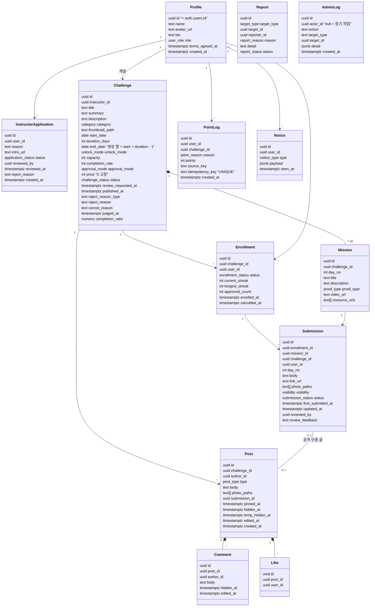

**열거형**

| 타입 | 값 | 정책 근거 |
|------|----|-----------|
| `user_role` | `student`, `instructor`, `admin` | BP-AUTH-003 |
| `application_status` | `pending`, `approved`, `rejected` | BP-AUTH-004 |
| `category` | `dev`, `design`, `language`, `self_dev`, `fitness`, `finance` | BP-CHAL-002 |
| `challenge_status` | `draft`(작성 중), `in_review`(검수 대기), `recruiting`(모집 중), `in_progress`(진행 중), `ended`(종료), `cancelled`(취소됨) | BP-CHAL-001 |
| `unlock_mode` | `daily`, `all_at_start` | BP-CONTENT-002-1 |
| `approval_mode` | `auto`, `manual` | BP-SUB-004 |
| `proof_type` | `text`, `photo`, `link`, `check` | BP-SUB-001 |
| `enrollment_status` | `active`, `cancelled`, `challenge_cancelled`, `completed`, `incomplete` | BP-ENR-003 |
| `submission_status` | `pending`(대기), `approved`(인정), `rejected`(반려) | BP-SUB-004 |
| `visibility` | `public`, `private` | BP-SUB-002-4 |
| `post_type` | `proof`, `question`, `free`, `notice` | BP-FEED-001 |
| `point_reason` | `proof_approved`, `early_bonus`, `like_received`, `comment_written`, `streak_bonus`, `revoke` | BP-POINT-001, 003 |
| `report_reason` | `abuse`, `spam`, `obscene`, `privacy`, `other` | BP-FEED-003-1 |
| `report_status` | `open`, `hidden`, `kept` | BP-FEED-003-3 |
| `notice_type` | `instructor_result`, `challenge_rejected`, `challenge_cancelled`, `completion_result`, `review_auto_returned` | BP-NOTI-001 |

**주요 제약·인덱스**

| 대상 | 제약 / 인덱스 | 목적 |
|------|---------------|------|
| `missions` | UNIQUE(`challenge_id`, `day_no`) | Day 중복 방지 |
| `enrollments` | 부분 UNIQUE(`challenge_id`, `user_id`) WHERE `status = 'active'` | 활성 신청 1개 (BP-ENR-001-3) |
| `submissions` | UNIQUE(`enrollment_id`, `mission_id`) | Day당 1건 (BP-SUB-002-2) |
| `posts` | UNIQUE(`submission_id`) WHERE NOT NULL | 인증 글 1:1 |
| `likes` | UNIQUE(`post_id`, `user_id`) | 좋아요 1회 |
| `reports` | UNIQUE(`target_type`, `target_id`, `reporter_id`) | 중복 신고 방지 |
| `point_logs` | UNIQUE(`idempotency_key`), INDEX(`challenge_id`, `created_at`), INDEX(`user_id`), INDEX(`source_key`) | 멱등 적립, 리더보드 기간 합계 |
| `challenges` | CHECK(`duration_days` BETWEEN 7 AND 60), CHECK(`capacity` BETWEEN 1 AND 300), CHECK(`completion_rate` BETWEEN 50 AND 100 AND `completion_rate` % 10 = 0), CHECK(`price` = 0), INDEX(`status`, `start_date`) | BP-CHAL-002, BP-PAY-001-1 |
| `admin_logs` | update·delete 금지 (RLS·트리거) | NFR-006 |

### 2.2 서비스 계층 클래스 다이어그램

각 기능 모듈은 `actions.ts`(Server Action, 입력 검증·권한 1차 확인) → `service.ts`(도메인 규칙 조합) → `repository.ts`(Supabase 조회·RPC 호출) 구조를 가진다. 순수 계산은 `src/domain`에 두고 화면·서버 양쪽에서 쓴다.

```mermaid
classDiagram
    class DayCalendar {
        <<domain>>
        +dayDate(startDate, dayNo) Date
        +isOpen(challenge, dayNo, now) bool
        +deadline(startDate, dayNo) Instant
        +isEarly(firstSubmittedAt, startDate, dayNo) bool
        +todayDayNo(challenge, now) int?
        +requiredCount(durationDays, rate) int
    }
    class StreakCalculator {
        <<domain>>
        +calculate(days: DayProofState[], today) StreakResult
        +expectedBonuses(longest) BonusSpec[]
    }
    class PointRules {
        <<domain>>
        +PROOF = 10
        +EARLY = 5
        +LIKE = 1
        +COMMENT = 2
        +COMMENT_DAILY_LIMIT = 5
        +levelOf(total) int
        +nextLevelGap(total) int
    }
    class ProofValidator {
        <<domain / strategy>>
        +validate(proofType, payload) ValidationResult
    }

    class ChallengeService {
        +createDraft(instructorId)
        +saveStep(id, step, dto)
        +requestReview(id)
        +cancelReviewRequest(id)
        +review(id, decision, reason)
        +update(id, patch)
        +cancel(id, reason)
        +listPublic(query)
        +getDetail(id, viewer)
    }
    class EnrollmentService {
        +enroll(challengeId)
        +cancel(enrollmentId)
        +listMine(userId)
    }
    class CurriculumService {
        +listDays(challengeId, viewer)
        +getDay(challengeId, dayNo, viewer)
        +todayMissions(userId)
    }
    class SubmissionService {
        +submit(missionId, payload)
        +update(submissionId, payload)
        +remove(submissionId)
        +review(submissionId, decision, feedback)
        +listForInstructor(challengeId, filter)
    }
    class FeedService {
        +list(challengeId, cursor)
        +create(dto)
        +update(postId, dto)
        +remove(postId)
        +pin(postId)
        +hide(targetType, targetId)
        +toggleLike(postId)
        +comment(postId, body)
        +report(target, reason, detail)
        +resolveReport(target, decision)
    }
    class PointService {
        +leaderboard(challengeId, period)
        +summary(userId)
    }
    class DashboardService {
        +overview(challengeId)
        +dayRates(challengeId)
        +atRiskStudents(challengeId)
        +completionResult(challengeId)
    }
    class InstructorService {
        +apply(dto)
        +review(applicationId, decision, reason)
    }
    class ProfileService {
        +get(userId)
        +update(userId, dto)
        +consumeNotices(userId)
    }

    ChallengeService ..> DayCalendar
    CurriculumService ..> DayCalendar
    SubmissionService ..> ProofValidator
    SubmissionService ..> DayCalendar
    PointService ..> PointRules
    DashboardService ..> DayCalendar
    ProfileService ..> PointRules
```

### 2.3 Infrastructure 계층 클래스 다이어그램

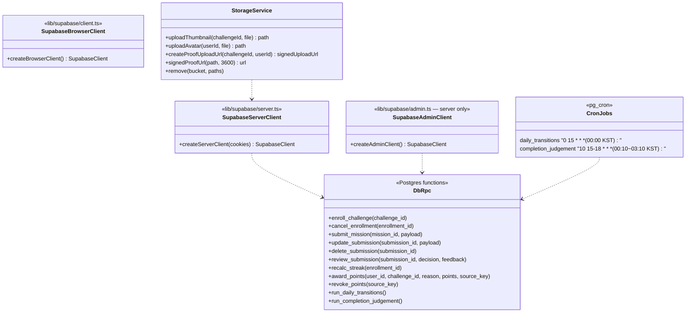

---

## 3. 시퀀스 다이어그램

### 3.1 로그인 플로우 (UC-002, FR-002)

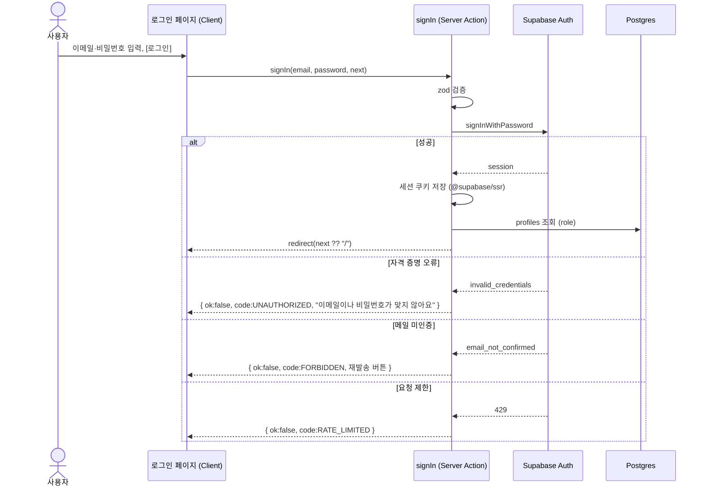

### 3.2 챌린지 신청 플로우 (UC-009, FR-012)

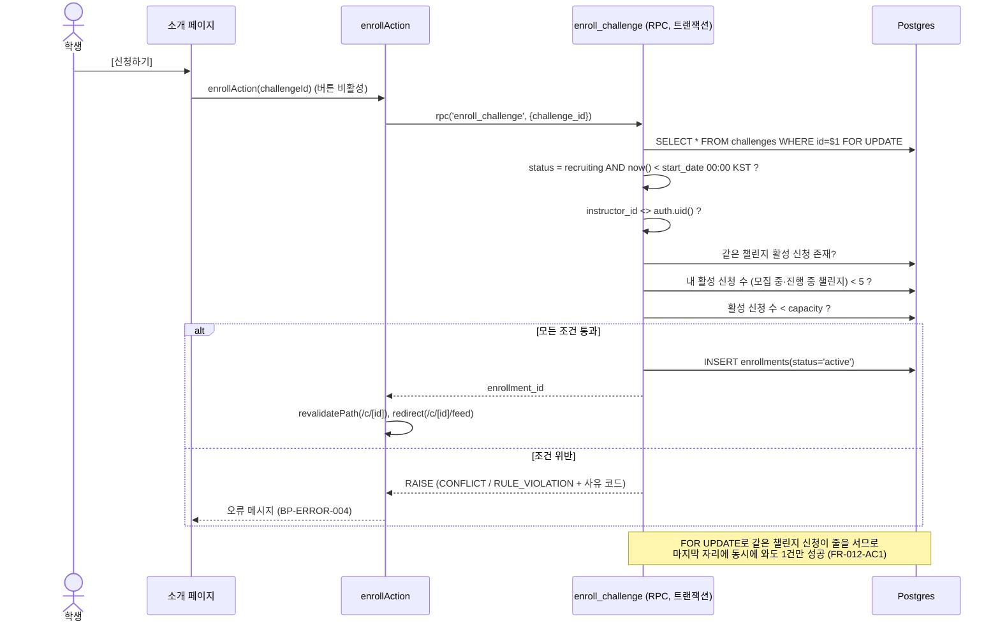

### 3.3 미션 인증 제출 플로우 (UC-011, FR-015·018·019)

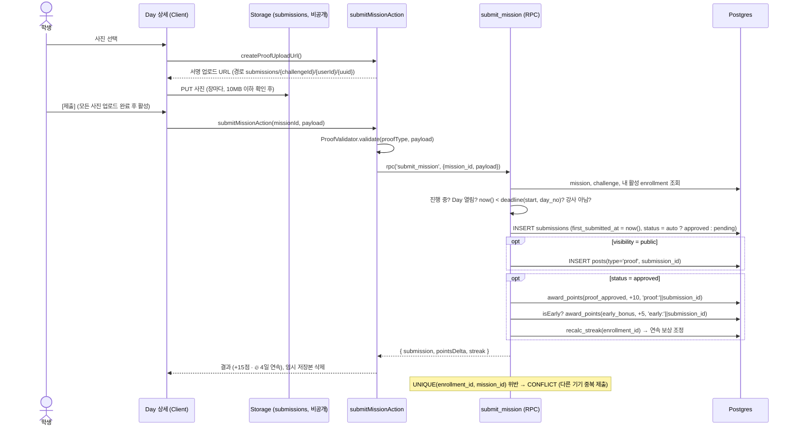

### 3.4 일일 상태 전환 플로우 (UC-016, FR-008·019)

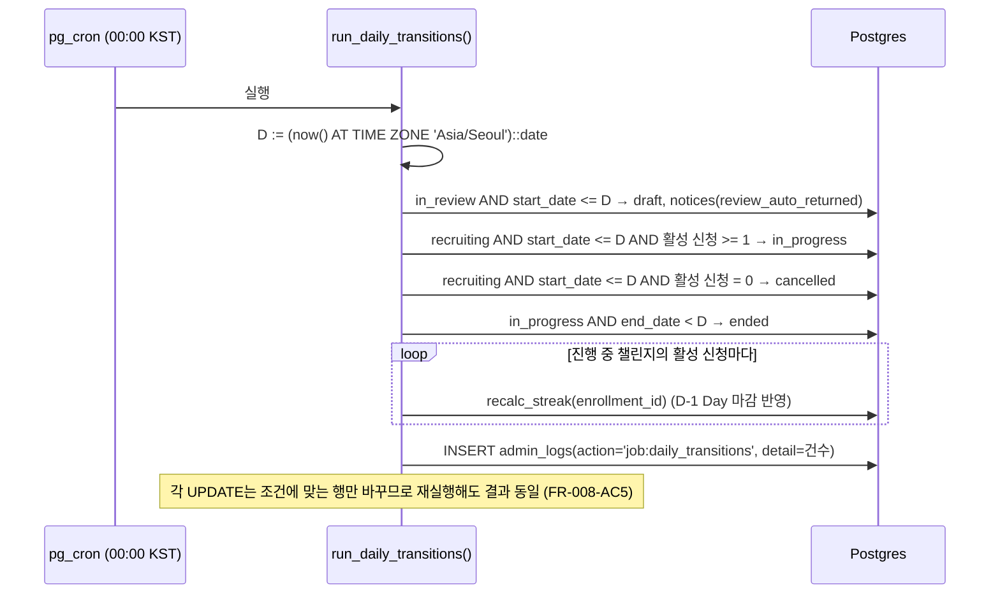

### 3.5 완주 판정 플로우 (UC-016, FR-020)

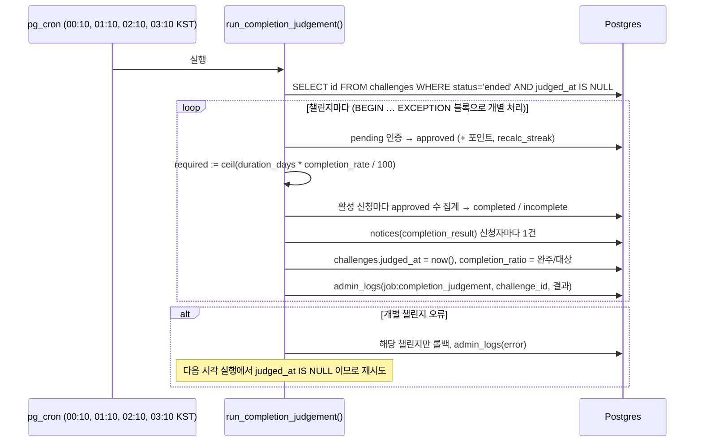

---

## 4. 상태 다이어그램

### 4.1 챌린지 상태 (Challenge Status)

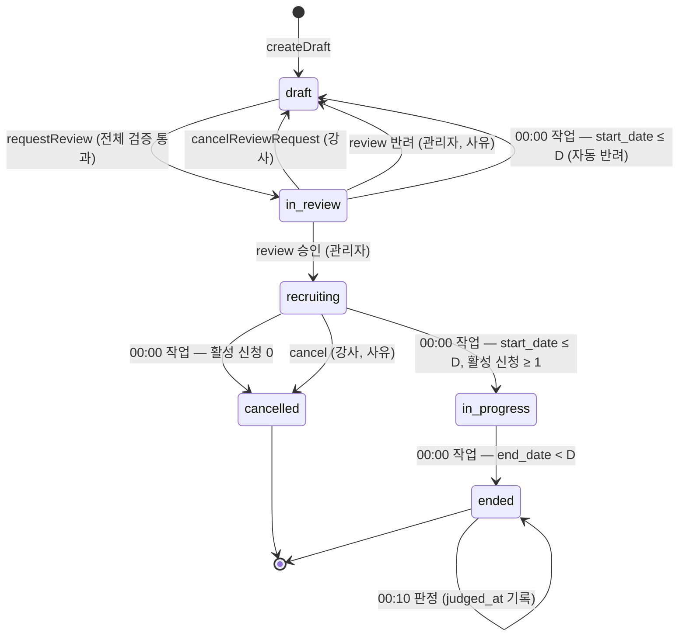

#### 상태 전이 규칙

| 현재 상태 | 이벤트 | 다음 상태 | 권한 | 부가 동작 |
|-----------|--------|-----------|------|-----------|
| - | 새 챌린지 | draft | 강사 | 빈 챌린지 생성 |
| draft | 검수 요청 | in_review | 강사 본인 | 전체 검증, `review_requested_at` |
| in_review | 검수 요청 취소 | draft | 강사 본인 | - |
| in_review | 승인 | recruiting | 관리자 | `published_at`, admin_logs |
| in_review | 반려 | draft | 관리자 | 사유 저장, notices(challenge_rejected), admin_logs |
| in_review | 자동 반려 | draft | 스케줄러 | notices(review_auto_returned) |
| recruiting | 시작일 도래 | in_progress / cancelled | 스케줄러 | 신청 0명이면 cancelled |
| recruiting | 취소 | cancelled | 강사 본인 | 활성 신청 → challenge_cancelled, notices |
| in_progress | 종료일 경과 | ended | 스케줄러 | 인증 마감, 피드 읽기 전용 |
| ended | 판정 | ended | 스케줄러 | `judged_at`, `completion_ratio` |

다른 전이는 모두 거절한다 (BP-CHAL-001-1). 전이 검사는 각 RPC/서비스의 Guard Clause와 DB 트리거 `challenges_status_transition_check` 두 곳에서 한다.

### 4.2 신청 상태 (Enrollment Status)

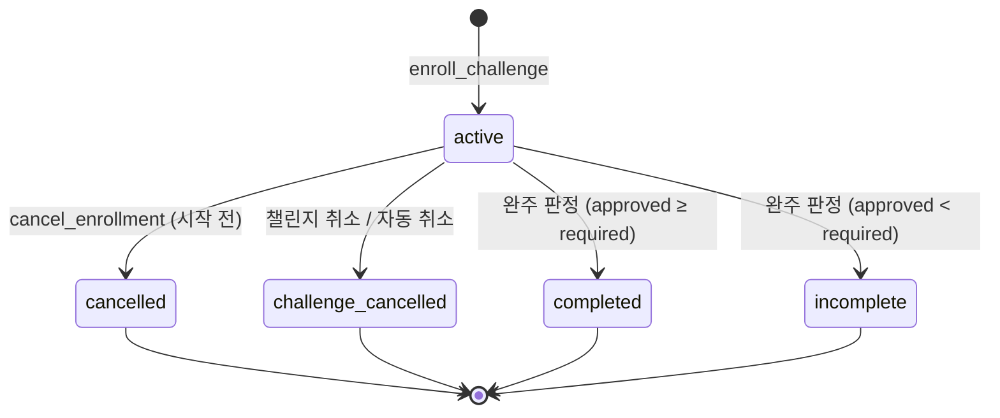

| 현재 상태 | 이벤트 | 다음 상태 | 트리거 | 부가 동작 |
|-----------|--------|-----------|--------|-----------|
| - | 신청 | active | 학생 | 3.2 |
| active | 취소 | cancelled | 학생 (시작일 전날 23:59:59까지) | `cancelled_at`, 자리 반환 |
| active | 챌린지 취소 | challenge_cancelled | 강사 / 스케줄러 | notices(challenge_cancelled) |
| active | 판정 | completed / incomplete | 스케줄러 | notices(completion_result) |

취소한 사용자가 다시 신청하면 새 `active` 행을 만든다 (부분 UNIQUE가 active만 제한).

### 4.3 인증 상태 (Submission Status)

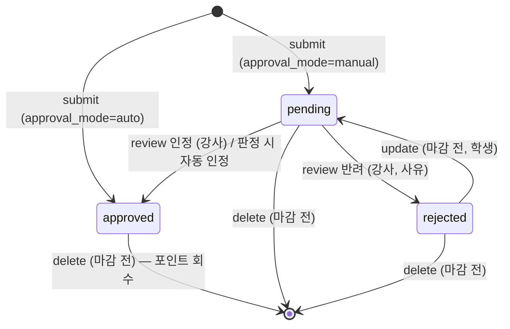

| 현재 상태 | 이벤트 | 다음 상태 | 트리거 | 부가 동작 |
|-----------|--------|-----------|--------|-----------|
| - | 제출 (auto) | approved | 학생 | +10, 조기 +5, recalc_streak |
| - | 제출 (manual) | pending | 학생 | 포인트 없음 |
| pending | 인정 | approved | 강사 / 판정 작업 | +10, 조기 +5(최초 제출 시각 기준), recalc_streak |
| pending | 반려 | rejected | 강사 | 사유 필수, 마감 후면 recalc_streak |
| rejected | 수정 | pending | 학생 (마감 전) | - |
| approved / pending / rejected | 삭제 | (삭제) | 학생 (마감 전) | revoke_points, 피드 글·사진 삭제, recalc_streak |
| approved | 수정 | approved | 학생 (마감 전) | 상태·포인트 변화 없음 |

마감 이후에는 학생 쪽 전이(수정·삭제)를 모두 막는다 (BP-SUB-003-3).

### 4.4 강사 신청 상태 (Instructor Application Status)

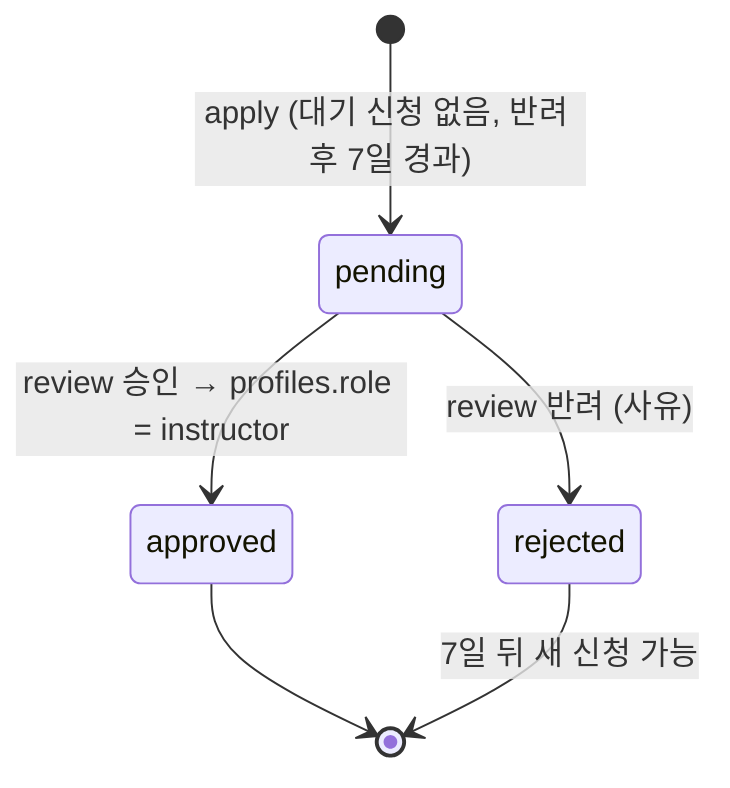

---

## 5. 모듈 상세 설계

### 5.1 AuthModule / ProfileModule

| 항목 | 내용 |
|------|------|
| **모듈명** | `features/auth`, `features/profile` |
| **책임** | 가입·로그인·로그아웃·비밀번호 재설정, 프로필 조회·수정, 1회성 안내(notices) 소비, 마이페이지 요약 |
| **의존성** | Supabase Auth, `profiles`, `notices`, StorageService(avatars), PointRules |
| **관련 FR** | FR-001, FR-002, FR-003, FR-022, NFR-014 |

#### 인터페이스 정의

```
AuthActions
├── signUp(dto: SignUpDTO): ActionResult<void>
│   - zod: email, password(8~72, /[A-Za-z]/ && /\d/), name(2~20), agreeTerms=true, agreePrivacy=true
│   - supabase.auth.signUp({ email, password, options: { data: { name }, emailRedirectTo } })
│   - 트리거 handle_new_user(): auth.users INSERT 시 profiles(id, name, role='student', terms_agreed_at=now())
├── signIn(dto: SignInDTO, next?: string): ActionResult<void>      // 3.1
├── signInWithGoogle(next?: string): redirect                        // P2
├── signOut(): redirect("/")
└── requestPasswordReset(email): ActionResult<void>                  // 링크 1시간 (Auth 설정)

ProfileService
├── get(userId): ProfileDTO
├── update(userId, dto: UpdateProfileDTO): ProfileDTO
│   - 본인만 (RLS: id = auth.uid())
│   - 사진: avatars/{userId}/{uuid}.webp 업로드 후 이전 파일 삭제
├── summary(userId): MyPageDTO
│   - 누적 포인트 = SUM(point_logs.points), level = PointRules.levelOf(total)
│   - 현재 스트릭 = MAX(enrollments.current_streak) (진행 중 챌린지), 최장 = MAX(longest_streak)
│   - 완주 배지 수 = COUNT(enrollments.status='completed')
└── consumeNotices(userId): NoticeDTO[]
    - seen_at IS NULL 인 notices를 가져오고 seen_at = now() 로 표시 (1회 노출)
```

#### 주요 로직/알고리즘

**구글 로그인 계정 연결 (BP-AUTH-001-5):** Supabase Auth의 동일 이메일 자동 연결(identity linking)을 켠다. `handle_new_user` 트리거는 profiles가 이미 있으면 아무것도 하지 않는다. 구글로 처음 들어온 사용자는 `terms_agreed_at IS NULL`이므로 미들웨어가 `/signup/consent`로 보낸다.

**탈퇴 (BP-AUTH-005, 수동):** 관리자가 SQL 함수 `anonymize_user(user_id)`를 실행한다 — 진행·모집 중 강사 챌린지가 있으면 거절, profiles의 name = '탈퇴한 사용자', avatar·bio 삭제, auth 사용자 삭제, admin_logs 기록.

---

### 5.2 InstructorModule

| 항목 | 내용 |
|------|------|
| **모듈명** | `features/instructor` |
| **책임** | 강사 신청, 관리자 승인·반려 |
| **의존성** | `instructor_applications`, `profiles`, `notices`, `admin_logs` |
| **관련 FR** | FR-005 |

#### 인터페이스 정의

```
InstructorService
├── apply(dto: ApplyInstructorDTO): ActionResult<ApplicationDTO>
│   - zod: reason(20~500), introUrl(optional, http(s))
│   - Guard: role = student
│   - Guard: pending 신청 없음 → 아니면 CONFLICT("이미 신청했어요. 결과가 나오면 알려 드릴게요")
│   - Guard: 마지막 rejected.reviewed_at + 7일 ≤ now() → 아니면 CONFLICT(재신청 가능일 포함)
└── review(applicationId, decision: 'approve'|'reject', reason?): ActionResult<void>   // 관리자
    - RPC review_instructor_application: 
      UPDATE ... WHERE id=$1 AND status='pending' RETURNING (0행이면 CONFLICT "이미 처리된 항목이에요. 목록을 새로 불러왔어요")
      approve → profiles.role='instructor'
      reject → reason(10자 이상) 필수
      notices(instructor_result), admin_logs
```

---

### 5.3 ChallengeModule

| 항목 | 내용 |
|------|------|
| **모듈명** | `features/challenge` |
| **책임** | 등록 5단계, 검수, 수정·취소, 탐색 목록, 소개 페이지 |
| **의존성** | `challenges`, `missions`, `enrollments`(집계), StorageService(thumbnails), DayCalendar, `notices`, `admin_logs` |
| **관련 FR** | FR-006, FR-007, FR-009, FR-010, FR-011 |

#### 인터페이스 정의

```
ChallengeService
├── createDraft(): ChallengeDTO                         // status=draft, 기본값: unlock=daily, rate=80, approval=auto, price=0
├── saveStep(id, step: 1..5, dto): ActionResult<ChallengeDTO>
│   - Guard: 강사 본인 + 수정 가능 상태 (draft, 또는 5.3 수정 매트릭스)
│   - step 1: BasicInfoSchema (title 5~50, summary 10~80, description 50~5000, category, thumbnail)
│   - step 2: ScheduleSchema (startDate, durationDays 7~60, unlockMode)
│             → syncMissions(id, durationDays): 부족한 day_no INSERT, 남는 day_no DELETE (내용 있으면 confirm 플래그 필요)
│   - step 3: MissionSchema[] (title 2~40, description 10~2000, proofType, videoUrl(YouTube|Vimeo), resourceUrls ≤3)
│             추가 기능: copyPrevDay(dayNo), reorder(fromDay, toDay) → day_no 재부여 (트랜잭션)
│   - step 4: RulesSchema (capacity 1~300, completionRate 50..100 step 10, approvalMode)
│             approvalMode='manual'은 FEATURE_MANUAL_APPROVAL 플래그가 켜져 있을 때만 허용 (FR-016 구현 전 차단)
│   - step 5: price = 0 고정 (입력 무시)
├── requestReview(id): ActionResult<void>
│   - 전체 스키마 재검증, 미입력 Day 목록 반환 (EF-005-02)
│   - startDate ∈ [todayKst + 3, todayKst + 90] (EF-005-03)
│   - status draft → in_review, review_requested_at = now()
├── cancelReviewRequest(id): in_review → draft
├── review(id, decision, rejectType?, rejectReason?)       // 관리자, RPC
│   - UPDATE ... WHERE status='in_review' (0행이면 CONFLICT)
├── update(id, patch): ActionResult<void>                 // FR-009
│   - assertEditable(challenge, patch, todayKst)  ← 아래 수정 매트릭스
├── cancel(id, reason): ActionResult<void>                // RPC cancel_challenge
│   - Guard: status = recruiting, reason ≥ 10자
│   - challenges.status = cancelled; enrollments active → challenge_cancelled; notices 일괄
├── listPublic(query: ChallengeQueryDTO): PageDTO<ChallengeCardDTO>
│   - status IN (recruiting, in_progress), category 필터, 정렬, 검색(title ILIKE / instructor name ILIKE), 12개씩
└── getDetail(id, viewer): ChallengeDetailDTO
    - draft/in_review/cancelled 는 강사 본인·관리자만 (아니면 NOT_FOUND)
    - viewerState: guest | can_enroll | enrolled | full | closed | owner  (FR-011 버튼 상태)
```

#### 주요 로직/알고리즘

**수정 매트릭스 `assertEditable` (BP-CHAL-004):**

```
EDITABLE = {
  draft:       ALL,
  in_review:   NONE,
  recruiting:  { summary, description, thumbnail, capacity(↑만), missions.* },
  in_progress: { summary, description, thumbnail, capacity(↑만),
                 missions.videoUrl, missions.resourceUrls,
                 missions.{title,description,proofType} WHERE dayDate(start, day_no) > todayKst },
  ended / cancelled: NONE
}
assertEditable(c, patch, today):
  for field in changedFields(patch):
    if field not allowed for c.status → throw RuleViolation("지금은 {label}을(를) 바꿀 수 없어요. 신청한 사람에게 안내한 조건이라서예요")
  if 'capacity' in patch and patch.capacity < c.capacity → throw RuleViolation("정원은 늘릴 수만 있어요")
```

같은 검사를 DB 트리거 `challenges_guard_update` / `missions_guard_update`에도 둔다 (서버 우회 방지).

**카드 상태 배지 (FR-010):**

```
badgeOf(c, activeCount, today):
  if c.status = in_progress → "진행중"
  if activeCount >= c.capacity → "정원 마감"
  d = c.startDate - today
  if d <= 7 → "D-{d}"  (d = 0이면 "D-Day")
  else → "모집중"
```

---

### 5.4 EnrollmentModule

| 항목 | 내용 |
|------|------|
| **모듈명** | `features/enrollment` |
| **책임** | 신청, 시작 전 취소, 내 신청 목록 |
| **의존성** | RPC `enroll_challenge`, `cancel_enrollment`, DayCalendar |
| **관련 FR** | FR-012 |

#### 인터페이스 정의

```
EnrollmentService
├── enroll(challengeId): ActionResult<{ enrollmentId }>      // 3.2
├── cancel(enrollmentId): ActionResult<void>
└── listMine(userId): MyEnrollmentDTO[]   // 진행 중 / 시작 전 / 끝난 챌린지 탭용
```

#### 주요 로직/알고리즘

**`enroll_challenge(p_challenge_id uuid)` (security definer):**

```sql
-- 의사 코드
v_uid := auth.uid();  IF v_uid IS NULL THEN RAISE 'UNAUTHORIZED';
SELECT * INTO c FROM challenges WHERE id = p_challenge_id FOR UPDATE;
IF c.status <> 'recruiting' OR now() >= kst_midnight(c.start_date) THEN RAISE 'RULE_VIOLATION:recruit_closed';
IF c.instructor_id = v_uid THEN RAISE 'RULE_VIOLATION:own_challenge';
IF EXISTS(active enrollment for (c.id, v_uid)) THEN RAISE 'CONFLICT:already_enrolled';
IF (SELECT count(*) FROM enrollments e JOIN challenges x ON x.id = e.challenge_id
    WHERE e.user_id = v_uid AND e.status = 'active' AND x.status IN ('recruiting','in_progress')) >= 5
  THEN RAISE 'RULE_VIOLATION:max_concurrent';
IF (SELECT count(*) FROM enrollments WHERE challenge_id = c.id AND status = 'active') >= c.capacity
  THEN RAISE 'CONFLICT:full';
INSERT INTO enrollments(challenge_id, user_id, status) VALUES (c.id, v_uid, 'active') RETURNING id;
```

`kst_midnight(d date)` = `(d::timestamp AT TIME ZONE 'Asia/Seoul')`. RAISE 메시지 앞부분(코드)을 Server Action이 SRS 5.2.3 오류 코드로 바꾼다.

**`cancel_enrollment(p_id)`:** 본인 + active + `now() < kst_midnight(start_date)` 확인 → status = cancelled, cancelled_at = now().

---

### 5.5 CurriculumModule (DayCalendar 포함)

| 항목 | 내용 |
|------|------|
| **모듈명** | `features/curriculum`, `domain/day-calendar.ts`, SQL `day_calendar` 함수군 |
| **책임** | Day 열림·마감 계산, 커리큘럼 목록, Day 상세, 오늘의 미션 |
| **의존성** | `missions`, `submissions`, `enrollments` |
| **관련 FR** | FR-013, FR-014, NFR-012 |

#### 인터페이스 정의

```
DayCalendar (TS, 순수 함수 — SQL 함수와 같은 규칙, 테스트로 일치 확인)
├── dayDate(startDate: PlainDate, dayNo: number): PlainDate          // start + (dayNo-1)
├── openAt(c, dayNo): Instant          // daily: dayDate 00:00 KST, all_at_start: start 00:00 KST
├── isOpen(c, dayNo, now): boolean     // openAt <= now
├── deadline(startDate, dayNo): Instant  // (dayDate + 1) 00:00:00 KST — 이 시각부터 거절 (배타적)
├── isEarly(firstSubmittedAt, startDate, dayNo): boolean   // firstSubmittedAt < dayDate 21:00:00 KST
├── todayDayNo(c, now): number | null  // todayKst - start + 1, 1..duration 밖이면 null
└── requiredCount(duration, rate): number   // Math.ceil(duration * rate / 100) → 정수 계산 (duration*rate + 99) / 100

CurriculumService
├── listDays(challengeId, viewer): DayListItemDTO[]
│   - 비신청자: 제목만, state = 'locked_preview'
│   - 신청자: state ∈ locked | open | approved | pending | rejected | missed
│     missed = now >= deadline AND (submission 없음 OR rejected)
├── getDay(challengeId, dayNo, viewer): DayDetailDTO
│   - Guard: 신청자·강사·관리자, 신청자는 isOpen 이어야 함 (아니면 FORBIDDEN + openAt)
│   - videoEmbedUrl = toEmbed(videoUrl) (YouTube: /embed/{id}, Vimeo: player.vimeo.com/video/{id})
│   - mySubmission (+ 사진 서명 URL)
└── todayMissions(userId): TodayMissionCardDTO[]                 // FR-014
    - 내 active 신청 중 in_progress 챌린지, dayNo = todayDayNo
    - 정렬: 미인증 → rejected → pending → approved, 같으면 start_date 순
```

#### 주요 로직/알고리즘

**시간 경계 (NFR-012):** 모든 비교는 서버 `now()`(DB) 또는 서버 `Temporal.Now.instant()`로 한다. 클라이언트는 `deadline`을 받아 남은 시간만 그린다. 마감 비교는 `now < deadline`(배타적)이므로 23:59:59.999는 허용, 00:00:00.000은 거절된다.

**시각 고정 — 테스트용 (NFR-012, TC 시간 경계):** 판단에 쓰는 "현재 시각"은 한 함수로만 얻는다.

```sql
-- 모든 RPC·정기 작업은 now() 대신 app_now()를 쓴다 (이 문서의 의사 코드에 나오는 now()는 app_now()를 뜻한다)
create function app_now() returns timestamptz language sql stable as $$
  select case
    when current_setting('app.env', true) = 'test'
     and nullif(current_setting('app.now', true), '') is not null
    then current_setting('app.now', true)::timestamptz
    else now()
  end
$$;
-- 테스트: set local app.env = 'test'; set local app.now = '2026-12-03 23:59:59.999+09';
```

- 운영 DB에는 `app.env`를 설정하지 않으므로 `app.now`를 넣어도 무시된다.
- TS 쪽은 `Clock` 인터페이스(`now(): Instant`)를 서비스에 주입한다. 운영은 `systemClock`, 테스트는 `fixedClock('2026-12-03T23:59:59.999+09:00')`. `domain/` 함수는 시각을 인자로만 받는다.

**영상 링크 검증:** `^(https?://)?(www\.)?(youtube\.com/watch\?v=|youtu\.be/)[\w-]{11}` 또는 `^(https?://)?(www\.)?vimeo\.com/\d+$`.

---

### 5.6 SubmissionModule

| 항목 | 내용 |
|------|------|
| **모듈명** | `features/submission` |
| **책임** | 인증 제출·수정·삭제, 강사 인정·반려, 인증 사진 업로드·열람 |
| **의존성** | RPC `submit_mission`·`update_submission`·`delete_submission`·`review_submission`, ProofValidator, StorageService, PointModule(RPC 내부) |
| **관련 FR** | FR-015, FR-016, NFR-005 |

#### 인터페이스 정의

```
SubmissionService
├── createProofUploadUrl(challengeId): { path, signedUploadUrl }
│   - Guard: 내 active 신청 존재
│   - path = submissions/{challengeId}/{userId}/{uuid}.{ext}
├── submit(missionId, payload: SubmitProofDTO): ActionResult<SubmitResultDTO>     // 3.3
├── update(submissionId, payload): ActionResult<SubmitResultDTO>
│   - RPC: Guard 본인 + now() < deadline; first_submitted_at 유지
│   - visibility 변경 시 posts INSERT/DELETE; rejected → pending
├── remove(submissionId): ActionResult<void>
│   - RPC: Guard 본인 + now() < deadline
│   - revoke_points('proof:'||id), revoke_points('early:'||id); DELETE posts, submissions; recalc_streak
│   - 커밋 후 Storage 사진 삭제 (실패 시 orphan 정리 대상 로그)
├── review(submissionId, decision, feedback?): ActionResult<void>                 // FR-016, 강사
│   - RPC: Guard 강사 본인 챌린지 + approval_mode='manual' + status='pending' + judged_at IS NULL
│   - approve: status=approved, award_points(+10, isEarly? +5), recalc_streak
│   - reject: feedback ≥ 5자, status=rejected; now() >= deadline 이면 recalc_streak
└── listForInstructor(challengeId, filter: {dayNo?, status?}): InstructorSubmissionDTO[]
```

#### 주요 로직/알고리즘

**ProofValidator (Strategy, BP-SUB-001):**

```
validators = {
  text:  p => len(p.body) in 10..2000,
  photo: p => p.photoPaths.length in 1..3 AND all startsWith(`submissions/${challengeId}/${uid}/`) AND len(p.body ?? '') <= 500,
  link:  p => isHttpUrl(p.linkUrl) AND len(p.body ?? '') <= 500,
  check: p => len(p.body ?? '') <= 200,
}
```

사진 용량(10MB)·형식(jpg·png·webp)은 업로드 전 클라이언트 검사 + Storage 버킷 설정(`file_size_limit = 10MB`, `allowed_mime_types`)으로 이중 확인한다.

**사진 열람 (NFR-005):** `submissions` 버킷은 비공개. 화면이 인증을 그릴 때 서버가 RLS로 열람 권한을 확인한 뒤 `createSignedUrl(path, 3600)`을 발급한다. Storage RLS는 "경로의 challengeId 참여자·강사·관리자만 select"로 둔다.

---

### 5.7 FeedModule (신고 포함)

| 항목 | 내용 |
|------|------|
| **모듈명** | `features/feed` |
| **책임** | 피드 목록·작성·수정·삭제, 공지 고정, 숨김, 좋아요, 댓글, 신고·처리 |
| **의존성** | `posts`, `comments`, `likes`, `reports`, PointModule RPC, StorageService |
| **관련 FR** | FR-017, FR-023 |

#### 인터페이스 정의

```
FeedService
├── list(challengeId, cursor?): { pinned: PostDTO[], items: PostDTO[], nextCursor }
│   - pinned: pinned_at IS NOT NULL ORDER BY pinned_at DESC LIMIT 3
│   - items: created_at DESC, 20개, (created_at, id) 커서
│   - 숨김(hidden_at / temp_hidden_at): 작성자 본인에게만 "숨겨진 글"로
├── create(dto: CreatePostDTO)          // type ∈ question|free|notice(강사만); 종료 챌린지 → RULE_VIOLATION
├── update(postId, dto)                 // 본인, edited_at = now(); proof 글은 SubmissionService.update로
├── remove(postId)                      // 본인; proof 글이면 SubmissionService.remove 규칙(마감 전) / 마감 후에는 hide만
├── pin(postId, replaceOldest = false)  // 강사, type=notice; 3개면 replaceOldest 필요 (아니면 CONFLICT + 대상 제목)
├── hide(targetType, targetId)          // 강사 본인 챌린지: hidden_at, hidden_by
├── toggleLike(postId)                  // RPC toggle_like: 있으면 DELETE + revoke('like:'||like_id), 없으면 INSERT + award(작성자 ≠ 나)
├── comment(postId, body)               // RPC add_comment: INSERT + (작성자 ≠ 글 작성자 AND 오늘 적립 < 5) award('comment:'||id, +2)
├── deleteComment(commentId)            // 본인: DELETE + revoke('comment:'||id)
├── report(target, reason, detail?)     // FR-023: UNIQUE 위반 → CONFLICT; 서로 다른 신고자 3명 → temp_hidden_at = now()
└── resolveReport(target, decision)     // 관리자 RPC: hidden → hidden_at + 해당 글의 like/comment 포인트 revoke; kept → temp_hidden_at = NULL; admin_logs
```

---

### 5.8 PointModule (리더보드·스트릭 포함)

| 항목 | 내용 |
|------|------|
| **모듈명** | `features/point`, `domain/points.ts`, `domain/streak.ts`, SQL `award_points`·`revoke_points`·`recalc_streak` |
| **책임** | 포인트 원장 적립·회수, 레벨, 리더보드, 스트릭과 연속 보상 |
| **의존성** | `point_logs`, `enrollments`, `submissions` |
| **관련 FR** | FR-018, FR-019, FR-022 |

#### 인터페이스 정의

```
SQL
├── award_points(user_id, challenge_id, reason, points, source_key) → bool
│   - IF net(source_key) > 0 THEN RETURN false          -- 이미 유효한 적립 있음 (멱등)
│   - n := count(*) WHERE source_key = $5 AND points > 0
│   - INSERT point_logs(..., idempotency_key = source_key || '#' || (n+1)) ON CONFLICT DO NOTHING
├── revoke_points(source_key) → int
│   - v := net(source_key); IF v <= 0 THEN RETURN 0
│   - INSERT point_logs(reason='revoke', points = -v, idempotency_key = 'revoke:' || source_key || '#' || seq)
└── recalc_streak(enrollment_id) → (current, longest)

PointService (TS)
├── leaderboard(challengeId, period: '7d'|'30d'|'all', viewerId): LeaderboardDTO
└── summary(userId): { total, level, nextLevelGap }
```

`net(key) = SUM(points) WHERE source_key = key`. source_key 규칙: `proof:{submissionId}`, `early:{submissionId}`, `like:{likeId}`, `comment:{commentId}`, `streak:{enrollmentId}:{value}`.

#### 주요 로직/알고리즘

**스트릭 계산 `StreakCalculator.calculate` / `recalc_streak` (BP-POINT-005):**

```
input: Day 1..N 의 상태 (approved | pending | rejected | none), 각 Day의 deadline, now
run = 0; longest = 0
for d in 1..N where dayDate(d) <= todayKst:          -- 미래 Day는 날짜가 될 때까지 계산하지 않음
  s = state(d)
  if s == approved:                run += 1; longest = max(longest, run)
  elif s == pending:               continue            -- 끊지도 더하지도 않음
  elif now >= deadline(d):         run = 0             -- none 또는 rejected 확정
  else:                            continue            -- 오늘, 아직 마감 전
current = run
```

**연속 보상 맞추기 (BP-POINT-001 연속 보상):**

```
expected = { v : v = 7k, 7 ≤ v ≤ longest }       -- longest 는 신청의 전체 이력 기준 최장
for v in expected:  award_points(user, challenge, 'streak_bonus', v % 21 == 0 ? 100 : 30, 'streak:'||enr||':'||v)
for v in awardedValues(enr) - expected:  revoke_points('streak:'||enr||':'||v)
enrollments.current_streak = current; longest_streak = longest
```

같은 신청에서 값마다 1회만 받는다는 정책은 source_key에 값이 들어가서 보장된다. 인증 삭제로 최장 스트릭이 줄면 넘치는 보상이 회수되고, 다시 인증하면 `award_points`가 새 idempotency_key(#2)로 다시 적립한다.

**레벨 (BP-POINT-002):** `LEVELS = [0, 20, 60, 150, 300, 600, 1000, 2000, 3000]`, `levelOf(t) = 마지막으로 t ≥ LEVELS[i] 인 i + 1`.

**리더보드 쿼리 (BP-POINT-004):**

```sql
WITH win AS (SELECT CASE $period WHEN '7d'  THEN kst_midnight(today_kst() - 6)
                                 WHEN '30d' THEN kst_midnight(today_kst() - 29)
                                 ELSE '-infinity' END AS since)
SELECT e.user_id, p.name, p.avatar_url, e.current_streak,
       COALESCE(SUM(l.points), 0) AS pts,
       MAX(l.created_at) AS reached_at,
       RANK() OVER (ORDER BY COALESCE(SUM(l.points),0) DESC) AS rank
FROM enrollments e
JOIN profiles p ON p.id = e.user_id
LEFT JOIN point_logs l ON l.user_id = e.user_id AND l.challenge_id = e.challenge_id
                      AND l.created_at >= (SELECT since FROM win)
WHERE e.challenge_id = $1 AND e.status IN ('active','completed','incomplete')
GROUP BY e.user_id, p.name, p.avatar_url, e.current_streak
ORDER BY pts DESC, reached_at ASC NULLS LAST;
```

`RANK()`가 1, 1, 3 순위를 만든다. 같은 점수 안의 순서는 그 기간에 마지막으로 점수가 바뀐 시각이 이른 사람이 위다 (BP-POINT-004-4, 2026-11-25 정책을 이 계산 방식에 맞춤). 레벨은 별도 쿼리로 사용자별 전체 합계를 붙인다.

---

### 5.9 DashboardModule

| 항목 | 내용 |
|------|------|
| **모듈명** | `features/dashboard` |
| **책임** | 강사 대시보드 지표, Day별 인증률, 이탈 위험 학생, 완주 결과 |
| **의존성** | `enrollments`, `submissions`, `challenges`, DayCalendar |
| **관련 FR** | FR-021 |

#### 인터페이스 정의

```
DashboardService   (Guard: 강사 본인 챌린지 또는 관리자)
├── overview(challengeId): { activeCount, capacity, todayProofCount, todayRate, avgDayRate }
│   - todayProofCount = COUNT(DISTINCT user_id) submissions WHERE day_no = todayDayNo AND status IN (approved, pending)
│   - todayRate = round(todayProofCount / activeCount * 100), activeCount = 0 → null ("-")
├── dayRates(challengeId): { dayNo, rate, final: bool }[]
│   - rate = approved(day) / activeCount, final = now >= deadline(day)
├── atRiskStudents(challengeId): { userId, name, lastApprovedDay }[]
│   - 마감 지난 최근 3개 Day (k = 마감 지난 마지막 Day, k-2..k) 모두 approved 없음
│   - 마감 지난 Day가 3개 미만이면 빈 목록
└── completionResult(challengeId): { judgedAt, ratio, completed[], incomplete[] } | { pending: true }
```

---

### 5.10 SchedulerModule (관리자 작업 로그 포함)

| 항목 | 내용 |
|------|------|
| **모듈명** | `supabase/migrations/*_jobs.sql` |
| **책임** | 00:00 상태 전환·스트릭, 00:10 완주 판정, 작업·관리자 로그 |
| **의존성** | pg_cron, 모든 도메인 테이블 |
| **관련 FR** | FR-008, FR-019, FR-020, NFR-003, NFR-006 |

#### 인터페이스 정의

```
run_daily_transitions(): jsonb            -- 3.4, 반환: 단계별 건수
run_completion_judgement(): jsonb         -- 3.5, 반환: 처리·실패 챌린지 수
log_admin(actor_id uuid, action text, target_type text, target_id uuid, detail jsonb)

cron.schedule('daily_transitions',    '0 15 * * *',    'select run_daily_transitions()');
cron.schedule('completion_judgement', '10 15-18 * * *', 'select run_completion_judgement()');
```

#### 주요 로직/알고리즘

**완주 판정 (BP-DONE-001):**

```
for c in challenges where status='ended' and judged_at is null:
  begin
    for s in submissions where challenge_id=c.id and status='pending':
      approve(s)   -- 포인트 포함, 5.6 review approve 와 같은 함수 재사용
    required := (c.duration_days * c.completion_rate + 99) / 100      -- 정수 올림
    update enrollments e set status = case when e.approved_count >= required then 'completed' else 'incomplete' end
      where e.challenge_id = c.id and e.status = 'active'
    update challenges set judged_at = now(),
      completion_ratio = completed / nullif(judged_total, 0)
    insert notices(completion_result) ...; log_admin(null, 'job:completion_judgement', ...)
  exception when others then
    log_admin(null, 'job:completion_judgement:error', 'challenge', c.id, sqlerrm)   -- 이 챌린지만 롤백
  end
```

`approved_count`는 인증 인정·삭제·반려 시 RPC가 갱신하고, 판정 직전에 `COUNT(*)`로 한 번 더 맞춘다.

**성능 (NFR-003):** 판정은 챌린지 단위 트랜잭션이며 신청 300명 × Day 60 = 18,000행 이하를 다룬다. 종료 챌린지 20개 기준 10분 목표에 여유가 있도록 `submissions(challenge_id, status)` 인덱스를 둔다.

---

### 5.11 AuthorizationModule (RLS 정책표)

| 항목 | 내용 |
|------|------|
| **모듈명** | `supabase/migrations/*_rls.sql`, 헬퍼 함수 |
| **책임** | BP-CONTENT-001 접근 표의 DB 강제 |
| **관련 FR** | FR-004, NFR-004, NFR-005 |

**헬퍼 함수 (security definer, stable):**

```
is_admin()                         -- profiles.role = 'admin'
is_instructor_of(challenge_id)     -- challenges.instructor_id = auth.uid()
is_member_of(challenge_id)         -- 내 enrollments 중 status IN (active, completed, incomplete)
can_view_challenge_home(cid)       -- is_member_of(cid) OR is_instructor_of(cid) OR is_admin()
day_is_open(mission_id)            -- DayCalendar.isOpen 의 SQL 판
```

**정책표:**

| 테이블 | select | insert | update | delete |
|--------|--------|--------|--------|--------|
| profiles | 모두 (공개 필드만 뷰 `public_profiles`로) | 트리거만 | 본인 (role 열 제외) | 없음 (관리자 함수) |
| instructor_applications | 본인, 관리자 | 본인 (RPC) | 관리자 (RPC) | 없음 |
| challenges | status ∈ (recruiting, in_progress, ended) 모두 / 그 외 강사 본인·관리자 | 강사 | 강사 본인 (트리거로 매트릭스 검사) | 없음 |
| missions | 제목·day_no: 공개 챌린지면 모두 (뷰 `mission_titles`) / 전체 열: 신청자(열린 Day), 강사 본인, 관리자 | 강사 본인 | 강사 본인 (트리거) | 강사 본인 (draft만) |
| enrollments | 본인, 같은 챌린지 참여자(멤버 목록용 일부 열 뷰), 강사 본인, 관리자 | RPC만 | RPC만 | 없음 |
| submissions | 본인, 강사 본인, 관리자 / 공개 인증은 참여자 (posts 통해) | RPC만 | RPC만 | RPC만 |
| posts | can_view_challenge_home (숨김은 작성자·강사·관리자만) | 참여자·강사 (종료 아님) | 작성자, 강사(숨김·고정) | 작성자 |
| comments | can_view_challenge_home | 참여자·강사 (RPC) | 작성자, 강사(숨김) | 작성자 (RPC) |
| likes | can_view_challenge_home | RPC만 | 없음 | RPC만 |
| reports | 본인, 관리자 | 참여자 (RPC) | 관리자 (RPC) | 없음 |
| point_logs | 본인, 같은 챌린지 참여자(리더보드 뷰), 강사 본인 | RPC만 | 없음 | 없음 |
| notices | 본인 | 서버 함수만 | 본인 (seen_at만) | 없음 |
| admin_logs | 관리자 | 서버 함수만 | 없음 | 없음 |

"RPC만"은 해당 테이블에 클라이언트 insert/update/delete 정책을 두지 않고, `security definer` 함수가 내부에서 규칙을 검사한 뒤 쓴다는 뜻이다.

---

## 6. 디자인 패턴 적용 기록

### 6.1 적용 패턴 목록

| 패턴명 | 적용 위치 | 목적 | 코드 구조 설명 |
|--------|-----------|------|---------------|
| **Transaction Script (DB 함수)** | 신청, 인증, 인정, 판정, 상태 전환 | 여러 행을 바꾸는 규칙을 한 트랜잭션으로 묶어 동시성·일관성 보장 | `enroll_challenge`, `submit_mission` 등 RPC. Server Action은 입력 검증과 오류 코드 변환만 |
| **Ledger (원장) + 멱등 키** | 포인트 | 합계를 저장하지 않고 로그로 계산, 재시도·회수에도 정확 | `point_logs` 추가 전용, `source_key`로 net 계산, `idempotency_key` UNIQUE |
| **Repository** | 각 feature의 `repository.ts` | Supabase 쿼리를 서비스에서 분리 | 서비스는 `ChallengeRepository.findPublic(query)` 같은 함수만 호출 |
| **Strategy** | 인증 형식 검증 | 형식(텍스트·사진·링크·체크)별 검증을 교체 가능하게 | `ProofValidator` 맵 (5.6) |
| **Pure Domain Functions** | `src/domain/*` | 날짜·스트릭·레벨 규칙을 프레임워크와 분리해 단위 테스트 | `dayDate`, `deadline`, `calculateStreak`, `levelOf` |
| **Guard Clause** | 서비스·RPC 전반 | 권한·상태 검사를 함수 앞쪽에서 끝내기 | `assertOwner`, `assertStatus`, `assertBeforeDeadline` |
| **State Machine (전이표)** | 챌린지·신청·인증 상태 | 허용 전이만 수행 | 4장 표를 `ALLOWED_TRANSITIONS` 상수와 DB 트리거로 구현 |
| **Feature Flag** | 강사 확인 방식 (FR-016) | P2 기능을 배포와 분리 | `FEATURE_MANUAL_APPROVAL` 환경 변수 |

### 6.2 패턴 적용 상세 예시

#### Ledger + 멱등 키 (포인트)

```
-- 인증 인정 (재시도로 두 번 호출돼도 1회만)
award_points(u, c, 'proof_approved', 10, 'proof:S1')   → idempotency_key 'proof:S1#1' INSERT
award_points(u, c, 'proof_approved', 10, 'proof:S1')   → net('proof:S1') = 10 > 0 → 무시 (FR-018-AC4)

-- 마감 전 삭제
revoke_points('proof:S1')                               → -10, key 'revoke:proof:S1#1'

-- 같은 Day에 새로 제출 → 새 submission S2 → 'proof:S2#1'
```

#### Transaction Script (신청)

신청 규칙 다섯 가지(모집 기간, 본인 챌린지, 중복, 동시 5개, 정원)를 애플리케이션에서 나눠 확인하면, 확인과 INSERT 사이에 다른 요청이 끼어들 수 있다. `FOR UPDATE`로 챌린지 행을 잠근 DB 함수 안에서 확인과 INSERT를 함께 하면 같은 챌린지의 신청은 순서대로 처리된다 (3.2).

#### Pure Domain Functions (TS·SQL 이중 구현)

Day 날짜·마감·필요 인증 수는 화면(남은 시간 표시)과 DB 함수(판단) 양쪽에 필요하다. 판단의 기준은 DB 함수이고, TS 함수는 표시용이다. 두 구현이 어긋나지 않도록 `tests/domain/parity.test.ts`에서 같은 입력 표(경계 시각 포함)로 TS 결과와 SQL 결과를 비교한다.

---

## 7. 코딩 표준

### 7.1 네이밍 컨벤션

| 대상 | 규칙 | 예시 | 반례 |
|------|------|------|------|
| React 컴포넌트 파일 | PascalCase | `ChallengeCard.tsx` | `challengeCard.tsx` |
| 기타 TS 파일 | kebab-case | `day-calendar.ts`, `actions.ts` | `DayCalendar.ts` |
| 컴포넌트·타입 | PascalCase | `ChallengeCard`, `SubmitProofDTO` | `challengeCard` |
| 함수·변수 | camelCase | `requiredCount`, `todayDayNo` | `required_count` |
| Server Action | 동사 + 대상 + `Action` | `enrollAction`, `submitMissionAction` | `enroll` |
| 상수 | UPPER_SNAKE_CASE | `COMMENT_DAILY_LIMIT` | `commentDailyLimit` |
| DB 테이블 | snake_case 복수 | `point_logs` | `PointLog` |
| DB 열·함수 | snake_case | `first_submitted_at`, `enroll_challenge` | `firstSubmittedAt` |
| enum 값 | snake_case 소문자 | `in_progress` | `IN_PROGRESS` |
| URL 경로 | kebab-case | `/me/instructor-apply` | `/me/instructorApply` |
| 환경 변수 | UPPER_SNAKE_CASE | `SUPABASE_SERVICE_ROLE_KEY` | - |

#### 네이밍 의미 규칙

| 접두사/접미사 | 용도 | 예시 |
|-------------|------|------|
| `is/has/can` | Boolean | `isOpen`, `canViewChallengeHome` |
| `get` | 반드시 있는 값 조회 | `getDetail` |
| `find` | 없을 수 있는 조회 | `findActiveEnrollment` |
| `assert` | 조건 위반 시 예외 | `assertBeforeDeadline` |
| `calc/calculate` | 순수 계산 | `calculateStreak` |
| `DTO` | 화면·액션 입출력 | `ChallengeCardDTO` |
| `Schema` | zod 스키마 | `MissionSchema` |

### 7.2 코드 구조

#### 디렉토리 구조

```
src/
├── app/                                  # Next.js App Router (화면 = SRS 5.1.2)
│   ├── (public)/page.tsx                 # SCR-01 탐색 + 오늘의 미션
│   ├── (auth)/login, signup, reset-password
│   ├── c/[id]/page.tsx                   # SCR-03 소개
│   ├── c/[id]/(home)/feed|curriculum|leaderboard|members/page.tsx
│   ├── c/[id]/day/[n]/page.tsx           # SCR-06
│   ├── me/…, studio/…, admin/…
│   └── middleware.ts                     # 세션 갱신, 약관 미동의 리다이렉트
├── features/                             # 기능 모듈 (5장)
│   └── {auth|profile|instructor|challenge|enrollment|curriculum|submission|feed|point|dashboard}/
│       ├── actions.ts                    # 'use server' — 검증 → service 호출 → ActionResult
│       ├── service.ts                    # 규칙 조합
│       ├── repository.ts                 # Supabase 쿼리·RPC
│       ├── schema.ts                     # zod
│       ├── types.ts                      # DTO
│       └── components/                   # 이 기능 전용 UI
├── domain/                               # 순수 함수 (프레임워크 의존 없음)
│   ├── day-calendar.ts, streak.ts, points.ts, completion.ts, proof-validator.ts
├── components/ui/                        # shadcn/ui + DESIGN.md 토큰 컴포넌트 (CourseCard, Badge…)
├── lib/
│   ├── supabase/server.ts, client.ts, admin.ts (server-only)
│   ├── errors.ts                         # AppError, 오류 코드 변환
│   └── time.ts                           # KST 변환 (Temporal polyfill)
supabase/
├── migrations/                           # 테이블, enum, 인덱스, RLS, RPC, cron
├── seed.sql                              # 테스트 계정·챌린지
└── tests/                                # pgTAP 또는 SQL 테스트 (RLS, RPC)
tests/
├── domain/                               # Vitest 단위 + parity
└── e2e/                                  # Playwright (핵심 흐름)
```

#### 파일 내부 구조 규칙

- `actions.ts`는 한 함수가 30줄을 넘지 않게 하고, 규칙 판단은 `service.ts`나 RPC로 넘긴다.
- `domain/`은 `next`, `@supabase/*`를 import하지 않는다.
- 서버 전용 모듈은 `import 'server-only'`로 시작한다 (`lib/supabase/admin.ts` 필수).
- 상수(점수, 한도, 제한값)는 `domain/constants.ts` 한 곳에 두고, SQL 쪽 값은 마이그레이션 주석에 같은 상수 이름을 적는다.

### 7.3 주석/문서화 규칙

- 비즈니스 규칙을 구현한 곳에는 정책 ID를 주석으로 남긴다: `// BP-SUB-002-1: 마감은 배타적 비교`.
- RPC 함수 머리에 관련 FR·UC와 RAISE 코드 목록을 적는다.
- 주석은 "왜"를 적고, 코드가 이미 말하는 "무엇"은 적지 않는다.

#### 주석 예시

```ts
// BP-POINT-001 조기 인증: 최초 제출 시각이 Day 날짜 21:00 KST보다 이르면 +5.
// 수정해도 firstSubmittedAt은 바뀌지 않으므로 수정으로 보너스를 얻거나 잃지 않는다.
export function isEarly(firstSubmittedAt: Instant, startDate: PlainDate, dayNo: number): boolean { … }
```

### 7.4 에러 처리 규칙

| 규칙 | 설명 |
|------|------|
| 결과 객체 | Server Action은 예외를 던지지 않고 `ActionResult<T> = { ok: true, data } \| { ok: false, error: { code, message, fields? } }`를 반환한다 |
| 오류 코드 | SRS 5.2.3 (VALIDATION_ERROR, UNAUTHORIZED, FORBIDDEN, NOT_FOUND, CONFLICT, RULE_VIOLATION, RATE_LIMITED, INTERNAL_ERROR) |
| RPC 오류 | DB 함수는 `RAISE EXCEPTION 'CODE:reason'`으로 던지고, `lib/errors.ts`가 코드·사유를 BP-ERROR-004 메시지로 바꾼다 |
| 사용자 메시지 | 기술 정보(SQL, 스택)를 노출하지 않는다 |
| 재시도 | 조회만 1초·2초 최대 2회 (BP-ERROR-001-1). 쓰기는 자동 재시도하지 않는다 |
| 로깅 | INTERNAL_ERROR는 서버 로그(Vercel)에 요청 ID와 함께 기록. 개인정보(이메일, 인증 본문)는 로그에 남기지 않는다 |
| XSS | 사용자 입력은 React 기본 이스케이프로만 렌더링. `dangerouslySetInnerHTML` 금지 |

#### 예외 클래스 구조

```
AppError (base, code, userMessage)
├── ValidationError   // VALIDATION_ERROR 400 (fields)
├── UnauthorizedError // UNAUTHORIZED 401
├── ForbiddenError    // FORBIDDEN 403 (잠긴 Day: openAt 포함)
├── NotFoundError     // NOT_FOUND 404
├── ConflictError     // CONFLICT 409 (already_enrolled, full, already_submitted, already_processed…)
└── RuleViolationError// RULE_VIOLATION 422 (deadline_passed, recruit_closed, max_concurrent, not_editable…)
```

서비스 내부에서는 위 예외를 던지고, `actions.ts`의 공통 래퍼 `toActionResult()`가 `ActionResult`로 바꾼다.

### 7.5 코드 리뷰 체크리스트

#### 기능 (Functionality)

| 항목 | 확인 내용 |
|------|-----------|
| [ ] | 관련 FR의 수용 기준(FR-xxx-ACn)을 모두 만족하는가? |
| [ ] | 정책 ID가 주석으로 연결되어 있고, 규칙 값이 `domain/constants.ts`와 같은가? |
| [ ] | 마감·열림·모집 판단이 서버 시각·KST·배타적 비교인가? DB는 `app_now()`, TS는 주입한 `Clock`만 쓰는가? (NFR-012) |
| [ ] | 여러 행을 바꾸는 쓰기가 RPC 한 트랜잭션 안에 있는가? |
| [ ] | 상태 전이가 4장 표에 있는 것만인가? |

#### 보안 (Security)

| 항목 | 확인 내용 |
|------|-----------|
| [ ] | 새 테이블·열에 RLS 정책이 있고 5.11 표와 같은가? |
| [ ] | service role 클라이언트를 사용자 요청 경로에서 쓰지 않았는가? |
| [ ] | 비공개 인증 사진을 공개 URL로 내보내지 않는가? |
| [ ] | 사용자 입력을 HTML로 렌더링하지 않는가? |

#### 성능 (Performance)

| 항목 | 확인 내용 |
|------|-----------|
| [ ] | 목록 조회에 페이지 크기 제한과 인덱스가 있는가? |
| [ ] | 카드·리더보드에서 N+1 조회가 없는가? (집계는 한 쿼리) |
| [ ] | 주요 화면 LCP가 3초 안인가? (NFR-001) |

#### 코드 품질 (Quality)

| 항목 | 확인 내용 |
|------|-----------|
| [ ] | tsc strict·ESLint 오류가 0인가? |
| [ ] | `domain/`이 프레임워크에 의존하지 않는가? |
| [ ] | 화면 문구가 한국어이고 BP-ERROR-004 메시지를 따르는가? |
| [ ] | DESIGN.md 토큰(색·간격·모서리)만 썼는가? (임의 hex 금지) |

#### 테스트 (Testing)

| 항목 | 확인 내용 |
|------|-----------|
| [ ] | `domain/` 함수에 경계값 테스트가 있는가? (23:59:59.999 / 00:00:00.000, 20:59:59 / 21:00:00, 올림 계산) |
| [ ] | 새 RPC에 성공·각 RAISE 경로 테스트가 있는가? |
| [ ] | RLS 변경 시 허용·거부 테스트를 추가했는가? |

#### 유지보수성 (Maintainability)

| 항목 | 확인 내용 |
|------|-----------|
| [ ] | 마이그레이션이 되돌릴 수 있고(또는 되돌림 방법이 주석에 있고) seed가 갱신되었는가? |
| [ ] | RTM의 설계·구현 열을 갱신했는가? |

---

## 부록

### A. DTO 목록

| DTO 명 | 용도 | 주요 필드 |
|--------|------|-----------|
| `SignUpDTO` | 회원가입 | email, password, passwordConfirm, name, agreeTerms, agreePrivacy |
| `SignInDTO` | 로그인 | email, password |
| `UpdateProfileDTO` | 프로필 수정 | name, avatarFile?, bio? |
| `MyPageDTO` | 마이페이지 | profile, totalPoints, level, nextLevelGap, currentStreak, longestStreak, badgeCount, enrollments |
| `ApplyInstructorDTO` | 강사 신청 | reason, introUrl? |
| `BasicInfoDTO` … `RulesDTO` | 등록 1~4단계 | 5.3 단계별 스키마 |
| `MissionInputDTO` | Day 입력 | dayNo, title, description, proofType, videoUrl?, resourceUrls[] |
| `ChallengeQueryDTO` | 탐색 조건 | category?, sort?, q?, cursor? |
| `ChallengeCardDTO` | 카드 | id, title, thumbnailUrl, instructorName, durationDays, startDate, activeCount, capacity, price, badge |
| `ChallengeDetailDTO` | 소개 페이지 | card 필드 + description, instructor, endDate, completionRate, requiredCount, dayTitles[], viewerState, completionRatio? |
| `DayListItemDTO` | 커리큘럼 | dayNo, date, title, state, openAt |
| `DayDetailDTO` | Day 상세 | dayNo, date, title, description, proofType, videoEmbedUrl?, resourceUrls, deadline, mySubmission? |
| `TodayMissionCardDTO` | 오늘의 미션 | challengeId, challengeTitle, dayNo, durationDays, dayTitle, deadline, myState |
| `SubmitProofDTO` | 인증 제출·수정 | body?, linkUrl?, photoPaths[], visibility |
| `SubmitResultDTO` | 제출 결과 | submissionId, status, pointsDelta, currentStreak |
| `InstructorSubmissionDTO` | 강사 인증 목록 | submissionId, user, dayNo, proofType, content, status, firstSubmittedAt |
| `CreatePostDTO` | 글 작성 | challengeId, type, body, photoPaths[] |
| `PostDTO` | 피드 글 | id, type, author, body, photos, dayNo?, likeCount, likedByMe, commentCount, pinned, hiddenForOthers, editedAt, createdAt |
| `CommentDTO` | 댓글 | id, author, body, editedAt, createdAt |
| `LeaderboardDTO` | 리더보드 | period, me: Row, rows: { rank, user, level, points, currentStreak }[] |
| `DashboardOverviewDTO` | 대시보드 | activeCount, capacity, todayProofCount, todayRate, avgDayRate |
| `NoticeDTO` | 1회 안내 | id, type, payload |
| `ActionResult<T>` | 모든 액션 응답 | ok, data / error{code, message, fields?} |

### B. 다이어그램 목록

| 다이어그램 | 섹션 | 유형 | 용도 |
|-----------|------|------|------|
| 도메인 모델 전체 뷰 | 2.1 | classDiagram | 테이블·관계 |
| 서비스 계층 구조 | 2.2 | classDiagram | 서비스·도메인 함수 의존성 |
| Infrastructure 계층 | 2.3 | classDiagram | Supabase 클라이언트, Storage, RPC, cron |
| 로그인 플로우 | 3.1 | sequenceDiagram | UC-002 |
| 신청 플로우 | 3.2 | sequenceDiagram | UC-009, 정원 동시성 |
| 인증 제출 플로우 | 3.3 | sequenceDiagram | UC-011, 포인트·스트릭 |
| 일일 상태 전환 | 3.4 | sequenceDiagram | UC-016 00:00 |
| 완주 판정 | 3.5 | sequenceDiagram | UC-016 00:10 |
| 챌린지 상태 전이 | 4.1 | stateDiagram | |
| 신청 상태 전이 | 4.2 | stateDiagram | |
| 인증 상태 전이 | 4.3 | stateDiagram | |
| 강사 신청 상태 전이 | 4.4 | stateDiagram | |

### C. 참조 문서

| 문서 | 경로 |
|------|------|
| 시스템 아키텍처 설계서 | `../02-시스템설계/시스템아키텍처설계서-SAD.md` (미작성) |
| 데이터베이스 설계서 | `../02-시스템설계/데이터베이스설계서.md` (미작성) |
| API 설계서 | `../02-시스템설계/API설계서.md` (미작성) |
| 화면 설계서 | `../02-시스템설계/화면설계서.md` (미작성) |
| 요구사항 정의서 | `../01-요구사항분석/요구사항명세서-SRS.md` |
| 유스케이스 명세서 | `../01-요구사항분석/유스케이스명세서.md` |
| 요구사항 추적 매트릭스 | `../01-요구사항분석/요구사항추적매트릭스-RTM.md` |
| 비즈니스 정책서 | `../00-기획/비즈니스정책서.md` |
| 디자인 가이드 | `../../DESIGN.md` |
