# 테스트 계획서 (Test Plan)

> 작성 근거: [SRS](../01-요구사항분석/요구사항명세서-SRS.md) SRS-CHUP-v0.1, [비즈니스 정책서](../00-기획/비즈니스정책서.md) BPD-CHUP-v0.2, [유스케이스 명세서](../01-요구사항분석/유스케이스명세서.md) UCS-CHUP-v0.1, [상세 설계서](../03-상세설계/상세설계서.md) DDS-CHUP-v0.1.
>
> **현재 상태: 계획만 있고 실행한 테스트는 없다.** 코드, 후보 빌드, 테스트 환경이 아직 없다. [구현·테스트 인계서](../04-구현/구현-테스트-인계서.md)와 02-시스템설계 문서(SAD·DB·API·화면)도 양식 상태로 작성되지 않았다. 아래 일정·인원·수치 중 근거가 없는 값은 "미정"으로 두었다.

| 항목 | 내용 |
|------|------|
| **프로젝트명** | 챌린지업 (ChallengeUp) — 온라인 강의 챌린지 플랫폼 |
| **문서 ID / 버전** | TPL-CHUP-v0.2 / v0.2 |
| **작성일** | 2026-11-25 |
| **작성자** | Claude Code (초안) |
| **승인자** | 미정 (서비스 기획서 DEC-001) |
| **문서 상태** | [x] 초안 / [ ] 검토 중 / [ ] 승인됨 |

---

## 1. 문서 개요

### 1.1 목적

본 문서는 챌린지업 MVP(v1.0)의 테스트 범위, 전략, 환경, 진입·종료 기준, 일정과 역할을 정한다. 테스트 케이스는 [테스트 케이스 문서](테스트케이스.md)(TCS-CHUP-v0.1)에, 실행 결과는 [테스트 결과 보고서](테스트결과보고서.md)(TRP-CHUP-v0.1)에 기록한다.

### 1.2 범위

- **대상 시스템**: 챌린지업 웹 앱 v1.0 MVP (Next.js App Router + Supabase, Vercel 배포). 후보 빌드는 아직 없다.
- **테스트 대상 범위**: SRS FR-001~023(P1~P3), NFR-001~014 중 검증 대상 13개(NFR-007 제외). FR-024·025는 제외(P4).
- **테스트 기간**: 미정 — 서비스 기획서 7.2 로드맵의 "테스트 및 출시 1주"를 따르되, 시작일은 G4 통과일로 정한다.

### 1.3 참조 문서

| 문서명 | 버전 | 비고 |
|--------|------|------|
| 요구사항 명세서 (SRS) | v0.1 (초안) | FR 수용 기준(FR-xxx-ACn), NFR 합격 기준 |
| 비즈니스 정책서 (BPD) | v0.2 (초안) | 경계값 예시(BP-*) |
| 유스케이스 명세서 (UCS) | v0.1 (초안) | 정상·대안·예외 흐름 |
| 시스템 설계서 (SAD·DB·API·화면) | 미작성 | 상세 설계서 ASM-01~10으로 대신함 |
| 상세 설계서 (DDS) | v0.1 (초안) | 모듈 5.1~5.11, 시퀀스 3.1~3.5, 상태 4.1~4.4, 테스트 디렉터리 7.2 |
| 구현·테스트 인계서 | 미작성 | 후보 커밋·빌드 정보 없음 |
| [요구사항 추적 매트릭스](../01-요구사항분석/요구사항추적매트릭스-RTM.md) | v0.2 | TC 연결 |
| [배포 계획서](../06-배포/배포계획서.md) | v0.1 (초안) | Vercel Preview 환경 |

### 1.4 변경 이력

| 버전 | 변경일 | 변경 내용 | 작성자 | 승인자 |
|------|--------|-----------|--------|--------|
| v0.1 | 2026-11-25 | SRS v0.1·BPD v0.2·DDS v0.1 기준 초안 작성 | Claude Code | - |

### 1.5 용어 정의

| 용어 | 설명 |
|------|------|
| SUT (System Under Test) | 테스트 대상 시스템 (챌린지업 웹 앱 + Supabase DB) |
| TC (Test Case) | 테스트 케이스. ID 형식 `TC-{유형}-{영역}-NNN` |
| RTM | 요구사항 추적 매트릭스 |
| UAT | 사용자 인수 테스트 |
| RLS | Postgres 행 단위 보안. 권한 검증의 기준 |
| pgTAP | Postgres 안에서 SQL로 쓰는 단위 테스트 도구 (RLS·RPC 검증) |
| Preview 배포 | Vercel이 PR마다 만드는 미리보기 배포. 시스템 테스트 환경으로 쓴다 |
| 시각 고정 | 테스트에서 서버 현재 시각을 정해 둔 값으로 바꿔 경계 시각을 재현하는 방법 |

---

## 2. 테스트 전략

### 2.1 테스트 레벨별 전략

#### 2.1.1 단위 테스트 (Unit Test)

| 항목 | 내용 |
|------|------|
| **목적** | 날짜·마감·조기 인증·완주 필요 수·스트릭·레벨·인증 형식 검증 같은 순수 규칙의 정확성 확인 |
| **범위** | `src/domain/*` (day-calendar, streak, points, completion, proof-validator), zod 스키마 (DDS 7.2) |
| **테스트 도구** | Vitest |
| **커버리지 목표** | NFR-013: 도메인 함수 규칙 100% 테스트(경계값 포함). 전체 Statement·Branch 목표는 미정 (G3에서 결정) |
| **담당** | 개발 담당 (미정) |
| **자동화 수준** | 100% 자동화, GitHub Actions에서 PR마다 실행 (CI 구성은 미작성) |
| **실행 빈도** | 커밋·PR마다 |

**단위 테스트 기준**:
- 경계 시각(23:59:59.999 / 00:00:00.000, 20:59:59 / 21:00:00)과 올림 계산을 표 기반 테스트로 작성한다.
- TS 함수와 SQL 함수의 결과를 같은 입력 표로 비교한다 (`tests/domain/parity.test.ts`, DDS 6.2).
- 외부 의존성(Supabase, Next.js)을 import하지 않는다 (DDS 7.2 규칙).

#### 2.1.2 통합 테스트 (Integration Test)

| 항목 | 내용 |
|------|------|
| **목적** | RLS 정책, RPC 트랜잭션, 정기 작업 함수가 정책대로 동작하는지 DB 수준에서 확인 |
| **범위** | `enroll_challenge`, `submit_mission`, `review_submission`, `award_points`/`revoke_points`/`recalc_streak`, `run_daily_transitions`, `run_completion_judgement`, RLS 정책표(DDS 5.11), Storage 정책 |
| **테스트 도구** | pgTAP 또는 SQL 테스트 (`supabase/tests`), 로컬 Supabase(CLI)에서 실행 |
| **담당** | 개발 담당 (미정) |
| **자동화 수준** | 100% 자동화 목표 |
| **실행 빈도** | 마이그레이션이 바뀌는 PR마다 |

**통합 테스트 기준**:
- 역할(비회원·학생·신청자·강사·관리자)별로 `auth.uid()`를 바꿔 허용·거부를 모두 확인한다 (NFR-013 RLS 테스트).
- 각 RPC의 성공 경로와 모든 RAISE 경로를 1건 이상 확인한다 (DDS 7.5).
- 정원 동시성은 두 세션에서 동시에 호출해 확인한다 (FR-012-AC1).
- 멱등성(같은 작업 재실행)을 확인한다 (FR-008-AC5, FR-018-AC4, FR-020-AC4).

#### 2.1.3 시스템 테스트 (System Test)

| 항목 | 내용 |
|------|------|
| **목적** | 화면부터 DB까지 전체 흐름과 비기능 요구사항 확인 |
| **범위** | 핵심 사용자 흐름(가입 → 신청 → Day 열람 → 인증 → 피드 → 리더보드 → 완주 결과), 강사·관리자 흐름, 성능·호환성·접근성 |
| **테스트 도구** | Playwright (E2E, chromium·firefox·webkit), Lighthouse·Vercel Speed Insights (성능), axe (접근성) |
| **담당** | QA 담당 (미정) |
| **자동화 수준** | 핵심 흐름 자동화, 사진 업로드 시간·탐색적 테스트는 수동 |
| **실행 빈도** | 후보 빌드(Preview 배포)마다 |

**시스템 테스트 기준**:
- SRS 수용 기준(FR-xxx-ACn) 전체를 TC로 연결한다.
- 오류 메시지는 BP-ERROR-004 문구와 일치하는지 확인한다.
- 시간 경계 시나리오는 DDS 5.5의 시각 고정 방식(`app_now()`, `Clock` 주입)으로 실행한다 (7장 R-02, 2026-11-25 설계 반영, 구현 전).

#### 2.1.4 인수 테스트 (Acceptance Test / UAT)

| 항목 | 내용 |
|------|------|
| **목적** | 학생·강사·관리자 관점에서 핵심 루프가 업무 목적에 맞는지 확인 |
| **범위** | 9.1 사용성 태스크, 강사의 챌린지 등록·운영, 관리자 검수 |
| **테스트 도구** | 수동 테스트 + 시나리오 문서 |
| **담당** | 기획 책임자(미정, DEC-001) 승인, 참여 사용자 미정 |
| **자동화 수준** | 수동 |
| **실행 빈도** | 시스템 테스트 종료 후 1회 |

**인수 테스트 기준**:
- 인수 시나리오와 판정 기준은 G4 전에 기획 책임자와 합의한다 (현재 미합의).
- 실제 개인정보가 아닌 테스트 계정과 시드 데이터를 쓴다.

### 2.2 테스트 유형별 전략

#### 2.2.1 기능 테스트 (Functional Test)

| 항목 | 내용 |
|------|------|
| **목적** | FR-001~023 수용 기준과 정책 규칙의 동작 확인 |
| **접근 방법** | 요구사항·정책 예시 기반 블랙박스 테스트 + 도메인 함수 화이트박스 테스트 |
| **기법** | 경계값 분석(시각·길이·용량·정원), 상태 전이(DDS 4.1~4.4), 의사결정 표(접근 권한 BP-CONTENT-001), 동시성 테스트 |
| **도구** | Vitest, pgTAP, Playwright |
| **우선순위** | 높음 |

#### 2.2.2 성능 테스트 (Performance Test)

| 항목 | 내용 |
|------|------|
| **목적** | NFR-001~003, NFR-009 확인 |
| **유형** | 페이지 응답(LCP), 서버 액션 응답 시간, 마감 직전 부하, 정기 작업 처리 시간 |
| **도구** | Lighthouse(Preview 배포, 실험실 측정), Vercel Speed Insights(출시 후 실사용 p75), Vercel 함수 로그(서버 액션 시간), SQL 실행 시간 측정. 부하 도구는 미결(k6 후보) |
| **목표** | LCP p75 ≤ 3초, 서버 액션 p95 ≤ 800ms, 동시 200명에서 유지, 00:00 작업 5분·판정 10분 이내 |
| **환경** | Vercel Preview + 스테이징 Supabase (환경 구성 미결, 배포 계획서 1.4 DEP-DEC-03) |
| **우선순위** | 높음 (NFR-001·003 P1) |

**성능 테스트 시나리오**:
- 일반 부하: 미정 (출시 후 실측 기준값으로 정한다)
- 피크 부하: 동시 200명, 23:00~23:59 마감 직전 인증 제출 (NFR-002, SRS 2.5 가정 2 — 근거 없는 가정값)
- 스트레스: MVP 범위에서 수행하지 않음 (3.2 Out-of-Scope)
- 지속성: MVP 범위에서 수행하지 않음

> Speed Insights의 p75는 실제 방문자 데이터가 쌓여야 의미가 있다. 출시 전에는 Lighthouse 측정값으로 판단하고, 출시 후 Speed Insights로 다시 확인한다.

#### 2.2.3 보안 테스트 (Security Test)

| 항목 | 내용 |
|------|------|
| **목적** | NFR-004~006 확인, 특히 RLS 접근 표와 비공개 인증 사진 보호 |
| **범위** | RLS·Storage 정책, 직접 요청(화면 우회), XSS, 비밀 키 노출, 관리자 로그 불변성 |
| **도구** | pgTAP, Playwright(직접 요청), `npm audit`, 빌드 산출물 문자열 검사, GitHub 비밀 정보 검사(공개 저장소) |
| **점검 항목** | 권한 우회, 잠긴 Day 노출, 타인 데이터 수정, 저장형 XSS, service role 키 노출, 로그 수정·삭제 |
| **우선순위** | 높음 |

**보안 테스트 체크리스트** (모두 미실행):
- [ ] 인증 및 세션 관리 (Supabase Auth 쿠키, 비로그인 요청 401)
- [ ] 입력값 검증 (소개글·피드 글 XSS, HTML 미허용)
- [ ] CSRF — Server Actions의 출처 검사는 Next.js 기본 동작에 의존, 별도 TC 없음 (미결)
- [ ] 민감 데이터 보호 (비공개 인증 사진 서명 URL 1시간)
- [ ] 인가 검증 (BP-CONTENT-001 접근 표 전 칸, 역할 열 변경 시도)
- [ ] 에러 메시지 정보 노출 (SQL·스택 미노출)
- [ ] 의존성 취약점 스캔 (`npm audit`)
- [ ] 공개 저장소에 비밀 키 없음

#### 2.2.4 호환성 테스트 (Compatibility Test)

| 항목 | 내용 |
|------|------|
| **목적** | NFR-010 확인 |
| **범위** | SRS 2.3.3 브라우저, 너비 360~1440px |
| **도구** | Playwright 브라우저 프로젝트(chromium·firefox·webkit) + 실기기 수동 확인 |
| **우선순위** | 중간 (NFR-010은 P1이므로 주요 흐름은 높음) |

**대상 환경 매트릭스**:

| 브라우저 | 버전 | OS | 비고 |
|----------|------|----|------|
| Chrome | 최신 2개 버전 | Windows, macOS | 주력 |
| Edge | 최신 2개 버전 | Windows | |
| Firefox | 최신 2개 버전 | Windows, macOS | |
| Safari | 최신 2개 버전 | macOS | |
| iOS Safari | 16 이상 | iOS | |
| Android Chrome | 최신 2개 버전 | Android | |

| 화면 너비 | 구분 | 비고 |
|-------------|---------|------|
| 360px | 모바일 최소 | SRS 2.3.3 최소 해상도 |
| 600px | 태블릿 시작 | DESIGN.md 기준점 |
| 960px | 데스크톱 시작 | |
| 1440px | 넓은 화면 | 본문 최대 1120px |

> 실기기 종류(모델)는 미정이다. 확보 가능한 기기로 정하고 결과 보고서에 기록한다.

#### 2.2.5 접근성 테스트 (Accessibility Test)

| 항목 | 내용 |
|------|------|
| **목적** | NFR-011 확인 |
| **기준** | 명도 대비 4.5:1, 키보드 조작·포커스 표시, 이미지 대체 텍스트 (WCAG 2.1 AA 일부) |
| **도구** | axe(Playwright 연동), Lighthouse 접근성 점수, 키보드 수동 점검 |
| **우선순위** | 중간 (NFR-011 P2) |

#### 2.2.6 UX 테스트 (Usability Test)

| 항목 | 내용 |
|------|------|
| **목적** | 학생이 오늘의 미션을 찾아 인증하고, 강사가 챌린지를 등록·운영할 수 있는지 확인 |
| **방법** | 태스크 기반 사용성 테스트, [UX 검토서](../08-검토/UX검토서.md)의 문구 개선안 반영 확인 |
| **참여자** | 미정 (DEC-003 인터뷰 대상자 활용 검토) |
| **도구** | 화면 녹화, 관찰 기록지 |
| **우선순위** | 중간 |

---

## 3. 테스트 범위

### 3.1 In-Scope 항목

| 기능 ID | 기능명 | 테스트 레벨 | 우선순위 | 비고 |
|---------|--------|-------------|----------|------|
| FR-001~003 | 회원가입·로그인·프로필 | 단위, 통합, 시스템, 인수 | 높음 | 구글 로그인(P2) 포함 |
| FR-004 | 역할·권한 제어 | 통합, 시스템 | 높음 | RLS 접근 표 |
| FR-005 | 강사 신청·승인 | 통합, 시스템 | 높음 | |
| FR-006·007·009 | 챌린지 등록·검수·수정·취소 | 단위, 통합, 시스템, 인수 | 높음 | |
| FR-008 | 챌린지 상태 자동 전환 | 통합 | 높음 | 시각 고정 필요 |
| FR-010·011 | 탐색·소개 페이지 | 시스템 | 높음 | 정렬·검색(P2)은 SRS 수용 기준 없음 |
| FR-012 | 신청·취소 | 통합, 시스템 | 높음 | 정원 동시성 |
| FR-013·014 | 커리큘럼·오늘의 미션 | 단위, 시스템 | 높음 | |
| FR-015 | 미션 인증 | 단위, 통합, 시스템, 인수 | 높음 | 마감·조기 인증 경계 |
| FR-016 | 강사 인증 확인 | 통합, 시스템 | 중간 | P2, 기능 플래그 |
| FR-017 | 인증 피드 | 통합, 시스템 | 높음 | |
| FR-018·019 | 포인트·레벨·리더보드·스트릭 | 단위, 통합, 시스템 | 높음 | |
| FR-020 | 완주 자동 판정 | 단위, 통합 | 높음 | |
| FR-021 | 강사 운영 대시보드 | 통합, 시스템 | 높음 | |
| FR-022 | 마이페이지 | 시스템 | 중간 | P2 |
| FR-023 | 신고 처리 | 통합, 시스템 | 낮음 | P3 |
| NFR-001~003, 009 | 성능 | 시스템 | 높음 | 비기능 |
| NFR-004~006, 014 | 보안·개인정보 | 통합, 시스템 | 높음 | 비기능 |
| NFR-008 | 백업·복구 | 운영 점검 | 중간 | 요금제 미결 (ISSUE-04) |
| NFR-010·011 | 호환성·접근성 | 시스템 | 중간 | 비기능 |
| NFR-012 | 시간 기준 | 단위, 통합 | 높음 | 비기능 |

### 3.2 Out-of-Scope 항목

| 항목 | 사유 |
|------|------|
| FR-024 유료 결제·매출 배분(직접 운영형 20% / 기획 지원형 50%) | MVP 제외 (EX-001, EX-013). v2에서 테스트 계획 별도 작성 |
| FR-025 외부 알림 발송 | MVP 제외 (EX-004) |
| NFR-007 월간 가용성 99.5% | Vercel·Supabase 사업자 관리. 출시 후 운영 측정 |
| NFR-013 코드 품질(tsc·ESLint) | TC가 아니라 CI 점검으로 확인 |
| 스트레스·장시간 지속성 테스트 | MVP 규모(동시 200명 가정)에서 우선순위 낮음 |
| 다국어 | 한국어 단일 (SRS 5.1.1) |
| YouTube·Vimeo·Google OAuth 내부 동작 | 외부 사업자 책임. 연동 지점만 확인 |
| 회원 탈퇴 처리 | MVP는 수동 처리 (BP-AUTH-005). 운영 가이드 절차로 확인 |

---

## 4. 테스트 환경

### 4.1 환경 구성

#### 4.1.1 서버 환경

| 환경 | 용도 | 서버 구성 | OS | 비고 |
|------|------|-----------|----|----|
| 로컬 (DEV) | 단위·통합 테스트 | 개발자 PC + Supabase CLI 로컬 스택 | 개발자 PC | 구성 미실행 |
| Preview (QA) | 시스템 테스트 | Vercel Preview 배포(PR마다) | Vercel 관리 (Node.js 24 LTS) | 스테이징 Supabase 연결 — 미실행 |
| 스테이징 (STG) | 성능·인수 테스트 | Preview 배포 중 후보 빌드 1개를 고정해 사용 | Vercel 관리 | 별도 Vercel 환경을 둘지 미결 |
| 운영 (PROD) | 실 서비스 | Vercel Production | Vercel 관리 | 테스트 직접 불가, 배포 후 스모크만 |

#### 4.1.2 데이터베이스

| 환경 | DBMS | 버전 | 호스트 | 포트 | DB명 |
|------|------|------|--------|------|------|
| DEV | PostgreSQL (Supabase 로컬) | Supabase CLI 제공 버전 | 로컬 | Supabase 기본 | 로컬 프로젝트 |
| QA·STG | PostgreSQL (Supabase) | Supabase 제공 버전 | 스테이징 Supabase 프로젝트 (미생성) | Supabase 기본 | 미정 |
| PROD | PostgreSQL (Supabase) | Supabase 제공 버전 | 운영 Supabase 프로젝트 (미생성) | Supabase 기본 | 테스트 사용 금지 |

> 스테이징을 별도 Supabase 프로젝트로 둘지, Supabase 브랜칭을 쓸지는 미결이다 ([배포 계획서](../06-배포/배포계획서.md) 1.4 DEP-DEC-03). 접속 정보는 문서에 적지 않고 Vercel 환경 변수로만 관리한다 (공개 저장소).

#### 4.1.3 외부 연동 서비스

| 서비스 | 테스트 환경 | 비고 |
|--------|-------------|------|
| Supabase Auth 메일 | 스테이징 프로젝트 기본 메일 또는 로컬 Inbucket | 발송 한도 확인 필요 (ISSUE-04) |
| Google OAuth | 테스트용 OAuth 클라이언트 (미생성) | P2 |
| Supabase Storage | 스테이징 버킷 `thumbnails`, `avatars`, `submissions` | ASM-07 |
| YouTube / Vimeo | 공개 테스트 영상 링크 | 임베드 표시만 확인 |
| Vercel Web Analytics / Speed Insights | Preview에서는 수집 확인만 | KPI 측정은 운영에서 |

### 4.2 테스트 데이터 준비 전략

| 구분 | 전략 | 도구/방법 | 비고 |
|------|------|-----------|------|
| 기초 데이터 | Seed 데이터 스크립트 | `supabase/seed.sql` (DDS 7.2) | 테스트 사이클마다 초기화 |
| 대량 데이터 | 데이터 생성 스크립트 | SQL `generate_series` | NFR-003: 종료 챌린지 20개·신청 6,000건 / NFR-009: 가입자 1만 명 |
| 실 데이터 기반 | 사용하지 않음 | - | 출시 전 운영 데이터 없음 |
| 엣지 케이스 | TC별 고정 데이터 | 시각 고정 + 테스트별 시드 | 경계 시각, 정원 마지막 자리, 21일 연속 |

**테스트 데이터 관리 원칙**:
- 테스트 데이터는 운영 Supabase 프로젝트에 넣지 않는다.
- 실제 개인정보를 쓰지 않는다. 테스트 이메일은 프로젝트 소유 도메인 또는 로컬 메일함으로 한정한다.
- 시드·정리 스크립트는 저장소에서 버전 관리한다. 비밀번호 등 비밀 값은 저장소에 넣지 않는다.

### 4.3 테스트 계정 목록

계정 값(이메일·비밀번호)은 공개 저장소에 적지 않는다. 시드 스크립트가 실행 시 환경 변수로 받아 만든다.

| 계정 ID | 역할 | 권한 수준 | 용도 | 비고 |
|---------|------|-----------|------|------|
| `admin` (시드) | 관리자 | 검수·강사 승인·신고 처리 | 관리자 기능, 접근 표 | DB에서 역할 지정 |
| `instructor_a` (시드) | 강사 | 자기 챌린지 운영 | 등록·대시보드·인증 확인 | |
| `instructor_b` (시드) | 강사 | 자기 챌린지 운영 | 타 강사 접근 거부 확인 | |
| `student_1`~`student_30` (시드) | 학생 | 기본 | 신청·인증·정원·리더보드 | 정원 30 시나리오 |
| `student_outsider` (시드) | 학생 (미신청) | 기본 | 미신청자 접근 거부 | |
| `guest` | 비회원 | 없음 | 탐색·소개 페이지 | 로그인 없음 |
| 신규 가입용 | 없음 | 없음 | 회원가입 | 테스트마다 새 주소 |

---

## 5. 진입/종료 기준

G4에서 QA 검증을 시작할 때 [구현·테스트 인계서](../04-구현/구현-테스트-인계서.md)의 후보 커밋·빌드, 환경과 데이터, 점검 증거, 미해결 제약을 확인한다. **현재 인계서가 작성되지 않았고 후보 빌드도 없어 진입 기준을 충족하지 못한다.**

### 5.1 테스트 레벨별 진입/종료 기준

#### 단위 테스트

| 구분 | 기준 |
|------|------|
| **진입 기준** | - `src/domain/*` 구현 및 코드 리뷰 완료 (현재 미충족 — 코드 없음) |
| | - Vitest 설정 완료 (미충족) |
| | - DDS 5.5·5.8·5.10 규칙 확인 |
| **종료 기준** | - 도메인 규칙 경계값 TC 100% 통과 (NFR-013) |
| | - TS·SQL 일치 테스트 통과 (TC-FN-TIME-001) |
| | - S1·S2 결함 0건 |

#### 통합 테스트

| 구분 | 기준 |
|------|------|
| **진입 기준** | - 단위 테스트 종료 기준 충족 |
| | - 마이그레이션(테이블·RLS·RPC·cron)이 로컬 Supabase에 적용됨 |
| | - 시각 고정 방법 구현 (DDS 5.5에 설계 반영 — 구현 미실행, R-02) |
| | - 시드 데이터 준비 |
| **종료 기준** | - TC-SEC-RLS 전체와 RPC 관련 TC 100% 실행 |
| | - 통과율 100% (권한·동시성·멱등성은 예외 없음) |
| | - S1·S2 결함 전수 수정·재검증 |

#### 시스템 테스트

| 구분 | 기준 |
|------|------|
| **진입 기준** | - 통합 테스트 종료 기준 충족 |
| | - Preview 배포와 스테이징 Supabase 구성 완료 (미실행) |
| | - 구현·테스트 인계서 작성, 후보 커밋 SHA 기록 (미작성) |
| | - 테스트 케이스 검토 완료 (미실행) |
| **종료 기준** | - P1 TC 100% 실행, P1 통과율 100% |
| | - P2·P3 TC 실행률 100%, 실패는 5.4 예외 승인 시에만 허용 |
| | - 성능·보안 목표 확인 (5.4) |
| | - 테스트 결과 보고서 승인 |

#### 인수 테스트

| 구분 | 기준 |
|------|------|
| **진입 기준** | - 시스템 테스트 종료 기준 충족 |
| | - 인수 시나리오 합의 (미합의) |
| | - 스테이징 준비 |
| | - 승인자 지정 (DEC-001 미결) |
| **종료 기준** | - 9.1 태스크 전체 실행 |
| | - 기획 책임자 승인 |
| | - 5.4 출시 차단 결함 기준 확인 |
| | - 결과 보고서에 승인 기록 |

### 5.2 결함 심각도 정의

| 등급 | 심각도 | 정의 | 예시 |
|------|--------|------|------|
| S1 | **Critical** | 핵심 흐름 불가, 권한 우회, 데이터 손실·유출 | 미신청자가 Day 내용·비공개 인증을 봄, 인증 제출 불가, 완주 판정이 잘못 저장됨 |
| S2 | **Major** | 주요 규칙 위반 (우회 방법 없음) | 마감 경계 오판, 정원 초과 신청, 포인트 중복 적립, 스트릭 오계산 |
| S3 | **Minor** | 부가 기능 오류 (우회 가능) | 카드 배지 오표시, 정렬 오류, 문구 불일치 |
| S4 | **Trivial** | 사용에 영향 없음 | 오탈자, 간격 차이 |

### 5.3 결함 우선순위 정의

| 등급 | 우선순위 | 정의 | 대응 기한 |
|------|----------|------|-----------|
| P1 | **Immediate** | 테스트 진행 차단 | 미정 (인원 확정 후 G4에서 결정) |
| P2 | **High** | 현재 테스트 사이클 안에서 수정 | 미정 |
| P3 | **Medium** | 다음 후보 빌드에서 수정 | 미정 |
| P4 | **Low** | 출시 후 v1.1로 이관 가능 | 릴리스 전 판단 |

### 5.4 G5 출시 종료 기준

아래 기준은 초안 제안이다. G4 진입 전에 승인자와 확정한다.

| 기준 | 적용 범위와 승인 목표 | 판정 근거·예외 허용 범위 |
| --- | --- | --- |
| 실행률·통과율 | P1 FR·NFR 연결 TC 실행률 100%, 통과율 100%. P2·P3 TC 실행률 100% | 결과 보고서 1.1 집계 / P2·P3 실패는 승인된 예외만 |
| 필수 요구사항 | P1 FR의 모든 수용 기준, NFR-004·005·012 관련 TC | RTM 4·5장, 테스트 케이스 문서 |
| 출시 차단 결함 | S1·S2 미해결 0건 | 결함 목록 / 수정 후 재검증 기록 |
| 성능·보안·접근성·UAT | NFR-001(Lighthouse 기준), NFR-003, 보안 TC 전체 통과, 접근성 S1·S2 0건, UAT 승인 | 측정 기록 / NFR-002·009는 실측 후 예외 승인 가능 |
| 승인 | 승인자 미정 (DEC-001) / 계획서 버전 미확정 | 승인 기록 없음 (미실행) |

허용된 예외는 [결과 보고서](테스트결과보고서.md#8-종료-기준-충족-판정)에 대상·영향, 완화 조치, 담당자·기한과 승인 근거를 기록한다.

---

## 6. 일정 및 리소스

### 6.1 테스트 일정

구현 착수일과 G4 통과일이 정해지지 않아 날짜를 적지 않았다. 아래는 서비스 기획서 7.2의 "구현 28일 + 테스트·출시 7일"을 기준으로 한 상대 기간이다. 시작일이 정해지면 날짜로 바꾼다.

```mermaid
gantt
    title 테스트 일정 계획 (상대 일정, 시작일 미정)
    dateFormat  X
    axisFormat  D+%s

    section 준비 (구현 기간과 병행)
    테스트 계획·케이스 검토   :plan, 0, 2
    로컬·Preview 환경 구성    :env, 2, 3
    시드·시각 고정 준비       :data, 2, 3

    section 단위·통합 (구현 기간과 병행)
    단위 테스트(Vitest)       :ut, 5, 20
    통합 테스트(pgTAP)        :it, 5, 20

    section 시스템 테스트 (G4 이후)
    기능 E2E(Playwright)      :st_fn, 28, 3
    성능·보안·호환성          :st_nf, 28, 3
    결함 수정·재테스트        :st_fix, 31, 2

    section 인수·완료
    UAT                       :uat, 33, 1
    결과 보고서·승인          :report, 34, 1
```



> 테스트 기간 1주에 시스템·인수 테스트를 모두 넣으면 결함 수정 여유가 2일 정도다 (R-03).

### 6.2 역할/책임 매트릭스 (RACI)

인원과 담당자가 정해지지 않았다 (SRS 2.4 "인원 미정"). 소규모 팀에서는 한 사람이 여러 역할을 맡을 수 있다.

| 활동 | QA 담당 | 개발 담당 | 기획 책임자 | 사용자(UAT) |
|------|---------|-----------|-------------|-------------|
| 테스트 계획 수립 | **R** | C | **A** | I |
| 테스트 케이스 작성 | **R/A** | C | I | - |
| 테스트 환경 구성 | C | **R/A** | I | - |
| 단위·통합 테스트 실행 | I | **R/A** | - | - |
| 시스템 테스트 실행 | **R/A** | C | I | - |
| 성능·보안 테스트 실행 | **R/A** | C | I | - |
| 인수 테스트 | C | I | **A** | **R** |
| 결함 보고·관리 | **R/A** | C | I | - |
| 결함 수정 | I | **R/A** | - | - |
| 테스트 결과 보고 | **R** | C | **A** | I |

> **R**: 수행 / **A**: 승인 / **C**: 자문 / **I**: 통보

### 6.3 테스트 리소스

| 역할 | 인원 | 투입 기간 | 투입률 | 담당자 |
|------|------|-----------|--------|--------|
| QA 담당 | 미정 | 테스트 기간 | 미정 | 미정 |
| 개발 담당 (단위·통합, 결함 수정) | 미정 | 구현·테스트 기간 | 미정 | 미정 |
| 기획 책임자 (UAT 승인) | 1명 | UAT | 미정 | 미정 (DEC-001) |
| UAT 참여 사용자 | 미정 | UAT | - | 미정 |

---

## 7. 위험 관리

### 7.1 테스트 위험 식별 및 대응

| ID | 위험 | 영향도 | 발생 확률 | 위험 등급 | 대응 방안 | 담당 |
|----|------|--------|-----------|-----------|-----------|------|
| R-01 | 02-시스템설계·구현·테스트 인계서 미작성으로 테스트 기준(API·화면)이 바뀜 | 높음 | 높음 | 높음 | SRS 수용 기준과 BP 규칙을 기준으로 TC를 작성하고, 02 문서 작성 시 TC 영향 분석 | 설계 담당 (미정) |
| R-02 | DB 시각 고정 방식(DDS 5.5 `app_now()`)이 설계에만 있고 아직 구현되지 않아 마감·상태 전환 경계를 재현하지 못함 | 높음 | 높음 | 높음 | RPC에 시각 인자(테스트 전용) 또는 `app_now()` 래퍼를 두는 방안을 G3에서 결정 (DDS 갱신 필요) | 개발 담당 (미정) |
| R-03 | 테스트 1주 안에 결함 수정 여유 부족 (P1 공수 29일 > 4주, DEC-004) | 높음 | 중간 | 높음 | 단위·통합 테스트를 구현 기간에 병행, P3 범위 조정 | 기획·개발 담당 |
| R-04 | 요구사항·점수값 변경 (G0 미승인, DEC-008) | 중간 | 높음 | 높음 | 점수·한도는 `domain/constants.ts` 기준으로 TC 작성, 변경 시 영향 분석 | 기획 담당 |
| R-05 | 스테이징 Supabase 구성 방식(별도 프로젝트 vs 브랜칭) 미결 | 중간 | 중간 | 중간 | 배포 계획서 DEP-DEC-03 결정 후 4.1 갱신 | 개발 담당 |
| R-06 | Supabase 무료 요금제 한도(메일 발송, pg_cron, 일시 정지) | 중간 | 중간 | 중간 | ISSUE-04 결정, 로컬 메일함 사용 | 개발 담당 |
| R-07 | 동시 200명 부하 도구·비용 미정 | 중간 | 중간 | 중간 | NFR-002는 P2, 출시 후 실측으로 예외 승인 검토 | QA 담당 |
| R-08 | 테스트·승인 인력 미정 (DEC-001) | 높음 | 높음 | 높음 | G0에서 승인자·QA 담당 지정 | 프로젝트 팀 |
| R-09 | 공개 저장소에 테스트 계정·키 노출 | 높음 | 낮음 | 중간 | 시드 값은 환경 변수로, 비밀 정보 검사(TC-SEC-KEY-002) | 개발 담당 |

---

## 8. 보고 체계

### 8.1 일일 보고 항목

| 항목 | 내용 |
|------|------|
| 보고 시점 | 시스템 테스트 기간 매일 (시각 미정) |
| 보고 방법 | GitHub Issues/PR 코멘트 (커뮤니케이션 계획: [프로젝트 관리 산출물](../08-검토/프로젝트관리-산출물.md)) |
| **보고 내용** | |
| - 금일 실행 TC 수 | 신규 실행 / 재테스트 건수 |
| - 통과/실패/차단 현황 | 수치 및 비율 |
| - 신규 결함 수 | 심각도별 |
| - 수정 완료 결함 수 | 재검증 결과 포함 |
| - Blocking 이슈 | 테스트 진행 차단 사항 |
| - 내일 계획 | 대상 TC |

### 8.2 주간 보고 항목

| 항목 | 내용 |
|------|------|
| 보고 시점 | 주 1회 (요일 미정) |
| 보고 방법 | 주간 회의 또는 문서 |
| **보고 내용** | |
| - 주간 테스트 진행률 | 계획 TC 대비 실행 |
| - 결함 추이 | 발견 vs 해결 |
| - 주요 결함 요약 | S1·S2 목록과 상태 |
| - 위험 사항 | 7.1 위험 상태 변경 |
| - 일정 준수 현황 | 계획 대비 실적 |
| - 차주 계획 | 범위와 목표 |

### 8.3 결함 관리 프로세스

```
발견(New) → 등록(Open) → 분류(Triaged) → 할당(Assigned)
    → 수정(Fixed) → 재검증(Verified) → 종료(Closed)
                                      → 재오픈(Reopened) → 할당
    → 보류(Deferred) → [v1.1 이관]
    → 반려(Rejected) → 종료(Closed)
```

**결함 관리 규칙**:

| 단계 | 담당 | 활동 | 기한 |
|------|------|------|------|
| **발견/등록** | QA | GitHub Issues에 `bug` 라벨로 등록, 관련 TC·FR ID 기재 | 발견 즉시 |
| **분류** | QA 담당 | 심각도·우선순위 지정 | 미정 |
| **할당** | 개발 담당 | 담당자 지정 | 미정 |
| **수정** | 개발 담당 | 원인 분석·수정, PR에 이슈 연결 | 5.3 기한 |
| **재검증** | QA | 새 Preview 배포에서 재현 테스트 | 미정 |
| **종료** | QA | 재검증 통과 시 종료 | 재검증 직후 |
| **재오픈** | QA | 재검증 실패 시 재오픈, 사유 기록 | 재검증 직후 |

**결함 관리 도구**: GitHub Issues (저장소 lucyjeremy/learning-challenge-platform). 공개 저장소이므로 결함 기록에 개인정보·키·접속 정보를 쓰지 않는다.

---

## 9. UX 테스트 계획

### 9.1 사용성 테스트 시나리오

#### 테스트 개요

| 항목 | 내용 |
|------|------|
| **목적** | 학생·강사가 안내 없이 핵심 흐름을 끝낼 수 있는지 확인 |
| **방법** | 태스크 기반 사용성 테스트 (진행자 동석) |
| **참여자** | 온라인 강의 수강 경험이 있는 학생, 챌린지 운영 경험이 있는 강사 — 인원 미정 (DEC-003 인터뷰 대상 활용 검토) |
| **장소** | 미정 (원격 가능) |
| **녹화** | 화면 + 음성 녹화 (참여자 동의 시) |
| **진행자** | 미정 |

#### 사용성 테스트 태스크

| 태스크 ID | 시나리오 | 성공 기준 | 시간 제한 | 난이도 |
|-----------|----------|-----------|-----------|--------|
| UX-T-01 | 비회원으로 들어와 가입하고, 모집 중인 챌린지 하나를 신청하세요 | 신청 완료, 챌린지 홈 도착 | 미정 | 쉬움 |
| UX-T-02 | 오늘 미션을 찾아 사진으로 인증하세요 | 인증 제출 완료, 포인트 안내 확인 | 미정 | 보통 |
| UX-T-03 | 이미 인증한 오늘 미션의 내용을 고치세요 | 수정 저장 | 미정 | 보통 |
| UX-T-04 | 리더보드에서 내 순위와 연속 인증 일수를 확인하세요 | 정확히 말함 | 미정 | 쉬움 |
| UX-T-05 | (강사) 21일 챌린지를 등록하고 검수를 요청하세요 | 검수 대기 상태 | 미정 | 어려움 |
| UX-T-06 | (강사) 대시보드에서 3일 연속 인증하지 않은 학생을 찾으세요 | 이탈 위험 목록 확인 | 미정 | 보통 |

시간 제한은 첫 시범 진행 후 정한다.

#### 측정 항목

| 측정 항목 | 설명 | 측정 방법 |
|-----------|------|-----------|
| 태스크 성공률 | 완료 비율 | 완료/실패/부분 완료 기록 |
| 태스크 완료 시간 | 시작~완료 시간 | 타이머 |
| 오류 횟수 | 잘못된 경로·입력 | 관찰 기록 |
| 도움 요청 횟수 | 진행자에게 물은 횟수 | 관찰 기록 |
| SUS 점수 | System Usability Scale | 설문 (목표 68점 이상 — 제안값) |
| 문구 이해도 | 오류·안내 문구를 바로 이해했는지 | 태스크 후 질문 (UX 검토서 개선안 확인) |

### 9.2 접근성 테스트 체크리스트 (WCAG 2.1 AA)

모든 항목은 미실행이다. NFR-011 직접 대상은 A-05, A-11, A-20, A-01이다.

#### 인지 가능 (Perceivable)

| ID | 항목 | 기준 | 통과 | 비고 |
|----|------|------|------|------|
| A-01 | 모든 이미지에 대체 텍스트 | 1.1.1 | [ ] | 인증 사진 "Day N 인증 사진" (NFR-011) |
| A-02 | 동영상 자막 | 1.2.1~1.2.5 | [ ] | 해당 없음 — 외부 YouTube·Vimeo 영상, 강사 책임 |
| A-03 | 콘텐츠 순서가 논리적 | 1.3.1~1.3.3 | [ ] | |
| A-04 | 색상만으로 정보 전달 안 함 | 1.4.1 | [ ] | 마감 임박 빨강 배지에 글자 병기 |
| A-05 | 텍스트 명도 대비 4.5:1 | 1.4.3 | [ ] | 어두운 테마 회색 글자 확인 (NFR-011) |
| A-06 | 텍스트 200% 확대 | 1.4.4 | [ ] | |
| A-07 | 이미지 안 텍스트 최소화 | 1.4.5 | [ ] | |
| A-08 | 반응형 (320px~) | 1.4.10 | [ ] | 지원 최소 360px (SRS 2.3.3) |
| A-09 | UI 컴포넌트 대비 3:1 | 1.4.11 | [ ] | |
| A-10 | 텍스트 간격 조정 | 1.4.12 | [ ] | |

#### 조작 가능 (Operable)

| ID | 항목 | 기준 | 통과 | 비고 |
|----|------|------|------|------|
| A-11 | 모든 기능 키보드 접근 | 2.1.1 | [ ] | NFR-011 |
| A-12 | 키보드 함정 없음 | 2.1.2 | [ ] | 공지 고정 확인 대화상자 |
| A-13 | 시간 제한 조절 | 2.2.1 | [ ] | 해당 없음 — 마감은 업무 규칙 (BP-SUB-002), 남은 시간 표시만 |
| A-14 | 자동 재생 정지 | 2.2.2 | [ ] | |
| A-15 | 깜빡임 없음 | 2.3.1 | [ ] | |
| A-16 | 건너뛰기 링크 | 2.4.1 | [ ] | |
| A-17 | 페이지 제목 | 2.4.2 | [ ] | |
| A-18 | 포커스 순서 | 2.4.3 | [ ] | |
| A-19 | 링크 목적 | 2.4.4 | [ ] | |
| A-20 | 포커스 표시 | 2.4.7 | [ ] | NFR-011 |
| A-21 | 포인터 제스처 대안 | 2.5.1 | [ ] | 카드 가로 넘김에 버튼 제공 |

#### 이해 가능 (Understandable)

| ID | 항목 | 기준 | 통과 | 비고 |
|----|------|------|------|------|
| A-22 | 페이지 언어 `lang="ko"` | 3.1.1 | [ ] | |
| A-23 | 포커스 시 예상치 않은 동작 없음 | 3.2.1 | [ ] | |
| A-24 | 입력 시 예상치 않은 동작 없음 | 3.2.2 | [ ] | |
| A-25 | 일관된 내비게이션 | 3.2.3 | [ ] | |
| A-26 | 일관된 식별 | 3.2.4 | [ ] | |
| A-27 | 입력 오류 식별·설명 | 3.3.1 | [ ] | BP-ERROR-004 400 항목별 사유 |
| A-28 | 레이블·지시문 | 3.3.2 | [ ] | |
| A-29 | 오류 수정 제안 | 3.3.3 | [ ] | |
| A-30 | 중요한 제출 확인·취소 | 3.3.4 | [ ] | 챌린지 취소, 인증 삭제 확인 |

#### 견고함 (Robust)

| ID | 항목 | 기준 | 통과 | 비고 |
|----|------|------|------|------|
| A-31 | 유효한 HTML | 4.1.1 | [ ] | |
| A-32 | 커스텀 컴포넌트 이름·역할·값 | 4.1.2 | [ ] | shadcn/ui 컴포넌트 |
| A-33 | 상태 메시지 전달 | 4.1.3 | [ ] | "+10점" 안내, 오프라인 배너 |

### 9.3 사용자 만족도 평가 기준

#### System Usability Scale (SUS) 설문

| # | 문항 | 1 (전혀 동의 안함) ~ 5 (매우 동의) |
|---|------|-------------------------------------|
| 1 | 이 서비스를 자주 사용하고 싶다 | 1 - 2 - 3 - 4 - 5 |
| 2 | 이 서비스가 불필요하게 복잡하다 | 1 - 2 - 3 - 4 - 5 |
| 3 | 이 서비스는 사용하기 쉽다 | 1 - 2 - 3 - 4 - 5 |
| 4 | 이 서비스를 쓰려면 도움이 필요하다 | 1 - 2 - 3 - 4 - 5 |
| 5 | 이 서비스의 기능이 잘 이어져 있다 | 1 - 2 - 3 - 4 - 5 |
| 6 | 이 서비스에 앞뒤가 맞지 않는 부분이 많다 | 1 - 2 - 3 - 4 - 5 |
| 7 | 대부분의 사람이 빠르게 배울 수 있을 것이다 | 1 - 2 - 3 - 4 - 5 |
| 8 | 이 서비스는 쓰기 불편하다 | 1 - 2 - 3 - 4 - 5 |
| 9 | 이 서비스를 자신 있게 쓸 수 있다 | 1 - 2 - 3 - 4 - 5 |
| 10 | 쓰기 전에 배워야 할 것이 많았다 | 1 - 2 - 3 - 4 - 5 |

**SUS 점수 해석**:
- 80 이상: 우수
- 68~80: 양호 (평균 이상)
- 51~68: 보통
- 51 미만: 개선 필요

**목표**: SUS 68점 이상 (제안값, 승인 전)

#### 추가 만족도 평가 항목

| 평가 영역 | 평가 항목 | 측정 방법 |
|-----------|-----------|-----------|
| 학습 용이성 | 처음 접속해 오늘의 미션을 찾을 수 있는지 | UX-T-02 |
| 효율성 | 인증 제출에 걸린 시간 | 시간 측정 |
| 문구 이해도 | 마감·잠금·정원 안내를 바로 이해했는지 | 태스크 후 질문 |
| 오류 발생률 | 태스크 중 오류 빈도 | 관찰 기록 |
| 만족도 | 전반적 만족도 | 설문 (5점 척도) |
| 동기 부여 | 포인트·스트릭이 다음 날 인증 의향에 영향을 주는지 | 인터뷰 질문 |

---

## 부록

### A. 테스트 자동화 전략

| 항목 | 내용 |
|------|------|
| 자동화 대상 | 도메인 함수(Vitest), RLS·RPC·정기 작업(pgTAP), 핵심 E2E 흐름(Playwright), Lighthouse 측정 |
| 자동화 제외 | 사용성 테스트, 실기기 확인, 사진 업로드 시간(4G), Google OAuth 실제 로그인 |
| 자동화 프레임워크 | Vitest, pgTAP, Playwright |
| CI/CD 연동 | GitHub Actions(단위·통합) + Vercel Preview 배포(E2E 대상). 워크플로 파일 미작성 |
| 자동화 목표 | 테스트 케이스 문서의 "도구" 열이 Vitest·pgTAP·Playwright인 TC 전부 |

### B. 테스트 도구 목록

버전은 개발 착수 시 최신 안정판으로 정하고 `package.json`에 고정한다 (현재 미설치).

| 도구 | 용도 | 버전 | 라이선스 |
|------|------|------|----------|
| Vitest | 단위 테스트 | 착수 시 결정 | MIT |
| pgTAP (Supabase CLI `supabase test db`) | RLS·RPC 테스트 | Supabase 제공 | PostgreSQL License |
| Playwright | E2E·호환성 | 착수 시 결정 | Apache 2.0 |
| Lighthouse | 성능·접근성 측정 | 착수 시 결정 | Apache 2.0 |
| Vercel Speed Insights | 실사용 성능 (출시 후) | Vercel 제공 | Vercel 서비스 약관 |
| axe-core (`@axe-core/playwright`) | 접근성 자동 점검 | 착수 시 결정 | MPL 2.0 |
| 부하 도구 | NFR-002 | 미결 (k6 후보) | - |
| GitHub Issues | 결함 관리 | - | GitHub 서비스 |

### C. 승인

| 역할 | 성명 | 서명 | 일자 |
|------|------|------|------|
| QA 담당 | 미정 | | |
| 개발 담당 | 미정 | | |
| 기획 책임자 (승인) | 미정 (DEC-001) | | |
