# 배포 계획서 (Deployment Plan)

> 작성 근거: 서비스 기획서 5.5(인프라 Vercel), SRS 2.3, 상세 설계서 ASM-01~10, [테스트 계획서](../05-테스트/테스트계획서.md).
>
> **현재 상태 (2026-11-27): 운영 배포 중이다.** 운영 URL https://learning-challenge-platform-virid.vercel.app , Vercel 프로젝트 `learning-challenge-platform`(함수 리전 icn1, `main` 푸시 시 Production 자동 배포), Supabase 프로젝트 challengeup(서울, ap-northeast-2). 현재 `main` = origin/main = `f85c7de`. 배포 범위는 학생 흐름이며 강사·관리자·정기 작업은 없다(6장). 아래에서 실제로 한 것은 "완료"와 근거 커밋을, 하지 않은 것은 "미실행"으로 적었다. Vercel 대시보드의 Production 배포 ID·SHA는 Vercel 연결 권한이 없어 이 문서 작성 중 직접 확인하지 못했다(2026-11-27 운영 URL 응답 200, `X-Vercel-Id` icn1만 확인).

| 항목 | 내용 |
|------|------|
| **프로젝트명** | 챌린지업 (ChallengeUp) — 온라인 강의 챌린지 플랫폼 |
| **문서 ID / 버전** | DPP-CHUP-v0.2 / v0.2 |
| **작성일** | 2026-11-25 (v0.1), 2026-11-27 갱신 (v0.2) |
| **작성자** | Claude Code (초안) |
| **승인자** | 미정 (DEC-001) |
| **배포 일자** | 첫 운영 배포 2026-11-26 (`bdcd8a7` 환경 변수 적용 재배포, `242719c` 리전 icn1 고정). 이후 `main` 푸시마다 자동 배포. v1.0.0 전체 출시일은 미정 |

---

## 1. 배포 개요

### 1.1 배포 정보

| 항목 | 내용 |
|------|------|
| **대상 시스템** | 챌린지업 웹 앱 (Next.js App Router 모놀리식, ASM-01) + Supabase(Auth·Postgres·Storage·pg_cron) |
| **배포 버전** | 버전 태그 없음 — `main` `f85c7de` (학생 흐름 MVP). v1.0.0은 보류 범위 구현 후 |
| **배포 유형** | [x] 신규 배포 / [ ] 업그레이드 / [ ] 패치 / [ ] 핫픽스 |
| **배포 방식** | Vercel 원자적 배포(새 배포가 준비되면 도메인을 한 번에 전환) — 템플릿의 블루-그린과 비슷한 효과. [ ] 카나리 / [ ] 롤링 / [ ] 다운타임 배포 해당 없음 |
| **예상 다운타임** | 앱: 없음. 단, 0004 트리거 수정 중 모든 신청이 약 5분간 실패한 기록 있음(Critical·S0, `18acf30`에서 해결, QA 계정만 영향) |
| **배포 담당자** | 미정 (실제 배포는 `main` 푸시로 자동 실행) |
| **배포 승인자** | 미정 (DEC-001) — 승인 없이 배포됨 |

### 1.2 배포 범위

| 구성 요소 | 현재 버전 | 배포 버전 | 변경 사항 요약 |
|-----------|-----------|-----------|---------------|
| 웹 앱 (Next.js 16.4.6, Vercel) | `main` `f85c7de` (운영 중) | v1.0.0 (미정) | 학생 흐름 운영 중. 강사·관리자·완주 판정 등은 보류 (6장) |
| 데이터베이스 (Supabase Postgres) | 0001~0004 적용 | 후속 마이그레이션 | 0001 스키마, 0002 slug·RLS·권한(`748224c`), 0003 그로블 웹훅(`8310050`), 0004 정원 트리거(`c46a189`·`18acf30`). RPC는 없음(서버 규칙 사용) |
| 정기 작업 (pg_cron) | 없음 | 초기 등록 | 미구현 — `daily_transitions`, `completion_judgement` (DDS 5.10) |
| 파일 저장 (Supabase Storage) | 없음 | 버킷 3개 | 미구현 (사진 인증 없음) |
| 인증 (Supabase Auth) | 이메일·비밀번호 가입·로그인 (`748224c`) | 메일 인증·재설정·Google | 메일 인증 안내·재설정·Google OAuth 미구현 |
| 프로젝트 설정 | `web/vercel.json` (`regions: ["icn1"]`, `242719c`) | - | 계획했던 `vercel.ts` 대신 vercel.json 사용 |
| 외부 연동 | 그로블 웹훅 `/api/webhooks/groble` (`8310050`), GA4 `G-M7JKKTBECS` (`11369d6`) | - | 웹훅 운영 W1~W9 통과(`0416880` 기록). 그로블 상품↔챌린지 연결 데이터 없음 |

### 1.3 전제 조건

운영 배포는 아래 조건이 모두 갖춰지기 전에 이루어졌다. 현재 충족 여부:

- [ ] [테스트 결과 보고서의 G5 판정](../05-테스트/테스트결과보고서.md#8-종료-기준-충족-판정)과 예외 승인 기록 확인 — 현재 "조건부 Go(작성자 제안, 미승인)": 학생 흐름 운영 유지 Go, v1.0.0 전체 No-Go
- [ ] 배포 후보 커밋 SHA가 G5 승인 대상과 일치 — 승인 대상 없음. 판정 기준 SHA는 `f85c7de`
- [ ] PR 코드 리뷰 및 `main` 머지 완료 — PR 없이 `main`에 직접 커밋
- [ ] 배포 승인 획득 (승인자 미정)
- [ ] 출시 공지 준비 (5.3) — 미실행
- [ ] 롤백 절차(4장)를 Preview·스테이징에서 리허설 — 미실행
- [x] 공개 저장소 비밀 정보 검사 통과 (TC-SEC-KEY-002 통과, 2026-11-26)
- [ ] 운영 Supabase 요금제 결정 (ISSUE-04) — 현재 Free 플랜 사용, 결정 기록 없음

### 1.4 배포 플랫폼 결정 (Vercel vs Cloudflare)

| ID | 결정 | 상태 | 근거 |
|----|------|------|------|
| DEP-DEC-01 | 배포 플랫폼은 **Vercel**로 한다 (Cloudflare Workers 대신) | 결정됨 (서비스 기획서 5.5와 일치, 2026-11-25 문서화) | 아래 비교표 |
| DEP-DEC-02 | 정기 작업은 Vercel Cron이 아니라 **Supabase pg_cron**으로 실행한다 | 결정됨 (DDS ASM-05) | DB 함수를 DB 안에서 바로 실행. 플랫폼 cron·함수 시간 제한과 무관 |
| DEP-DEC-03 | 비운영(개발·스테이징) DB를 별도 Supabase 프로젝트로 둘지, Supabase 브랜칭을 쓸지 | **미결** | 담당: 개발 담당 / 결정 시점: G3 (개발 환경 준비 전). 요금제(ISSUE-04)와 함께 결정 |
| DEP-DEC-04 | Supabase를 Vercel Marketplace 통합으로 연결할지(통합이 환경 변수를 자동 등록), 기존 Supabase 프로젝트를 수동 연결할지 | **미결** (Marketplace 통합 우선 검토) | 담당: 개발 담당 / 결정 시점: G3 |
| DEP-DEC-05 | 운영 도메인 | **미결** | 서비스 이름 확정(DEC-002) 후. 그 전에는 Vercel 기본 도메인 사용 |

**Vercel을 고른 이유**

| 기준 | Vercel | Cloudflare Workers |
|------|--------|--------------------|
| Next.js App Router (Server Components, Server Actions) | 별도 어댑터 없이 바로 실행 | OpenNext 어댑터가 필요하고 Node API 호환 여부를 확인해야 함 |
| PR별 미리보기 | GitHub 연동으로 PR마다 Preview 배포 자동 생성 → 테스트 환경으로 사용 (테스트 계획서 4.1) | 별도 구성 필요 |
| Supabase 연결 | Vercel Marketplace의 Supabase 통합이 환경 변수를 프로젝트에 등록 | 수동 등록 |
| 정기 작업 | pg_cron 사용으로 플랫폼 cron 불필요 (DEP-DEC-02) | 같음 |
| 성능 측정 | Vercel Web Analytics·Speed Insights로 KPI(서비스 기획서 6.4)·NFR-001 측정 | 별도 도구 필요 |
| 함수 실행 | Fluid Compute 기본, Node.js 24 LTS 기본, 함수 기본 제한 시간 300초 | - |

현재 Vercel 기준(작성 시점): Fluid Compute가 기본값, Node.js 24 LTS가 기본 런타임, 함수 기본 제한 시간 300초. 프로젝트 설정은 `vercel.ts`(`@vercel/config`)를 권장 방식으로 쓴다. 사용자 PC에는 Vercel CLI가 설치되어 있지 않다 — CLI가 필요한 단계(환경 변수 내려받기 등)는 설치 후 실행하거나 대시보드에서 한다.

---

## 2. 배포 환경

### 2.1 환경별 구성

공개 저장소(lucyjeremy/learning-challenge-platform)이므로 키·접속 문자열·비밀번호를 이 문서와 저장소에 적지 않는다. 모든 비밀 값은 Vercel 환경 변수(환경별)에만 둔다. 로컬은 `.env.local`(`.gitignore` 등록)을 쓰고 `.env.example`에는 변수 이름만 적는다.

#### 개발 환경 (로컬 + Preview)

| 항목 | 내용 |
|------|------|
| **서버** | 로컬: `next dev` + Supabase CLI 로컬 스택 / Preview: Vercel Preview 배포 (PR마다 자동) |
| **호스트** | Preview: Vercel이 배포마다 만드는 URL |
| **DB** | 로컬 Supabase / Preview는 비운영 Supabase (DEP-DEC-03 미결) |
| **도메인** | Vercel 기본 Preview 도메인 |
| **인증서** | Vercel 자동 HTTPS |
| **비고** | Preview는 시스템 테스트 환경. 운영 DB에 연결하지 않는다 |

#### 스테이징 환경 (STG)

| 항목 | 내용 |
|------|------|
| **서버** | 별도 스테이징 환경을 두지 않고, 후보 커밋의 Preview 배포 1개를 고정해 스테이징으로 쓴다 (안). Vercel 사용자 정의 환경 사용 여부는 미결 |
| **호스트** | 해당 Preview URL |
| **DB** | 비운영 Supabase (DEP-DEC-03) |
| **도메인** | Vercel 기본 도메인 |
| **인증서** | Vercel 자동 HTTPS |
| **비고** | 성능·UAT용. 운영과 같은 마이그레이션을 적용 |

#### 운영 환경 (PROD)

| 항목 | 내용 |
|------|------|
| **서버** | Vercel Production (Fluid Compute, Node.js 24 LTS). 서버 사양 관리 없음 |
| **호스트** | `main` 브랜치 → Production 자동 배포 (현재 운영 방식). 함수 리전 icn1 (`web/vercel.json`) |
| **로드밸런서** | Vercel 관리 (해당 없음) |
| **DB** | Supabase 프로젝트 challengeup (서울 ap-northeast-2, Free 플랜). 스테이징 DB 없음 — QA도 이 DB에서 실행 |
| **캐시** | 해당 없음 (SRS 2.3.1) |
| **파일 스토리지** | Supabase Storage |
| **CDN** | Vercel CDN |
| **도메인** | Vercel 기본 도메인 `learning-challenge-platform-virid.vercel.app` (사용자 도메인 DEP-DEC-05 미결) |
| **인증서** | Vercel 자동 발급·갱신 |
| **모니터링** | 사용 중: Vercel 대시보드 함수 로그, Supabase 대시보드(DB·Auth 로그), GA4 `G-M7JKKTBECS`. Speed Insights·Web Analytics 활성화 여부 미확인, 알림 미설정 |
| **로깅** | Vercel 함수 로그, Supabase 로그, `admin_logs` 테이블(NFR-006) |

**환경 변수 (이름만, 값은 Vercel에만 저장)**

| 변수 | 공개 여부 | Preview | Production | 비고 |
|------|-----------|---------|------------|------|
| `NEXT_PUBLIC_SUPABASE_URL` | 브라우저 공개 | 비운영 값 | 운영 값 | Marketplace 통합이 등록하면 이름을 연결 시 확인 |
| `NEXT_PUBLIC_SUPABASE_ANON_KEY` (또는 publishable 키) | 브라우저 공개 | 비운영 값 | 운영 값 | RLS가 보호 (NFR-004) |
| `SUPABASE_SERVICE_ROLE_KEY` (또는 secret 키) | **서버 전용** | 비운영 값 | 운영 값 | `lib/supabase/admin.ts`(server-only)에서만. `NEXT_PUBLIC_` 접두사 금지 |
| `FEATURE_MANUAL_APPROVAL` | 서버 | 켜기/끄기 | 미정 | FR-016 기능 플래그 (DDS 6.1) |
| Google OAuth 클라이언트 정보 | Supabase Auth 설정에 저장 | - | - | Vercel이 아니라 Supabase 대시보드에 저장 |

### 2.2 인프라 체크리스트

| 항목 | 확인 내용 | 상태 | 근거 |
|------|-----------|------|--------|
| Vercel 프로젝트 | GitHub 저장소 연결, 프레임워크 Next.js, `main` = Production | [x] 완료 | 운영 URL 응답, `main` 푸시 자동 배포 |
| 리전 설정 | 함수 리전 서울 | [x] 완료 | `web/vercel.json` icn1 (`242719c`), 응답 헤더 `X-Vercel-Id` icn1 (2026-11-27) |
| 런타임 | Node.js·Fluid Compute 설정 | [ ] 미확인 | 대시보드 확인 안 함 |
| DNS | 사용자 도메인 연결 | [ ] 미실행 | DEP-DEC-05 미결, Vercel 기본 도메인 사용 |
| SSL 인증서 | Vercel 자동 발급 | [x] 완료 | HTTPS 응답 |
| Supabase 프로젝트 | 운영 생성·리전·요금제 | [x] 일부 | challengeup 서울, Free. 비운영 프로젝트 없음 |
| DB | 마이그레이션 적용, RLS, 백업 설정 | [x] 일부 | 0001~0004 적용, anon 401 확인. 백업 복원 미실행 |
| pg_cron | 작업 등록 | [ ] 미실행 | 정기 작업 미구현 |
| 파일 스토리지 | 버킷·정책 | [ ] 미실행 | 사진 인증 미구현 |
| Auth | Site URL·Redirect URL, 메일 인증, 재설정 | [ ] 일부 | 이메일·비밀번호 가입·로그인 동작. URL 설정·메일 인증 확인 기록 없음 |
| 모니터링 | Speed Insights·Web Analytics·알림 | [ ] 미실행 | GA4만 설치 |
| 로깅 | Vercel 로그 보존 기간, 개인정보 미기록 | [ ] 미확인 | |
| 환경 변수 | Supabase 키·그로블 키 등록, 서버 키 비공개 | [x] 완료 | `bdcd8a7` 재배포 후 운영 동작, TC-SEC-KEY-001 통과 |
| 시크릿 관리 | 저장소·문서에 키 없음 | [x] 완료 | TC-SEC-KEY-001·002 통과 |

------|-----------|------|--------|
| Vercel 프로젝트 | GitHub 저장소 연결, 프레임워크 Next.js, `main` = Production | [ ] 미실행 | 미정 |
| `vercel.ts` | `@vercel/config` 설치, 리전·빌드 설정 | [ ] 미실행 | 미정 |
| 런타임 | Node.js 24 LTS, Fluid Compute 기본값 확인 | [ ] 미실행 | 미정 |
| DNS | 도메인 연결 (DEP-DEC-05 결정 후) | [ ] 미실행 | 미정 |
| SSL 인증서 | Vercel 자동 발급 확인 | [ ] 미실행 | 미정 |
| Supabase 프로젝트 | 운영·비운영 생성, 리전, 요금제 | [ ] 미실행 | 미정 |
| DB | 마이그레이션 적용, RLS 전 테이블 활성화, 백업 설정 | [ ] 미실행 | 미정 |
| pg_cron | 확장 활성화, 작업 2개 등록, 실행 기록 확인 | [ ] 미실행 | 미정 |
| 파일 스토리지 | 버킷 3개, `submissions` 비공개·10MB·MIME 제한, Storage 정책 | [ ] 미실행 | 미정 |
| Auth | Site URL·Redirect URL(Production·Preview), 메일 인증, 재설정 1시간 | [ ] 미실행 | 미정 |
| 모니터링 | Speed Insights·Web Analytics 활성화, 알림 설정 (운영 가이드 3.3) | [ ] 미실행 | 미정 |
| 로깅 | Vercel 로그 보존 기간 확인, 개인정보 미기록 (DDS 7.4) | [ ] 미실행 | 미정 |
| 환경 변수 | 2.1 표의 변수가 환경별로 등록, 서버 전용 키가 공개 변수 아님 | [ ] 미실행 | 미정 |
| 시크릿 관리 | 저장소·문서에 키 없음 (TC-SEC-KEY-001·002) | [ ] 미실행 | 미정 |

---

## 3. 배포 절차

### 3.1 사전 작업 체크리스트

| # | 작업 | 담당자 | 예상 시간 | 완료 |
|---|------|--------|-----------|------|
| 1 | 출시 일정 공지 준비 (5.3) | 미정 | - | [ ] 미실행 |
| 2 | 운영 DB 백업 확인 (첫 배포는 빈 DB — 이후 배포부터 필수) | 미정 | 미정 | [ ] 미실행 |
| 3 | 파일 스토리지 백업 (첫 배포 해당 없음) | 미정 | - | [ ] 미실행 |
| 4 | 현재 Production 배포 ID 기록 (롤백 기준점, 첫 배포는 없음) | 미정 | 5분 | [ ] 미실행 |
| 5 | 배포 시간대가 마감 시간대(21:00~00:30)를 피하는지 확인 (NFR-007) | 미정 | - | [ ] 미실행 |
| 6 | 점검 화면 준비 여부 결정 (무중단이면 불필요) | 미정 | - | [ ] 미실행 |
| 7 | 배포 참여자 대기 확인 | 미정 | - | [ ] 미실행 |
| 8 | 롤백 절차 최종 확인 (4장) | 미정 | 10분 | [ ] 미실행 |
| 9 | 스테이징(Preview)에서 같은 커밋·같은 마이그레이션 검증 완료 | 미정 | 미정 | [ ] 미실행 |
| 10 | 마이그레이션마다 되돌림 스크립트 준비 (3.3) | 미정 | 미정 | [ ] 미실행 |

### 3.2 배포 단계별 절차

명령어는 예정이다. Vercel CLI는 아직 설치되지 않았으므로 설치 전에는 대시보드에서 같은 작업을 한다.

#### Phase 1: 배포 준비

| 순서 | 작업 내용 | 명령어/작업 | 예상 시간 | 담당자 | 완료 |
|------|----------|------------|-----------|--------|------|
| 1-1 | 배포 시작 공지 | 팀 채널 공지 (커뮤니케이션 계획) | 2분 | 미정 | [ ] 미실행 |
| 1-2 | 점검 모드 (필요 시) | 해당 없음 예상 (무중단) | - | 미정 | [ ] 미실행 |
| 1-3 | 현재 Production 배포 확인 | Vercel 대시보드 Deployments 또는 `vercel ls` (CLI 설치 후) | 1분 | 미정 | [ ] 미실행 |
| 1-4 | 배포 대상 커밋 확인 | G5 승인 커밋 SHA와 `main` HEAD 비교 | 2분 | 미정 | [ ] 미실행 |

#### Phase 2: 데이터베이스 마이그레이션

앱 배포보다 먼저 적용한다. 새 코드가 아직 없는 열·함수를 부르지 않도록, 마이그레이션은 이전 버전 앱과도 호환되게 작성한다(추가 위주).

| 순서 | 작업 내용 | 명령어/작업 | 예상 시간 | 담당자 | 완료 |
|------|----------|------------|-----------|--------|------|
| 2-1 | 적용할 마이그레이션 목록 확인 | `supabase migration list` (운영 프로젝트 연결) | 2분 | 미정 | [ ] 미실행 |
| 2-2 | 백업 확인 | Supabase 대시보드 백업 목록 (요금제 의존) | 2분 | 미정 | [ ] 미실행 |
| 2-3 | 마이그레이션 적용 | `supabase db push` | 미정 | 미정 | [ ] 미실행 |
| 2-4 | 결과 확인 | `supabase migration list`, RLS 활성화 확인 쿼리 | 2분 | 미정 | [ ] 미실행 |
| 2-5 | pg_cron 작업 확인 | `select * from cron.job;` 작업 2개 | 2분 | 미정 | [ ] 미실행 |

#### Phase 3: 애플리케이션 배포

| 순서 | 작업 내용 | 명령어/작업 | 예상 시간 | 담당자 | 완료 |
|------|----------|------------|-----------|--------|------|
| 3-1 | `main` 머지 → Vercel Production 빌드·배포 | GitHub 연동 자동 배포 | 미정 | 미정 | [ ] 미실행 |
| 3-2 | 빌드 로그 확인 | Vercel 대시보드 빌드 로그 (tsc·ESLint 오류 0, NFR-013) | 5분 | 미정 | [ ] 미실행 |
| 3-3 | 배포 상태 Ready 확인 | 대시보드 또는 `vercel inspect` (CLI 설치 후) | 2분 | 미정 | [ ] 미실행 |
| 3-4 | 도메인이 새 배포를 가리키는지 확인 | 대시보드 Domains | 2분 | 미정 | [ ] 미실행 |

#### Phase 4: 검증

| 순서 | 작업 내용 | 명령어/작업 | 예상 시간 | 담당자 | 완료 |
|------|----------|------------|-----------|--------|------|
| 4-1 | 헬스 체크 | 운영 가이드 3.1 `/api/health` (구현 예정) | 1분 | 미정 | [ ] 미실행 |
| 4-2 | 배포 버전 확인 | 대시보드 배포 커밋 SHA | 1분 | 미정 | [ ] 미실행 |
| 4-3 | 스모크 테스트 | TC-RG-AUTH-001·002, TC-RG-SUB-001을 운영 테스트 계정으로 (Playwright) | 10분 | 미정 | [ ] 미실행 |
| 4-4 | 핵심 기능 수동 확인 | 탐색 → 소개 → (테스트 계정) 신청 → Day 열람 → 인증 → 피드 | 10분 | 미정 | [ ] 미실행 |
| 4-5 | 오류 로그 확인 | Vercel 함수 로그 5xx, Supabase 로그 | 5분 | 미정 | [ ] 미실행 |
| 4-6 | 다음 00:00·00:10 KST 정기 작업 실행 기록 확인 | `cron.job_run_details`, `admin_logs` | 다음 날 | 미정 | [ ] 미실행 |

> 운영 스모크 테스트용 데이터(테스트 챌린지·계정)는 실제 사용자에게 보이지 않게 정리 방법을 미리 정한다 (미결).

### 3.3 데이터 마이그레이션 절차

| 항목 | 내용 |
|------|------|
| **마이그레이션 필요 여부** | [x] 예 / [ ] 아니오 |
| **마이그레이션 유형** | [x] 스키마 변경 (초기 생성) / [ ] 데이터 변환 / [ ] 데이터 이관 |
| **영향 범위** | DDS 2.1 테이블 전체(profiles, challenges, missions, enrollments, submissions, posts, comments, likes, reports, point_logs, notices, admin_logs 등), RLS·RPC·cron |
| **예상 소요 시간** | 미정 (빈 DB 기준 짧을 것으로 예상, 리허설로 측정) |
| **다운타임 필요 여부** | [ ] 예 / [x] 아니오 (첫 배포) |

Supabase CLI 마이그레이션은 앞으로만 적용된다. 되돌리려면 마이그레이션마다 되돌림 SQL을 따로 작성해 저장소에 둔다 (DDS 7.5 "되돌릴 수 있고 되돌림 방법이 주석에 있는가").

**마이그레이션 스크립트 목록** (예정, 파일 없음):

| 순서 | 파일명 | 설명 | 롤백 스크립트 |
|------|--------|------|---------------|
| 1 | `supabase/migrations/*_schema.sql` | 테이블·enum·인덱스 | `supabase/rollback/*_schema_down.sql` (예정) |
| 2 | `supabase/migrations/*_rls.sql` | RLS 정책·헬퍼 함수 (DDS 5.11) | `*_rls_down.sql` (예정) |
| 3 | `supabase/migrations/*_rpc.sql` | `enroll_challenge`, `submit_mission` 등 | `*_rpc_down.sql` (예정) |
| 4 | `supabase/migrations/*_jobs.sql` | `run_daily_transitions`, `run_completion_judgement`, `cron.schedule` | `cron.unschedule` 포함 `*_jobs_down.sql` (예정) |
| 5 | `supabase/migrations/*_storage.sql` | 버킷·Storage 정책 | `*_storage_down.sql` (예정) |

### 3.4 사후 작업

| # | 작업 | 담당자 | 예상 시간 | 완료 |
|---|------|--------|-----------|------|
| 1 | 점검 모드 해제 (적용한 경우) | 미정 | - | [ ] 미실행 |
| 2 | CDN 캐시 — Vercel은 배포마다 새 캐시, 별도 무효화 불필요 여부 확인 | 미정 | - | [ ] 미실행 |
| 3 | 모니터링 알림 확인 | 미정 | 2분 | [ ] 미실행 |
| 4 | 배포 완료 공지 | 미정 | 2분 | [ ] 미실행 |
| 5 | 집중 모니터링 (오류율, 응답 시간, 첫 00:00·00:10 정기 작업) | 미정 | 출시 후 첫 3일 (안) | [ ] 미실행 |
| 6 | 릴리스 노트 발행 (6장), RTM·결과 보고서 링크 | 미정 | 15분 | [ ] 미실행 |
| 7 | Speed Insights·Web Analytics 데이터 수집 시작 확인 | 미정 | - | [ ] 미실행 |

### 3.5 G6 운영 인수 기록

| 확인 항목 | 기록 |
| --- | --- |
| 실제 배포 | 완료 — Vercel Production, 운영 URL https://learning-challenge-platform-virid.vercel.app , 현재 `main` `f85c7de` (Vercel 대시보드의 배포 ID·SHA는 미확인) |
| 배포 후 검증 | 운영 학생 QA S1~S6 6/6(2026-11-26 `242719c` 이후), 웹훅 W1~W9 9/9, 전체 166 TC(실패 0), AC-01·FEED-02 통과(`4e55d62`·`d97ef43`), 토스 UX 운영 확인. `f85c7de` 배포 후 스모크는 미실행 |
| 데이터·복구 | 백업 복원 미실행 (Supabase Free, TC-OP-BAK-001 미실행). 앱 롤백은 Vercel Instant Rollback(4.2), 리허설 미실행 |
| 운영 접근과 책임 | [운영 가이드](운영가이드.md) OPG-CHUP-v0.2. 운영 담당·롤백 담당·복구 책임자 미정 |
| 남은 이슈 | DEP-DEC-03(스테이징)·05(도메인), ISSUE-04(요금제), 미실행 TC 80건, 알림 미설정, 롤백 리허설 미실행 |
| 인수 판정 | 미실행 — 인수자 미정 |

운영 담당자는 [운영 가이드](운영가이드.md)와 검증 기록을 확인하고 [유지보수 계획서](../07-유지보수/유지보수계획서.md)에 후속 대응을 인계받는다.

---

## 4. 롤백 계획

### 4.1 롤백 기준

| # | 롤백 기준 | 판단 주체 |
|---|----------|-----------|
| 1 | 스모크 테스트 실패 (로그인·신청·인증 제출 불가) | 배포 담당자 |
| 2 | 5xx 오류율이 배포 전보다 뚜렷하게 증가 (기준값은 출시 후 측정해 정함) | 배포 담당자 |
| 3 | 서버 액션 p95가 800ms(NFR-001)를 지속 초과 | 배포 담당자 |
| 4 | 데이터 정합성 오류 (포인트 중복, 정원 초과, 판정 오류) | 배포 담당자 / DB 담당 |
| 5 | 인증·권한 장애, RLS 누락으로 참여자 전용 데이터 노출 | 배포 담당자 (즉시) |
| 6 | 배포 후 S1 결함 발견 | 기획 책임자 / 배포 담당자 |
| 7 | 정기 작업(00:00·00:10) 실패가 재시도(03:10)까지 해결되지 않음 | DB 담당 |

**롤백 결정 권한**: 배포 담당자(미정) / 에스컬레이션 시 기획 책임자(미정, DEC-001)
**롤백 실행 담당**: 미정

**되돌릴 기준점 (git log로 확인 가능한 범위)**: 직전 정상 배포의 Vercel 배포 ID는 대시보드에서만 확인할 수 있어 이 문서에는 없다. 커밋 기준으로는 6장 "직전 정상 배포" 표의 SHA를 기준점 후보로 쓴다. DB 마이그레이션 0001~0004는 되돌림 SQL이 없으므로, 앱만 되돌리고 스키마는 유지한다(4.3 기본 방침).

### 4.2 롤백 절차

| 순서 | 작업 내용 | 명령어/작업 | 예상 시간 | 담당자 | 완료 |
|------|----------|------------|-----------|--------|------|
| R-1 | 롤백 결정 및 공지 | 팀 채널 | 2분 | 미정 | [ ] 미실행 |
| R-2 | 점검 모드 (필요 시) | 데이터 오류 확산을 막아야 할 때만 | - | 미정 | [ ] 미실행 |
| R-3 | 앱을 이전 배포로 즉시 되돌림 | Vercel Instant Rollback: 대시보드 → 프로젝트 `learning-challenge-platform` → Deployments → 되돌릴 이전 Production 배포의 메뉴 → Instant Rollback (또는 `vercel rollback <배포 URL>`) | 수 분 (리허설 미실행, 미측정) | 미정 | [ ] 미실행 |
| R-4 | DB 마이그레이션 되돌림 (필요 시) | 3.3 되돌림 SQL 실행. 이전 앱이 새 스키마와 호환되면 생략 | 미정 | 미정 | [ ] 미실행 |
| R-5 | 헬스 체크 | `/api/health` | 1분 | 미정 | [ ] 미실행 |
| R-6 | 버전 확인 | 대시보드에서 현재 Production 배포 확인 | 1분 | 미정 | [ ] 미실행 |
| R-7 | 스모크 테스트 | 3.2 Phase 4-3 | 10분 | 미정 | [ ] 미실행 |
| R-8 | 점검 모드 해제 | - | - | 미정 | [ ] 미실행 |
| R-9 | 롤백 완료 공지 | 팀 채널, 필요 시 사용자 공지 | 2분 | 미정 | [ ] 미실행 |
| R-10 | 원인 분석 보고 | 유지보수 계획서 장애 기록 | 미정 | 미정 | [ ] 미실행 |

> Instant Rollback 후 Vercel은 이후 `main` 푸시의 자동 승격을 멈출 수 있다. 수정 후 다시 승격하는 절차를 리허설 때 확인한다.

### 4.3 데이터 롤백 방법

| 시나리오 | 롤백 방법 | 데이터 영향 | 비고 |
|----------|----------|-------------|------|
| 스키마 추가만 있는 경우 | 앱만 되돌리고 스키마는 유지, 필요 시 되돌림 SQL | 신규 데이터 보존 | 기본 방침 |
| 규칙 변경으로 데이터가 잘못 쌓인 경우 (포인트·판정) | 원장(point_logs)에 보정 로그 추가, 판정 정정은 관리자 DB 작업 + admin_logs (BP-DONE-001-5) | 기록 보존 | 로그는 지우지 않는다 |
| 전체 복원이 필요한 경우 | Supabase 백업 복원 (PITR은 요금제 의존) | 백업 시점 이후 데이터 유실 | 최후 수단, RPO 24시간 (NFR-008) |

**데이터 복구 절차** (배포 후 입력 데이터 보존 필요 시):

1. 롤백 전 현재 DB를 덤프한다 (`supabase db dump` 또는 대시보드 백업).
2. 되돌림 SQL 또는 백업 복원으로 이전 상태로 만든다.
3. 덤프에서 배포 후 생성된 신청·인증·글을 추출한다.
4. 규칙에 맞는 행만 다시 넣는다 (RPC를 거쳐 포인트·스트릭 재계산).
5. 정합성 쿼리(참여 인원, 포인트 합계, 인증 수)로 확인한다.

---

## 5. 배포 일정

### 5.1 배포 일정 차트

배포일이 정해지지 않아 상대 시간으로 적는다. 시작 시각은 마감 시간대(21:00~00:30 KST)와 정기 작업(00:00·00:10)을 피해 낮 시간으로 잡는다.

```mermaid
gantt
    title 배포 일정 (상대 시간, 배포일 미정)
    dateFormat  HH:mm
    axisFormat  %H:%M

    section 사전 작업
    출시 공지·참여자 확인        :notice, 10:00, 10m
    백업·롤백 기준점 기록        :backup, after notice, 10m

    section 배포 실행
    DB 마이그레이션 (supabase db push) :migrate, after backup, 15m
    main 머지 → Vercel Production 배포 :deploy, after migrate, 15m

    section 검증
    헬스 체크·버전 확인          :health, after deploy, 5m
    스모크 테스트                :smoke, after health, 15m
    핵심 기능 수동 확인          :manual, after smoke, 15m

    section 사후 작업
    완료 공지·릴리스 노트        :complete, after manual, 10m
    집중 모니터링                :monitor, after complete, 120m
```

> 소요 시간은 추정값이다. 리허설 후 실제 값으로 바꾼다.

### 5.2 서비스 다운타임 계획

| 항목 | 내용 |
|------|------|
| **다운타임 필요 여부** | [ ] 예 / [x] 아니오 (무중단, 예정) |
| **예상 다운타임** | 없음 (예상) |
| **점검 페이지** | 미구현 — BP-ERROR-004 503 "지금 점검하고 있어요. ○○:○○에 다시 열어요" 화면이 필요한지 결정 필요 |
| **사용자 사전 공지** | 첫 출시는 해당 없음. 이후 점검은 마감 시간대를 피하고 사전 공지 (NFR-007) |

### 5.3 관련 부서 알림 일정

| 시점 | 알림 대상 | 알림 내용 | 채널 | 담당자 |
|------|-----------|-----------|------|--------|
| 배포 전 (일정 미정) | 프로젝트 팀 전원 | 배포 일정·범위 | 팀 채널 (프로젝트 관리 산출물 커뮤니케이션 계획) | 미정 |
| 배포 전 | 초기 강사 (MVP 참여 강사) | 출시 일정, 등록 가능 시점 | 이메일 (서비스 밖 개별 연락) | 미정 |
| 배포 시작 시 | 개발·QA | 시작 알림 | 팀 채널 | 미정 |
| 배포 완료 시 | 프로젝트 팀 | 완료, 릴리스 노트 링크 | 팀 채널 | 미정 |
| 롤백 시 | 프로젝트 팀, 영향 받은 사용자 | 롤백 사유·영향 | 팀 채널 / 서비스 공지 | 미정 |

---

## 6. 릴리스 노트

---

# 릴리스 노트 (Release Notes)

## 챌린지업 — 운영 배포 `f85c7de` (학생 흐름, 버전 태그 없음)

| 항목 | 내용 |
|------|------|
| **운영 URL** | https://learning-challenge-platform-virid.vercel.app |
| **현재 SHA** | `f85c7de` (2026-11-27 19:21 KST, `main` = origin/main) |
| **배포 방식** | `main` 푸시 → Vercel Production 자동 배포, 함수 리전 icn1 |
| **DB** | Supabase challengeup (서울), 마이그레이션 0001~0004 |
| **첫 운영 배포** | 2026-11-26 (`bdcd8a7` 환경 변수 적용 재배포 → `242719c` icn1 고정) |
| **판정** | 조건부 Go (작성자 제안, 미승인) — [테스트 결과 보고서](../05-테스트/테스트결과보고서.md) 1.3 |

---

### 포함 기능

| # | 기능 | 설명 | 관련 커밋 |
|---|------|------|-----------|
| 1 | 가입·로그인·로그아웃 | Supabase Auth 이메일·비밀번호, 비밀번호 보기 버튼, 로그인 후 원래 화면 복귀 | `748224c`, `76e86f3`, `7da9354` |
| 2 | 탐색·소개·무료 신청 | 모집 중 챌린지 목록·카테고리, 소개 페이지, 정원 내 신청, 동시 신청 시 정원 초과 방지(DB 트리거) | `c293853`, `c46a189`, `18acf30` |
| 3 | 내 강의실·Day 열람·오늘의 미션 | 매일 열림 계산(KST), 시작 전 D-day 안내, 강사는 자기 챌린지 전체 Day 열람 | `c293853`, `748224c`, `c46a189` |
| 4 | 미션 인증 | 텍스트·링크·체크 형식, 23:59 마감, 공개 시 피드 글, 오프라인 시 입력 보관 | `c293853`, `c46a189` |
| 5 | 피드 | 질문·자유 글 작성·수정·삭제, 좋아요, 자체 확인창, 응답 유실 시 중복 글 방지 | `c293853`, `7da9354`, `d97ef43` |
| 6 | 포인트·스트릭·리더보드 | 원장 적립(멱등), 레벨 1~9, 7일·30일·전체 순위 | `c293853`, `c46a189` |
| 7 | 그로블 결제 웹훅 수신 | 서명 확인, 같은 이벤트 한 번만 처리, 결제 완료 시 자동 신청 | `8310050` |
| 8 | 분석 | GA4 `G-M7JKKTBECS`, GTM | `76e86f3`, `11369d6` |

### 개선 사항

| # | 항목 | 설명 | 관련 커밋 |
|---|------|------|-----------|
| 1 | 응답 속도 | 함수 리전을 서울(icn1)로 고정 — 신청 15초 이상 → 0.4초 | `242719c` |
| 2 | 토스 UX 점검 반영 | 화면당 주요 버튼 하나, 터치 영역 44px, 말줄임 제거, 문구 통일, 라이트 모드 | `ed20e48`, `c1e5432`, `7da9354` |
| 3 | 저장 실패 처리 (AC-01) | 요청이 끊겨도 입력 유지·한국어 안내·재시도 가능 | `4e55d62` |
| 4 | 한국어 오류 화면 | `error.tsx` 다시 시도·홈으로, 404 버튼 44px (운영 확인 미실행) | `f85c7de` |

### 버그 수정

심각도는 기존 표기 옆에 S 등급을 병기한다 (S0 출시 차단 ~ S3 사소).

| # | 수정 항목 | 심각도 | 관련 커밋 |
|---|----------|--------|-----------|
| 1 | 정원 트리거 변수 이름 충돌로 모든 신청 약 5분 실패 | Critical (S0) | `18acf30` |
| 2 | 동시 신청 정원 초과 | High (S1) | `c46a189` |
| 3 | 홈 '내 기록' 예시 값 표시 | High (S1) | `c46a189` |
| 4 | 운영 서버 액션 15초 이상 지연 (BUG-11) | High (S1) | `242719c` |
| 5 | 리더보드 예시 데이터, 탐색에 진행 중 표시, 오늘의 미션 순서, 강사 강의실(BUG-09), 색 대비 | Medium (S2) | `c46a189` |
| 6 | 시작 전 강의실 "Day -1" (BUG-10) | Medium (S2) | `748224c` |
| 7 | 비회원 신청 안내, 마감 문구 '(23:59)' | Low (S3) | `c46a189` |
| 8 | 요청 실패 시 영어 오류 페이지·입력 소실 (AC-01) | 등급 기록 없음 | `4e55d62` |
| 9 | 응답 유실 후 재시도 시 글 2건 (FEED-02) | 등급 기록 없음 | `d97ef43` |

### 알려진 이슈 (Known Issues)

| # | 이슈 | 영향 | 우회 방법 | 수정 예정 |
|---|------|------|-----------|-----------|
| 1 | 강사 신청·챌린지 등록·검수 없음 | 챌린지는 시드로만 등록 | 운영자가 시드 스크립트 실행 | 미정 |
| 2 | 상태 자동 전환·완주 판정(pg_cron) 없음 | 완주 결과가 나오지 않음 | 없음 | 미정 |
| 3 | 강사 대시보드·마이페이지·신고·댓글 화면 없음 | 해당 기능 사용 불가 | - | 미정 |
| 4 | 사진 인증, 인증 수정·삭제, 비밀번호 재설정, 메일 인증 안내 없음 | 텍스트·링크·체크 인증만 | - | 미정 |
| 5 | 그로블 상품↔챌린지 연결 데이터 없음 | 결제 완료 웹훅이 unmapped_product로 기록만 됨 | 수동 신청 | 미정 |
| 6 | AC-01을 인증 제출·로그인·가입 폼에서 재현하지 않음, 신청 버튼은 `safeAction` 미적용 | 요청 실패 시 동작 미확인 | - | 미정 |
| 7 | 스테이징 없음 — QA 계정·데이터가 운영 DB에 있음 | 운영 데이터에 테스트 흔적 | - | DEP-DEC-03 |
| 8 | 백업 복원·롤백 리허설 미실행 | 복구 시간 미측정 | - | ISSUE-04 |
| 9 | 유료 결제·매출 배분, 이메일·알림톡 없음 | - | - | v2.0 (EX-001, EX-004, EX-013) |

### 직전 정상 배포 (git log로 확인 가능한 범위)

Vercel 배포 ID와 커밋마다 배포가 만들어졌는지는 대시보드에서만 확인할 수 있어 미확인이다. 아래는 운영 검증 기록이 있는 커밋이다.

| 커밋 | 일시 (KST) | 운영 검증 근거 | 롤백 기준점 여부 |
|------|-----------|----------------|------------------|
| `e0ce3ff` (코드는 `d97ef43`과 같음, 문서만 추가) | 2026-11-27 18:24 | FEED-02 1건 2회, 같은 배포에서 AC-01 재통과 | **직전 정상 후보** (`f85c7de` 바로 앞) |
| `4e55d62` | 2026-11-27 18:14 | AC-01 통과 | 후보 |
| `be4dce7` | 2026-11-27 18:08 | 토스 UX 남은 제안 3건 운영 확인 | 후보 |
| `18acf30` | 2026-11-26 22:33 | 결함 수정 후 166 TC 재검증(실패 0) | 후보 |

### 롤백 절차 요약

1. 롤백 결정 (결정 권한·실행 담당 모두 미정, 4.1)
2. Vercel 대시보드 → `learning-challenge-platform` → Deployments → 위 표의 기준점 커밋에 해당하는 Production 배포 선택 → **Instant Rollback**
3. 운영 URL에서 탐색 → 로그인 → 신청 → 인증 스모크 확인 (헬스 체크 엔드포인트는 없음)
4. Instant Rollback 뒤에는 이후 `main` 푸시가 자동 승격되지 않을 수 있으므로, 수정 후 대시보드에서 다시 승격
5. DB는 되돌리지 않는다 (마이그레이션 되돌림 SQL 없음)

리허설은 하지 않았다.

### 호환성 정보

| 항목 | 확인 결과 |
|------|-----------|
| 브라우저 | Chromium 통과, WebKit(iPhone 13 에뮬) 가로 스크롤 없음. Firefox는 이 PC에서 실행 실패로 미실행. Edge·실기기 미실행 |
| 화면 폭 | 360·600·960·1440px 가로 스크롤 없음 |
| 데이터베이스 | Supabase 제공 PostgreSQL |

### 업그레이드 가이드

해당 없음 (버전 태그 없는 연속 배포).

**Breaking Changes**: 없음.

---

## 부록

### A. 배포 이력

| 버전·커밋 | 배포일 (커밋 시각) | 배포 유형 | 주요 내용 | 비고 |
|------|--------|-----------|-----------|------|
| `bdcd8a7` | 2026-11-26 20:36 | 신규 (환경 변수 적용 재배포) | Supabase·그로블 연결된 첫 운영 동작 | 커밋 메시지 기준 |
| `242719c` | 2026-11-26 20:38 | 설정 | 함수 리전 icn1 | BUG-11 해결 |
| `c46a189`, `18acf30` | 2026-11-26 22:28, 22:33 | 패치 | 166 TC 결함 수정 | 재검증 실패 0 |
| `ed20e48` ~ `be4dce7` | 2026-11-26 23:30 ~ 11-27 18:08 | 개선 | 토스 UX 반영 | 운영 확인 |
| `4e55d62`, `d97ef43` | 2026-11-27 18:14, 18:19 | 패치 | AC-01, FEED-02 | 운영 전후 검증 |
| `f85c7de` | 2026-11-27 19:21 | 개선 | 한국어 오류 화면 | 운영 확인 미실행 |

Vercel 배포 ID·배포 시각은 대시보드 미확인. 위 일시는 커밋 시각이다.

### B. 비상 연락처

실제 연락처는 공개 저장소에 적지 않는다. 비공개 채널(팀 내부 문서)에 둔다.

| 역할 | 담당자 | 연락처 | 비고 |
|------|--------|--------|------|
| 배포 담당 | 미정 | 비공개 채널 | 1차 연락 |
| DB 담당 (Supabase) | 미정 | 비공개 채널 | 마이그레이션·정기 작업 |
| 기획 책임자 | 미정 (DEC-001) | 비공개 채널 | 에스컬레이션 |
| Vercel 지원 | Vercel | 대시보드 지원 요청 | 요금제에 따른 지원 범위 |
| Supabase 지원 | Supabase | 대시보드 지원 요청 | 요금제에 따른 지원 범위 |

### C. 승인

| 역할 | 성명 | 서명 | 일자 |
|------|------|------|------|
| 개발 담당 | 미정 | | |
| QA 담당 | 미정 | | |
| 기획 책임자 | 미정 (DEC-001) | | |
