# 배포 계획서 (Deployment Plan)

> 작성 근거: 서비스 기획서 5.5(인프라 Vercel), SRS 2.3, 상세 설계서 ASM-01~10, [테스트 계획서](../05-테스트/테스트계획서.md).
>
> **현재 상태: 배포한 적이 없다.** 코드·빌드·Vercel 프로젝트·Supabase 프로젝트가 아직 없고, 사용자 PC에 Vercel CLI도 설치되어 있지 않다. 아래 모든 절차·체크리스트·점검 항목은 계획이며 상태는 "미실행"이다. 완료 날짜는 적지 않는다.

| 항목 | 내용 |
|------|------|
| **프로젝트명** | 챌린지업 (ChallengeUp) — 온라인 강의 챌린지 플랫폼 |
| **문서 ID / 버전** | DPP-CHUP-v0.1 / v0.1 |
| **작성일** | 2026-11-25 |
| **작성자** | Claude Code (초안) |
| **승인자** | 미정 (DEC-001) |
| **배포 예정일** | 미정 — G5 판정 후 결정 (서비스 기획서 7.2 로드맵: 구현 4주 + 테스트·출시 1주) |

---

## 1. 배포 개요

### 1.1 배포 정보

| 항목 | 내용 |
|------|------|
| **대상 시스템** | 챌린지업 웹 앱 (Next.js App Router 모놀리식, ASM-01) + Supabase(Auth·Postgres·Storage·pg_cron) |
| **배포 버전** | v1.0.0 (MVP, 예정) |
| **배포 유형** | [x] 신규 배포 / [ ] 업그레이드 / [ ] 패치 / [ ] 핫픽스 |
| **배포 방식** | Vercel 원자적 배포(새 배포가 준비되면 도메인을 한 번에 전환) — 템플릿의 블루-그린과 비슷한 효과. [ ] 카나리 / [ ] 롤링 / [ ] 다운타임 배포 해당 없음 |
| **예상 다운타임** | 앱: 없음 (예상). DB 마이그레이션: 첫 배포는 데이터가 없어 영향 없음 |
| **배포 담당자** | 미정 (개발 담당) |
| **배포 승인자** | 미정 (DEC-001) |

### 1.2 배포 범위

| 구성 요소 | 현재 버전 | 배포 버전 | 변경 사항 요약 |
|-----------|-----------|-----------|---------------|
| 웹 앱 (Next.js, Vercel) | 없음 | v1.0.0 | MVP-001~013 (P1) + 포함이 결정된 P2·P3 (DEC-004 미결) |
| 데이터베이스 (Supabase Postgres) | 없음 | 초기 마이그레이션 | 테이블·enum·인덱스·RLS·RPC (DDS 2.1, 5.11) |
| 정기 작업 (pg_cron) | 없음 | 초기 등록 | `daily_transitions` 15:00 UTC, `completion_judgement` 15~18시 10분 UTC (DDS 5.10) |
| 파일 저장 (Supabase Storage) | 없음 | 버킷 3개 | `thumbnails`·`avatars`(공개), `submissions`(비공개) (ASM-07) |
| 인증 (Supabase Auth) | 없음 | 초기 설정 | 이메일 인증(ISSUE-01 미결), 재설정 링크 1시간, Google OAuth(P2) |
| 프로젝트 설정 | 없음 | `vercel.ts` | `@vercel/config` 패키지 사용 (vercel.json 대신) |

### 1.3 전제 조건

모두 미충족(미실행)이다.

- [ ] [테스트 결과 보고서의 G5 판정](../05-테스트/테스트결과보고서.md#8-종료-기준-충족-판정)과 예외 승인 기록 확인 — 현재 "판정 불가 — 미실행"
- [ ] 배포 후보 커밋 SHA가 G5 승인 대상과 일치
- [ ] PR 코드 리뷰 및 `main` 머지 완료
- [ ] 배포 승인 획득 (승인자 미정)
- [ ] 출시 공지 준비 (5.3)
- [ ] 롤백 절차(4장)를 Preview·스테이징에서 리허설
- [ ] 공개 저장소 비밀 정보 검사 통과 (TC-SEC-KEY-002)
- [ ] 운영 Supabase 요금제 결정 (ISSUE-04 — 백업·pg_cron·메일 한도·일시 정지)

### 1.4 배포 플랫폼 결정 (Vercel vs Cloudflare)

| ID | 결정 | 상태 | 근거 |
|----|------|------|------|
| DEP-DEC-01 | 배포 플랫폼은 **Vercel**로 한다 (Cloudflare Workers 대신) | 결정됨 (서비스 기획서 5.5와 일치, 2026-11-25 문서화) | 아래 비교표 |
| DEP-DEC-02 | 정기 작업은 Vercel Cron이 아니라 **Supabase pg_cron**으로 실행한다 | 결정됨 (DDS ASM-05) | DB 함수를 DB 안에서 바로 실행. 플랫폼 cron·함수 시간 제한과 무관 |
| DEP-DEC-03 | 비운영(개발·스테이징) DB를 별도 Supabase 프로젝트로 둘지, Supabase 브랜칭을 쓸지 | **미결** | 담당: 개발 담당 / 결정 시점: G3 (개발 환경 준비 전). 요금제(ISSUE-04)와 함께 결정 |
| DEP-DEC-04 | Supabase를 Vercel Marketplace 통합으로 연결할지(통합이 환경 변수를 자동 등록), 기존 Supabase 프로젝트를 수동 연결할지 | **미결** (Marketplace 통합 우선 검토) | 담당: 개발 담당 / 결정 시점: G3 |
| DEP-DEC-05 | 운영 도메인 | **미결** | 서비스 이름 확정(DEC-002) 후. 그 전에는 Vercel 기본 도메인 사용 |

**Vercel을 고른 이유**

| 기준 | Vercel | Cloudflare Workers |
|------|--------|--------------------|
| Next.js App Router (Server Components, Server Actions) | 별도 어댑터 없이 바로 실행 | OpenNext 어댑터가 필요하고 Node API 호환 여부를 확인해야 함 |
| PR별 미리보기 | GitHub 연동으로 PR마다 Preview 배포 자동 생성 → 테스트 환경으로 사용 (테스트 계획서 4.1) | 별도 구성 필요 |
| Supabase 연결 | Vercel Marketplace의 Supabase 통합이 환경 변수를 프로젝트에 등록 | 수동 등록 |
| 정기 작업 | pg_cron 사용으로 플랫폼 cron 불필요 (DEP-DEC-02) | 같음 |
| 성능 측정 | Vercel Web Analytics·Speed Insights로 KPI(서비스 기획서 6.4)·NFR-001 측정 | 별도 도구 필요 |
| 함수 실행 | Fluid Compute 기본, Node.js 24 LTS 기본, 함수 기본 제한 시간 300초 | - |

현재 Vercel 기준(작성 시점): Fluid Compute가 기본값, Node.js 24 LTS가 기본 런타임, 함수 기본 제한 시간 300초. 프로젝트 설정은 `vercel.ts`(`@vercel/config`)를 권장 방식으로 쓴다. 사용자 PC에는 Vercel CLI가 설치되어 있지 않다 — CLI가 필요한 단계(환경 변수 내려받기 등)는 설치 후 실행하거나 대시보드에서 한다.

---

## 2. 배포 환경

### 2.1 환경별 구성

공개 저장소(lucyjeremy/learning-challenge-platform)이므로 키·접속 문자열·비밀번호를 이 문서와 저장소에 적지 않는다. 모든 비밀 값은 Vercel 환경 변수(환경별)에만 둔다. 로컬은 `.env.local`(`.gitignore` 등록)을 쓰고 `.env.example`에는 변수 이름만 적는다.

#### 개발 환경 (로컬 + Preview)

| 항목 | 내용 |
|------|------|
| **서버** | 로컬: `next dev` + Supabase CLI 로컬 스택 / Preview: Vercel Preview 배포 (PR마다 자동) |
| **호스트** | Preview: Vercel이 배포마다 만드는 URL |
| **DB** | 로컬 Supabase / Preview는 비운영 Supabase (DEP-DEC-03 미결) |
| **도메인** | Vercel 기본 Preview 도메인 |
| **인증서** | Vercel 자동 HTTPS |
| **비고** | Preview는 시스템 테스트 환경. 운영 DB에 연결하지 않는다 |

#### 스테이징 환경 (STG)

| 항목 | 내용 |
|------|------|
| **서버** | 별도 스테이징 환경을 두지 않고, 후보 커밋의 Preview 배포 1개를 고정해 스테이징으로 쓴다 (안). Vercel 사용자 정의 환경 사용 여부는 미결 |
| **호스트** | 해당 Preview URL |
| **DB** | 비운영 Supabase (DEP-DEC-03) |
| **도메인** | Vercel 기본 도메인 |
| **인증서** | Vercel 자동 HTTPS |
| **비고** | 성능·UAT용. 운영과 같은 마이그레이션을 적용 |

#### 운영 환경 (PROD)

| 항목 | 내용 |
|------|------|
| **서버** | Vercel Production (Fluid Compute, Node.js 24 LTS). 서버 사양 관리 없음 |
| **호스트** | `main` 브랜치 → Production 자동 배포 (자동/수동 승격은 미결) |
| **로드밸런서** | Vercel 관리 (해당 없음) |
| **DB** | 운영 Supabase 프로젝트 (미생성, 요금제 ISSUE-04 미결). 리전 미결 — 서울(ap-northeast-2) 검토, Vercel 함수 리전과 맞춘다 |
| **캐시** | 해당 없음 (SRS 2.3.1) |
| **파일 스토리지** | Supabase Storage |
| **CDN** | Vercel CDN |
| **도메인** | 미정 (DEP-DEC-05) |
| **인증서** | Vercel 자동 발급·갱신 |
| **모니터링** | Vercel Observability(함수 로그·오류), Speed Insights, Web Analytics / Supabase 대시보드(DB·Auth·cron 로그) |
| **로깅** | Vercel 함수 로그, Supabase 로그, `admin_logs` 테이블(NFR-006) |

**환경 변수 (이름만, 값은 Vercel에만 저장)**

| 변수 | 공개 여부 | Preview | Production | 비고 |
|------|-----------|---------|------------|------|
| `NEXT_PUBLIC_SUPABASE_URL` | 브라우저 공개 | 비운영 값 | 운영 값 | Marketplace 통합이 등록하면 이름을 연결 시 확인 |
| `NEXT_PUBLIC_SUPABASE_ANON_KEY` (또는 publishable 키) | 브라우저 공개 | 비운영 값 | 운영 값 | RLS가 보호 (NFR-004) |
| `SUPABASE_SERVICE_ROLE_KEY` (또는 secret 키) | **서버 전용** | 비운영 값 | 운영 값 | `lib/supabase/admin.ts`(server-only)에서만. `NEXT_PUBLIC_` 접두사 금지 |
| `FEATURE_MANUAL_APPROVAL` | 서버 | 켜기/끄기 | 미정 | FR-016 기능 플래그 (DDS 6.1) |
| Google OAuth 클라이언트 정보 | Supabase Auth 설정에 저장 | - | - | Vercel이 아니라 Supabase 대시보드에 저장 |

### 2.2 인프라 체크리스트

모든 항목 미실행.

| 항목 | 확인 내용 | 상태 | 확인자 |
|------|-----------|------|--------|
| Vercel 프로젝트 | GitHub 저장소 연결, 프레임워크 Next.js, `main` = Production | [ ] 미실행 | 미정 |
| `vercel.ts` | `@vercel/config` 설치, 리전·빌드 설정 | [ ] 미실행 | 미정 |
| 런타임 | Node.js 24 LTS, Fluid Compute 기본값 확인 | [ ] 미실행 | 미정 |
| DNS | 도메인 연결 (DEP-DEC-05 결정 후) | [ ] 미실행 | 미정 |
| SSL 인증서 | Vercel 자동 발급 확인 | [ ] 미실행 | 미정 |
| Supabase 프로젝트 | 운영·비운영 생성, 리전, 요금제 | [ ] 미실행 | 미정 |
| DB | 마이그레이션 적용, RLS 전 테이블 활성화, 백업 설정 | [ ] 미실행 | 미정 |
| pg_cron | 확장 활성화, 작업 2개 등록, 실행 기록 확인 | [ ] 미실행 | 미정 |
| 파일 스토리지 | 버킷 3개, `submissions` 비공개·10MB·MIME 제한, Storage 정책 | [ ] 미실행 | 미정 |
| Auth | Site URL·Redirect URL(Production·Preview), 메일 인증, 재설정 1시간 | [ ] 미실행 | 미정 |
| 모니터링 | Speed Insights·Web Analytics 활성화, 알림 설정 (운영 가이드 3.3) | [ ] 미실행 | 미정 |
| 로깅 | Vercel 로그 보존 기간 확인, 개인정보 미기록 (DDS 7.4) | [ ] 미실행 | 미정 |
| 환경 변수 | 2.1 표의 변수가 환경별로 등록, 서버 전용 키가 공개 변수 아님 | [ ] 미실행 | 미정 |
| 시크릿 관리 | 저장소·문서에 키 없음 (TC-SEC-KEY-001·002) | [ ] 미실행 | 미정 |

---

## 3. 배포 절차

### 3.1 사전 작업 체크리스트

| # | 작업 | 담당자 | 예상 시간 | 완료 |
|---|------|--------|-----------|------|
| 1 | 출시 일정 공지 준비 (5.3) | 미정 | - | [ ] 미실행 |
| 2 | 운영 DB 백업 확인 (첫 배포는 빈 DB — 이후 배포부터 필수) | 미정 | 미정 | [ ] 미실행 |
| 3 | 파일 스토리지 백업 (첫 배포 해당 없음) | 미정 | - | [ ] 미실행 |
| 4 | 현재 Production 배포 ID 기록 (롤백 기준점, 첫 배포는 없음) | 미정 | 5분 | [ ] 미실행 |
| 5 | 배포 시간대가 마감 시간대(21:00~00:30)를 피하는지 확인 (NFR-007) | 미정 | - | [ ] 미실행 |
| 6 | 점검 화면 준비 여부 결정 (무중단이면 불필요) | 미정 | - | [ ] 미실행 |
| 7 | 배포 참여자 대기 확인 | 미정 | - | [ ] 미실행 |
| 8 | 롤백 절차 최종 확인 (4장) | 미정 | 10분 | [ ] 미실행 |
| 9 | 스테이징(Preview)에서 같은 커밋·같은 마이그레이션 검증 완료 | 미정 | 미정 | [ ] 미실행 |
| 10 | 마이그레이션마다 되돌림 스크립트 준비 (3.3) | 미정 | 미정 | [ ] 미실행 |

### 3.2 배포 단계별 절차

명령어는 예정이다. Vercel CLI는 아직 설치되지 않았으므로 설치 전에는 대시보드에서 같은 작업을 한다.

#### Phase 1: 배포 준비

| 순서 | 작업 내용 | 명령어/작업 | 예상 시간 | 담당자 | 완료 |
|------|----------|------------|-----------|--------|------|
| 1-1 | 배포 시작 공지 | 팀 채널 공지 (커뮤니케이션 계획) | 2분 | 미정 | [ ] 미실행 |
| 1-2 | 점검 모드 (필요 시) | 해당 없음 예상 (무중단) | - | 미정 | [ ] 미실행 |
| 1-3 | 현재 Production 배포 확인 | Vercel 대시보드 Deployments 또는 `vercel ls` (CLI 설치 후) | 1분 | 미정 | [ ] 미실행 |
| 1-4 | 배포 대상 커밋 확인 | G5 승인 커밋 SHA와 `main` HEAD 비교 | 2분 | 미정 | [ ] 미실행 |

#### Phase 2: 데이터베이스 마이그레이션

앱 배포보다 먼저 적용한다. 새 코드가 아직 없는 열·함수를 부르지 않도록, 마이그레이션은 이전 버전 앱과도 호환되게 작성한다(추가 위주).

| 순서 | 작업 내용 | 명령어/작업 | 예상 시간 | 담당자 | 완료 |
|------|----------|------------|-----------|--------|------|
| 2-1 | 적용할 마이그레이션 목록 확인 | `supabase migration list` (운영 프로젝트 연결) | 2분 | 미정 | [ ] 미실행 |
| 2-2 | 백업 확인 | Supabase 대시보드 백업 목록 (요금제 의존) | 2분 | 미정 | [ ] 미실행 |
| 2-3 | 마이그레이션 적용 | `supabase db push` | 미정 | 미정 | [ ] 미실행 |
| 2-4 | 결과 확인 | `supabase migration list`, RLS 활성화 확인 쿼리 | 2분 | 미정 | [ ] 미실행 |
| 2-5 | pg_cron 작업 확인 | `select * from cron.job;` 작업 2개 | 2분 | 미정 | [ ] 미실행 |

#### Phase 3: 애플리케이션 배포

| 순서 | 작업 내용 | 명령어/작업 | 예상 시간 | 담당자 | 완료 |
|------|----------|------------|-----------|--------|------|
| 3-1 | `main` 머지 → Vercel Production 빌드·배포 | GitHub 연동 자동 배포 | 미정 | 미정 | [ ] 미실행 |
| 3-2 | 빌드 로그 확인 | Vercel 대시보드 빌드 로그 (tsc·ESLint 오류 0, NFR-013) | 5분 | 미정 | [ ] 미실행 |
| 3-3 | 배포 상태 Ready 확인 | 대시보드 또는 `vercel inspect` (CLI 설치 후) | 2분 | 미정 | [ ] 미실행 |
| 3-4 | 도메인이 새 배포를 가리키는지 확인 | 대시보드 Domains | 2분 | 미정 | [ ] 미실행 |

#### Phase 4: 검증

| 순서 | 작업 내용 | 명령어/작업 | 예상 시간 | 담당자 | 완료 |
|------|----------|------------|-----------|--------|------|
| 4-1 | 헬스 체크 | 운영 가이드 3.1 `/api/health` (구현 예정) | 1분 | 미정 | [ ] 미실행 |
| 4-2 | 배포 버전 확인 | 대시보드 배포 커밋 SHA | 1분 | 미정 | [ ] 미실행 |
| 4-3 | 스모크 테스트 | TC-RG-AUTH-001·002, TC-RG-SUB-001을 운영 테스트 계정으로 (Playwright) | 10분 | 미정 | [ ] 미실행 |
| 4-4 | 핵심 기능 수동 확인 | 탐색 → 소개 → (테스트 계정) 신청 → Day 열람 → 인증 → 피드 | 10분 | 미정 | [ ] 미실행 |
| 4-5 | 오류 로그 확인 | Vercel 함수 로그 5xx, Supabase 로그 | 5분 | 미정 | [ ] 미실행 |
| 4-6 | 다음 00:00·00:10 KST 정기 작업 실행 기록 확인 | `cron.job_run_details`, `admin_logs` | 다음 날 | 미정 | [ ] 미실행 |

> 운영 스모크 테스트용 데이터(테스트 챌린지·계정)는 실제 사용자에게 보이지 않게 정리 방법을 미리 정한다 (미결).

### 3.3 데이터 마이그레이션 절차

| 항목 | 내용 |
|------|------|
| **마이그레이션 필요 여부** | [x] 예 / [ ] 아니오 |
| **마이그레이션 유형** | [x] 스키마 변경 (초기 생성) / [ ] 데이터 변환 / [ ] 데이터 이관 |
| **영향 범위** | DDS 2.1 테이블 전체(profiles, challenges, missions, enrollments, submissions, posts, comments, likes, reports, point_logs, notices, admin_logs 등), RLS·RPC·cron |
| **예상 소요 시간** | 미정 (빈 DB 기준 짧을 것으로 예상, 리허설로 측정) |
| **다운타임 필요 여부** | [ ] 예 / [x] 아니오 (첫 배포) |

Supabase CLI 마이그레이션은 앞으로만 적용된다. 되돌리려면 마이그레이션마다 되돌림 SQL을 따로 작성해 저장소에 둔다 (DDS 7.5 "되돌릴 수 있고 되돌림 방법이 주석에 있는가").

**마이그레이션 스크립트 목록** (예정, 파일 없음):

| 순서 | 파일명 | 설명 | 롤백 스크립트 |
|------|--------|------|---------------|
| 1 | `supabase/migrations/*_schema.sql` | 테이블·enum·인덱스 | `supabase/rollback/*_schema_down.sql` (예정) |
| 2 | `supabase/migrations/*_rls.sql` | RLS 정책·헬퍼 함수 (DDS 5.11) | `*_rls_down.sql` (예정) |
| 3 | `supabase/migrations/*_rpc.sql` | `enroll_challenge`, `submit_mission` 등 | `*_rpc_down.sql` (예정) |
| 4 | `supabase/migrations/*_jobs.sql` | `run_daily_transitions`, `run_completion_judgement`, `cron.schedule` | `cron.unschedule` 포함 `*_jobs_down.sql` (예정) |
| 5 | `supabase/migrations/*_storage.sql` | 버킷·Storage 정책 | `*_storage_down.sql` (예정) |

### 3.4 사후 작업

| # | 작업 | 담당자 | 예상 시간 | 완료 |
|---|------|--------|-----------|------|
| 1 | 점검 모드 해제 (적용한 경우) | 미정 | - | [ ] 미실행 |
| 2 | CDN 캐시 — Vercel은 배포마다 새 캐시, 별도 무효화 불필요 여부 확인 | 미정 | - | [ ] 미실행 |
| 3 | 모니터링 알림 확인 | 미정 | 2분 | [ ] 미실행 |
| 4 | 배포 완료 공지 | 미정 | 2분 | [ ] 미실행 |
| 5 | 집중 모니터링 (오류율, 응답 시간, 첫 00:00·00:10 정기 작업) | 미정 | 출시 후 첫 3일 (안) | [ ] 미실행 |
| 6 | 릴리스 노트 발행 (6장), RTM·결과 보고서 링크 | 미정 | 15분 | [ ] 미실행 |
| 7 | Speed Insights·Web Analytics 데이터 수집 시작 확인 | 미정 | - | [ ] 미실행 |

### 3.5 G6 운영 인수 기록

| 확인 항목 | 기록 |
| --- | --- |
| 실제 배포 | 없음 — 미실행 |
| 배포 후 검증 | 없음 — 미실행 |
| 데이터·복구 | 없음 — 미실행 (백업 정책은 요금제 결정 후, ISSUE-04) |
| 운영 접근과 책임 | [운영 가이드](운영가이드.md) OPG-CHUP-v0.1(초안). 운영 담당·복구 책임자 미정 |
| 남은 이슈 | DEP-DEC-03·04·05, ISSUE-04, 테스트 미실행 |
| 인수 판정 | 미실행 — 인수자 미정 |

운영 담당자는 [운영 가이드](운영가이드.md)와 검증 기록을 확인하고 [유지보수 계획서](../07-유지보수/유지보수계획서.md)에 후속 대응을 인계받는다.

---

## 4. 롤백 계획

### 4.1 롤백 기준

| # | 롤백 기준 | 판단 주체 |
|---|----------|-----------|
| 1 | 스모크 테스트 실패 (로그인·신청·인증 제출 불가) | 배포 담당자 |
| 2 | 5xx 오류율이 배포 전보다 뚜렷하게 증가 (기준값은 출시 후 측정해 정함) | 배포 담당자 |
| 3 | 서버 액션 p95가 800ms(NFR-001)를 지속 초과 | 배포 담당자 |
| 4 | 데이터 정합성 오류 (포인트 중복, 정원 초과, 판정 오류) | 배포 담당자 / DB 담당 |
| 5 | 인증·권한 장애, RLS 누락으로 참여자 전용 데이터 노출 | 배포 담당자 (즉시) |
| 6 | 배포 후 S1 결함 발견 | 기획 책임자 / 배포 담당자 |
| 7 | 정기 작업(00:00·00:10) 실패가 재시도(03:10)까지 해결되지 않음 | DB 담당 |

**롤백 결정 권한**: 배포 담당자(미정) / 에스컬레이션 시 기획 책임자(미정, DEC-001)

### 4.2 롤백 절차

| 순서 | 작업 내용 | 명령어/작업 | 예상 시간 | 담당자 | 완료 |
|------|----------|------------|-----------|--------|------|
| R-1 | 롤백 결정 및 공지 | 팀 채널 | 2분 | 미정 | [ ] 미실행 |
| R-2 | 점검 모드 (필요 시) | 데이터 오류 확산을 막아야 할 때만 | - | 미정 | [ ] 미실행 |
| R-3 | 앱을 이전 배포로 즉시 되돌림 | Vercel Instant Rollback (대시보드 이전 Production 배포 선택, 또는 CLI 설치 후 `vercel rollback`) | 수 분 (리허설로 측정) | 미정 | [ ] 미실행 |
| R-4 | DB 마이그레이션 되돌림 (필요 시) | 3.3 되돌림 SQL 실행. 이전 앱이 새 스키마와 호환되면 생략 | 미정 | 미정 | [ ] 미실행 |
| R-5 | 헬스 체크 | `/api/health` | 1분 | 미정 | [ ] 미실행 |
| R-6 | 버전 확인 | 대시보드에서 현재 Production 배포 확인 | 1분 | 미정 | [ ] 미실행 |
| R-7 | 스모크 테스트 | 3.2 Phase 4-3 | 10분 | 미정 | [ ] 미실행 |
| R-8 | 점검 모드 해제 | - | - | 미정 | [ ] 미실행 |
| R-9 | 롤백 완료 공지 | 팀 채널, 필요 시 사용자 공지 | 2분 | 미정 | [ ] 미실행 |
| R-10 | 원인 분석 보고 | 유지보수 계획서 장애 기록 | 미정 | 미정 | [ ] 미실행 |

> Instant Rollback 후 Vercel은 이후 `main` 푸시의 자동 승격을 멈출 수 있다. 수정 후 다시 승격하는 절차를 리허설 때 확인한다.

### 4.3 데이터 롤백 방법

| 시나리오 | 롤백 방법 | 데이터 영향 | 비고 |
|----------|----------|-------------|------|
| 스키마 추가만 있는 경우 | 앱만 되돌리고 스키마는 유지, 필요 시 되돌림 SQL | 신규 데이터 보존 | 기본 방침 |
| 규칙 변경으로 데이터가 잘못 쌓인 경우 (포인트·판정) | 원장(point_logs)에 보정 로그 추가, 판정 정정은 관리자 DB 작업 + admin_logs (BP-DONE-001-5) | 기록 보존 | 로그는 지우지 않는다 |
| 전체 복원이 필요한 경우 | Supabase 백업 복원 (PITR은 요금제 의존) | 백업 시점 이후 데이터 유실 | 최후 수단, RPO 24시간 (NFR-008) |

**데이터 복구 절차** (배포 후 입력 데이터 보존 필요 시):

1. 롤백 전 현재 DB를 덤프한다 (`supabase db dump` 또는 대시보드 백업).
2. 되돌림 SQL 또는 백업 복원으로 이전 상태로 만든다.
3. 덤프에서 배포 후 생성된 신청·인증·글을 추출한다.
4. 규칙에 맞는 행만 다시 넣는다 (RPC를 거쳐 포인트·스트릭 재계산).
5. 정합성 쿼리(참여 인원, 포인트 합계, 인증 수)로 확인한다.

---

## 5. 배포 일정

### 5.1 배포 일정 차트

배포일이 정해지지 않아 상대 시간으로 적는다. 시작 시각은 마감 시간대(21:00~00:30 KST)와 정기 작업(00:00·00:10)을 피해 낮 시간으로 잡는다.

```mermaid
gantt
    title 배포 일정 (상대 시간, 배포일 미정)
    dateFormat  HH:mm
    axisFormat  %H:%M

    section 사전 작업
    출시 공지·참여자 확인        :notice, 10:00, 10m
    백업·롤백 기준점 기록        :backup, after notice, 10m

    section 배포 실행
    DB 마이그레이션 (supabase db push) :migrate, after backup, 15m
    main 머지 → Vercel Production 배포 :deploy, after migrate, 15m

    section 검증
    헬스 체크·버전 확인          :health, after deploy, 5m
    스모크 테스트                :smoke, after health, 15m
    핵심 기능 수동 확인          :manual, after smoke, 15m

    section 사후 작업
    완료 공지·릴리스 노트        :complete, after manual, 10m
    집중 모니터링                :monitor, after complete, 120m
```

> 소요 시간은 추정값이다. 리허설 후 실제 값으로 바꾼다.

### 5.2 서비스 다운타임 계획

| 항목 | 내용 |
|------|------|
| **다운타임 필요 여부** | [ ] 예 / [x] 아니오 (무중단, 예정) |
| **예상 다운타임** | 없음 (예상) |
| **점검 페이지** | 미구현 — BP-ERROR-004 503 "서비스 점검 중입니다" 화면이 필요한지 결정 필요 |
| **사용자 사전 공지** | 첫 출시는 해당 없음. 이후 점검은 마감 시간대를 피하고 사전 공지 (NFR-007) |

### 5.3 관련 부서 알림 일정

| 시점 | 알림 대상 | 알림 내용 | 채널 | 담당자 |
|------|-----------|-----------|------|--------|
| 배포 전 (일정 미정) | 프로젝트 팀 전원 | 배포 일정·범위 | 팀 채널 (프로젝트 관리 산출물 커뮤니케이션 계획) | 미정 |
| 배포 전 | 초기 강사 (MVP 참여 강사) | 출시 일정, 등록 가능 시점 | 이메일 (서비스 밖 개별 연락) | 미정 |
| 배포 시작 시 | 개발·QA | 시작 알림 | 팀 채널 | 미정 |
| 배포 완료 시 | 프로젝트 팀 | 완료, 릴리스 노트 링크 | 팀 채널 | 미정 |
| 롤백 시 | 프로젝트 팀, 영향 받은 사용자 | 롤백 사유·영향 | 팀 채널 / 서비스 공지 | 미정 |

---

## 6. 릴리스 노트 템플릿

---

# 릴리스 노트 (Release Notes)

## 챌린지업 v1.0.0 (초안 — 미배포)

**릴리스 일자**: 미정
**이전 버전**: 없음 (첫 출시)

---

### 신규 기능 (New Features)

실제 포함 범위는 DEC-004 결정과 G5 결과에 따라 확정한다. 아래는 P1 계획 범위다.

| # | 기능 | 설명 | 관련 이슈 |
|---|------|------|-----------|
| 1 | 회원가입·로그인·프로필 | 이메일 가입, 메일 인증, 이름·사진·한 줄 소개 | MVP-001 / FR-001~003 |
| 2 | 강사 신청·챌린지 등록·검수 | 5단계 등록, 관리자 검수 | MVP-002~004 / FR-005~007 |
| 3 | 탐색·소개·무료 신청 | 카드 목록, 소개 페이지, 정원 내 신청 | MVP-005~007 / FR-010~012 |
| 4 | Day 커리큘럼·오늘의 미션·인증 | 날짜별 Day 열림, 마감 전 인증 | MVP-008·009 / FR-013~015 |
| 5 | 인증 피드·포인트·리더보드·스트릭 | 좋아요·댓글, 레벨 1~9, 7일·30일·전체 순위 | MVP-010·011 / FR-017~019 |
| 6 | 완주 자동 판정·강사 대시보드 | 종료 다음 날 00:10 판정, 인증률·이탈 위험 | MVP-012·013 / FR-020·021 |

### 개선 사항 (Improvements)

| # | 항목 | 설명 | 관련 이슈 |
|---|------|------|-----------|
| - | 해당 없음 | 첫 출시 | - |

### 버그 수정 (Bug Fixes)

| # | 수정 항목 | 설명 | 관련 이슈 |
|---|----------|------|-----------|
| - | 해당 없음 | 첫 출시 | - |

### 알려진 이슈 (Known Issues)

| # | 이슈 | 영향 | 우회 방법 | 수정 예정 |
|---|------|------|-----------|-----------|
| 1 | 유료 결제·매출 배분 없음 (직접 운영형 20% / 기획 지원형 50%는 v2) | 모든 챌린지 무료 | - | v2.0 (EX-001, EX-013) |
| 2 | 이메일·알림톡 알림 없음 | 미션을 놓칠 수 있음 | 오늘의 미션 카드 | v2.0 (EX-004) |
| 3 | 회원 탈퇴는 문의로 수동 처리 | 5영업일 소요 | 고객 문의 이메일 | 미정 (BP-AUTH-005) |

### 호환성 정보

| 항목 | 지원 버전 |
|------|-----------|
| 브라우저 | Chrome·Edge·Safari·Firefox 최신 2버전 (SRS 2.3.3) |
| 모바일 | iOS Safari 16+, Android Chrome 최신 2버전 |
| Node.js | 24 LTS (Vercel 기본) |
| 데이터베이스 | Supabase 제공 PostgreSQL |

### 업그레이드 가이드

첫 출시이므로 업그레이드 절차가 없다.

1. 해당 없음
2. 해당 없음
3. 해당 없음

**Breaking Changes**:

| 항목 | 변경 내용 | 마이그레이션 방법 |
|------|----------|------------------|
| 없음 | 첫 출시 | - |

---

## 부록

### A. 배포 이력

| 버전 | 배포일 | 배포 유형 | 주요 내용 | 비고 |
|------|--------|-----------|-----------|------|
| - | - | - | 배포 이력 없음 | 미실행 |

### B. 비상 연락처

실제 연락처는 공개 저장소에 적지 않는다. 비공개 채널(팀 내부 문서)에 둔다.

| 역할 | 담당자 | 연락처 | 비고 |
|------|--------|--------|------|
| 배포 담당 | 미정 | 비공개 채널 | 1차 연락 |
| DB 담당 (Supabase) | 미정 | 비공개 채널 | 마이그레이션·정기 작업 |
| 기획 책임자 | 미정 (DEC-001) | 비공개 채널 | 에스컬레이션 |
| Vercel 지원 | Vercel | 대시보드 지원 요청 | 요금제에 따른 지원 범위 |
| Supabase 지원 | Supabase | 대시보드 지원 요청 | 요금제에 따른 지원 범위 |

### C. 승인

| 역할 | 성명 | 서명 | 일자 |
|------|------|------|------|
| 개발 담당 | 미정 | | |
| QA 담당 | 미정 | | |
| 기획 책임자 | 미정 (DEC-001) | | |
