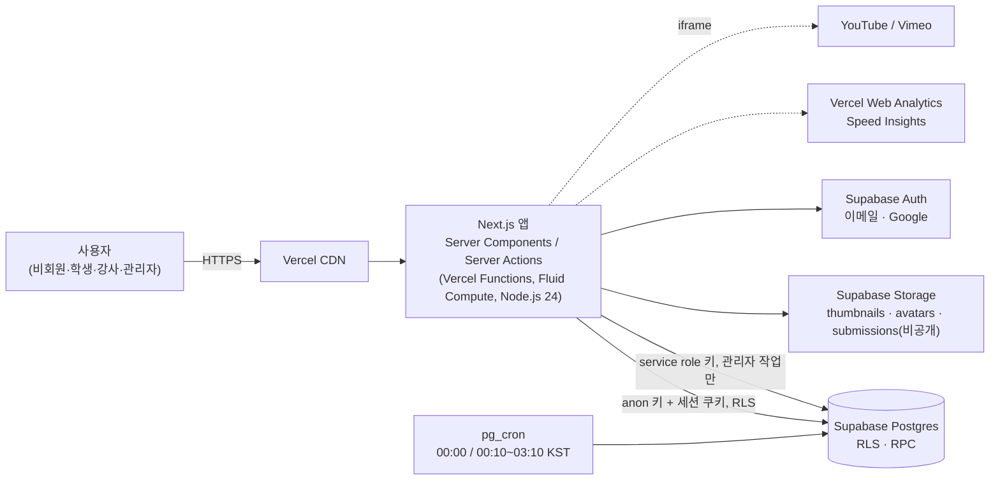
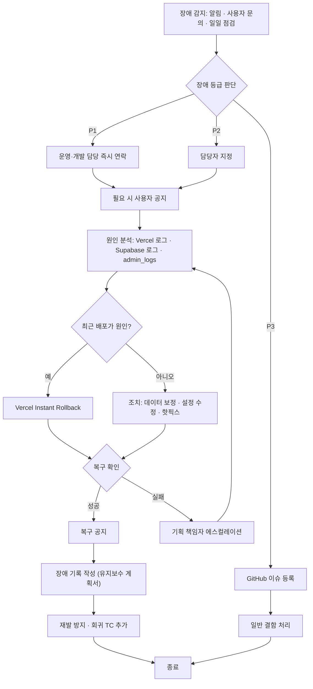

# 운영 가이드 (Operations Guide)

> 운영 인수 시 [G6 배포 기록](배포계획서.md#35-g6-운영-인수-기록)에 이 문서의 버전, 접근 확인과 운영 책임자를 연결한다.
>
> **현재 상태: 운영 중인 시스템이 없다.** 배포 전이라 이 문서의 모든 점검·알림·복구 절차는 계획이며 "미실행"이다. 임계값 중 근거가 없는 값은 출시 후 실측으로 정한다고 적었다. 공개 저장소이므로 접속 주소·계정·연락처·키를 적지 않는다.

| 항목 | 내용 |
|------|------|
| **프로젝트명** | 챌린지업 (ChallengeUp) — 온라인 강의 챌린지 플랫폼 |
| **문서 ID / 버전** | OPG-CHUP-v0.1 / v0.1 |
| **작성일** | 2026-11-25 |
| **작성자** | Claude Code (초안) |
| **대상 독자** | 운영 담당(관리자 역할 겸임 예상), 개발 담당 |

---

## 1. 시스템 개요

### 1.1 시스템 구성도

### 1.2 주요 컴포넌트

| 컴포넌트 | 설명 | 기술 | 인스턴스 수 | 비고 |
|----------|------|------|------------|------|
| 웹 앱 (화면 + 서버 로직) | 모든 화면, Server Actions (ASM-01·02) | Next.js App Router on Vercel | Vercel 자동 확장 | 서버 관리 없음 |
| API 서버 | 별도 없음 | - | - | ASM-01 |
| 데이터베이스 | 도메인 데이터, RLS, RPC 트랜잭션 | Supabase Postgres | 프로젝트 1개 (운영) | 요금제 미결 (ISSUE-04) |
| 캐시 | 없음 | - | - | SRS 2.3.1 |
| 파일 스토리지 | 썸네일, 프로필 사진, 인증 사진 | Supabase Storage | 버킷 3개 | ASM-07 |
| 검색 엔진 | 없음 | - | - | 검색(P2)은 Postgres 조회 |
| 메시지 큐 | 없음 | - | - | ASM-08 (Realtime도 미사용) |
| 배치/스케줄러 | 상태 전환·스트릭, 완주 판정 | Supabase pg_cron → DB 함수 | 작업 2개 | DEP-DEC-02 |

### 1.3 기술 스택

| 계층 | 기술 | 버전 | 비고 |
|------|------|------|------|
| Frontend·서버 | Next.js (App Router) + TypeScript, Tailwind, shadcn/ui | 착수 시 최신 안정판 | |
| Runtime | Node.js | 24 LTS (Vercel 기본) | Fluid Compute 기본, 함수 기본 제한 시간 300초 |
| Database | PostgreSQL (Supabase) | Supabase 제공 | |
| Cache | 해당 없음 | - | |
| Container / Orchestration | 해당 없음 | - | Vercel 관리형 |
| CI/CD | GitHub + Vercel 자동 배포, GitHub Actions(테스트) | - | 워크플로 미작성 |
| IaC | `vercel.ts` (`@vercel/config`), `supabase/migrations` | - | 설정은 코드로 관리 |

---

## 2. 접속 정보

### 2.1 서버 목록

Vercel·Supabase 관리형이라 직접 접속하는 서버가 없다.

| 환경 | 역할 | 호스트 | IP | 포트 | 접속 방법 | 비고 |
|------|------|--------|-----|------|-----------|------|
| Production | 웹 앱 | 운영 도메인 (미정, DEP-DEC-05) | 해당 없음 | 443 | 브라우저 | Vercel 관리 |
| Preview | 웹 앱 (테스트) | 배포마다 생성되는 Vercel URL | 해당 없음 | 443 | 브라우저 | PR마다 |
| - | 서버 SSH | 해당 없음 | - | - | - | 관리형 서비스 |

### 2.2 데이터베이스 접속

| 환경 | 구분 | 호스트 | 포트 | DB명 | 사용자 | 비고 |
|------|------|--------|------|------|--------|------|
| Production | Supabase 운영 프로젝트 | Supabase 대시보드에서 확인 | Supabase 기본 | Supabase 기본 | 대시보드 계정 | 미생성 |
| 비운영 | Supabase 개발·스테이징 (또는 브랜치) | 대시보드에서 확인 | Supabase 기본 | Supabase 기본 | 대시보드 계정 | DEP-DEC-03 미결 |

> **주의**: 접속 문자열·키는 Vercel 환경 변수와 Supabase 대시보드에서만 관리한다. 이 문서와 저장소(공개)에 적지 않는다. 운영 DB를 직접 수정하는 작업(판정 정정, 탈퇴 처리)은 `admin_logs`에 기록한다 (NFR-006).

### 2.3 관리 콘솔

| 서비스 | URL | 용도 | 접근 권한 |
|--------|-----|------|-----------|
| Vercel 대시보드 | vercel.com (프로젝트 미생성) | 배포, 롤백, 환경 변수, 로그, Speed Insights, Web Analytics | 개발 담당 (미정) |
| Supabase 대시보드 | supabase.com (프로젝트 미생성) | DB, Auth, Storage, 로그, 백업, cron | 개발 담당 (미정) |
| GitHub | lucyjeremy/learning-challenge-platform | 코드, 이슈(결함·CR), Actions | 프로젝트 팀 |
| 서비스 관리자 화면 | `/admin/reviews`, `/admin/instructors`, `/admin/reports` | 검수, 강사 승인, 신고 처리 | 관리자 역할 |
| 에러 트래킹 | 별도 도구 없음 (Vercel 로그 사용) | - | 도입 여부 미결 |

---

## 3. 모니터링

### 3.1 모니터링 대시보드 구성

| 대시보드 | URL | 주요 내용 | 갱신 주기 |
|----------|-----|-----------|-----------|
| 헬스 체크 | `/api/health` (구현 예정) | 앱 응답 + DB 연결 확인 (200) | 외부 확인 주기 미정 |
| Vercel Observability | Vercel 대시보드 | 함수 호출 수, 5xx, 실행 시간 | 실시간 |
| Speed Insights | Vercel 대시보드 | LCP p75 (NFR-001) | 실사용 데이터 누적 |
| Web Analytics | Vercel 대시보드 | 방문, 소개 → 신청 전환 (서비스 기획서 6.4) | 실시간 |
| Supabase | Supabase 대시보드 | DB 부하, 연결 수, Auth 로그, Storage 사용량 | 실시간 |
| 정기 작업 | SQL: `cron.job_run_details`, `admin_logs` | 00:00·00:10 실행 결과·건수 | 매일 |
| 비즈니스 메트릭 | SQL 조회 (KPI-001~005) | 완주율, 일일 인증률, 반응 수 | 주간 (대시보드 미구현) |

### 3.2 주요 메트릭 및 정상 범위

서버 리소스(CPU·메모리·디스크)는 Vercel·Supabase가 관리하므로 직접 측정하지 않는다. 아래 "정상 범위"는 출시 후 2주 실측으로 정한다.

#### 서버 리소스 메트릭

| 메트릭 | 정상 범위 | 경고 임계값 | 위험 임계값 | 비고 |
|--------|-----------|------------|------------|------|
| Supabase DB CPU·메모리 | 실측 후 결정 | 미정 | 미정 | 요금제 한도 대비 |
| Supabase DB 디스크 | 실측 후 결정 | 요금제 한도 80% (안) | 90% (안) | |
| Storage 사용량 | 실측 후 결정 | 요금제 한도 80% (안) | 90% (안) | 인증 사진 누적 |
| Vercel 함수 사용량 | 실측 후 결정 | 요금제 한도 80% (안) | 90% (안) | 비용 제약 (SPD 7.3) |

#### 애플리케이션 메트릭

| 메트릭 | 정상 범위 | 경고 임계값 | 위험 임계값 | 비고 |
|--------|-----------|------------|------------|------|
| LCP p75 (주요 화면) | ≤ 3초 | > 3초 | 미정 | NFR-001 |
| 서버 액션 p95 | ≤ 800ms | > 800ms | 미정 | NFR-001 |
| 5xx 비율 | 실측 후 결정 | 미정 | 미정 | |
| 4xx 비율 | 실측 후 결정 | - | - | 409·422는 정상 규칙 거절도 포함 |
| 23:00~23:59 요청 수 | 실측 후 결정 | - | - | 마감 직전 피크 (NFR-002) |

#### 데이터베이스 메트릭

| 메트릭 | 정상 범위 | 경고 임계값 | 위험 임계값 | 비고 |
|--------|-----------|------------|------------|------|
| DB 연결 수 | 실측 후 결정 | 요금제 한도 80% (안) | 90% (안) | |
| 느린 쿼리 | 실측 후 결정 | 미정 | 미정 | 리더보드·대시보드 (ASM-10) |
| 00:00 작업 소요 | ≤ 5분 | > 5분 | 실패 | NFR-003 |
| 00:10 판정 소요 | ≤ 10분 | > 10분 | 03:10까지 실패 | NFR-003, BP-DONE-001-6 |

### 3.3 알림 설정

알림 채널과 수신자는 정해지지 않았다. 모든 알림은 미설정(미실행)이다.

| 알림명 | 조건 | 심각도 | 알림 채널 | 수신 대상 |
|--------|------|--------|-----------|-----------|
| 헬스 체크 실패 | 연속 실패 (횟수 미정) | Critical | 미정 | 운영 담당 |
| 5xx 증가 | 기준값 대비 증가 (실측 후) | Warning | 미정 | 개발 담당 |
| 정기 작업 오류 | `admin_logs`에 `job:*:error` 기록 | Critical | 미정 (SQL 조회 또는 DB 웹훅 — 방식 미결) | 운영·개발 담당 |
| 판정 3회 실패 | 03:10 실행 후 `judged_at IS NULL`인 종료 챌린지 존재 | Critical | 미정 | 운영 담당 |
| 요금제 한도 | Vercel·Supabase 사용량 경고 | Warning | 사업자 기본 이메일 | 개발 담당 |
| 신고 누적 | 임시 숨김 발생 (BP-FEED-003-4) | Info | 관리자 화면 | 관리자 |
| 강사 신청·검수 대기 | 2영업일 경과 (BP-AUTH-004-4, BP-CHAL-003-1) | Info | 관리자 화면 | 관리자 |

---

## 4. 장애 대응 절차 (Runbook)

### 4.1 장애 등급 정의

목표 시간은 소규모 팀 기준 제안값이며 승인 전이다. SLA 계약은 없다 (NFR-007).

| 등급 | 정의 | 영향 범위 | 대응 시간 목표 | 복구 시간 목표 | 예시 |
|------|------|-----------|---------------|---------------|------|
| **Critical (P1)** | 서비스 접속 불가, 인증 제출 불가, 권한 우회·데이터 노출 | 전체 사용자 | 미정 (마감 시간대는 우선 대응) | 4시간 (NFR-008 RTO) | 앱 다운, DB 장애, RLS 누락, 판정 오류 |
| **Major (P2)** | 주요 규칙 오류, 심각한 지연 | 다수 사용자 | 미정 | 미정 | 포인트 중복, 정원 초과, 정기 작업 지연 |
| **Minor (P3)** | 부가 기능 오류 | 일부 사용자 | 다음 영업일 (안) | 다음 릴리스 | 배지 오표시, 문구 오류 |

### 4.2 장애 대응 프로세스

### 4.3 주요 장애 시나리오별 대응 방법

#### 시나리오 1: 앱 응답 없음 (5xx, 화면 오류)

| 항목 | 내용 |
|------|------|
| **증상** | 헬스 체크 실패, 5xx 증가, 화면에 "일시적인 오류가 발생했습니다" |
| **장애 등급** | Critical (P1) |

**대응 절차**:

| 순서 | 조치 | 명령어/도구 | 담당 |
|------|------|------------|------|
| 1 | Vercel·Supabase 상태 페이지 확인 (사업자 장애 여부) | 각 사 상태 페이지 | 운영 담당 |
| 2 | 최근 배포 확인 | Vercel 대시보드 Deployments | 개발 담당 |
| 3 | 함수 로그 확인 | Vercel 대시보드 Logs (CLI 설치 후 `vercel logs`) | 개발 담당 |
| 4 | 배포 직후 발생이면 이전 배포로 되돌림 | Vercel Instant Rollback | 개발 담당 |
| 5 | 헬스 체크 재확인 | `/api/health` | 운영 담당 |
| 6 | 환경 변수 누락·만료 확인 | Vercel 환경 변수 설정 | 개발 담당 |

#### 시나리오 2: DB 연결 수 초과·느려짐

| 항목 | 내용 |
|------|------|
| **증상** | 연결 오류, 서버 액션 시간 증가 (특히 23:00~23:59) |
| **장애 등급** | Critical (P1) ~ Major (P2) |

**대응 절차**:

| 순서 | 조치 | 명령어/도구 | 담당 |
|------|------|------------|------|
| 1 | 연결 수 확인 | Supabase 대시보드, `select count(*) from pg_stat_activity;` | 개발 담당 |
| 2 | 오래 실행 중인 쿼리 확인 | `pg_stat_activity` (state, query_start) | 개발 담당 |
| 3 | 문제 쿼리 종료 | `select pg_cancel_backend(pid);` | 개발 담당 |
| 4 | 연결 풀러(Supavisor) 사용 여부 확인 | Supabase 연결 설정 | 개발 담당 |
| 5 | 리더보드·대시보드 쿼리면 집계 뷰 전환 검토 | ASM-10, NFR-009 | 개발 담당 |
| 6 | 근본 원인 수정 후 배포 | PR → Preview 검증 → Production | 개발 담당 |

#### 시나리오 3: 정기 작업 실패 (상태 전환·완주 판정)

| 항목 | 내용 |
|------|------|
| **증상** | 시작일인데 Day 1이 열리지 않음, 종료 후 "결과 집계 중"이 계속 보임, `admin_logs`에 오류 |
| **장애 등급** | Critical (P1) — 마감·판정은 서비스 핵심 |

**대응 절차**:

| 순서 | 조치 | 명령어/도구 | 담당 |
|------|------|------------|------|
| 1 | 작업 실행 기록 확인 | `select * from cron.job_run_details order by start_time desc limit 20;` | 개발 담당 |
| 2 | 오류 로그 확인 | `select * from admin_logs where action like 'job:%error%' order by created_at desc;` | 개발 담당 |
| 3 | 판정은 01:10·02:10·03:10 자동 재시도 대기 (BP-DONE-001-6) | - | 운영 담당 |
| 4 | 원인 수정 후 수동 재실행 (멱등이라 중복 처리 없음, FR-008-AC5·FR-020-AC4) | `select run_daily_transitions();` / `select run_completion_judgement();` (service role) | 개발 담당 |
| 5 | 결과 확인 후 작업 로그 기록 | `admin_logs` | 개발 담당 |
| 6 | 영향 받은 사용자 안내 필요 여부 판단 | - | 기획 책임자 |

#### 시나리오 4: 권한 오류·데이터 노출 (RLS)

| 항목 | 내용 |
|------|------|
| **증상** | 미신청자에게 Day 내용·피드가 보임, 비공개 인증 사진 노출 |
| **장애 등급** | Critical (P1) |

**대응 절차**:

| 순서 | 조치 | 명령어/도구 | 담당 |
|------|------|------------|------|
| 1 | 노출 범위 확인 (대상 테이블·정책) | DDS 5.11 정책표와 실제 정책 비교 (`pg_policies`) | 개발 담당 |
| 2 | 즉시 차단: 해당 정책 수정 마이그레이션 적용 또는 기능 비활성 | `supabase db push` | 개발 담당 |
| 3 | 배포 원인이면 앱 롤백 + 정책 되돌림 SQL | 배포 계획서 4.2 | 개발 담당 |
| 4 | TC-SEC-RLS-010 재실행 | pgTAP | 개발 담당 |
| 5 | 개인정보 유출 여부 판단과 신고 의무 검토 | 개인정보 보호법 (법률 검토 미결, ISSUE-05) | 기획 책임자 |

#### 시나리오 5: 인증 메일 미발송·로그인 불가

| 항목 | 내용 |
|------|------|
| **증상** | 가입 후 인증 메일이 오지 않음, 재설정 메일 지연 |
| **장애 등급** | Major (P2) |

**대응 절차**:

| 순서 | 조치 | 명령어/도구 | 담당 |
|------|------|------------|------|
| 1 | Supabase Auth 로그 확인 | Supabase 대시보드 Auth Logs | 개발 담당 |
| 2 | 메일 발송 한도 초과 여부 확인 | 요금제 한도 (ISSUE-04) | 개발 담당 |
| 3 | 사용자 정의 SMTP 연결 검토 | Supabase Auth SMTP 설정 (미결) | 개발 담당 |
| 4 | Site URL·Redirect URL 설정 확인 | Supabase Auth URL 설정 | 개발 담당 |
| 5 | 사용자 안내 | 서비스 공지 | 운영 담당 |

### 4.4 에스컬레이션 매트릭스

| 경과 시간 | 에스컬레이션 대상 | 알림 방법 |
|-----------|-------------------|-----------|
| 즉시 | 운영 담당 (미정) | 팀 채널 |
| P1 30분 이내 미해결 (안) | 개발 담당 (미정) | 팀 채널 + 전화 (번호는 비공개 문서) |
| P1 2시간 이내 미해결 (안) | 기획 책임자 (미정, DEC-001) | 전화 |
| 사업자 장애 | Vercel·Supabase 지원 | 대시보드 지원 요청 |

**에스컬레이션 기준**:
- 마감 시간대(21:00~00:30)의 P1은 즉시 개발 담당을 부른다.
- 원인을 모르거나 혼자 해결할 수 없으면 바로 올린다.
- 개인정보 노출 가능성이 있으면 즉시 기획 책임자에게 보고한다.

---

## 5. 백업/복구

### 5.1 백업 스케줄 및 보존 정책

Supabase 요금제에 따라 백업 주기·보존·PITR 가능 여부가 달라진다 (ISSUE-04 미결). 아래는 NFR-008 목표 기준이다.

| 대상 | 백업 유형 | 주기 | 보존 기간 | 저장 위치 | 비고 |
|------|----------|------|-----------|-----------|------|
| 데이터베이스 | Supabase 자동 백업 | 일 1회 (NFR-008) | 요금제 기준 | Supabase | 요금제가 자동 백업을 지원하지 않으면 `supabase db dump`를 정기 실행 (방식 미결) |
| 데이터베이스 | PITR | 미정 | 미정 | Supabase | 요금제 의존 |
| 데이터베이스 | 수동 덤프 | 배포 전 | 미정 | 비공개 저장소 (저장소 위치 미정) | 공개 저장소에 두지 않음 |
| 파일 스토리지 | 없음 (Supabase 기본) | - | - | - | 인증 사진 백업 필요 여부 미결 |
| 설정·스키마 | Git | 변경 시 | 무제한 | GitHub (`vercel.ts`, `supabase/migrations`) | 키 제외 |
| 비밀 값 | Vercel 환경 변수 | 변경 시 | - | Vercel | 원본은 각 사업자 대시보드 |

### 5.2 복구 절차

| 항목 | 내용 |
|------|------|
| **RTO** | 4시간 (NFR-008, 수동 복구) |
| **RPO** | 24시간 (NFR-008, 일 1회 백업) |

#### DB 복구 절차

| 순서 | 작업 | 명령어/도구 | 예상 시간 | 담당 |
|------|------|------------|-----------|------|
| 1 | 복구 시점 결정 | - | 미정 | 개발 담당 |
| 2 | 현재 DB 덤프 (안전장치) | `supabase db dump` | 미정 | 개발 담당 |
| 3-A | 전체 복원 | Supabase 대시보드 백업 복원 | 미정 | 개발 담당 |
| 3-B | PITR | Supabase 대시보드 (요금제 의존) | 미정 | 개발 담당 |
| 4 | 정합성 확인 | 참여 인원·포인트 합계·인증 수·`judged_at` 쿼리 | 미정 | 개발 담당 |
| 5 | 정기 작업 재실행 필요 여부 확인 | 3.2 데이터베이스 메트릭 | 미정 | 개발 담당 |
| 6 | 스모크 테스트 | 배포 계획서 3.2 Phase 4-3 | 10분 | 운영 담당 |

### 5.3 복구 테스트 주기

| 테스트 유형 | 주기 | 최근 실행일 | 다음 실행 예정일 | 결과 |
|------------|------|------------|----------------|------|
| DB 백업 복원 (TC-OP-BAK-001) | 출시 전 1회, 이후 분기 1회 (안) | 없음 | 미정 (출시 전) | 미실행 |
| PITR | 요금제 결정 후 | 없음 | 미정 | 미실행 |
| 전체 DR 시뮬레이션 | 해당 없음 (MVP 범위 외) | - | - | - |

---

## 6. 정기 작업

### 6.1 일일 점검 체크리스트

모든 항목 미실행 (운영 시작 전).

| # | 점검 항목 | 확인 방법 | 정상 기준 | 확인 |
|---|----------|-----------|-----------|------|
| 1 | 헬스 체크 | `/api/health` | 200 | [ ] 미실행 |
| 2 | 00:00 상태 전환 결과 | `cron.job_run_details`, `admin_logs` | 성공, 5분 이내 | [ ] 미실행 |
| 3 | 00:10 완주 판정 결과 | `admin_logs`, `judged_at IS NULL`인 종료 챌린지 0건 | 성공, 10분 이내 | [ ] 미실행 |
| 4 | 오류 로그 | Vercel 함수 로그 5xx | 비정상 패턴 없음 | [ ] 미실행 |
| 5 | 관리자 대기 업무 | 검수·강사 신청·신고 목록 | 2영업일·1영업일 목표 내 | [ ] 미실행 |
| 6 | 백업 성공 | Supabase 백업 목록 | 최근 24시간 이내 | [ ] 미실행 |
| 7 | 탈퇴 요청 | 문의 메일함 | 5영업일 이내 처리 (BP-AUTH-005-1) | [ ] 미실행 |

### 6.2 주간 점검 체크리스트

| # | 점검 항목 | 확인 방법 | 비고 |
|---|----------|-----------|------|
| 1 | KPI 집계 (KPI-002 일일 인증률, KPI-003 반응 수) | SQL 조회 | 서비스 기획서 6.2 |
| 2 | LCP p75 (NFR-001) | Speed Insights | |
| 3 | 느린 쿼리 | Supabase 쿼리 성능 화면 | 리더보드·대시보드 |
| 4 | 의존성 취약점 | `npm audit`, GitHub Dependabot 알림 | |
| 5 | 반복 오류 | Vercel 로그 | GitHub 이슈 등록 |
| 6 | 사용량·비용 | Vercel·Supabase 사용량 | 무료 한도 (SPD 7.3) |

### 6.3 월간 점검 체크리스트

| # | 점검 항목 | 확인 방법 | 비고 |
|---|----------|-----------|------|
| 1 | SSL 인증서 | Vercel 자동 갱신 상태 | 수동 갱신 없음 |
| 2 | 도메인 만료일 | 등록 기관 | 도메인 미정 |
| 3 | 백업 복원 테스트 | 5.3 (분기) | |
| 4 | Node.js·Next.js·Supabase 클라이언트 업데이트 | 릴리스 노트 확인 | 유지보수 계획서 적응 유지보수 |
| 5 | 비용 분석 | 대시보드 | |
| 6 | 용량 계획 | 가입자·인증 사진 증가 추이 | NFR-009 |
| 7 | 가용성 (NFR-007 99.5%) | 사업자 상태 기록 + 헬스 체크 기록 | 측정 방식 미결 |

### 6.4 인증서/라이선스 갱신 일정

| 항목 | 발급일 | 만료일 | 자동 갱신 | 관리 담당 | 비고 |
|------|--------|--------|-----------|-----------|------|
| SSL 인증서 (운영 도메인) | 없음 | 없음 | [x] 예 (Vercel) / [ ] 아니오 | 미정 | 도메인 연결 후 |
| 도메인 등록 | 없음 | 없음 | [ ] 예 / [ ] 아니오 | 미정 | DEP-DEC-05 |
| Vercel 요금제 | 없음 | - | - | 미정 | 무료 한도 가정 |
| Supabase 요금제 | 없음 | - | - | 미정 | ISSUE-04 |

### 6.5 로그 로테이션/정리

| 로그 유형 | 위치 | 로테이션 주기 | 보존 기간 | 압축 | 비고 |
|-----------|------|-------------|-----------|------|------|
| 함수 로그 | Vercel | Vercel 관리 | 요금제 기준 | - | 개인정보 미기록 (DDS 7.4) |
| DB·Auth 로그 | Supabase | Supabase 관리 | 요금제 기준 | - | |
| 관리자 작업 로그 | `admin_logs` 테이블 | 없음 (추가 전용) | 2년 (정기 작업 1년) | - | NFR-006. 보존 기간 지난 행 삭제 절차 미정 |
| cron 실행 기록 | `cron.job_run_details` | 정리 작업 필요 | 미정 | - | 행이 계속 쌓이므로 정리 주기 결정 필요 |
| 인증 사진 고아 파일 | Storage `submissions` | 정리 작업 미정 | - | - | DDS 5.6 orphan 정리 대상 로그 |

---

## 7. 긴급 연락처

공개 저장소이므로 실제 이름·전화번호·이메일은 비공개 팀 문서에 둔다. 아래는 역할만 적는다.

### 7.1 내부 연락처

| 역할 | 담당자 | 전화번호 | 이메일 | Slack | 비고 |
|------|--------|----------|--------|-------|------|
| 운영 담당 (관리자 역할) | 미정 | 비공개 문서 | 비공개 문서 | 미정 | 1차 연락 |
| 개발 담당 | 미정 | 비공개 문서 | 비공개 문서 | 미정 | 배포·DB·롤백 |
| 기획 책임자 | 미정 (DEC-001) | 비공개 문서 | 비공개 문서 | 미정 | 에스컬레이션, 사용자 공지 결정 |

### 7.2 외부 연락처

| 서비스/업체 | 담당 | 연락처 | 지원 시간 | 비고 |
|------------|------|--------|-----------|------|
| Vercel | 기술 지원 | Vercel 대시보드 지원 요청 | 요금제 기준 | |
| Supabase | 기술 지원 | Supabase 대시보드 지원 요청 | 요금제 기준 | |
| Google Cloud (OAuth) | - | Google Cloud 콘솔 | - | P2 |
| 도메인 등록 기관 | - | 미정 | - | DEP-DEC-05 |

### 7.3 온콜 스케줄

소규모 팀이라 온콜 순번을 두지 않는다 (안). 마감 시간대(21:00~00:30)와 정기 작업 직후(00:00~00:30)에는 개발 담당이 연락 가능한 상태를 유지하는 방안을 검토한다 (미결).

| 기간 | 주 담당 | 백업 담당 | 비고 |
|------|---------|-----------|------|
| 출시 후 첫 3일 (안) | 개발 담당 (미정) | 운영 담당 (미정) | 집중 모니터링 (배포 계획서 3.4) |

**온콜 규칙**:
- 교대: 해당 없음 (순번 없음, 안)
- 응답 시간: P1은 확인 즉시 (목표 시간 미정)
- 연락 불가 시: 기획 책임자에게 연락
- 온콜 도구: 없음 (팀 채널)
