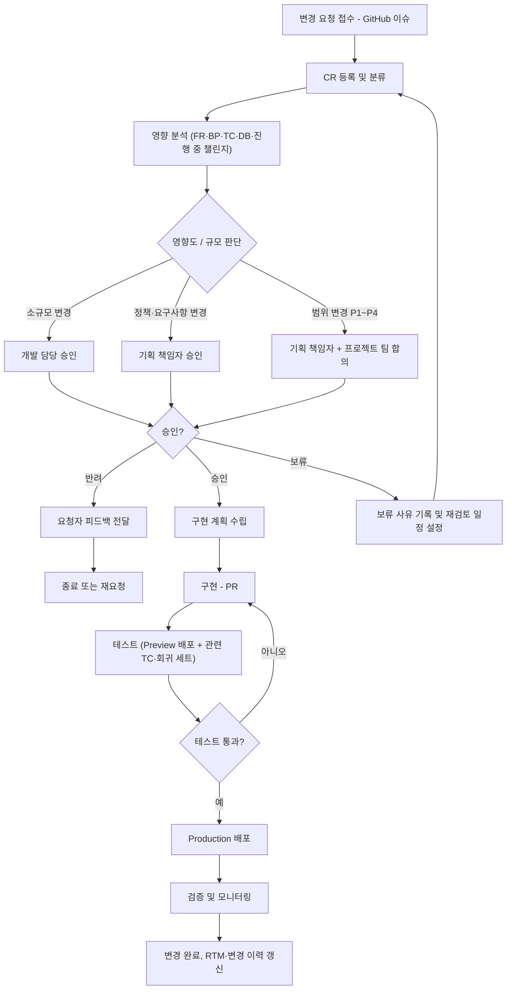

# 유지보수 계획서 (Maintenance Plan)

> 작성 근거: [배포 계획서](../06-배포/배포계획서.md) DPP-CHUP-v0.1, [운영 가이드](../06-배포/운영가이드.md) OPG-CHUP-v0.1, 서비스 기획서 7.2 로드맵(v1.1 안정화), [변경 관리 계획](../08-검토/프로젝트관리-산출물.md#4-변경-관리-계획).
>
> **현재 상태: 출시 전이라 유지보수 활동은 하나도 시작하지 않았다 (모두 미실행).** [G6 운영 인수 기록](../06-배포/배포계획서.md#35-g6-운영-인수-기록)도 비어 있다. 목표 시간은 소규모 팀 기준 제안값이며 승인 전이다. SLA 계약은 없다.

| 항목 | 내용 |
|------|------|
| **프로젝트명** | 챌린지업 (ChallengeUp) — 온라인 강의 챌린지 플랫폼 |
| **문서 ID / 버전** | MTP-CHUP-v0.1 / v0.1 |
| **작성일** | 2026-11-25 |
| **작성자** | Claude Code (초안) |
| **승인자** | 미정 (DEC-001) |
| **유지보수 기간** | 미정 — v1.0 출시일(G6)부터 v2.0 착수 전까지 (안) |

---

## 1. 유지보수 유형 정의

### 1.1 유지보수 유형 분류

#### 수정 유지보수 (Corrective Maintenance)

| 항목 | 내용 |
|------|------|
| **정의** | 운영 중 발견된 결함을 고치는 활동 |
| **목적** | 매일 인증·완주 판정 같은 핵심 루프를 정상으로 되돌림 |
| **트리거** | 사용자 문의, 관리자 신고 처리 중 발견, 운영 가이드 일일 점검, Vercel·Supabase 로그 |
| **우선순위** | 3.1 장애 등급에 따름. 마감 시간대 영향 결함은 우선 |

**예시** (챌린지업에서 예상되는 유형):
- 마감 경계(23:59:59.999 / 00:00:00.000) 오판으로 인증이 잘못 거절됨 (NFR-012)
- 같은 인정 이벤트로 포인트가 두 번 쌓임 (BP-POINT-001-2)
- 정원 마지막 자리에서 초과 신청 (BP-ENR-001-6)
- 완주 판정 오류 → 관리자 DB 정정 + `admin_logs` (BP-DONE-001-5)

#### 적응 유지보수 (Adaptive Maintenance)

| 항목 | 내용 |
|------|------|
| **정의** | 플랫폼·라이브러리·법규 변화에 맞추는 활동 |
| **목적** | 바뀐 환경에서도 같은 동작 보장 |
| **트리거** | Vercel 런타임 변경(Node.js LTS 교체), Next.js·Supabase 클라이언트 업데이트, 요금제 변경, 개인정보 보호 법령 |
| **우선순위** | 보안 패치는 긴급, 나머지는 영향도에 따라 |

**예시**:
- Node.js 24 LTS 지원 종료 전 다음 LTS로 전환
- Next.js 메이저 업그레이드 (Server Actions·캐시 동작 변화 확인)
- Supabase Auth·Storage API 변경 대응
- 개인정보 보관 기간 확정(ISSUE-05)에 따른 파기 기능 추가

#### 완전 유지보수 (Perfective Maintenance)

| 항목 | 내용 |
|------|------|
| **정의** | 사용자 피드백·KPI 결과로 기능을 개선하는 활동 |
| **목적** | H-001~H-005 가설 검증 결과에 맞춰 개선 |
| **트리거** | KPI 판정(서비스 기획서 6.3), UX 검토서 반영 항목, 강사 인터뷰 |
| **우선순위** | KPI 영향 순 |

**예시**:
- v1.1: P3 항목(MVP-019 멤버 탭·피드 필터·신고, MVP-020 완주 배지) — 서비스 기획서 7.2
- [UX 검토서](../08-검토/UX검토서.md)의 문구 개선안 반영
- 일일 인증률 70% 미만이면 알림(EX-004) 우선 도입 (H-002)
- 리더보드·대시보드 응답이 NFR-001을 넘으면 집계 뷰 전환 (ASM-10)

#### 예방 유지보수 (Preventive Maintenance)

| 항목 | 내용 |
|------|------|
| **정의** | 장애를 미리 막는 활동 |
| **목적** | 핵심 규칙(마감·포인트·판정)과 권한(RLS)의 회귀 방지 |
| **트리거** | 정기 점검(운영 가이드 6장), 기술 부채 검토, 의존성 알림 |
| **우선순위** | 위험도 순 |

**예시**:
- RLS 접근 표 회귀 테스트(TC-RG-SEC-001)를 마이그레이션 PR 필수 점검으로 유지
- `cron.job_run_details`·`admin_logs` 정리 주기 결정
- 인증 사진 고아 파일 정리 (DDS 5.6)
- 공개 저장소 비밀 정보 검사 정기 실행

### 1.2 유지보수 유형별 비율 목표

출시 후 실측 전이라 근거 있는 비율이 없다. 아래는 v1.1 안정화 기간(출시 후 2주, 서비스 기획서 7.2)의 방향만 적는다.

| 유지보수 유형 | 목표 비율 | 비고 |
|-------------|-----------|------|
| 수정 (Corrective) | 미정 (안정화 기간 최우선) | 출시 직후 결함 대응 |
| 적응 (Adaptive) | 미정 | 보안 패치 수시 |
| 완전 (Perfective) | 미정 | v1.1 P3 항목, KPI 판정 후 |
| 예방 (Preventive) | 미정 | 회귀 테스트 유지 |

---

## 2. 변경 요청(CR) 프로세스

변경 요청은 GitHub Issues에 `change-request` 라벨로 등록한다 (공개 저장소이므로 개인정보·키를 쓰지 않는다). 범위·정책·요구사항이 바뀌는 CR은 [변경 관리 계획](../08-검토/프로젝트관리-산출물.md#4-변경-관리-계획)을 따르고 SRS·BPD·RTM·TC를 함께 갱신한다 (BPD 17.2).

### 2.1 CR 프로세스 흐름도



### 2.2 CR 양식 템플릿

---

#### 변경 요청서 (Change Request)

| 항목 | 내용 |
|------|------|
| **CR-ID** | CR-YYYY-NNNN (GitHub 이슈 번호 병기) |
| **요청일** | YYYY-MM-DD |
| **요청자** | 역할 (학생·강사 피드백이면 출처 채널) |
| **유형** | [ ] 수정 / [ ] 적응 / [ ] 완전 / [ ] 예방 |
| **우선순위** | [ ] 긴급 / [ ] 높음 / [ ] 보통 / [ ] 낮음 |
| **희망 완료일** | YYYY-MM-DD |

**변경 설명**:

| 항목 | 내용 |
|------|------|
| 현재 상황 | 현재 동작과 관련 FR·BP ID |
| 변경 요청 내용 | 원하는 변경 |
| 변경 사유 | KPI·피드백·결함 근거 |
| 비즈니스 영향 | 진행 중 챌린지·기존 포인트 로그 영향, 소급 여부 (BPD 17.2) |
| 첨부 자료 | 이슈 링크, 화면 캡처 (개인정보 제거) |

**승인 이력**:

| 단계 | 승인자 | 결정 | 일자 | 비고 |
|------|--------|------|------|------|
| 접수 | 역할 | 접수 | YYYY-MM-DD | |
| 영향 분석 | 역할 | 분석 완료 | YYYY-MM-DD | |
| 승인 | 역할 | [ ] 승인 / [ ] 반려 / [ ] 보류 | YYYY-MM-DD | 사유 |

현재 접수된 CR은 없다 (출시 전).

---

### 2.3 영향 분석 템플릿

---

#### 변경 영향 분석서

| 항목 | 내용 |
|------|------|
| **CR-ID** | CR-YYYY-NNNN |
| **분석일** | YYYY-MM-DD |
| **분석자** | 역할 |

**기술적 영향 분석**:

| 영향 범위 | 영향 내용 | 영향도 |
|-----------|----------|--------|
| 소스 코드 | `src/features/*`, `src/domain/*` 대상 파일 | 높음/중간/낮음 |
| 데이터베이스 | 마이그레이션, RLS·RPC·cron 변경, 되돌림 SQL | 높음/중간/낮음 |
| Server Action·RPC | 입출력·오류 코드 변경 (SRS 5.2) | 높음/중간/낮음 |
| UI/UX | 화면 SCR-01~14, 문구(BP-ERROR-004) | 높음/중간/낮음 |
| 외부 연동 | Supabase Auth·Storage, Google OAuth, YouTube·Vimeo | 높음/중간/낮음 |
| 성능 | NFR-001·003 | 높음/중간/낮음 |
| 보안 | RLS 접근 표, 비공개 사진 | 높음/중간/낮음 |
| 진행 중 챌린지 | 이미 신청한 학생의 조건(기간·완주 조건) 보호 (BP-CHAL-004) | 높음/중간/낮음 |
| 문서·TC | SRS·BPD·RTM·TC 갱신 대상 | 높음/중간/낮음 |

**리소스 산정**:

| 항목 | 산정 |
|------|------|
| 개발 공수 | N man-day |
| QA 공수 | N man-day |
| 예상 소요 기간 | N 영업일 |
| 필요 인력 | 개발 N명, QA N명 |

**위험 분석**:

| 위험 | 확률 | 영향 | 대응 방안 |
|------|------|------|-----------|
| 진행 중 챌린지 데이터와 충돌 | 높음/중간/낮음 | 높음/중간/낮음 | 다음 기수부터 적용, 소급 금지 |
| 포인트·스트릭 재계산 필요 | 높음/중간/낮음 | 높음/중간/낮음 | 원장에 보정 로그 추가 |

**분석 결과 의견**:

| 항목 | 내용 |
|------|------|
| 종합 영향도 | [ ] 높음 / [ ] 중간 / [ ] 낮음 |
| 구현 가능성 | [ ] 가능 / [ ] 조건부 가능 / [ ] 불가 |
| 권고 의견 | 분석자 의견 |

---

### 2.4 승인 기준

| 변경 규모 | 판단 기준 | 승인 권한 | 소요 시간 |
|-----------|-----------|-----------|-----------|
| **소규모** | 결함 수정·문구 수정, 정책·요구사항 변경 없음 | 개발 담당 (미정) | 미정 |
| **중규모** | 정책 값(점수·한도·시간) 또는 수용 기준 변경 | 기획 책임자 (미정, DEC-001) | 미정 |
| **대규모** | 범위 변경(EX → MVP), 스키마 대규모 변경, 운영 방식·결제(v2) | 기획 책임자 + 프로젝트 팀 | 미정 |
| **긴급** | S1 결함, 보안 패치, RLS 노출 | 개발 담당 (사후 보고) | 즉시 |

---

## 3. SLA 정의

외부와 맺은 SLA는 없다. 아래는 팀 내부 목표(제안값)이며 승인 전이다.

### 3.1 장애 등급별 대응/복구 시간 목표

| 장애 등급 | 정의 | 대응 시간 | 우회 방안 제공 | 복구 시간 | 근본 원인 분석 |
|-----------|------|-----------|---------------|-----------|---------------|
| **Critical (P1)** | 접속 불가, 인증 제출 불가, 권한 우회·데이터 노출, 판정 오류 | 미정 (마감 시간대 우선) | 미정 | 4시간 (NFR-008 RTO) | 미정 |
| **Major (P2)** | 포인트·스트릭·정원 규칙 오류, 정기 작업 지연 | 미정 | 미정 | 미정 | 미정 |
| **Minor (P3)** | 부가 기능 오류 | 다음 영업일 (안) | 필요 시 | 다음 릴리스 | 필요 시 |
| **Low (P4)** | 사용에 영향 없음 | 미정 | 필요 시 | 다음 릴리스 | 필요 시 |

> **대응 시간**: 장애를 안 뒤 담당자가 분석을 시작하기까지의 시간
> **복구 시간**: 장애를 안 뒤 정상 운영으로 돌아오기까지의 시간

### 3.2 가용성 목표

| 항목 | 목표 | 허용 다운타임 | 비고 |
|------|------|-------------|------|
| **서비스 가용성** | 99.5% (NFR-007) | 월 약 3.6시간 | Vercel·Supabase 사업자 기본 수준을 따름 |
| **핵심 기능 가용성** | 별도 목표 없음 | - | 마감 시간대(21:00~00:30) 점검 금지로 대신함 |
| **정기 작업** | 00:10 판정은 03:10까지 성공 | - | BP-DONE-001-6 |

**가용성 산정 기준**:
- 측정 기간: 월간
- 측정 방법: 외부 가동 확인 도구 미정 (헬스 체크 기록 + 사업자 상태 기록)
- 제외 항목: 사전 공지한 점검, 사업자 장애

### 3.3 SLA 위반 시 에스컬레이션

| 위반 수준 | 조건 | 에스컬레이션 대상 | 조치 사항 |
|-----------|------|-------------------|-----------|
| Level 1 | 대응 시간 목표 초과 | 개발 담당 | 즉시 대응 시작 |
| Level 2 | P1이 2시간 이상 지속 (안) | 기획 책임자 | 사용자 공지, 롤백 결정 |
| Level 3 | 복구 시간(4시간) 초과 | 기획 책임자 | 사업자 지원 요청, 영향 받은 챌린지 보정 방안 결정 |
| Level 4 | 월간 가용성 99.5% 미달 | 프로젝트 팀 | 원인 분석, 요금제·구성 재검토 |

---

## 4. 기술 부채 관리

### 4.1 기술 부채 분류

| 분류 | 설명 | 예시 | 영향 |
|------|------|------|------|
| **코드 부채** | 규칙 중복, 하드코딩 | 점수·한도 값이 `domain/constants.ts` 밖에 흩어짐, TS·SQL 이중 구현 불일치 | 규칙 오판 |
| **아키텍처 부채** | 설계 결정 미확정 | 02-시스템설계 미작성으로 DDS가 ASM-01~10 가정에 의존 | 구현 후 재작업 |
| **테스트 부채** | 테스트 부족 | 시각 고정 방법 부재, 부하 도구 미정 | 경계 회귀 |
| **문서 부채** | 문서 불일치 | 테스트 결과 보고서 9.2의 문서 간 불일치 | 기대 결과 혼란 |
| **인프라 부채** | 수동 운영 | 알림 미설정, 백업 방식 미정, cron 기록 정리 없음 | 장애 발견 지연 |

### 4.2 기술 부채 등록 템플릿

---

#### 기술 부채 등록서

| 항목 | 내용 |
|------|------|
| **TD-ID** | TD-NNNN |
| **등록일** | YYYY-MM-DD |
| **등록자** | 역할 |
| **분류** | [ ] 코드 / [ ] 아키텍처 / [ ] 테스트 / [ ] 문서 / [ ] 인프라 |
| **위치** | 파일·모듈·문서 위치 |
| **심각도** | [ ] 높음 / [ ] 중간 / [ ] 낮음 |

**부채 내용**:

| 항목 | 내용 |
|------|------|
| 현재 상태 | 문제점 |
| 발생 원인 | 배경 |
| 영향 범위 | 영향 받는 FR·NFR |
| 개선 방안 | 방법 |
| 예상 공수 | N man-day |
| 비용 (방치 시) | 방치 영향 |

**우선순위 판단**:

| 기준 | 점수 (1-5) | 비고 |
|------|-----------|------|
| 비즈니스 영향 | N | 완주·인증에 미치는 영향 |
| 기술적 위험 | N | 장애·보안 가능성 |
| 개발 생산성 영향 | N | |
| 해소 비용 | N | 1=저렴, 5=고비용 (역산정) |
| **종합 우선순위** | N/20 | |

---

### 4.3 기술 부채 해소 계획

현재 등록된 기술 부채는 설계·문서 단계에서 보이는 후보이며, 해소 활동은 모두 미실행이다. 코드가 생기면 TD로 정식 등록한다.

| 분기 | 해소 대상 (후보) | 분류 | 예상 공수 | 담당 | 상태 |
|------|-------------------|------|-----------|------|------|
| 구현 착수 전 | 02-시스템설계 작성, ASM-01~10 확정 (ISSUE-06) | 아키텍처 | 미정 | 설계 담당 (미정) | [x] 예정 / [ ] 진행 중 / [ ] 완료 |
| 구현 착수 전 | 서버 시각 주입 방식 결정 (테스트 계획서 R-02) | 테스트 | 미정 | 개발 담당 (미정) | [x] 예정 / [ ] 진행 중 / [ ] 완료 |
| G4 전 | GitHub Actions 테스트 워크플로 | 인프라 | 미정 | 개발 담당 (미정) | [x] 예정 / [ ] 진행 중 / [ ] 완료 |
| G1·G2 검토 시 | 문서 간 불일치 정리 (테스트 결과 보고서 9.2) | 문서 | 미정 | 기획 담당 (미정) | [x] 예정 / [ ] 진행 중 / [ ] 완료 |
| 출시 후 | 알림·백업·로그 정리 자동화 (운영 가이드 3.3, 5.1, 6.5) | 인프라 | 미정 | 개발 담당 (미정) | [x] 예정 / [ ] 진행 중 / [ ] 완료 |

**기술 부채 관리 원칙**:
- 새 규칙 값은 `domain/constants.ts` 한 곳에만 두고 SQL 쪽에 같은 상수 이름을 주석으로 남긴다 (DDS 7.2).
- 릴리스마다 공수의 일부를 기술 부채에 쓴다 (비율 미정).
- 분기마다 기술 부채 현황을 검토한다 (첫 검토일 미정).
- 보안·권한 관련 부채는 발견 즉시 해소 계획을 세운다.

---

## 5. 인수인계 문서 템플릿

> 유지보수 주체가 바뀔 때(예: 수업 종료 후 다른 팀원에게 이관) 아래 내용을 기반으로 인수인계 문서를 작성한다. 현재 인수인계 대상·일정은 없다.

### 5.1 시스템 구성도

```
챌린지업 구성 (운영 가이드 1.1 참조)

인프라 레이어:
  └─ 관리형 서비스 (서버 직접 관리 없음)
      ├─ Vercel: Next.js 앱, CDN, Preview·Production 배포
      ├─ Supabase Postgres: 테이블·RLS·RPC·pg_cron
      ├─ Supabase Storage: thumbnails, avatars, submissions(비공개)
      └─ Supabase Auth: 이메일, Google OAuth

애플리케이션 레이어:
  ├─ src/app: 화면 SCR-01~14 (Server Components)
  ├─ src/features/*: Server Actions, 서비스, 리포지토리
  ├─ src/domain/*: 날짜·스트릭·포인트·완주 순수 함수
  └─ supabase/migrations: 스키마·RLS·RPC·cron

CI/CD 레이어:
  ├─ GitHub Actions: Vitest·pgTAP (미작성)
  ├─ Vercel GitHub 연동: PR → Preview, main → Production
  └─ 환경 변수: Vercel 환경별 설정 (값은 문서에 없음)

모니터링/로깅 레이어:
  ├─ Vercel Observability, Speed Insights, Web Analytics
  ├─ Supabase 로그, admin_logs 테이블
  └─ 알림: 미설정
```

**주요 소스 코드 저장소**:

| 저장소 | URL | 설명 | 브랜치 전략 |
|--------|-----|------|-------------|
| 메인 애플리케이션 + 문서 | https://github.com/lucyjeremy/learning-challenge-platform (공개) | 앱, 마이그레이션, 워터폴 문서 | 미정 (PR → main, 소스 코드 관리 계획 미작성) |
| 인프라 코드 | 같은 저장소 (`vercel.ts`, `supabase/`) | 설정 코드 | main |

### 5.2 계정/접근 권한 목록

| 서비스 | 계정/역할 | 접근 범위 | 관리 담당자 | 비고 |
|--------|-----------|-----------|-------------|------|
| Vercel | 팀 멤버 | 프로젝트 배포·환경 변수 | 미정 | 2단계 인증 권장 |
| Supabase | 조직 멤버 | 운영·비운영 프로젝트 | 미정 | 2단계 인증 권장 |
| GitHub 저장소 | 협업자 | 쓰기 | 저장소 소유자 | 공개 저장소 |
| Google Cloud (OAuth) | 프로젝트 멤버 | OAuth 클라이언트 | 미정 | P2 |
| 서비스 관리자 역할 | `profiles.role = admin` | 검수·승인·신고 | 미정 | DB에서만 지정 (BP-AUTH-003) |
| 도메인 관리 | 등록 기관 계정 | DNS | 미정 | DEP-DEC-05 |

> **주의**: 인수인계가 끝나면 이전 담당자의 Vercel·Supabase 접근과 관리자 역할을 즉시 회수한다.

### 5.3 정기 작업 일정

| 작업 | 주기 | 시간 | 담당 | 자동화 | 상세 가이드 |
|------|------|------|------|--------|-------------|
| 상태 전환·스트릭 | 매일 | 00:00 KST | pg_cron | 자동 | 운영 가이드 6.1 #2 |
| 완주 판정 (재시도 포함) | 매일 | 00:10~03:10 KST | pg_cron | 자동 | 운영 가이드 6.1 #3 |
| 정기 작업 결과 확인 | 매일 | 오전 (시각 미정) | 운영 담당 | 수동 | 운영 가이드 6.1 |
| 관리자 대기 업무 (검수·강사 신청·신고) | 매일 | - | 관리자 | 수동 | 운영 가이드 6.1 #5 |
| 탈퇴 요청 처리 | 접수 시 | 5영업일 이내 | 관리자 | 수동 | BP-AUTH-005 |
| KPI 집계 | 주별 | - | 기획 담당 | 수동 (SQL) | 운영 가이드 6.2 |
| 의존성 업데이트 검토 | 주별 | - | 개발 담당 | 알림 + 수동 | 운영 가이드 6.2 |
| 백업 복원 테스트 | 분기 (안) | - | 개발 담당 | 수동 | 운영 가이드 5.3 |
| 사용량·비용 확인 | 월별 | - | 개발 담당 | 수동 | 운영 가이드 6.3 |

모든 정기 작업은 운영 시작 전이라 미실행이다.

### 5.4 알려진 이슈 목록

출시 전 기준으로 이미 알려진 제약이다.

| ID | 이슈 | 심각도 | 영향 | 우회 방법 | 해결 계획 | 비고 |
|----|------|--------|------|-----------|-----------|------|
| KI-001 | 이메일·알림톡 알림 없음 | 중간 | 미션을 놓칠 수 있음 | 오늘의 미션 카드 | v2 (EX-004), H-002 결과에 따라 | |
| KI-002 | 회원 탈퇴 수동 처리 | 낮음 | 최대 5영업일 | 문의 이메일 | 미정 | BP-AUTH-005 |
| KI-003 | 완주 판정 정정은 관리자 DB 수동 작업 | 중간 | 정정 지연 | `admin_logs` 기록 | 미정 | BP-DONE-001-5 |
| KI-004 | 리더보드 동점 순서는 "마지막 포인트 변동 시각" 근사 | 낮음 | 회수가 섞이면 순서가 정책과 다를 수 있음 | - | DEC-008 검토 시 | DDS 5.8 |
| KI-005 | 개인정보 보관 기간·파기 절차 미확정 | 높음 | 법규 위험 | - | 출시 전 (ISSUE-05) | |

**운영 주의 사항**:

| 항목 | 내용 |
|------|------|
| 마감 시간대 | 21:00~00:30 KST에는 배포·점검을 하지 않는다 (NFR-007) |
| 정기 작업 직후 | 00:00·00:10 작업 직후에는 상태 전환·판정 결과를 확인한다 |
| 규칙 변경 | 점수·한도 변경은 과거 포인트 로그에 소급하지 않는다 (BPD 16.1) |
| 공개 저장소 | 키·연락처·개인정보를 커밋하지 않는다 |

### 5.5 긴급 연락처

실제 연락처는 공개 저장소에 적지 않고 비공개 팀 문서에 둔다 ([운영 가이드](../06-배포/운영가이드.md) 7장).

| 역할 | 담당자 | 연락처 | 비고 |
|------|--------|--------|------|
| **내부** | | | |
| 운영 담당 | 미정 | 비공개 문서 | 1차 연락 |
| 개발 담당 | 미정 | 비공개 문서 | 코드·DB |
| 기획 책임자 | 미정 (DEC-001) | 비공개 문서 | 에스컬레이션 |
| **외부** | | | |
| Vercel 지원 | - | 대시보드 지원 요청 | 요금제 기준 |
| Supabase 지원 | - | 대시보드 지원 요청 | 요금제 기준 |

---

## 부록

### A. 유지보수 보고서 양식

| 항목 | 내용 |
|------|------|
| 보고 기간 | YYYY-MM (첫 보고는 출시 후) |
| 작성자 | 역할 |
| 작성일 | YYYY-MM-DD |

| 지표 | 수치 | 목표 | 달성 여부 |
|------|------|------|-----------|
| 서비스 가용성 | 측정 전 | 99.5% (NFR-007) | 미측정 |
| P1 장애 건수 | 측정 전 | 0건 | 미측정 |
| P1 평균 복구 시간 | 측정 전 | 4시간 이내 | 미측정 |
| 정기 작업 성공률 | 측정 전 | 판정 03:10까지 100% | 미측정 |
| CR 처리 건수 | 측정 전 | - | - |
| 기술 부채 해소 | 측정 전 | - | - |
| 배포 횟수 | 0회 | - | - |
| 롤백 횟수 | 0회 | - | - |

### B. 승인

| 역할 | 성명 | 서명 | 일자 |
|------|------|------|------|
| 운영 담당 | 미정 | | |
| 개발 담당 | 미정 | | |
| 기획 책임자 | 미정 (DEC-001) | | |
