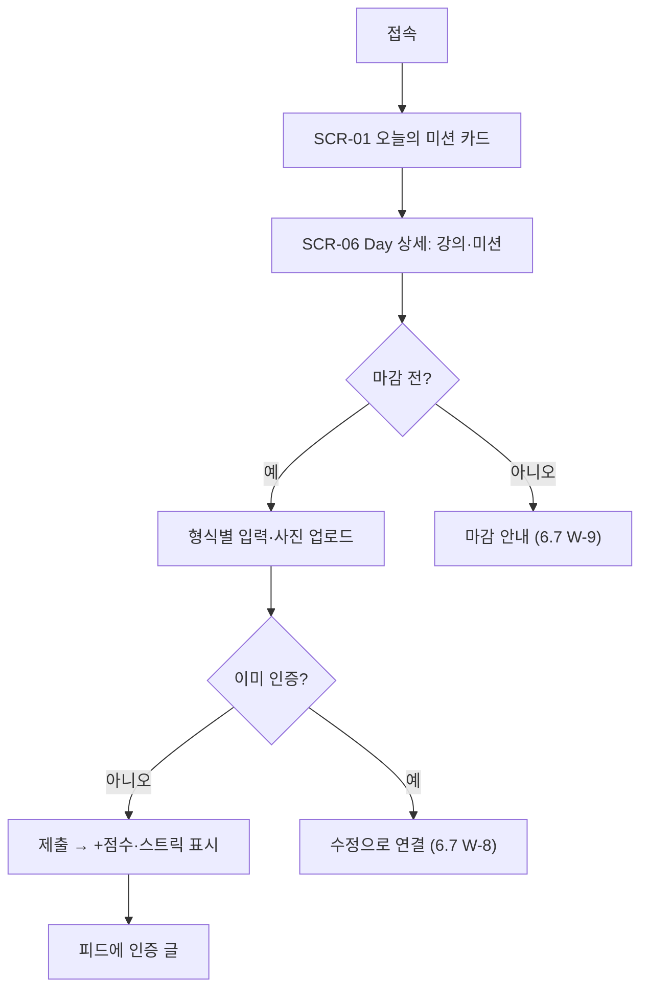

# UX 검토서 (UX Review Document)

> 기기·브라우저·화면 상태와 함께 충족·미충족·미검토·해당 없음을 기록한다. 미검토와 해당 없음에는 사유를, 확인 결과에는 재현 조건과 자료 링크를 남긴다.
>
> **이 검토는 문서만 보고 한 것이다.** 화면(UI)이 아직 없어서 휴리스틱 평가, 접근성·반응형 점검, 사용자 플로우 관찰, 사용성 테스트는 모두 **미실행**이다. 실제로 수행한 것은 6.7의 **UX 라이팅(문구) 문서 검토** 하나이며, 기준은 토스(Toss) UX 라이팅 원칙이다. 다른 문서의 문구는 고치지 않았고, 개선안은 모두 "반영 필요"로 남겼다.

> **프로젝트명:** 챌린지업 (ChallengeUp) — 온라인 강의 챌린지 플랫폼
> **문서 버전:** v0.1 (초안)
> **작성일:** 2026-11-25
> **작성자:** Claude Code (초안)
> **검토 대상:** 화면 SCR-01~14(SRS 5.1.2)의 사용자 노출 문구 — 근거 문서: 비즈니스 정책서 BPD-CHUP-v0.2(BP-ERROR-004 외), SRS-CHUP-v0.1 출력 표·수용 기준, 유스케이스 명세서 UCS-CHUP-v0.1, 서비스 기획서 3.4 톤앤매너, DESIGN.md

---

## 목차

1. [UX 검토 개요](#1-ux-검토-개요)
2. [닐슨의 10가지 휴리스틱 평가](#2-닐슨의-10가지-휴리스틱-평가)
3. [접근성(Accessibility) 검토](#3-접근성-검토-accessibility-review)
4. [반응형 디자인 검토](#4-반응형-디자인-검토)
5. [사용자 플로우 검토](#5-사용자-플로우-검토)
6. [에러/예외 상황 검토](#6-에러예외-상황-검토) — 6.7 UX 라이팅 검토 포함
7. [성능 UX 검토](#7-성능-ux-검토)
8. [UX 검토 결과 보고서](#8-ux-검토-결과-보고서)

---

## 1. UX 검토 개요

### 1.1 검토 목적

챌린지업의 화면 문구가 학생이 매일 인증하고 끝까지 완주하도록 돕는지(KPI-001·002) 확인한다. 화면이 생기기 전에 문구를 먼저 다듬어, 구현할 때 BP-ERROR-004 메시지를 그대로 옮기며 생기는 어색한 표현을 줄인다.

### 1.2 검토 범위

**대상 화면 목록:** 화면 설계서(02)는 미작성이라 SRS 5.1.2 화면 목록을 쓴다. 모든 화면은 구현 전이므로 화면 검토 상태는 "미착수"이고, 문구 검토만 문서 기준으로 끝냈다.

| # | 화면 ID | 화면명 | 화면 유형 | 우선순위 | 검토 상태 |
|---|---------|--------|-----------|----------|-----------|
| 1 | SCR-01 | 탐색(메인) + 오늘의 미션 | 목록 / 대시보드 | High | 화면 미착수 / 문구 검토 완료(문서 기준) |
| 2 | SCR-02 | 로그인 / 회원가입 / 비밀번호 재설정 | 폼 | High | 화면 미착수 / 문구 검토 완료(문서 기준) |
| 3 | SCR-03 | 챌린지 소개 | 상세 | High | 화면 미착수 / 문구 검토 완료(문서 기준) |
| 4 | SCR-04~08 | 챌린지 홈(피드·커리큘럼·리더보드·멤버) | 목록 | High | 화면 미착수 / 문구 검토 완료(문서 기준) |
| 5 | SCR-06 | Day 상세 + 인증 | 상세 / 폼 | High | 화면 미착수 / 문구 검토 완료(문서 기준) |
| 6 | SCR-09·10 | 마이페이지·프로필·강사 신청 | 폼 | Medium | 화면 미착수 / 문구 검토 완료(문서 기준) |
| 7 | SCR-11~13 | 강사 스튜디오(내 챌린지·등록 5단계·대시보드) | 폼 / 대시보드 | High | 화면 미착수 / 문구 검토 완료(문서 기준) |
| 8 | SCR-14 | 관리자(검수·강사 신청·신고) | 목록 | Medium | 화면 미착수 / 문구 검토 완료(문서 기준) |

### 1.3 검토 기준

| 기준 | 설명 | 가중치 |
|------|------|--------|
| 사용성 (Usability) | 사용자가 쉽고 효율적으로 목표를 달성할 수 있는가 | 30% |
| 접근성 (Accessibility) | 장애를 가진 사용자도 이용할 수 있는가 (NFR-011, WCAG 2.1 AA 일부) | 25% |
| 일관성 (Consistency) | DESIGN.md 토큰과 문구 톤이 일관적인가 | 20% |
| 심미성 (Aesthetics) | 시각적으로 정돈되고 DESIGN.md를 따르는가 | 10% |
| 효율성 (Efficiency) | 최소한의 단계로 태스크를 완료할 수 있는가 | 15% |
| UX 라이팅 (이 검토 추가) | 토스 UX 라이팅 원칙(6.7.1)을 따르는가 | 가중치 없음 (별도 판정) |

### 1.4 검토 방법

| 방법 | 설명 | 적용 시점 | 이번 수행 여부 |
|------|------|-----------|----------------|
| 휴리스틱 평가 (Heuristic Evaluation) | 닐슨의 10가지 원칙에 따른 전문가 평가 | 화면 설계 완료 후 | 미실행 (화면 없음) |
| 인지 워크스루 (Cognitive Walkthrough) | 주요 태스크를 사용자 관점에서 단계별 수행 | 프로토타입 단계 | 미실행 |
| 체크리스트 (Checklist) | 접근성, 반응형 등 기준별 체크 항목 확인 | 구현 완료 후 | 미실행 |
| 사용성 테스트 (Usability Test) | 실제 사용자 대상 테스트 | 베타 단계 | 미실행 (테스트 계획서 9.1) |
| UX 라이팅 문서 검토 | 문서의 사용자 노출 문구를 토스 원칙으로 검토 | 설계 단계 | **수행 (2026-11-25, 문서 기준)** |

---

## 2. 닐슨의 10가지 휴리스틱 평가

> 화면이 없어 점수를 매기지 않는다 (모든 원칙 **미실행**). 문서에서 미리 보이는 문구·흐름 관련 사항만 "문서 기반 사전 발견"으로 적었다. 화면이 생기면 같은 표에 실제 평가를 적는다.

### 평가 척도

| 점수 | 등급 | 설명 |
|------|------|------|
| 5 | 우수 | 원칙을 완벽히 준수하며 모범적 |
| 4 | 양호 | 원칙을 대부분 준수, 사소한 개선 가능 |
| 3 | 보통 | 일부 미흡한 점이 있으나 사용에 큰 지장 없음 |
| 2 | 미흡 | 원칙 위반이 있어 사용성에 영향을 줌 |
| 1 | 심각 | 원칙을 심각하게 위반하여 사용에 큰 지장 |

---

### H1. 시스템 상태의 가시성 (Visibility of System Status)

> 시스템은 합리적인 시간 내에 적절한 피드백을 통해 사용자에게 현재 무슨 일이 일어나고 있는지 알려야 한다.

**체크 항목:** (모두 미실행)

- [ ] 현재 페이지/섹션의 위치가 네비게이션에서 명확히 표시되는가?
- [ ] 데이터 로딩 중 로딩 표시(Spinner, Skeleton UI)가 제공되는가?
- [ ] 폼 제출 후 처리 상태(성공/실패)가 명확히 피드백되는가?
- [ ] 파일 업로드/다운로드 시 진행률(Progress)이 표시되는가?
- [ ] 비동기 작업(이메일 발송, 데이터 처리 등)의 완료 상태가 알림되는가?
- [ ] 버튼 클릭 시 즉각적인 시각적 피드백(hover, active, disabled 상태)이 있는가?
- [ ] 현재 선택된 항목이 시각적으로 구분되는가?

**평가:** 미실행 (화면 없음)

**발견사항:** (문서 기반 사전 발견)

| # | 화면 | 설명 | 심각도 | 권장 개선안 |
|---|------|------|--------|------------|
| 1 | SCR-03·07 | 완주 판정 전 "결과 집계 중"이 언제 끝나는지 알려 주지 않음 (판정은 00:10~03:10) | Minor | 6.7 W-34 |
| 2 | SCR-06 | 사진 업로드 진행률 표시가 문서에 없음 (실패 표시만 있음, BP-ERROR-002-3) | Minor | 화면 설계서에 진행률 표시 추가 검토 |

---

### H2. 시스템과 현실 세계의 일치 (Match Between System and Real World)

> 시스템은 시스템 중심의 용어가 아닌, 사용자에게 친숙한 단어, 구문, 개념을 사용해야 한다.

**체크 항목:** (모두 미실행)

- [ ] 메뉴, 버튼, 레이블에 사용자가 이해하기 쉬운 용어가 사용되었는가?
- [ ] 아이콘이 직관적이며 일반적 관례를 따르는가?
- [ ] 날짜/시간/통화 형식이 대상 사용자의 로케일에 맞는가?
- [ ] 정보 구조(IA)가 사용자의 멘탈 모델과 일치하는가?
- [ ] 전문 용어 사용 시 도움말/툴팁이 제공되는가?
- [ ] 워크플로우가 현실 세계의 업무 프로세스를 반영하는가?

**평가:** 미실행 (화면 없음)

**발견사항:** (문서 기반 사전 발견)

| # | 화면 | 설명 | 심각도 | 권장 개선안 |
|---|------|------|--------|------------|
| 1 | SCR-12 | "MVP 기간에는…"처럼 내부 용어가 강사 화면에 노출됨 | Minor | 6.7 W-22 |
| 2 | 전체 | "검수", "영업일", "인정·반려" 같은 업무 용어가 학생 화면에 나옴 | Minor | 6.7 W-41, W-51 |

---

### H3. 사용자 제어 및 자유 (User Control and Freedom)

> 사용자는 실수로 원하지 않는 기능을 선택하는 경우가 많으므로, 긴 과정을 거치지 않고 원하지 않는 상태에서 벗어날 수 있는 "비상구"가 필요하다.

**체크 항목:** (모두 미실행)

- [ ] 실행 취소(Undo) 기능이 제공되는가?
- [ ] 다단계 프로세스에서 이전 단계로 돌아갈 수 있는가?
- [ ] 모달/다이얼로그를 쉽게 닫을 수 있는가? (X 버튼, ESC 키, Backdrop 클릭)
- [ ] 삭제 등 위험한 작업 전 확인(Confirmation) 절차가 있는가?
- [ ] 긴 폼 작성 중 이탈 시 경고가 표시되는가?
- [ ] 검색/필터 조건을 쉽게 초기화할 수 있는가?

**평가:** 미실행 (화면 없음)

**발견사항:** (문서 기반 사전 발견)

| # | 화면 | 설명 | 심각도 | 권장 개선안 |
|---|------|------|--------|------------|
| 1 | SCR-06 | 인증 삭제(마감 전)의 확인 단계와 포인트 회수 안내 문구가 문서에 없음 | Minor | 삭제 확인 대화상자 문구 정의 (6.7 W-46 형식) |
| 2 | SCR-12·13 | 챌린지 취소는 되돌릴 수 없는데 확인 문구에 그 사실이 없음 | Major | 6.7 W-46 |

---

### H4. 일관성 및 표준 (Consistency and Standards)

> 사용자가 서로 다른 단어, 상황, 행동이 같은 것을 의미하는지 궁금해할 필요가 없어야 한다.

**체크 항목:** (모두 미실행)

- [ ] 디자인 시스템/스타일 가이드가 일관적으로 적용되었는가?
- [ ] 동일한 기능이 모든 화면에서 동일한 위치와 형태로 제공되는가?
- [ ] 버튼 스타일(Primary, Secondary, Danger 등)이 일관적인가?
- [ ] 용어와 레이블이 전체 시스템에서 통일되었는가? (예: "저장"/"확인" 혼용 금지)
- [ ] 플랫폼 표준(OS, 브라우저)을 따르는가?
- [ ] 색상, 타이포그래피, 간격(Spacing)이 디자인 토큰에 맞는가?
- [ ] 동일한 인터랙션 패턴(정렬, 필터, 페이지네이션)이 통일되었는가?

**평가:** 미실행 (화면 없음)

**발견사항:** (문서 기반 사전 발견)

| # | 화면 | 설명 | 심각도 | 권장 개선안 |
|---|------|------|--------|------------|
| 1 | 전체 | 문구 어미가 섞여 있음: BP-ERROR-004는 합니다체, UC 일부("알려 드려요", "완주했어요!")는 해요체. 서비스 기획서 3.4는 "존댓말"만 정함 | Major | 해요체로 통일 (6.7.1 R-1), SPD 3.4에 명시 |
| 2 | SCR-09 | 프로필 사진 제한 문구가 SRS("5MB 이하만")와 UC("5MB 이하 jpg·png·webp만")에서 다름 | Minor | 6.7 W-23 |
| 3 | 전체 | UC에서 쓰는 문구 일부가 BP-ERROR-004 목록에 없음 ("동시에 참여할 수 있는 챌린지는 최대 5개입니다", "시작된 챌린지는 취소할 수 없습니다" 등) | Minor | 문구를 한 표(문구 사전)로 모으기 — 8.5 단기 |

---

### H5. 오류 방지 (Error Prevention)

> 좋은 에러 메시지도 중요하지만, 처음부터 문제가 발생하지 않도록 설계하는 것이 더 좋다.

**체크 항목:** (모두 미실행)

- [ ] 입력 필드에 형식 힌트(Placeholder, Helper Text)가 제공되는가?
- [ ] 실시간 입력 검증(Inline Validation)이 적용되었는가?
- [ ] 비가역적 작업(삭제, 발송 등)에 확인 단계가 있는가?
- [ ] 드롭다운, 날짜 선택기 등으로 자유 입력을 최소화했는가?
- [ ] 비활성화(Disabled) 상태의 컨트롤에 사유가 표시되는가?
- [ ] 중복 제출(Double Submit)이 방지되는가?

**평가:** 미실행 (화면 없음)

**발견사항:** (문서 기반 사전 발견)

| # | 화면 | 설명 | 심각도 | 권장 개선안 |
|---|------|------|--------|------------|
| 1 | SCR-12 | 시작일 제한을 오류 후에 알려 줌. 날짜 선택기에서 고를 수 있는 날짜만 열어 두면 오류가 줄어듦 | Minor | 6.7 W-25 + 날짜 선택 범위 제한 |
| 2 | SCR-12 | 비활성 항목에 이유를 보여 주는 설계(UC-007 "모집 중에는 기간을 바꿀 수 없습니다")는 좋음 | Enhancement | 문구만 다듬기 (6.7 W-63) |

---

### H6. 인식 > 회상 (Recognition Rather Than Recall)

> 객체, 동작, 옵션을 보이게 만들어 사용자의 기억 부담을 최소화해야 한다.

**체크 항목:** (모두 미실행)

- [ ] 최근 사용 항목, 자주 사용하는 기능이 쉽게 접근 가능한가?
- [ ] 이전 입력 값이 자동 완성/제안되는가?
- [ ] 복잡한 코드/ID 대신 사람이 읽을 수 있는 레이블이 표시되는가?
- [ ] 아이콘에 레이블 또는 툴팁이 함께 제공되는가?
- [ ] 다단계 프로세스에서 이전 입력 내용을 확인할 수 있는가?
- [ ] Breadcrumb 네비게이션이 복잡한 구조에 제공되는가?

**평가:** 미실행 (화면 없음)

**발견사항:**

| # | 화면 | 설명 | 심각도 | 권장 개선안 |
|---|------|------|--------|------------|
| - | - | 해당 없음 — 화면 검토 미실행 | - | - |

---

### H7. 유연성 및 효율성 (Flexibility and Efficiency of Use)

> 초보 사용자에게는 보이지 않는 가속기(Accelerator)가 숙련된 사용자의 상호작용 속도를 높일 수 있어야 한다.

**체크 항목:** (모두 미실행)

- [ ] 키보드 단축키가 자주 사용하는 기능에 제공되는가?
- [ ] 대량 작업(Bulk Action)이 지원되는가? (다중 선택, 일괄 처리)
- [ ] 자주 사용하는 설정을 저장/즐겨찾기 할 수 있는가?
- [ ] 고급 사용자를 위한 필터/검색 기능이 충분한가?
- [ ] 개인화(Personalization) 옵션이 제공되는가?
- [ ] 반복적 태스크의 자동화(템플릿, 매크로 등)가 가능한가?

**평가:** 미실행 (화면 없음)

**발견사항:** (문서 기반 사전 발견)

| # | 화면 | 설명 | 심각도 | 권장 개선안 |
|---|------|------|--------|------------|
| 1 | SCR-13 | 강사 확인 방식(FR-016)에서 대기 인증 일괄 인정이 없음 | Enhancement | v1.1 이후 검토 (CR로 등록) |

---

### H8. 미니멀한 디자인 (Aesthetic and Minimalist Design)

> 화면에는 관련 없거나 거의 필요하지 않은 정보가 포함되어서는 안 된다.

**체크 항목:** (모두 미실행)

- [ ] 화면에 불필요한 요소가 없는가?
- [ ] 정보의 시각적 계층(Visual Hierarchy)이 명확한가?
- [ ] 핵심 콘텐츠와 보조 콘텐츠의 구분이 명확한가?
- [ ] 여백(White Space)이 적절히 사용되어 가독성이 좋은가?
- [ ] 색상 사용이 절제되고 목적에 맞는가?
- [ ] 데이터 밀도가 적절한가? (정보 과잉 vs 부족)

**평가:** 미실행 (화면 없음)

**발견사항:**

| # | 화면 | 설명 | 심각도 | 권장 개선안 |
|---|------|------|--------|------------|
| 1 | 전체 | DESIGN.md는 콜로소 분석 기반으로 밀도가 높은 진열장 구조. 학생이 매일 들어와 오늘 미션만 빠르게 찾는 흐름(SCR-01)과 맞는지 화면 설계 때 확인 필요 | Info | 화면 설계서에서 오늘의 미션 카드 우선 배치 확인 |

---

### H9. 오류 인식/진단/복구 (Help Users Recognize, Diagnose, and Recover from Errors)

> 에러 메시지는 평범한 언어(코드 없이)로 표현되고, 문제를 정확히 지적하며, 해결 방법을 건설적으로 제안해야 한다.

**체크 항목:** (모두 미실행)

- [ ] 에러 메시지가 사용자가 이해할 수 있는 언어로 작성되었는가?
- [ ] 에러 메시지가 문제의 원인을 구체적으로 설명하는가?
- [ ] 에러 메시지가 해결 방법을 제안하는가?
- [ ] 폼 검증 에러가 해당 필드 근처에 표시되는가?
- [ ] 에러 발생 시 사용자가 입력한 데이터가 보존되는가?
- [ ] 시스템 에러(500 등)에 대한 사용자 친화적 화면이 있는가?

**평가:** 미실행 (화면 없음)

**발견사항:** (문서 기반 사전 발견)

| # | 화면 | 설명 | 심각도 | 권장 개선안 |
|---|------|------|--------|------------|
| 1 | 전체 | BP-ERROR-004 문구 대부분이 "~할 수 없습니다"로 끝나고 다음 행동을 알려 주지 않음 | Major | 6.7 W-1~W-14 |
| 2 | SCR-06 | 마감 직후 거절 문구가 아쉬운 감정을 고려하지 않고, 다음 미션 정보도 없음 | Major | 6.7 W-9 |
| 3 | 전체 | 입력 내용 보존(BP-ERROR-002)은 잘 설계됨. 문구에 "내용은 그대로 있어요"를 넣으면 불안이 줄어듦 | Enhancement | 6.7 W-13, W-16 |

---

### H10. 도움말 및 문서 (Help and Documentation)

> 시스템을 도움말 없이 사용할 수 있다면 가장 좋지만, 필요 시 도움말을 제공해야 한다.

**체크 항목:** (모두 미실행)

- [ ] 상황별 도움말(Contextual Help)이 제공되는가? (툴팁, 인라인 도움말)
- [ ] 온보딩 가이드/튜토리얼이 제공되는가? (첫 사용 시)
- [ ] FAQ 또는 도움말 센터에 쉽게 접근할 수 있는가?
- [ ] 검색 기능이 도움말/문서에서 제공되는가?
- [ ] 도움말 내용이 최신 상태로 유지되는가?

**평가:** 미실행 (화면 없음)

**발견사항:** (문서 기반 사전 발견)

| # | 화면 | 설명 | 심각도 | 권장 개선안 |
|---|------|------|--------|------------|
| 1 | 전체 | 포인트·스트릭·완주 조건 설명 화면이 MVP 범위에 없음. 점수 규칙(BP-POINT-001)이 복잡함 | Minor | 리더보드에 "점수 받는 방법" 짧은 안내 추가 검토 (CR) |
| 2 | 전체 | 탈퇴·문의 창구(BP-AUTH-005, 고객 문의 이메일)가 화면 어디에 있는지 문서에 없음 | Minor | 화면 설계서에 문의 링크 위치 정의 |

---

### 휴리스틱 평가 종합

화면 평가를 하지 않아 점수가 없다. 아래 이슈 수는 "문서 기반 사전 발견" 건수다.

| # | 원칙 | 평가 | 발견 이슈 수 | Critical | Major | Minor |
|---|------|:----:|:------------:|:--------:|:-----:|:-----:|
| H1 | 시스템 상태의 가시성 | 미실행 | 2 | 0 | 0 | 2 |
| H2 | 시스템과 현실 세계의 일치 | 미실행 | 2 | 0 | 0 | 2 |
| H3 | 사용자 제어 및 자유 | 미실행 | 2 | 0 | 1 | 1 |
| H4 | 일관성 및 표준 | 미실행 | 3 | 0 | 1 | 2 |
| H5 | 오류 방지 | 미실행 | 2 | 0 | 0 | 1 |
| H6 | 인식 > 회상 | 미실행 | 0 | 0 | 0 | 0 |
| H7 | 유연성 및 효율성 | 미실행 | 1 | 0 | 0 | 0 |
| H8 | 미니멀한 디자인 | 미실행 | 1 | 0 | 0 | 0 |
| H9 | 오류 인식/진단/복구 | 미실행 | 3 | 0 | 2 | 0 |
| H10 | 도움말 및 문서 | 미실행 | 2 | 0 | 0 | 2 |
| | **평균** | **미실행** | **합계 18** | **0** | **4** | **10** |

(나머지 4건은 Enhancement·Info)

---

## 3. 접근성 검토 (Accessibility Review)

> 화면이 없어 모든 항목 **미실행**이다. 실행 TC는 [테스트 케이스](../05-테스트/테스트케이스.md) TC-AC-CLR-001·KBD-001·IMG-001, 체크리스트는 [테스트 계획서](../05-테스트/테스트계획서.md) 9.2.

### 3.1 검토 기준

WCAG 2.1 AA 수준을 기준으로 하되, 필수 목표는 NFR-011(명도 대비 4.5:1, 키보드 조작·포커스, 대체 텍스트)이다.

### 3.2 인지 가능 (Perceivable)

#### 3.2.1 텍스트 대안 (Text Alternatives)

- [ ] 모든 의미 있는 이미지에 적절한 alt 텍스트가 제공되었는가? (인증 사진 "Day N 인증 사진")
- [ ] 장식용 이미지에 빈 alt 속성(`alt=""`)이 사용되었는가?
- [ ] 복잡한 이미지(차트, 다이어그램)에 장문 설명이 제공되었는가?
- [ ] 아이콘 버튼에 접근 가능한 레이블이 제공되었는가? (aria-label)
- [ ] 비디오에 자막(Caption)이 제공되었는가? (외부 영상 — 강사 책임, 해당 없음 가능)
- [ ] 오디오에 텍스트 대본(Transcript)이 제공되었는가?

#### 3.2.2 미디어 대안 (Time-based Media)

- [ ] 사전 녹화된 오디오/비디오에 대안이 제공되었는가?
- [ ] 실시간 미디어에 자막이 제공되었는가? (해당 없음 — 라이브 EX-008)
- [ ] 비디오에 오디오 설명(Audio Description)이 제공되었는가?

#### 3.2.3 적응 가능 (Adaptable)

- [ ] 콘텐츠가 시맨틱 HTML 구조(Heading, List, Table 등)로 마크업되었는가?
- [ ] 읽기 순서가 시각적 순서와 일치하는가?
- [ ] 감각적 특성(색상, 크기, 위치 등)에만 의존하지 않는가?
- [ ] 가로/세로 모드 전환이 콘텐츠를 손상시키지 않는가?
- [ ] 자동 완성(autocomplete) 속성이 폼 필드에 적절히 사용되었는가?

#### 3.2.4 구별 가능 (Distinguishable)

- [ ] 색상만으로 정보를 전달하지 않는가? (마감 임박 빨강 배지에 글자 병기)
- [ ] 텍스트와 배경의 명도 대비가 4.5:1 이상인가? (어두운 테마 회색 글자 주의)
- [ ] 큰 텍스트(18pt 이상)의 명도 대비가 3:1 이상인가?
- [ ] UI 컴포넌트와 그래픽 요소의 명도 대비가 3:1 이상인가?
- [ ] 텍스트 크기를 200%까지 확대해도 콘텐츠가 손실되지 않는가?
- [ ] 오디오가 자동 재생되지 않는가? (또는 정지 가능한가?)
- [ ] 텍스트 간격(행간, 자간, 단어 간격) 조정 시 콘텐츠가 손실되지 않는가?

### 3.3 조작 가능 (Operable)

#### 3.3.1 키보드 접근성 (Keyboard Accessible)

- [ ] 모든 기능이 키보드만으로 접근 가능한가?
- [ ] 키보드 포커스가 논리적 순서로 이동하는가?
- [ ] 키보드 포커스 표시(Focus Indicator)가 명확히 보이는가?
- [ ] 키보드 트랩(Keyboard Trap)이 없는가? (모달 제외)
- [ ] 모달 내에서 포커스가 적절히 관리되는가? (Focus Trap)
- [ ] 드롭다운, 탭, 아코디언 등이 키보드로 조작 가능한가?
- [ ] 커스텀 컴포넌트의 키보드 인터랙션이 WAI-ARIA 패턴을 따르는가?

#### 3.3.2 충분한 시간 (Enough Time)

- [ ] 시간 제한이 있는 경우 연장/해제 옵션이 제공되는가? (인증 마감은 업무 규칙 — 해당 없음, 남은 시간만 표시)
- [ ] 자동 갱신 콘텐츠를 정지/일시정지할 수 있는가?
- [ ] 세션 만료 전 경고가 표시되고 연장할 수 있는가?
- [ ] 자동 슬라이드/캐러셀에 정지 기능이 있는가?

#### 3.3.3 발작 방지 (Seizures and Physical Reactions)

- [ ] 1초에 3회 이상 깜빡이는 콘텐츠가 없는가?
- [ ] 애니메이션을 비활성화할 수 있는가? (prefers-reduced-motion 지원)
- [ ] 모션 기반 인터랙션의 대안이 제공되는가?

#### 3.3.4 탐색 가능 (Navigable)

- [ ] "건너뛰기 링크(Skip Navigation)"가 제공되는가?
- [ ] 페이지 제목(`<title>`)이 페이지 내용을 정확히 설명하는가?
- [ ] 링크 텍스트가 목적지를 명확히 설명하는가? ("여기를 클릭" 금지)
- [ ] 헤딩(`<h1>`~`<h6>`)이 논리적 계층으로 사용되었는가?
- [ ] 2가지 이상의 탐색 방법(메뉴, 검색, 사이트맵)이 제공되는가?
- [ ] 포커스 순서가 콘텐츠의 의미와 조작 순서에 맞는가?

### 3.4 이해 가능 (Understandable)

#### 3.4.1 읽기 쉬운 (Readable)

- [ ] 페이지 언어가 `<html lang>` 속성으로 지정되었는가? (`ko`)
- [ ] 다른 언어 콘텐츠에 `lang` 속성이 지정되었는가?
- [ ] 약어/축약어에 대한 설명이 제공되는가? ("D-3", "Lv3")

#### 3.4.2 예측 가능한 (Predictable)

- [ ] 포커스만으로 예기치 않은 변화(페이지 이동, 팝업 등)가 발생하지 않는가?
- [ ] 입력값 변경만으로 예기치 않은 변화가 발생하지 않는가?
- [ ] 네비게이션이 모든 페이지에서 일관적인가?
- [ ] 동일 기능의 컴포넌트가 일관적으로 식별되는가?

#### 3.4.3 입력 지원 (Input Assistance)

- [ ] 입력 에러가 자동 감지되고 텍스트로 설명되는가?
- [ ] 폼 필드에 레이블(`<label>`)이 연결되었는가?
- [ ] 필수 필드가 명확히 표시되었는가?
- [ ] 에러 수정을 위한 제안이 제공되는가?
- [ ] 법적/재정적 영향이 있는 제출에 확인/취소가 가능한가? (MVP 결제 없음 — 챌린지 취소·인증 삭제 확인)

### 3.5 견고한 (Robust)

#### 3.5.1 호환성 (Compatible)

- [ ] HTML 마크업이 유효한가? (W3C Validator)
- [ ] ARIA 역할(role)과 속성이 올바르게 사용되었는가?
- [ ] 상태 메시지가 보조 기술에 전달되는가? (aria-live — "+10점" 안내, 오프라인 배너)
- [ ] 커스텀 컴포넌트가 이름, 역할, 값을 올바르게 노출하는가?

### 3.6 접근성 자동화 도구 활용

| 도구 | 용도 | 적용 단계 |
|------|------|-----------|
| axe-core (`@axe-core/playwright`) | 자동화 접근성 검사 (Playwright와 함께 CI 실행) | 개발/테스트 |
| Lighthouse | 접근성 점수 및 권장 사항 | Preview 배포 |
| WAVE | 웹 접근성 시각적 평가 | QA (선택) |
| Pa11y | CLI 기반 접근성 테스트 | 사용 안 함 (axe로 대신) |
| Screen Reader (NVDA/VoiceOver) | 스크린 리더 수동 테스트 | QA (선택) |

### 3.7 수동 테스트 방법

모두 미실행.

**키보드 네비게이션 테스트:**

| # | 테스트 항목 | 조작 방법 | 예상 동작 | 결과 |
|---|------------|-----------|-----------|------|
| 1 | 전체 페이지 탐색 | Tab / Shift+Tab | 논리적 순서로 포커스 이동 | 미실행 |
| 2 | 카테고리 칩·정렬 | Enter, Arrow Keys | 항목 선택 | 미실행 |
| 3 | 공지 고정 확인 대화상자 | ESC, Tab | 포커스 가둠, 닫기 | 미실행 |
| 4 | 인증 제출 | Enter | 폼 전송 | 미실행 |
| 5 | 완주 조건 선택(50~100%) | Arrow Keys | 값 조정 | 미실행 |

**스크린 리더 테스트:**

| # | 테스트 항목 | 리더 | 예상 읽기 내용 | 결과 |
|---|------------|------|---------------|------|
| 1 | 페이지 랜드마크 | VoiceOver / NVDA | 헤더, 메인, 푸터 | 미실행 |
| 2 | 이미지 대안 텍스트 | VoiceOver / NVDA | "Day 3 인증 사진" | 미실행 |
| 3 | 폼 레이블 | VoiceOver / NVDA | 필드 용도 | 미실행 |
| 4 | 에러 메시지 | VoiceOver / NVDA | 6.7 개선 문구 | 미실행 |
| 5 | 동적 콘텐츠 변경 | VoiceOver / NVDA | "+15점, 4일 연속" | 미실행 |

**색상 대비 테스트:** DESIGN.md 색상으로 구현 후 측정한다 (미실행).

| 요소 | 전경색 | 배경색 | 대비율 | 기준 | 충족 여부 |
|------|--------|--------|--------|------|-----------|
| 본문 텍스트 | DESIGN.md 흰색 계열 | #121212 | 미측정 | >= 4.5:1 | 미실행 |
| 보조 회색 글자 | DESIGN.md grey 단계 | #121212 | 미측정 | >= 4.5:1 | 미실행 |
| 강조 빨강 배지 글자 | 흰색 | #ED2040 | 미측정 | >= 4.5:1 | 미실행 |
| 플레이스홀더 | DESIGN.md | 입력 배경 | 미측정 | >= 4.5:1 | 미실행 |
| 아이콘 | DESIGN.md | #121212 | 미측정 | >= 3:1 | 미실행 |

---

## 4. 반응형 디자인 검토

> 모든 항목 **미실행**. 브레이크포인트는 SRS NFR-010·DESIGN.md 기준(600·960·1120px)으로 바꿨다.

### 4.1 브레이크포인트 정의

| 이름 | 범위 | 대표 기기 |
|------|------|-----------|
| 모바일 (Mobile) | 360px ~ 599px | 스마트폰 (최소 360px, SRS 2.3.3) |
| 태블릿 (Tablet) | 600px ~ 959px | 태블릿 |
| 데스크톱 (Desktop) | 960px ~ 1439px | 노트북 (본문 최대 1120px) |
| 와이드 (Wide) | 1440px+ | 대형 모니터 |

### 4.2 브레이크포인트별 검토 체크리스트

#### 공통 항목

- [ ] 콘텐츠가 가로 스크롤 없이 표시되는가?
- [ ] 텍스트가 읽기 쉬운 크기인가? (DESIGN.md 본문 크기 확인)
- [ ] 이미지가 뷰포트에 맞게 조정되는가? (썸네일 16:10)
- [ ] 중요 콘텐츠가 fold 아래로 밀리지 않는가? (오늘의 미션 카드)

#### 모바일 (360px)

| # | 항목 | 결과 |
|---|------|------|
| 1 | 네비게이션이 모바일 헤더로 전환되는가? | 미실행 |
| 2 | 리더보드 표가 좁은 화면에서 읽히는가? | 미실행 |
| 3 | 터치 타겟 크기가 최소 44x44px인가? | 미실행 |
| 4 | 폼 필드가 적절한 키보드 타입(email, url)을 호출하는가? | 미실행 |
| 5 | 고정 요소(헤더·오프라인 배너)가 인증 입력란을 가리지 않는가? | 미실행 |
| 6 | 긴 챌린지 제목이 적절히 줄바꿈 또는 말줄임 처리되는가? | 미실행 |

#### 태블릿 (768px)

| # | 항목 | 결과 |
|---|------|------|
| 1 | 카드 목록이 2~3 컬럼으로 재배치되는가? | 미실행 |
| 2 | 챌린지 홈 탭(피드·커리큘럼·리더보드·멤버)이 정상 표시되는가? | 미실행 |
| 3 | 확인 대화상자 크기가 적절한가? | 미실행 |
| 4 | 가로/세로 모드 전환 시 레이아웃이 깨지지 않는가? | 미실행 |

#### 데스크톱 (1024px)

| # | 항목 | 결과 |
|---|------|------|
| 1 | 네비게이션이 전체 메뉴로 표시되는가? | 미실행 |
| 2 | 본문 최대 너비 1120px가 적용되었는가? | 미실행 |
| 3 | 호버(hover) 상태가 적절히 표시되는가? | 미실행 |
| 4 | 툴팁이 올바른 위치에 표시되는가? | 미실행 |

#### 와이드 (1440px)

| # | 항목 | 결과 |
|---|------|------|
| 1 | 콘텐츠가 과도하게 늘어나지 않는가? (max-width) | 미실행 |
| 2 | 여백이 적절히 분배되는가? | 미실행 |
| 3 | 강사 대시보드 레이아웃이 넓은 화면에 맞는가? | 미실행 |

### 4.3 터치 인터랙션 검토

| # | 항목 | 결과 |
|---|------|------|
| 1 | 터치 타겟(버튼, 링크) 크기가 최소 44x44px인가? | 미실행 |
| 2 | 인접한 터치 타겟 사이에 충분한 간격(8px 이상)이 있는가? | 미실행 |
| 3 | 카드 가로 넘김 제스처가 직관적인가? | 미실행 |
| 4 | 제스처에 대한 대안(버튼 등)이 제공되는가? | 미실행 |
| 5 | 길게 누르기(Long Press) 동작이 필요 시 안내되는가? | 해당 없음 (계획 없음) |
| 6 | 터치 피드백(시각적)이 제공되는가? | 미실행 |

---

## 5. 사용자 플로우 검토

> 화면 흐름이 없어 플로우 관찰은 **미실행**이다. 아래는 UC 문서 기준으로 정리한 태스크와 예상 흐름이다.

### 5.1 주요 사용자 태스크 목록

| # | 태스크명 | 대상 사용자 | 빈도 | 중요도 |
|---|---------|------------|------|--------|
| 1 | 오늘 미션 인증 (UC-010·011) | 학생 | 높음 (매일) | Critical |
| 2 | 챌린지 탐색·신청 (UC-008·009) | 비회원·학생 | 중간 | Critical |
| 3 | 피드에서 응원 (UC-013) | 학생 | 높음 | High |
| 4 | 챌린지 등록·검수 요청 (UC-005) | 강사 | 낮음 (기수마다) | High |
| 5 | 이탈 위험 학생 확인·공지 (UC-015) | 강사 | 높음 (진행 중 매일) | High |

### 5.2 태스크별 플로우 분석

#### 태스크: 오늘 미션 인증 (UC-010·011, 문서 기준)

**플로우 다이어그램:**



**플로우 분석:**

| 항목 | 내용 |
|------|------|
| 태스크 완수율 기대치 | 미정 (KPI-002 일일 인증률 70%가 상위 목표) |
| 현재 단계 수 | 문서상 3단계 (카드 → Day 상세 → 제출) |
| 최적 단계 수 (Optimal Path) | 미측정 — 카드에서 바로 인증 입력이 가능한지 화면 설계 때 검토 |
| 예상 소요 시간 | 미측정 (테스트 계획서 UX-SC-002 제안 3분) |

**에러 복구 경로:**

| 에러 발생 지점 | 에러 유형 | 복구 방법 | 사용자 데이터 보존 |
|---------------|-----------|-----------|-------------------|
| 제출 | 입력 검증 실패 (400) | 항목별 안내, 재입력 | 기기 임시 저장 (BP-ERROR-002-1) |
| 제출 | 네트워크 끊김 | 배너, 버튼 비활성, 연결 후 제출 | 유지 |
| 제출 | 마감 경과 (422) | 다음 Day 안내 | 기기에 남음 |
| 사진 업로드 | 일부 실패 | 실패 사진만 다시 올리기 | 나머지 사진 유지 |

**사용자 이탈 가능 지점:**

| 지점 | 이탈 사유 | 방지 대책 |
|------|----------|-----------|
| 마감 거절 | 하루를 놓쳐 의욕이 꺾임 (스트릭 0) | 공감 문구와 다음 미션 안내 (6.7 W-9) |
| 가입 메일 인증 | 메일을 못 찾음 | 다음 행동을 알려 주는 문구 (6.7 W-37, W-39) |

### 5.3 사용자 플로우 검토 양식

| # | 태스크명 | 현재 단계 수 | 최적 단계 수 | 문제점 | 개선안 | 우선순위 |
|---|---------|:----------:|:----------:|--------|--------|:--------:|
| 1 | 오늘 미션 인증 | 3 (문서) | 미측정 | 화면 없음 | 화면 설계 시 검토 | High |
| 2 | 탐색·신청 | 비회원은 가입·메일 인증 포함 (문서) | 미측정 | 메일 인증 단계 이탈 위험 (ISSUE-01) | 문구 개선 + 인증 켤지 결정 | High |
| 3 | 챌린지 등록 | 5단계 + Day N개 입력 (문서) | 미측정 | Day 21개 입력 부담 | 임시 저장(BP-ERROR-002-4) 안내 문구 | Medium |

---

## 6. 에러/예외 상황 검토

> 6.1~6.6의 화면 점검은 **미실행**이다. 6.7 UX 라이팅 검토만 문서 기준으로 수행했다.

### 6.1 폼 검증 에러 검토

| # | 항목 | 결과 |
|---|------|------|
| 1 | 에러 메시지가 해당 필드 바로 아래 또는 옆에 표시되는가? | 미실행 |
| 2 | 에러 필드가 시각적으로 강조되는가? | 미실행 |
| 3 | 에러 메시지가 구체적인 수정 방법을 안내하는가? | 미실행 (문서 문구는 6.7에서 개선안 제시) |
| 4 | 여러 에러 발생 시 모든 에러가 동시에 표시되는가? | 미실행 (UC-005 "Day 5, 12의…"는 모아서 보여 줌 — 좋음) |
| 5 | 에러 수정 시 에러 메시지가 즉시 사라지는가? | 미실행 |
| 6 | 폼 최상단에 에러 요약이 제공되는가? (등록 5단계) | 미실행 |
| 7 | 에러 메시지의 색상 외에 아이콘 등 추가 시각적 단서가 있는가? | 미실행 |

### 6.2 네트워크 에러 처리 검토

표시 내용은 정책서 기준 현재 문구이며, 개선안은 6.7을 따른다.

| # | 시나리오 | 사용자에게 표시되는 내용 | 자동 재시도 | 수동 재시도 버튼 | 결과 |
|---|---------|----------------------|:-----------:|:---------------:|------|
| 1 | 인터넷 연결 끊김 | "인터넷 연결이 끊겼습니다" 배너 | - | - (연결 후 제출) | 미실행 |
| 2 | 응답 지연 | 문서에 문구 없음 | 조회만 1·2초 2회 | 쓰기 "다시 시도" | 미실행 |
| 3 | 서버 에러 (5xx) | "일시적인 오류가 발생했습니다" | 조회만 | 있음 | 미실행 |
| 4 | 인증 만료 (401) | "로그인이 필요합니다" → 로그인 후 복귀 | - | - | 미실행 |
| 5 | 권한 부족 (403) | "이 챌린지에 참여한 사람만 볼 수 있습니다" / "권한이 없습니다" | - | - | 미실행 |
| 6 | 리소스 미발견 (404) | "찾을 수 없는 페이지입니다" + 탐색 링크 | - | - | 미실행 |

### 6.3 빈 상태 (Empty State) 디자인 검토

| # | 화면/컴포넌트 | 빈 상태 메시지 | 행동 유도(CTA) | 일러스트 | 결과 |
|---|--------------|---------------|:-------------:|:--------:|------|
| 1 | 탐색 (조건에 맞는 결과 없음) | "조건에 맞는 챌린지가 없습니다" | 문서에 없음 | 미정 | 미실행 (6.7 W-48) |
| 2 | 오늘의 미션 (참여 없음) | "참여 중인 챌린지가 없습니다" | 탐색 버튼 | 미정 | 미실행 (6.7 W-48) |
| 3 | 강사 대시보드 (참여 0명) | 비율 "-" | 없음 | 미정 | 미실행 |
| 4 | 멤버·리더보드 (참여자 없음) | "아직 참여자가 없습니다" | 없음 | 미정 | 미실행 (6.7 W-48) |
| 5 | 마이페이지 끝난 챌린지 | 문서에 없음 | - | - | 미실행 — 문구 정의 필요 |

### 6.4 로딩 상태 디자인 검토

| # | 항목 | 결과 |
|---|------|------|
| 1 | 전체 페이지 로딩에 적절한 로딩 표시가 있는가? | 미실행 (SRS 5.1.1: 모든 비동기 작업에 로딩 표시) |
| 2 | 부분 영역 로딩에 해당 영역만 로딩 표시가 되는가? | 미실행 |
| 3 | Skeleton UI가 실제 콘텐츠 레이아웃과 일치하는가? | 미실행 |
| 4 | 로딩이 3초 이상 소요 시 진행 상태 또는 메시지가 제공되는가? | 미실행 |
| 5 | 버튼 클릭 후 로딩 중 중복 클릭이 방지되는가? | 미실행 (SRS 5.1.1: 처리 중 비활성) |
| 6 | 피드 무한 스크롤 로딩이 자연스러운가? | 미실행 |

### 6.5 타임아웃 처리 검토

| # | 항목 | 결과 |
|---|------|------|
| 1 | 세션 만료 전 경고 모달이 표시되는가? | 해당 없음 — 세션은 로그아웃 전까지 유지 (BP-AUTH-002-3) |
| 2 | 세션 연장 옵션이 제공되는가? | 해당 없음 |
| 3 | 세션 만료 시 작성 중인 데이터가 자동 저장되는가? | 미실행 (인증·글은 기기 임시 저장) |
| 4 | 세션 만료 후 로그인 페이지로 적절히 이동하는가? | 미실행 |
| 5 | 로그인 후 이전 페이지로 복원되는가? | 미실행 |
| 6 | (추가) 인증 마감 5분 전부터 남은 시간이 초 단위로 보이는가? | 미실행 (BP-ERROR-003-2) |

### 6.6 권한 부족 안내 검토

| # | 항목 | 결과 |
|---|------|------|
| 1 | 접근 불가 사유가 명확히 안내되는가? | 미실행 (문구 개선안 6.7 W-3·W-4·W-21) |
| 2 | 권한 요청 방법이 안내되는가? (강사 신청 버튼) | 미실행 |
| 3 | 접근 불가 페이지에서 다른 기능으로의 이동 수단이 있는가? | 미실행 (소개 페이지로 이동, BP-CONTENT-001-1) |
| 4 | 부분 권한 시 접근 가능한 영역과 불가 영역이 구분되는가? (Day 제목만 공개) | 미실행 |

### 6.7 UX 라이팅 검토 (토스 UX 라이팅 원칙 적용)

**수행 여부: 수행함 (2026-11-25, 문서 기준).** 화면이 없으므로 문구가 실제 맥락(버튼 위치, 화면 흐름)에서 어떻게 읽히는지는 확인하지 못했다. 개선안은 검토 의견이며 원문 문서는 고치지 않았다. 모든 항목의 상태는 **반영 필요**다.

#### 6.7.1 적용한 원칙과 출처

**출처 (직접 읽은 페이지)**

| # | 출처 | URL | 비고 |
|---|------|-----|------|
| S1 | toss.tech, 「토스의 8가지 라이팅 원칙들」 (김자유, 2022-11-15) | https://toss.tech/article/8-writing-principles-of-toss | WebFetch로 읽음. 원칙 이름과 요지를 확인 |
| S2 | 앱인토스 개발자센터 「UI/UX 가이드」 (소비자 UX 가이드, UX 라이팅 부분) | https://developers-apps-in-toss.toss.im/design/consumer-ux-guide.md | WebFetch로 읽음. 해요체·능동형·긍정형·경어·버튼 규칙 확인. 일부 전후 예시는 이미지라 텍스트로 확인하지 못함 |

참고: 요청에 적힌 원칙 이름 중 "Remove empty doors"는 S1 원문에서 "Remove empty sentences"로 확인되어 그 이름을 썼다. "Suggest than force"는 S1에서 강요 대신 권유를 다루는 원칙으로 확인했다. 기억에만 의존한 원칙은 없다. 다만 WebFetch는 페이지를 요약해 전달하므로, 원문 문장 단위 인용은 하지 않았다.

**8가지 라이팅 원칙 (S1)**

| ID | 원칙 | 이 검토에서 본 점 |
|----|------|-------------------|
| P1 | Predictable hint (다음 화면을 예측하게) | 버튼·안내만 보고 다음에 무슨 일이 생기는지 알 수 있는가 |
| P2 | Weed cutting (잡초 뽑기) | 뜻에 보탬이 안 되는 단어를 뺐는가 |
| P3 | Remove empty sentences (빈 문장 없애기) | 제목을 되풀이하거나 자리 채우는 문장이 없는가 |
| P4 | Focus on key message (핵심 메시지에 집중) | 지금 필요한 정보만 남겼는가 |
| P5 | Easy to speak (말하기 쉬운 문장) | 소리 내어 읽었을 때 자연스러운가, 한자어·문어체가 없는가 |
| P6 | Suggest over force (강요 대신 권유) | 겁주거나 몰아붙이지 않고 선택을 존중하는가 |
| P7 | Universal words (누구나 아는 말) | 내부 용어·업계 용어를 쓰지 않았는가 |
| P8 | Find hidden emotion (숨은 감정 찾기) | 사용자가 그 순간 느낄 감정을 고려했는가 |

**문장 규칙 (S2)**

| ID | 규칙 | 요지 |
|----|------|------|
| R-1 | 해요체 | 모든 문구를 해요체로 통일 ("되어요" → "돼요") |
| R-2 | 능동형 | 수동형("됐어요")보다 능동형("했어요"). 기간 만료·행동 결과 안내 등은 수동형 허용 |
| R-3 | 긍정형 | "안 돼요·없어요"보다 "~하면 할 수 있어요". 정책상 막혔을 때는 부정형으로 분명히 쓰고 이유를 함께 |
| R-4 | 과한 경어 줄이기 | "~시겠어요?", "~께" 대신 친근한 말투 |
| R-5 | 명사 나열 피하기 | 한자어 명사를 동사로 풀어 쓰기 |
| R-6 | 버튼 | 대화상자 왼쪽 버튼은 "취소" 대신 "닫기". CTA는 버튼만 보고 다음 행동을 알 수 있게 |

**프로젝트 톤 기준과의 관계**: 서비스 기획서 3.4는 "친근하지만 진지한 코치, 다그치기보다 응원, 존댓말, 이모지를 아이콘처럼"이라고 정했다. 토스 원칙(R-1 해요체, P6 권유, P8 감정)과 방향이 같다. DESIGN.md는 시각 규칙만 있고 문구 규칙은 없다. 따라서 "존댓말"을 "해요체"로 구체화할 것을 권한다 (W-0).

#### 6.7.2 문구 검토 표 (원문 → 문제 → 수정안)

원문 출처 약어: BPD = 비즈니스 정책서, SRS = 요구사항 명세서, UC = 유스케이스 명세서.

**A. 공통 오류 메시지 (BPD BP-ERROR-004, SRS 5.1.1)**

| ID | 원문 (출처) | 문제 (원칙) | 수정안 | 상태 |
|----|-------------|-------------|--------|------|
| W-0 | 톤: "존댓말" (SPD 3.4) | 어미가 정해지지 않아 합니다체·해요체가 섞임 (R-1, H4) | "모든 화면 문구는 해요체"를 SPD 3.4와 BPD 1.2에 추가 | 반영 필요 |
| W-1 | "입력 내용을 확인해 주세요" + 항목별 사유 (BPD 400) | 공통 문장이 앞에 오면 핵심이 묻힘 (P4, P3) | 항목 옆에 사유를 바로 보여 주고, 공통 문장은 여러 항목일 때만: "빨간색 표시한 2곳을 고쳐 주세요" | 반영 필요 |
| W-2 | "로그인이 필요합니다" (BPD 401) | 합니다체, 다음에 무슨 일이 생기는지 모름 (R-1, P1) | "로그인하면 보던 화면으로 돌아와요" + [로그인하기] | 반영 필요 |
| W-3 | "이 챌린지에 참여한 사람만 볼 수 있습니다" (BPD 403) | 부정형·막는 느낌 (R-3, P6) | "신청하면 Day별 강의와 미션을 볼 수 있어요" + [신청하러 가기] | 반영 필요 |
| W-4 | "권한이 없습니다" (BPD 403) | 이유·대안 없는 부정형 (R-3, P1) | 상황별로: "관리자만 쓸 수 있는 화면이에요" / "이 챌린지의 강사만 볼 수 있어요" | 반영 필요 |
| W-5 | "찾을 수 없는 페이지입니다" (BPD 404) | 합니다체, 다음 행동 약함 (R-1, P1) | "페이지를 찾지 못했어요. 주소를 다시 확인해 주세요" + [챌린지 둘러보기] | 반영 필요 |
| W-6 | "이미 신청한 챌린지입니다" (BPD 409) | 합니다체 (R-1) | "이미 신청한 챌린지예요" + [챌린지 홈으로] | 반영 필요 |
| W-7 | "정원이 마감되었습니다" (BPD 409) | 수동형·한자어, 다음 선택지 없음 (R-2, P5, P1) | "정원이 다 찼어요. 비슷한 챌린지를 둘러볼까요?" + [둘러보기] | 반영 필요 |
| W-8 | "이미 인증한 Day입니다. 수정하시겠어요?" (BPD 409, SRS FR-015, UC-011) | 합니다체+과한 경어 섞임 (R-1, R-4) | "이 Day는 이미 인증했어요. 내용을 고칠까요?" + [고치기] / [닫기] | 반영 필요 |
| W-9 | "마감 시간이 지나 제출할 수 없습니다" (BPD 422, SRS FR-015, UC-011) | 하루를 놓친 아쉬움을 고려하지 않음, 다음 행동 없음 (P8, P1). 정책상 막힘이라 부정형은 허용(R-3 예외) | "아쉽지만 Day 3 인증 마감(23:59)이 지났어요. Day 4는 내일 00:00에 열려요. 쓴 내용은 이 기기에 남아 있어요" | 반영 필요 |
| W-10 | "모집이 끝난 챌린지입니다" (BPD 422, SRS FR-012) | 다음 선택지 없음 (P1) | "모집이 끝났어요. 지금 모집 중인 챌린지를 둘러볼까요?" | 반영 필요 |
| W-11 | "현재 상태에서는 ○○을(를) 바꿀 수 없습니다" (BPD 422, UC-007) | 무엇을·왜 못 바꾸는지 모호, "현재 상태" 같은 시스템 말 (P4, P7, R-3 예외 시 이유 필요) | 항목별로: "모집이 시작되면 기간은 바꿀 수 없어요. 신청한 사람에게 안내한 조건이라서예요" | 반영 필요 |
| W-12 | "요청이 너무 많습니다. 잠시 후 다시 시도해 주세요" (BPD 429, UC-002) | 시스템 입장 문장, "시도" 한자어 (P5, P3) | "잠깐 뒤에 다시 해 주세요" | 반영 필요 |
| W-13 | "일시적인 오류가 발생했습니다" (BPD 500) | 한자어·수동형, 데이터가 사라졌을지 불안 (P5, R-2, P8) | "잠깐 문제가 생겼어요. 다시 해 주세요. 쓰던 내용은 그대로 있어요" + [다시 하기] | 반영 필요 |
| W-14 | "서비스 점검 중입니다" (BPD 503) | 언제 다시 쓸 수 있는지 문장에 없음 (P1) | "지금 점검하고 있어요. ○○:○○에 다시 열어요" (종료 시각 표시는 BPD에 이미 있음) | 반영 필요 |

**B. 네트워크·저장 (BPD BP-ERROR-001·002)**

| ID | 원문 (출처) | 문제 (원칙) | 수정안 | 상태 |
|----|-------------|-------------|--------|------|
| W-15 | "저장하지 못했습니다. 다시 시도해 주세요" (BPD BP-ERROR-001-2) | 합니다체 (R-1, P5) | "저장하지 못했어요. 다시 해 주세요" | 반영 필요 |
| W-16 | "인터넷 연결이 끊겼습니다" (BPD BP-ERROR-001-3) | 쓰던 내용 걱정을 덜어 주지 않음 (P8) | "인터넷 연결이 끊겼어요. 쓰던 내용은 이 기기에 저장하고 있어요" | 반영 필요 |
| W-17 | "작성 중이던 내용을 불러올까요?" (BPD BP-ERROR-002-2) | 해요체·권유형으로 잘 씀 | 유지 (버튼은 [불러오기] / [새로 쓰기]) | 유지 (변경 없음) |
| W-18 | "업로드 실패 · 다시 시도" (BPD 8.3, UC-011) | 명사 나열 (R-5) | "올리지 못했어요 · 다시 올리기" | 반영 필요 |

**C. 가입·로그인·프로필·강사 신청 (BP-AUTH, FR-001~005, UC-001~004)**

| ID | 원문 (출처) | 문제 (원칙) | 수정안 | 상태 |
|----|-------------|-------------|--------|------|
| W-19 | "이미 가입된 이메일입니다" (BPD BP-AUTH-001-1, SRS FR-001) | 수동형·합니다체 (R-2, R-1) | "이미 가입한 이메일이에요. 로그인하거나 비밀번호를 찾아 주세요" | 반영 필요 |
| W-20 | "비밀번호는 영문과 숫자를 모두 포함해야 합니다" (BPD 3.3, SRS FR-001-AC2) | "~해야 합니다" 강요형, "포함" 한자어 (P6, P5) | "영문과 숫자를 함께 넣어 주세요 (8~72자)" — 입력 전에 도움말로 미리 보여 주기 | 반영 필요 |
| W-21 | "강사 승인 후 이용할 수 있습니다" (BPD 3.3, SRS FR-004-AC3) | 한자어 명사 나열 (R-5, P5) | "강사로 승인받으면 챌린지를 열 수 있어요" + [강사 신청하기] | 반영 필요 |
| W-22 | "MVP 기간에는 모든 챌린지가 무료로 운영됩니다" (BPD 4.3, SRS FR-006-AC5) | 내부 용어 "MVP", 수동형 (P7, R-2) | "지금은 모든 챌린지를 무료로 열어요" | 반영 필요 |
| W-23 | "사진은 5MB 이하만 올릴 수 있습니다" (SRS FR-003-AC2) / "사진은 5MB 이하 jpg·png·webp만 올릴 수 있습니다" (UC-003) | 두 문서 문구가 다름, "~만" 제한형 (H4, R-3) | "5MB 이하의 jpg, png, webp 사진을 올려 주세요" 한 가지로 통일 | 반영 필요 |
| W-24 | "이메일 또는 비밀번호가 올바르지 않습니다" (BPD BP-AUTH-002-1, UC-002) | 합니다체 (R-1). 어느 쪽이 틀렸는지 숨기는 보안 규칙은 유지 | "이메일이나 비밀번호가 맞지 않아요" + [비밀번호 찾기] | 반영 필요 |
| W-37 | "인증 메일을 보냈습니다" (UC-001) | 다음 할 일이 없음 (P1, R-1) | "인증 메일을 보냈어요. 메일의 링크를 누르면 가입이 끝나요" | 반영 필요 |
| W-38 | "인증 링크가 만료되었습니다" (UC-001) | 만료 안내는 수동형 허용(R-2 예외), 합니다체 (R-1) | "인증 링크가 만료됐어요. 새 링크를 받아 주세요" + [다시 보내기] | 반영 필요 |
| W-39 | "이메일 인증을 완료해 주세요" (UC-002) | 무엇을 해야 하는지 막연함 (P4, R-5) | "메일함에서 인증 링크를 눌러 주세요" + [메일 다시 보내기] | 반영 필요 |
| W-40 | "저장했습니다" / "공개했습니다" / "검수를 요청했습니다" (UC-003·005·006) | 합니다체 (R-1) | "저장했어요" / "공개했어요" / "검수를 요청했어요. 2일 안에 결과를 알려 드릴게요" | 반영 필요 |
| W-41 | "2영업일 안에 결과를 알려 드려요" (UC-004) | 해요체는 좋음. "영업일"은 일부만 아는 말 (P7) | "평일 기준 2일 안에 결과를 알려 드려요" | 반영 필요 |
| W-42 | "처리 대기 중인 신청이 있습니다" (UC-004) | 명사 나열 (R-5, P5) | "이미 신청했어요. 결과가 나오면 알려 드릴게요" | 반영 필요 |
| W-59 | "MM.DD 이후 다시 신청할 수 있습니다" (UC-004) | "이후" 경계가 모호(그날 포함?), 합니다체 (P4, R-1) | "MM.DD부터 다시 신청할 수 있어요" (BP-AUTH-004-3 예시와 같이 그날 00:00부터) | 반영 필요 |

**D. 챌린지 등록·수정·취소 (BP-CHAL, FR-006~009, UC-005~007)**

| ID | 원문 (출처) | 문제 (원칙) | 수정안 | 상태 |
|----|-------------|-------------|--------|------|
| W-25 | "시작일은 검수 요청일로부터 3일 이후여야 합니다" (BPD 10.3) / "…3일 이후, 90일 이내여야 합니다" (UC-005) | 한자어·강요형, 사용자가 날짜를 직접 계산해야 함 (P5, P6, P4) | "시작일은 11.27(금)부터 02.22(월) 사이에서 골라 주세요" (실제 날짜로 표시, 날짜 선택기 범위 제한) | 반영 필요 |
| W-26 | "정원은 늘리기만 할 수 있습니다" (BPD 10.3, SRS FR-009-AC3, UC-007) | 합니다체, 현재 숫자 정보 없음 (R-1, P4) | "정원은 늘릴 수만 있어요. 지금 28명이 신청했어요" | 반영 필요 |
| W-27 | "검수가 시작일 전에 끝나지 않아 다시 일정을 정해야 합니다" (BPD 10.3) | 강사가 느낄 당혹감을 고려하지 않음, 강요형 (P8, P6) | "시작일 전에 검수를 마치지 못했어요. 새 시작일을 정하면 바로 다시 검수할게요" | 반영 필요 |
| W-44 | "Day 15~21의 내용이 지워집니다. 계속할까요?" (UC-005) | 버튼만 보고 결과를 알기 어려움, "계속" 모호 (P1, R-6) | "기간을 줄이면 Day 15~21에 쓴 내용이 지워져요. 줄일까요?" + [줄이기] / [닫기] | 반영 필요 |
| W-46 | "신청자 N명의 신청이 취소됩니다" (UC-007) | 되돌릴 수 없다는 사실과 신청자에게 생기는 일을 말하지 않음 (P1, P8) | "챌린지를 취소하면 신청한 N명에게 취소 안내가 보여요. 취소는 되돌릴 수 없어요" + [챌린지 취소하기] / [닫기] | 반영 필요 |
| W-60 | "YouTube 또는 Vimeo 주소만 등록할 수 있습니다" (UC-005) | 제한형, 한자어 (R-3, P5) | "YouTube나 Vimeo 영상 주소를 넣어 주세요" | 반영 필요 |
| W-61 | "Day 5, 12의 미션 설명을 입력해 주세요" (UC-005) | 빠진 곳을 정확히 알려 줌 (P4) | 유지, 해당 Day로 바로 이동 | 유지 (변경 없음) |
| W-62 | "21일 중 17일 인증하면 완주" (UC-005, SRS FR-011-AC1) | 결과를 미리 보여 주는 좋은 예 (P1) | 유지 | 유지 (변경 없음) |
| W-63 | "모집 중에는 기간을 바꿀 수 없습니다" (UC-007) | 이유가 없음 (R-3 예외 조건) | "모집 중에는 기간을 바꿀 수 없어요. 신청한 사람에게 안내한 조건이라서예요" | 반영 필요 |
| W-64 | "진행 중인 챌린지는 취소할 수 없습니다. 관리자에게 문의해 주세요" (UC-007) | 문의 방법이 없음 (P1) | "진행 중인 챌린지는 직접 취소할 수 없어요. 고객 문의로 알려 주시면 도와 드릴게요" — 문의 경로(이메일 등) 정의 필요 | 반영 필요 |
| W-65 | "이미 처리된 챌린지입니다" / "이미 처리된 신청입니다" (UC-004·006) | 수동형, 무엇이 바뀌었는지 모름 (R-2, P4) | "이미 처리된 항목이에요. 목록을 새로 불러왔어요" (처리 결과 표시) | 반영 필요 |

**E. 탐색·신청·커리큘럼 (BP-ENR, BP-CONTENT, FR-010~014, UC-008~010)**

| ID | 원문 (출처) | 문제 (원칙) | 수정안 | 상태 |
|----|-------------|-------------|--------|------|
| W-28 | "동시에 참여할 수 있는 챌린지는 최대 5개입니다" (BPD 11.3, UC-009) | 다시 신청할 수 있는 조건이 없음 (P1, R-3) | "챌린지는 동시에 5개까지 참여할 수 있어요. 진행 중인 챌린지가 끝나면 다시 신청할 수 있어요" | 반영 필요 |
| W-29 | "시작된 챌린지는 취소할 수 없습니다" (BPD 11.3, UC-009) | 정책상 막힘이라 부정형 허용, 그러나 결과(미완주)를 알려 주지 않음 (R-3 예외, P1) | "챌린지가 시작돼서 신청을 취소할 수 없어요. 인증하지 않은 Day는 미완주로 기록돼요" | 반영 필요 |
| W-31 | "신청한 참여자만 볼 수 있습니다" (BPD 5.3, UC-008) | 부정형 (R-3) | "신청하면 Day별 강의와 미션을 볼 수 있어요" + [신청하기] | 반영 필요 |
| W-32 | "MM.DD(요일) 00:00에 열립니다" (BPD BP-CONTENT-002-4, SRS FR-013-AC1) | 합니다체 (R-1) | "12.04(금) 00:00에 열려요" | 반영 필요 |
| W-33 | "종료된 챌린지입니다" (SRS FR-008-AC3, UC-010·011) | 무엇을 할 수 있는지 빠짐 (P4, R-3) | "챌린지가 끝났어요. 강의와 미션은 계속 볼 수 있어요" | 반영 필요 |
| W-47 | "영상을 불러올 수 없습니다. 강사에게 알려 주세요" (UC-010) | 알리는 방법이 없음 (P1) | "영상을 불러오지 못했어요. 피드에 질문 글로 강사에게 알려 주세요" + [질문 쓰기] | 반영 필요 |
| W-48 | "조건에 맞는 챌린지가 없습니다" / "참여 중인 챌린지가 없습니다" / "아직 참여자가 없습니다" (UC-008·010·014) | 부정형, 다음 행동 없음 (R-3, P1) | "조건에 맞는 챌린지를 찾지 못했어요. 필터를 바꿔 볼까요?" / "아직 참여한 챌린지가 없어요. 이번 주에 시작하는 챌린지를 둘러볼까요?" / "첫 참여자를 기다리고 있어요" | 반영 필요 |
| W-56 | "마감되었습니다" (UC-010) | 수동형, 무엇이 마감인지 모호 (R-2, P4) | "Day 3 인증 마감이 지났어요" | 반영 필요 |

**F. 인증·피드·포인트·완주 (BP-SUB, BP-FEED, BP-POINT, BP-DONE, FR-015~023, UC-011~017)**

| ID | 원문 (출처) | 문제 (원칙) | 수정안 | 상태 |
|----|-------------|-------------|--------|------|
| W-24b | "사진은 한 장당 10MB 이하만 올릴 수 있습니다" (BPD 12.3, SRS FR-015) | 제한형, 합니다체 (R-3, R-1) | "사진 한 장은 10MB까지 올릴 수 있어요" (업로드 전 도움말로 미리 표시) | 반영 필요 |
| W-34 | "결과 집계 중" (BPD BP-DONE-001-6, SRS FR-020) | 언제 끝나는지 모름, 한자어 (P1, P5) | "완주 결과를 계산하고 있어요. 잠시 뒤에 다시 확인해 주세요" | 반영 필요 |
| W-35 | "완주했어요! 인증 18/21" (BPD BP-DONE-002-1) | 해요체·성취감을 잘 표현 (P8) | 유지 | 유지 (변경 없음) |
| W-36 | "다음 챌린지에서 다시 도전해요" (BPD BP-DONE-002-4) | 미완주 학생의 실망을 다룸. 권유형으로 더 부드럽게 (P6, P8) | "이번엔 18일까지 함께했어요. 다음 챌린지에서 다시 도전해 볼까요?" (실제 인증 수 표시) | 반영 필요 |
| W-43 | "이미 처리되었거나 삭제된 인증입니다" (UC-012) | 수동형 두 개, 모호 (R-2, P4) | "이미 처리했거나 학생이 지운 인증이에요. 목록을 새로 불러왔어요" | 반영 필요 |
| W-45 | "고정 공지는 최대 3개입니다. 가장 오래된 'OT 안내'의 고정을 풀까요?" (BPD 15.3, SRS FR-017) | 앞 문장이 길고 결과 버튼이 정의되지 않음 (P2, R-6) | "고정 공지는 3개까지예요. 'OT 안내' 고정을 풀고 이 공지를 고정할까요?" + [바꾸기] / [닫기] | 반영 필요 |
| W-49 | "신고가 접수되었습니다" (UC-017) | 수동형·한자어, 다음에 무슨 일이 생기는지 모름 (R-2, P5, P1) | "신고를 받았어요. 관리자가 확인할게요" | 반영 필요 |
| W-50 | "이미 신고한 글입니다" (UC-017) | 합니다체 (R-1) | "이미 신고한 글이에요" | 반영 필요 |
| W-51 | "강사 확인 대기 중" (UC-011) | 명사 나열, "대기" 업무 용어 (R-5, P7) | "강사가 확인하고 있어요. 확인되면 점수가 들어와요" | 반영 필요 |
| W-52 | "+15점 · 🔥 4일 연속" (UC-011) | 짧고 감정을 잘 살림 (P4, P8), 이모지는 SPD 3.4와 맞음 | 유지 (스크린 리더용 텍스트 "15점, 4일 연속 인증" 별도 제공) | 유지 (변경 없음) |
| W-53 | "완주 판정이 끝나 처리할 수 없습니다" (UC-012) | 정책상 막힘 — 부정형 허용, 합니다체 (R-1) | "완주 판정이 끝나서 더는 바꿀 수 없어요" | 반영 필요 |
| W-54 | "종료된 챌린지에는 글을 쓸 수 없습니다" (SRS FR-017) | 읽기는 가능하다는 점이 빠짐 (P4) | "끝난 챌린지예요. 지난 글은 계속 볼 수 있어요" | 반영 필요 |
| W-55 | "Lv4까지 15점" (SRS FR-022-AC1) | 짧고 목표가 분명함 (P4) | 유지 | 유지 (변경 없음) |

**집계**: 검토 문구 64건 (ID 기준, W-24b 포함). 개선안 58건 = **반영 필요**, 잘 지킨 문구 6건(W-17, W-35, W-52, W-55, W-61, W-62) = 유지. 번호가 건너뛴 ID(W-30, W-57, W-58)는 중복이라 다른 항목으로 합쳤다.

#### 6.7.3 반영 방법 (제안)

| # | 반영할 곳 | 내용 | 담당 | 기한 |
|---|-----------|------|------|------|
| 1 | 서비스 기획서 3.4 | "해요체" 명시, 토스 원칙 P1~P8·R-1~R-6을 문구 기준으로 채택할지 결정 | 기획 책임자 (미정) | G0 검토 시 |
| 2 | 비즈니스 정책서 BP-ERROR-004 | 6.7.2 A·B 수정안 반영, 누락 문구 추가 | 기획 담당 | G0 검토 시 |
| 3 | SRS 출력 표·수용 기준, UC 문구 | 바뀐 문구로 갱신 (수용 기준의 기대 문구도 함께) | 기획 담당 | G1 검토 시 |
| 4 | 테스트 케이스 | 기대 결과 문구를 새 문구로 갱신 (TC-FN-AUTH-002·004, TC-FN-SUB-003·004 등) | QA 담당 | 문구 확정 후 |
| 5 | 구현 | 문구를 한 파일(문구 사전)에 모으고 `lib/errors.ts`가 참조 (DDS 7.4) | 개발 담당 | 구현 시 |

---

## 7. 성능 UX 검토

> 모든 항목 **미실행** (화면·측정값 없음). 성능 목표는 NFR-001(LCP p75 ≤ 3초)이다.

### 7.1 인지 성능 (Perceived Performance) 검토

| # | 항목 | 적용 여부 | 결과 |
|---|------|:---------:|------|
| 1 | Skeleton UI가 데이터 로딩 영역에 적용되었는가? | 미정 | 미실행 |
| 2 | Progressive Loading이 적용되었는가? (이미지 Lazy Loading 등) | 미정 | 미실행 |
| 3 | Optimistic UI가 적절한 곳에 적용되었는가? (좋아요) | 미정 | 미실행 |
| 4 | 이미지 Placeholder가 사용되었는가? | 미정 | 미실행 |
| 5 | 중요 콘텐츠가 먼저 렌더링되는가? (오늘의 미션 카드) | 미정 | 미실행 |
| 6 | 애니메이션/트랜지션이 적절한 시간(200~500ms)인가? | 미정 | 미실행 |
| 7 | 로딩 시 레이아웃 시프트(Layout Shift)가 최소화되었는가? | 미정 | 미실행 |
| 8 | 긴 작업에 진행률 표시가 제공되는가? (사진 업로드) | 미정 | 미실행 |
| 9 | 스크롤 성능이 부드러운가? | 미정 | 미실행 |
| 10 | 입력 응답이 즉각적인가? | 미정 | 미실행 |

### 7.2 Core Web Vitals 목표

프로젝트 합격 기준은 NFR-001(LCP p75 ≤ 3초)이며, 아래 2.5초 등은 일반 권장값이다. 측정은 Vercel Speed Insights(출시 후)와 Lighthouse(Preview).

| 메트릭 | 설명 | 목표 | 측정값 | 충족 |
|--------|------|------|--------|------|
| LCP (Largest Contentful Paint) | 가장 큰 콘텐츠 렌더링 시간 | ≤ 3초 (NFR-001), 권장 ≤ 2.5초 | 미측정 | 미실행 |
| FID (First Input Delay) | 첫 입력 응답 지연 | 해당 없음 — INP로 대체된 지표 | - | - |
| INP (Interaction to Next Paint) | 인터랙션 응답 시간 | 권장 ≤ 200ms (프로젝트 기준 미정) | 미측정 | 미실행 |
| CLS (Cumulative Layout Shift) | 누적 레이아웃 시프트 | 권장 ≤ 0.1 (프로젝트 기준 미정) | 미측정 | 미실행 |
| TTFB (Time to First Byte) | 첫 바이트 수신 시간 | 권장 ≤ 800ms | 미측정 | 미실행 |
| FCP (First Contentful Paint) | 첫 콘텐츠 렌더링 시간 | 권장 ≤ 1.8초 | 미측정 | 미실행 |

### 7.3 리소스 최적화 검토

| # | 항목 | 결과 |
|---|------|------|
| 1 | 이미지가 적절한 포맷(WebP, AVIF)과 크기로 제공되는가? (썸네일·인증 사진) | 미실행 |
| 2 | 이미지에 width, height가 지정되었는가? (CLS 방지, Next.js Image) | 미실행 |
| 3 | Critical CSS가 인라인으로 포함되었는가? | 미실행 |
| 4 | JavaScript 번들 크기가 적절한가? (Server Components 활용) | 미실행 |
| 5 | 웹 폰트(Spoqa Han Sans Neo) 로딩 전략이 적용되었는가? | 미실행 |
| 6 | 캐싱 전략이 적용되었는가? | 미실행 |

---

## 8. UX 검토 결과 보고서

### 8.1 검토 요약

| 항목 | 수치 |
|------|------|
| 검토 화면 수 | 0개 (화면 없음 — 화면 검토 미실행) |
| 검토 문구 수 (6.7, 문서 기준) | 64건 |
| 문구 개선안 (반영 필요) | 58건 (유지 6건) |
| 문서 기반 사전 발견 (2장) | 18건 |
| Critical | 0건 |
| Major | 4건 (H3-2, H4-1, H9-1, H9-2) |
| Minor | 10건 |
| Enhancement·Info | 4건 |

**심각도별 분포** (2장 사전 발견 18건 기준):

```
Critical    : ░░░░░░░░░░   0%
Major       : ██░░░░░░░░  22%
Minor       : ██████░░░░  56%
Enhancement : ██░░░░░░░░  22%
```

### 8.2 심각도 기준

| 등급 | 명칭 | 설명 | 대응 기한 |
|------|------|------|-----------|
| S1 | Critical | 사용 불가 - 사용자가 핵심 태스크를 수행할 수 없음 | 릴리스 전 필수 수정 |
| S2 | Major | 기능 저하 - 사용자가 우회하여 태스크를 수행할 수 있으나 상당한 불편 | 릴리스 전 수정 권장 |
| S3 | Minor | 불편 - 사용성에 사소한 영향, 우회 방법이 명확함 | 차기 릴리스 |
| S4 | Enhancement | 개선 권장 - 현재도 사용 가능하나 개선 시 사용 경험 향상 | 로드맵 반영 |

### 8.3 이슈 목록

| 이슈 ID | 화면 | 카테고리 | 심각도 | 설명 | 권장 개선안 | 담당자 | 상태 |
|---------|------|----------|--------|------|------------|--------|------|
| UX-001 | 전체 | 일관성 | Major | 합니다체·해요체 혼용, 톤 기준이 "존댓말"뿐 | W-0: 해요체 명시 | 기획 책임자 (미정) | Open — 반영 필요 |
| UX-002 | 전체 | 에러처리 | Major | BP-ERROR-004 문구가 다음 행동을 알려 주지 않음 | W-1~W-14 | 기획 담당 | Open — 반영 필요 |
| UX-003 | SCR-06 | 에러처리 | Major | 마감 거절 문구가 감정·다음 미션 안내 없음 | W-9 | 기획 담당 | Open — 반영 필요 |
| UX-004 | SCR-12·13 | 사용성 | Major | 되돌릴 수 없는 챌린지 취소의 확인 문구 부족 | W-46 | 기획 담당 | Open — 반영 필요 |
| UX-005 | SCR-09 | 일관성 | Minor | 프로필 사진 제한 문구가 SRS·UC에서 다름 | W-23 | 기획 담당 | Open — 반영 필요 |
| UX-006 | SCR-12 | 사용성 | Minor | 시작일 제한을 사용자가 계산해야 함 | W-25 + 날짜 선택 범위 제한 | 기획·설계 담당 | Open — 반영 필요 |
| UX-007 | 전체 | 사용성 | Minor | 내부·업무 용어 노출(MVP, 영업일, 대기, 집계) | W-22, W-41, W-51, W-34 | 기획 담당 | Open — 반영 필요 |
| UX-008 | 전체 | 일관성 | Minor | UC에 쓰인 문구 일부가 BP-ERROR-004 목록에 없음 | 문구 사전 한 곳으로 | 기획·개발 담당 | Open — 반영 필요 |
| UX-009 | 빈 상태 | 사용성 | Minor | 빈 상태 문구가 부정형이고 CTA 없음 | W-48 | 기획 담당 | Open — 반영 필요 |
| UX-010 | 전체 | 사용성 | Minor | 대화상자 버튼 이름이 정의되지 않음 (토스 R-6: "닫기") | W-8, W-44, W-45, W-46 | 설계 담당 | Open — 반영 필요 |

### 8.4 우선 개선 항목 (Top 10)

심각도와 사용 빈도(매일 쓰는 인증 흐름 우선)를 함께 고려했다. 예상 공수는 문서 수정 기준 추정이다.

| 순위 | 이슈 ID | 화면 | 요약 | 심각도 | 예상 공수 | 기대 효과 |
|:----:|---------|------|------|--------|-----------|-----------|
| 1 | UX-003 | SCR-06 | 마감 거절 문구 | Major | 작음 | 하루 놓친 학생의 이탈 감소 (KPI-002) |
| 2 | UX-001 | 전체 | 해요체 통일 | Major | 중간 | 톤 일관성 |
| 3 | UX-002 | 전체 | 공통 오류 문구 | Major | 중간 | 복구 경로 제공 |
| 4 | UX-004 | SCR-12·13 | 챌린지 취소 확인 | Major | 작음 | 실수로 인한 취소 방지 |
| 5 | UX-010 | 전체 | 대화상자 버튼 | Minor | 작음 | 버튼만 보고 결과 예측 |
| 6 | UX-009 | 빈 상태 | 빈 상태 CTA | Minor | 작음 | 첫 신청 전환 |
| 7 | UX-007 | 전체 | 내부 용어 제거 | Minor | 작음 | 이해도 |
| 8 | UX-006 | SCR-12 | 시작일 표시 | Minor | 작음 | 등록 오류 감소 |
| 9 | UX-005 | SCR-09 | 사진 제한 문구 통일 | Minor | 작음 | 일관성 |
| 10 | UX-008 | 전체 | 문구 사전 | Minor | 중간 | 문서·코드 문구 불일치 방지 |

### 8.5 장기 개선 로드맵 권고

#### 단기 (현재 릴리스 — 구현 전)

| 항목 | 설명 | 관련 이슈 |
|------|------|-----------|
| 문구 기준 확정 | 해요체 + 토스 원칙 채택 여부 결정, BP-ERROR-004 갱신 | UX-001, UX-002 |
| 핵심 루프 문구 반영 | 인증·마감·스트릭 관련 문구 | UX-003 |
| 문구 사전 | 모든 사용자 노출 문구를 한 곳에서 관리 | UX-008 |

#### 중기 (구현·테스트 단계)

| 항목 | 설명 | 관련 이슈 |
|------|------|-----------|
| 화면 휴리스틱 평가 | 2장 실제 평가 (Preview 배포 화면) | 2장 전체 |
| 접근성·반응형 점검 | 3·4장, TC-AC·TC-CP 실행 | NFR-010·011 |
| 사용성 테스트 | 테스트 계획서 9.1 UX-T-01~06 | 5장 |

#### 장기 (로드맵)

| 항목 | 설명 | 관련 이슈 |
|------|------|-----------|
| 점수 규칙 안내 | 포인트·스트릭 설명 화면 | H10-1 |
| 강사 일괄 처리 | 대기 인증 일괄 인정 | H7-1 |
| 알림 문구 (v2) | BP-NOTI-001 v2 알림에 같은 원칙 적용 | EX-004 |

### 8.6 검토 서명

공식 검토·서명 없음 (미실행).

| 역할 | 이름 | 서명 | 일자 |
|------|------|------|------|
| UX 검토 (문구 검토 초안) | Claude Code (초안) | 서명 없음 | 2026-11-25 (문서 기반 검토 작성일) |
| 화면 설계 담당 | 미정 | | |
| 개발 담당 | 미정 | | |
| QA 담당 | 미정 | | |
| 기획 책임자 (승인) | 미정 (DEC-001) | | |

---

*본 문서는 프로젝트 특성과 디자인 가이드라인에 따라 체크리스트 항목을 조정하여 사용한다.*
