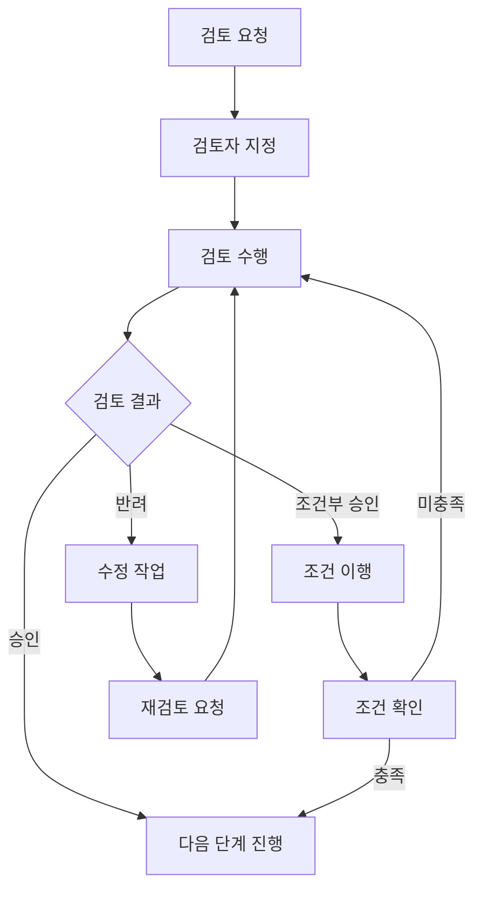

# 단계별 검토 체크리스트 (Phase Review Checklist)

> **프로젝트명:** 챌린지업 (ChallengeUp) — 온라인 강의 챌린지 플랫폼
> **문서 버전:** v0.1 (초안)
> **작성일:** 2026-11-25
> **작성자:** Claude Code (초안)
>
> **현재 상태: 어떤 게이트도 공식 검토·승인하지 않았다 (G0~G6 모두 미실행).** 00·01·03·05·06·07·08 문서는 초안이 있지만, 문서가 있다는 것과 검토·승인되었다는 것은 다르다. 02-시스템설계와 04-구현 문서는 작성되지 않았다. 승인자가 정해지지 않았다 (서비스 기획서 DEC-001, 결정 기한 2026-11-28). 아래 체크박스는 모두 비어 있으며, 각 단계 끝의 "작성자 사전 점검 메모"는 초안 작성자가 문서만 보고 찾은 사항이다. 공식 검토 결과가 아니다.

---

## 단계별 검토

- [G0 기획](#phase-0-기획-검토)
- [G1 요구사항 분석](#phase-1-요구사항-검토)
- [G2 시스템 설계](#phase-2-시스템-설계-검토)
- [G3 상세 설계](#phase-3-상세-설계-검토)
- [G4 구현](#phase-4-구현-검토)
- [G5 테스트](#phase-5-테스트-검토)
- [G6 배포 및 운영 인수](#phase-6-배포-검토)

## 공통 승인 기록

각 단계에서 적용 항목과 검토자를 지정한다. 검토 결과는 충족·미충족·미검토·해당 없음으로 기록하며, 해당 없음에는 사유를 적는다.

| Gate | 대상 산출물·버전 | 판정 | 검토 근거 | 승인자·일시 | 조건·담당자·기한 및 재확인 |
| --- | --- | --- | --- | --- | --- |
| G0 | 서비스 기획서 SPD-CHUP-v0.2, 비즈니스 정책서 BPD-CHUP-v0.2 (초안) | 미실행 (미검토) | 검토 기록 없음 | 미정 (DEC-001) / - | 승인자 지정(DEC-001), 사용자 인터뷰(DEC-003), MVP 범위(DEC-004), 점수값(DEC-008) — 기획 담당 / G0 검토 시 |
| G1 | SRS-CHUP-v0.1, UCS-CHUP-v0.1, RTM-CHUP-v0.2 (초안) | 미실행 (미검토) | 검토 기록 없음 | 미정 / - | G0 승인 선행. ISSUE-01·02 결정 — 기획·개발 담당 / G1 검토 시 |
| G2 | SAD·DB·API·화면 설계서 | 미실행 — **차단** (02 문서 미작성) | 없음 | 미정 / - | ISSUE-06: 02 문서 작성, ASM-01~10 확정 — 설계 담당(미정) / G2 전 |
| G3 | DDS-CHUP-v0.1 (초안), 코딩 표준(DDS 7장) | 미실행 (미검토) | 검토 기록 없음 | 미정 / - | G2 선행, 시각 주입 방식 결정(테스트 계획서 R-02), 개발 환경 미준비 — 개발 담당 / G3 |
| G4 | 구현·테스트 인계서, 후보 빌드 | 미실행 — **차단** (코드·인계서 없음) | 없음 | 미정 / - | 구현 착수 전 |
| G5 | TPL-CHUP-v0.1, TCS-CHUP-v0.1, TRP-CHUP-v0.1 (초안) | 미실행 — 결과 보고서 판정 "판정 불가 — 미실행" | 실행 기록 없음 | 미정 / - | G4 선행 |
| G6 | DPP-CHUP-v0.1, OPG-CHUP-v0.1, MTP-CHUP-v0.1 (초안) | 미실행 (배포 없음) | 없음 | 미정 / - | G5 선행, DEP-DEC-03~05, ISSUE-04 |

## Phase 0 기획 검토

모든 항목 미실행 (공식 검토 없음).

- [ ] [서비스 기획서](../00-기획/서비스기획서.md)의 사용자 문제와 근거를 확인했다.
- [ ] MVP 포함·제외 범위와 재검토 조건을 합의했다.
- [ ] 성공 지표의 데이터 출처와 측정·판정 시점을 정했다.
- [ ] 적용할 [비즈니스 정책](../00-기획/비즈니스정책서.md)과 주요 예외를 확인했다.
- [ ] 가정·의존성의 영향과 미결 결정의 담당자·기한을 기록했다.
- [ ] 요구사항 분석에 넘길 기획 기준선과 승인 근거를 기록했다.

**작성자 사전 점검 메모 (공식 검토 아님)**

| # | 발견 사항 | 근거 | 영향 | 처리 |
|---|-----------|------|------|------|
| 1 | 사용자 문제 OBJ-001~003이 모두 가정 상태 | SPD 1.1, DEC-003 | MVP 범위 재검토 가능성 | 미결 — 기획 담당 / 2026-12-05 |
| 2 | 승인자 미지정 | DEC-001 | 모든 게이트 승인 불가 | 미결 — 프로젝트 팀 / 2026-11-28 |
| 3 | P1 공수 약 29일 > 4주(1인 20일) | SPD 5.2, DEC-004 | 범위 조정 필요 | 미결 |
| 4 | 수익 모델이 2026-11-24에 두 운영 방식(강사 직접 운영형 20% / 플랫폼 기획 지원형 50%)으로 변경됨. MVP에는 영향 없음(EX-001·013) | SPD v0.2, BPD v0.2, [프로젝트 관리 산출물](프로젝트관리-산출물.md) 4.5 CHG-001 | v2 범위 | 변경 기록됨, 승인 미실행 |
| 5 | SPD 4.1 "강사는 챌린지마다 두 운영 방식 중 하나를 고른다"와 BPD-PAY-006-2 "강사가 스스로 기획 지원형을 고를 수 없다(신청·승인)"가 다름 | SPD 4.1, BPD 4.2 | v2 정책 해석 차이 | G0 검토 시 정리 필요 |
| 6 | SPD 5.5는 정기 작업을 "Supabase Cron 또는 Vercel Cron"으로 적었으나 DDS ASM-05와 배포 계획서 DEP-DEC-02는 pg_cron으로 정함 | SPD 5.5, DDS 1.3.1 | 문서 불일치 | SPD 갱신 필요 |
| 7 | BPD 작성 근거가 SPD-CHUP-v0.1로 적혀 있음 (현재 SPD v0.2) | BPD 머리말 | 추적성 | BPD 갱신 필요 |

---

## Phase 1 요구사항 검토

### 1.1 검토 목적

요구사항 명세서(SRS)의 **완전성(Completeness)**, **일관성(Consistency)**, **추적 가능성(Traceability)**, **테스트 가능성(Testability)** 을 확인하여, 후속 단계에서 발생할 수 있는 재작업과 비용을 최소화한다.

### 1.2 검토 범위

| 항목 | 대상 문서 | 버전 |
|------|-----------|------|
| 기능 요구사항 | SRS 섹션 3 (FR-001~025) | v0.1 (초안) |
| 비기능 요구사항 | SRS 섹션 4 (NFR-001~014) | v0.1 (초안) |
| 유스케이스 명세 | UC-001 ~ UC-017 | v0.1 (초안) |
| 인터페이스 요구사항 | SRS 섹션 5 | v0.1 (초안) |
| 데이터 요구사항 | SRS 섹션 6 | v0.1 (초안) |

### 1.3 요구사항 검토 체크리스트

모든 항목 미실행 (공식 검토 없음).

#### A. 완전성 (Completeness)

- [ ] 모든 기능 요구사항에 고유 ID(예: FR-001)가 부여되었는가?
- [ ] 모든 비기능 요구사항에 고유 ID(예: NFR-001)가 부여되었는가?
- [ ] 각 요구사항에 출처(이해관계자, 비즈니스 규칙 등)가 명시되었는가?
- [ ] 시스템 경계(Scope)가 명확히 정의되었는가?
- [ ] 제외 범위(Out of Scope)가 명시되었는가?
- [ ] 모든 사용자 역할(Actor)이 식별되고 정의되었는가?
- [ ] 각 유스케이스의 기본 흐름(Main Flow)과 대안 흐름(Alternative Flow)이 기술되었는가?
- [ ] 예외 흐름(Exception Flow)이 모든 유스케이스에 포함되었는가?
- [ ] 외부 시스템 인터페이스가 모두 식별되었는가?
- [ ] 데이터 입출력 형식이 정의되었는가?

#### B. 일관성 (Consistency)

- [ ] 용어 정의(Glossary)가 작성되고 문서 전체에서 일관적으로 사용되는가?
- [ ] 요구사항 간 충돌(Conflict)이 없는가?
- [ ] 동일 기능에 대한 중복 기술이 없는가?
- [ ] 유스케이스 간 데이터 흐름이 일관적인가?
- [ ] 비기능 요구사항이 기능 요구사항과 상충하지 않는가?

#### C. 추적 가능성 (Traceability)

- [ ] 요구사항 추적 매트릭스(RTM)가 작성되었는가?
- [ ] 비즈니스 요구사항 → 기능 요구사항 추적이 가능한가?
- [ ] 승인 범위의 FR·NFR 출처와 수용 기준을 RTM에서 찾을 수 있는가? 상세 TC는 테스트 설계에서 연결한다.
- [ ] 각 요구사항이 기획 목표, 정책, 이해관계자 요청 또는 외부 제약 등 출처와 연결되는가?

#### D. 테스트 가능성 (Testability)

- [ ] 각 요구사항이 검증 가능한(Verifiable) 형태로 기술되었는가?
- [ ] 비기능 요구사항에 측정 가능한 수치 기준이 명시되었는가? (예: 응답시간 < 2초)
- [ ] 수용 기준(Acceptance Criteria)이 각 요구사항에 정의되었는가?
- [ ] 모호한 표현("빠르게", "적절히", "대부분" 등)이 제거되었는가?

#### E. 우선순위 및 승인

- [ ] 모든 요구사항에 우선순위(Must/Should/Could/Won't)가 부여되었는가?
- [ ] 우선순위 결정 근거가 기록되었는가?
- [ ] 핵심 이해관계자의 검토가 완료되었는가?
- [ ] 이해관계자 서명/승인이 확보되었는가?
- [ ] 변경 이력(Change Log)이 관리되고 있는가?

### 1.4 요구사항 검토 피드백 양식

**검토 정보**

| 항목 | 내용 |
|------|------|
| 검토자 | 미정 (공식 검토 미실행). 아래 피드백은 초안 작성자의 사전 점검 |
| 검토일 | 미실행 |
| 검토 대상 문서 | SRS, UCS, RTM |
| 문서 버전 | SRS v0.1, UCS v0.1, RTM v0.2 |
| 검토 결과 | [ ] 승인 / [ ] 조건부 승인 / [ ] 반려 — 미실행 |
| 조건부 승인 조건 | 해당 없음 (미실행) |

**피드백 상세** (작성자 사전 점검, 공식 검토 아님)

| # | 항목 | 위치(섹션/페이지) | 심각도 | 피드백 내용 | 조치사항 | 담당자 | 상태 |
|---|------|-------------------|--------|-------------|----------|--------|------|
| 1 | 경계 표현 | SRS FR-012-AC6 | Minor | "11-30 23:59:59 이후"가 NFR-012 배타적 경계(12-01 00:00:00.000부터 거절)와 다르게 읽힘 | 표현 통일 | 기획 담당 (미정) | Open |
| 2 | 조기 인증 기준 | BPD BP-POINT-001 vs SRS FR-018 | Minor | "20:59:59 이전" vs "< 21:00:00". 예시(BP-SUB)는 20:59:59에 보너스 지급 | "21:00:00 전"으로 통일 | 기획 담당 | Open |
| 3 | 스트릭 정의 | BPD 부록 B vs SRS FR-019 | Minor | "인정(또는 대기)이 이어진 Day 수" vs "대기는 끊지도 더하지도 않음" | 정의 통일 | 기획 담당 | Open |
| 4 | 오류 메시지 목록 | BPD BP-ERROR-004 | Minor | UC에 쓰인 문구("챌린지가 시작돼서 신청을 취소할 수 없어요. 인증하지 않은 Day는 미완주로 기록돼요", "챌린지는 동시에 5개까지 참여할 수 있어요. 진행 중인 챌린지가 끝나면 다시 신청할 수 있어요" 등)가 422·409 목록에 없음 | 목록 보완, [UX 검토서](UX검토서.md) 개선안 반영 | 기획 담당 | Open |
| 5 | 정책 적용표 | BPD 16.1 | Info | "FR 미정 / TC 미정"으로 남아 있음 | FR·TC ID 기입 (RTM v0.2 참조) | 기획 담당 | Open |
| 6 | 접근 표 | BPD BP-CONTENT-001 | Info | "신청자(활성)" 열이 종료 후 완주·미완주 신청자의 열람(BP-CONTENT-002-5, DDS `is_member_of`)을 표현하지 못함 | 열 이름 보완 | 기획 담당 | Open |
| 7 | 미결 이슈 | SRS 부록 C | Major | ISSUE-01(메일 인증), ISSUE-02(계정 잠금), ISSUE-04(요금제), ISSUE-05(개인정보 보관) 미결 | 담당·기한대로 결정 | 각 담당 | Open |

> **심각도 기준:**
> - **Critical:** 프로젝트 진행 불가, 즉시 해결 필요
> - **Major:** 기능 또는 품질에 중대한 영향, 다음 단계 전 해결 필요
> - **Minor:** 품질 개선 필요, 일정 내 해결 권장
> - **Info:** 참고 사항, 향후 고려

### 1.5 요구사항 검토 회의록

검토 회의는 열리지 않았다 (미실행).

| 항목 | 내용 |
|------|------|
| 회의명 | 요구사항 검토 회의 |
| 일시 | 미정 (미개최) |
| 장소/채널 | 미정 |
| 참석자 | 미정 |
| 서기 | 미정 |

**안건:**

1. 요구사항 명세서 전체 검토
2. 미결 사항 논의 (ISSUE-01~06)
3. 결정 사항 확인

**논의 내용:**

| # | 논의 항목 | 의견 | 결정사항 | 담당자 | 기한 |
|---|-----------|------|----------|--------|------|
| - | 미개최 | - | - | - | - |

**액션 아이템:**

| # | 내용 | 담당자 | 기한 | 상태 |
|---|------|--------|------|------|
| 1 | 승인자 지정 후 G0·G1 검토 회의 개최 | 프로젝트 팀 | DEC-001 결정 후 | 미실행 |

---

## Phase 2 시스템 설계 검토

> **G2는 차단 상태다.** 02-시스템설계의 SAD·DB·API·화면 설계서가 양식 상태로 남아 있어 검토할 대상이 없다 (SRS ISSUE-06, RTM 7.3 "G2 미충족"). 상세 설계서가 시스템 수준 결정을 ASM-01~10 가정으로 대신하고 있다. 아래 체크리스트는 02 문서 작성 후 사용한다.

### 2.1 검토 목적

시스템 아키텍처 설계, 데이터베이스 설계, API 설계가 요구사항을 올바르게 반영하고, 품질 속성(성능, 보안, 확장성, 유지보수성)을 충족하는지 검증한다.

### 2.2 아키텍처 검토 체크리스트

모든 항목 미실행 (대상 문서 미작성).

#### A. 요구사항 충족성

- [ ] 모든 기능 요구사항이 아키텍처 컴포넌트에 매핑되었는가?
- [ ] 비기능 요구사항(성능, 보안, 확장성)이 아키텍처 결정에 반영되었는가?
- [ ] 요구사항 추적 매트릭스(RTM)가 설계 항목으로 확장되었는가?

#### B. 기술 스택 및 구조

- [ ] 기술 스택 선정에 대한 합리적 근거(ADR)가 문서화되었는가?
- [ ] 기술 스택의 성숙도, 커뮤니티 지원, 라이선스가 확인되었는가?
- [ ] 아키텍처 다이어그램(C4 Model 등)이 제공되었는가?
- [ ] 컴포넌트 간 의존성이 명확하고 순환 의존이 없는가?
- [ ] 계층(Layer) 분리가 적절한가? (Presentation, Business, Data)
- [ ] 모듈 간 결합도(Coupling)가 낮고 응집도(Cohesion)가 높은가?

#### C. 확장성 및 가용성

- [ ] 수평 확장(Scale-out) 전략이 정의되었는가?
- [ ] 장애 지점(Single Point of Failure)이 식별되고 대비책이 있는가?
- [ ] 로드밸런싱 전략이 정의되었는가?
- [ ] 캐싱 전략이 적절한가? (Cache invalidation 포함)
- [ ] 비동기 처리가 필요한 영역이 식별되었는가?

#### D. 보안 아키텍처

- [ ] 인증(Authentication) 메커니즘이 정의되었는가?
- [ ] 인가(Authorization) 모델이 설계되었는가? (RBAC, ABAC 등)
- [ ] 데이터 암호화 전략(전송 중/저장 시)이 정의되었는가?
- [ ] 시크릿 관리 방안이 있는가? (Vault, KMS 등)
- [ ] OWASP Top 10 위협에 대한 대응이 설계에 반영되었는가?

#### E. 운영 및 관측성

- [ ] 로깅 전략(로그 수준, 저장, 보관 기간)이 정의되었는가?
- [ ] 모니터링 및 알림(Alert) 전략이 정의되었는가?
- [ ] 장애 복구(Disaster Recovery) 계획이 있는가?
- [ ] CI/CD 파이프라인 아키텍처가 설계되었는가?
- [ ] 환경(Dev/Staging/Prod) 구성이 정의되었는가?

### 2.3 데이터베이스 설계 검토 체크리스트

모든 항목 미실행 (DB 설계서 미작성, DDS 2.1 도메인 모델이 기준안).

#### A. 데이터 모델링

- [ ] ERD(Entity-Relationship Diagram)가 제공되었는가?
- [ ] 정규화(Normalization)가 적절히 수행되었는가? (의도적 비정규화의 경우 근거 기록)
- [ ] 엔티티/테이블 명명 규칙이 일관적인가?
- [ ] 컬럼 명명 규칙이 일관적인가?
- [ ] 데이터 타입 선택이 적절한가?
- [ ] NULL 허용 정책이 적절한가?

#### B. 무결성 및 관계

- [ ] 기본키(PK) 전략이 적절한가? (자연키 vs 대리키)
- [ ] 외래키(FK) 관계가 올바르게 설정되었는가?
- [ ] CASCADE, SET NULL 등 참조 무결성 규칙이 적절한가?
- [ ] 유니크 제약조건이 필요한 곳에 설정되었는가?
- [ ] CHECK 제약조건이 필요한 곳에 설정되었는가?

#### C. 성능 및 운영

- [ ] 인덱스 전략이 주요 쿼리 패턴을 고려하여 설계되었는가?
- [ ] 대용량 테이블에 대한 파티셔닝 전략이 있는가?
- [ ] 데이터 마이그레이션 전략이 수립되었는가?
- [ ] 백업 및 복구 전략이 정의되었는가?
- [ ] 감사(Audit) 로그 테이블이 설계되었는가?
- [ ] Soft Delete vs Hard Delete 정책이 정의되었는가?

### 2.4 API 설계 검토 체크리스트

모든 항목 미실행 (API 설계서 미작성. MVP는 외부 공개 REST API 없이 Server Actions·RPC를 쓰므로 REST 항목 일부는 해당 없음이 될 수 있다 — SRS 5.2.1).

#### A. 설계 규약

- [ ] RESTful 규약(리소스 명명, HTTP 메서드 사용)을 따르는가?
- [ ] API 버전 관리 전략(URL path, Header 등)이 정의되었는가?
- [ ] URI 네이밍이 일관적이고 직관적인가? (복수형, kebab-case 등)
- [ ] HTTP 상태 코드 사용이 표준적인가?
- [ ] Content-Type 및 Accept 헤더 처리가 적절한가?

#### B. 인증 및 보안

- [ ] 인증(Authentication) 방식이 정의되었는가? (JWT, OAuth2 등)
- [ ] 인가(Authorization) 검증이 모든 엔드포인트에 적용되는가?
- [ ] Rate Limiting 정책이 정의되었는가?
- [ ] CORS 정책이 적절히 설정되었는가?
- [ ] 민감 데이터가 요청/응답에서 마스킹 처리되는가?

#### C. 요청/응답 설계

- [ ] 요청/응답 본문 형식(JSON Schema 등)이 정의되었는가?
- [ ] 에러 응답 형식이 일관적인가? (error code, message, details)
- [ ] 페이지네이션(Pagination) 방식이 표준적인가? (cursor-based, offset-based)
- [ ] 필터링/정렬 파라미터가 일관적인가?
- [ ] 대용량 응답에 대한 처리 전략이 있는가? (페이징, 스트리밍)
- [ ] API 문서(OpenAPI/Swagger)가 작성되었는가?
- [ ] Idempotency가 필요한 엔드포인트에 적용되었는가?

### 2.5 설계 검토 피드백 양식

**검토 정보**

| 항목 | 내용 |
|------|------|
| 검토자 | 미정 |
| 검토일 | 미실행 |
| 검토 대상 | [ ] 아키텍처 / [ ] DB 설계 / [ ] API 설계 — 모두 미작성 |
| 문서 버전 | 없음 |
| 검토 결과 | [ ] 승인 / [ ] 조건부 승인 / [ ] 반려 — 미실행 (차단) |

**피드백 상세** (작성자 사전 점검, 공식 검토 아님)

| # | 영역 | 항목 | 위치 | 심각도 | 피드백 내용 | 조치사항 | 담당자 | 상태 |
|---|------|------|------|--------|-------------|----------|--------|------|
| 1 | Arch / DB / API | 02 문서 전체 | 02-시스템설계/* | Critical | 양식 상태, 검토 불가 | ASM-01~10을 SAD·DB·API·화면 설계서로 확정 | 설계 담당 (미정) | Open |
| 2 | Arch | 배포 플랫폼 결정 | 배포 계획서 1.4 | Info | Vercel 결정(DEP-DEC-01)과 pg_cron(DEP-DEC-02)을 SAD ADR로 옮겨야 함 | SAD ADR 작성 | 설계 담당 | Open |
| 3 | DB | 테스트용 시각 주입 | DDS 5.5·5.10 | Major | DB `now()` 고정 방법 없음 → 경계 TC 실행 불가 | DB 설계서·DDS에 방식 결정 | 개발 담당 | Open |

---

### 2.6 G2 시스템 설계 승인

미실행 (차단).

- [ ] 적용되는 아키텍처·데이터·API·화면 간 계약과 요구사항의 관계를 확인했다.
- [ ] 시스템 경계, 주요 설계 결정과 미결 항목의 담당자를 기록했다.

---

## Phase 3 상세 설계 검토

모든 항목 미실행 (DDS-CHUP-v0.1 초안은 있으나 공식 검토 없음. G2 선행 필요).

- [ ] [상세 설계서](../03-상세설계/상세설계서.md)의 구현 단위와 담당 요구사항이 연결된다.
- [ ] 정상 흐름, 상태 전이, 권한 경계, 실패·복구 동작이 정의되었다.
- [ ] 데이터·API·화면의 계약과 용어가 일치한다.
- [ ] 실행 환경, 코딩·검증 기준과 미결 사항의 담당자·기한을 확인했다.
- [ ] 구현에 넘길 상세 설계 기준선을 승인했다.

**작성자 사전 점검 메모 (공식 검토 아님)**

| # | 발견 사항 | 근거 | 처리 |
|---|-----------|------|------|
| 1 | DDS가 02 문서 부재로 ASM-01~10 가정 위에서 설계됨 | DDS 머리말 | G2 후 재확인 |
| 2 | 테스트용 서버 시각 주입 방식이 정의되지 않음 | DDS 5.5·5.10, 테스트 계획서 R-02 | G3 전 결정 |
| 3 | 리더보드 동점 순서가 "마지막 포인트 변동 시각" 근사 (정책은 "그 점수에 먼저 도달한 사람") | DDS 5.8, BP-POINT-004-4 | DEC-008 검토 시 |
| 4 | 개발 환경(로컬 Supabase, Vercel 프로젝트, CI) 미준비 | 배포 계획서 2.2 | 미실행 |

---

## Phase 4 구현 검토

> 코드가 없어 구현 검토는 시작할 수 없다 (미실행). 아래 체크리스트는 PR 리뷰와 G4 판정에 사용한다. 챌린지업 전용 점검 항목은 [상세 설계서](../03-상세설계/상세설계서.md) 7.5 코드 리뷰 체크리스트를 함께 쓴다.

### 4.1 검토 목적

구현된 코드가 설계 명세와 코딩 표준을 준수하고, 보안 취약점 및 성능 이슈가 없는지 검증한다. 코드의 가독성, 유지보수성, 테스트 가능성을 확인한다.

### 4.2 코드 검토 체크리스트

모든 항목 미실행.

#### A. 기능 정확성

- [ ] 기능 요구사항이 올바르게 구현되었는가?
- [ ] 비즈니스 로직이 설계 명세와 일치하는가?
- [ ] Edge Case(경계값)가 처리되었는가?
- [ ] 입력 값 검증(Validation)이 적절히 수행되는가?
- [ ] 반환 값/출력이 명세와 일치하는가?

#### B. 코드 품질

- [ ] 코딩 표준(Coding Convention)을 준수하는가?
- [ ] 린터(Linter) 및 포맷터(Formatter) 경고가 없는가?
- [ ] 함수/메서드 길이가 적절한가? (SRP 준수)
- [ ] 클래스/모듈의 책임이 명확하고 단일한가?
- [ ] 변수/함수/클래스 명명이 의미를 잘 전달하는가?
- [ ] 불필요한 코드(Dead Code)가 없는가?
- [ ] 주석이 꼭 필요한 곳에만 적절히 사용되었는가?
- [ ] 매직 넘버(Magic Number)나 하드코딩된 값이 상수로 추출되었는가?
- [ ] DRY(Don't Repeat Yourself) 원칙을 따르는가?
- [ ] 복잡도(Cyclomatic Complexity)가 적절한 수준인가?

#### C. 보안

- [ ] SQL Injection 취약점이 없는가? (Parameterized Query 사용)
- [ ] XSS(Cross-Site Scripting) 취약점이 없는가? (Output Encoding)
- [ ] CSRF(Cross-Site Request Forgery) 방어가 적용되었는가?
- [ ] 인증/인가 검증이 누락된 엔드포인트가 없는가?
- [ ] 민감 정보(비밀번호, 토큰 등)가 로그에 출력되지 않는가?
- [ ] 파일 업로드 검증(확장자, 크기, MIME 타입)이 적절한가?
- [ ] 사용자 입력이 sanitize 되었는가?
- [ ] 의존성(Dependencies)에 알려진 취약점이 없는가?

#### D. 에러 처리

- [ ] 예외 처리(try-catch)가 적절히 사용되었는가?
- [ ] 에러 메시지가 사용자에게 내부 정보를 노출하지 않는가?
- [ ] 예외 발생 시 리소스 정리(cleanup)가 보장되는가?
- [ ] 에러가 적절한 수준에서 처리되고 전파되는가?
- [ ] 전역 에러 핸들러가 구현되었는가?

#### E. 성능

- [ ] N+1 쿼리 문제가 없는가?
- [ ] 불필요한 데이터 로딩(Over-fetching)이 없는가?
- [ ] 메모리 누수(Memory Leak) 가능성이 없는가?
- [ ] 대량 데이터 처리 시 배치(Batch) 또는 스트림(Stream) 방식이 적용되었는가?
- [ ] 적절한 캐싱이 적용되었는가?
- [ ] 데이터베이스 쿼리가 최적화되었는가? (인덱스 활용 등)

#### F. 테스트

- [ ] 단위 테스트(Unit Test)가 작성되었는가?
- [ ] 테스트 커버리지가 기준을 충족하는가? (챌린지업: 도메인 규칙 100%, NFR-013)
- [ ] 통합 테스트(Integration Test)가 필요한 경우 작성되었는가?
- [ ] 테스트가 독립적으로 실행 가능한가? (외부 의존성 Mock 처리)
- [ ] 경계값, 비정상 입력에 대한 테스트가 포함되었는가?

#### G. 로깅 및 관측성

- [ ] 로깅이 적절한 수준(Level)으로 구현되었는가? (DEBUG, INFO, WARN, ERROR)
- [ ] 로그 메시지가 디버깅에 충분한 컨텍스트를 포함하는가?
- [ ] 분산 추적(Distributed Tracing)을 위한 Correlation ID가 전파되는가?
- [ ] 메트릭(Metrics) 수집 포인트가 적절히 설정되었는가?

#### H. 접근성 (Frontend)

- [ ] 시맨틱 HTML이 적절히 사용되었는가?
- [ ] ARIA 속성이 필요한 곳에 사용되었는가?
- [ ] 키보드 네비게이션이 가능한가?
- [ ] 색상 대비가 WCAG AA 기준을 충족하는가?
- [ ] alt 텍스트가 모든 이미지에 제공되는가?

### 4.3 PR/MR 리뷰 템플릿

PR 설명에 아래 형식을 쓴다 (저장소에 PR 템플릿 파일은 아직 없다).

```markdown
## PR 정보

- **제목:** (PR 제목 — 예: feat(submission): 인증 제출 RPC)
- **작성자:** (작성자 GitHub 계정)
- **리뷰어:** (리뷰어 GitHub 계정)
- **관련 이슈:** (이슈 번호, FR·TC ID)
- **변경 유형:** [ ] 기능 추가 / [ ] 버그 수정 / [ ] 리팩토링 / [ ] 설정 변경 / [ ] 문서

## 변경 사항 요약

(무엇을 바꿨는지)

## 변경 이유

(관련 FR-xxx-ACn, BP 규칙 ID)

## 테스트 결과

- [ ] 단위 테스트 통과 (Vitest)
- [ ] 통합 테스트 통과 (pgTAP)
- [ ] Preview 배포에서 수동 확인
- **관련 TC:** (TC-ID 목록)

## 체크리스트

- [ ] 코딩 표준 준수 (DDS 7장)
- [ ] RLS·권한 검토 (DDS 5.11)
- [ ] 성능 영향 확인
- [ ] RTM 설계·구현 열 갱신
- [ ] DB 마이그레이션과 되돌림 SQL (해당 시)
- [ ] 환경 변수 변경 (해당 시, 값은 Vercel에만)
- [ ] 비밀 값이 커밋에 없음 (공개 저장소)

## 스크린샷 / 실행 결과

(해당 시 첨부, 개인정보 제거)

## 리뷰 요청 사항

(중점적으로 봐 줄 부분)
```

### 4.4 코드 리뷰 피드백 분류

| 접두어 | 의미 | 설명 |
|--------|------|------|
| `[MUST]` | 필수 수정 | 반드시 수정 후 재리뷰 필요 |
| `[SHOULD]` | 권장 수정 | 강력히 권장하지만, 합리적 사유 시 유지 가능 |
| `[COULD]` | 선택적 개선 | 개선하면 좋지만 현재로도 수용 가능 |
| `[QUESTION]` | 질문 | 코드 의도 또는 설계 결정에 대한 질문 |
| `[PRAISE]` | 칭찬 | 좋은 코드/접근 방식에 대한 인정 |
| `[NIT]` | 사소한 지적 | 스타일, 네이밍 등 사소한 사항 |

---

### 4.5 G4 테스트 인계

미실행 (차단 — 인계서 미작성, 후보 빌드 없음).

- [ ] [구현·테스트 인계서](../04-구현/구현-테스트-인계서.md)에 QA 후보 커밋·빌드, 환경과 실행 방법이 있다. — 인계서 양식 상태
- [ ] 단위 테스트·코드 리뷰 증빙, 테스트에 영향을 주는 제약과 담당자가 연결되어 있다.
- [ ] 현재 릴리스의 테스트 대상 요구사항을 TC에 연결했다. — TC 연결은 RTM v0.2에 있음(35/35). 공식 확인은 미실행
- [ ] QA가 접근과 테스트 데이터를 확인했고 [테스트 계획서](../05-테스트/테스트계획서.md)의 진입 기준을 충족했다.

---

## Phase 5 테스트 검토

> 테스트 계획서·테스트 케이스·결과 보고서 초안이 있으나 공식 검토는 없다. 결과 보고서의 판정은 "판정 불가 — 미실행"이다.

### 5.1 검토 목적

테스트 계획의 완전성과 테스트 결과의 신뢰성을 검증하여, 릴리스 품질 기준 충족 여부를 판단한다.

### 5.2 테스트 계획 검토 체크리스트

모든 항목 미실행.

#### A. 테스트 범위 및 전략

- [ ] 테스트 범위가 요구사항 추적 매트릭스(RTM)의 모든 항목을 커버하는가?
- [ ] 테스트 유형(단위, 통합, 시스템, 인수)별 범위가 정의되었는가?
- [ ] 테스트 제외 항목과 그 사유가 기록되었는가?
- [ ] 위험 기반 테스트(Risk-based Testing) 접근이 적용되었는가?
- [ ] 회귀 테스트(Regression Test) 전략이 수립되었는가?

#### B. 테스트 환경 및 데이터

- [ ] 테스트 환경이 운영 환경과 유사하게 구성되었는가?
- [ ] 테스트 데이터 준비 전략이 정의되었는가?
- [ ] 테스트 데이터에 개인정보가 포함되지 않았는가? (마스킹/익명화)
- [ ] 외부 시스템 연동 테스트를 위한 Mock/Stub 전략이 있는가?
- [ ] 테스트 환경 초기화/정리 절차가 정의되었는가?

#### C. 진입/종료 기준

- [ ] 테스트 진입 기준(Entry Criteria)이 명확히 정의되었는가?
- [ ] 테스트 종료 기준(Exit Criteria)이 명확히 정의되었는가?
- [ ] 중단 기준(Suspension Criteria)이 정의되었는가?
- [ ] 재개 기준(Resumption Criteria)이 정의되었는가?

#### D. 비기능 테스트

- [ ] 성능 테스트(Performance Test)가 계획에 포함되었는가?
- [ ] 부하 테스트(Load Test) 시나리오가 현실적인가?
- [ ] 보안 테스트(Security Test)가 포함되었는가? (OWASP 기반)
- [ ] 접근성 테스트(Accessibility Test)가 포함되었는가? (WCAG 2.1 AA)
- [ ] 호환성 테스트(Compatibility Test) 대상 브라우저/OS가 정의되었는가?

#### E. 결함 관리

- [ ] 결함 보고 절차가 정의되었는가?
- [ ] 결함 심각도(Severity) 및 우선순위(Priority) 기준이 정의되었는가?
- [ ] 결함 생명주기(Lifecycle)가 정의되었는가?
- [ ] 결함 에스컬레이션 절차가 있는가?

### 5.3 테스트 결과 검토 체크리스트

모든 항목 미실행 (실행 결과 없음).

#### A. 테스트 실행 결과

- [ ] 대상 빌드의 실행률과 통과율을 승인된 종료 기준으로 확인했는가?
- [ ] 테스트 종료 기준(Exit Criteria)이 충족되었는가?
- [ ] 미실행 테스트 케이스에 대한 사유가 기록되었는가?
- [ ] 테스트 케이스 통과율(Pass Rate)이 기준을 충족하는가?

#### B. 결함 현황

- [ ] 출시를 차단하는 결함이 해소되고 재검증되었는가?
- [ ] 미해결 결함(Open Defects)의 위험이 수용 가능한 수준인가?
- [ ] 미해결 결함에 대한 우회 방안(Workaround)이 문서화되었는가?
- [ ] 결함 밀도(Defect Density)가 허용 범위 내인가?
- [ ] 결함 추세(Trend)가 안정화(수렴) 추세인가?

#### C. 비기능 테스트 결과

- [ ] 성능 테스트 결과가 요구 기준을 충족하는가?
- [ ] 부하 테스트에서 병목 지점이 식별되고 해결되었는가?
- [ ] 보안 취약점 스캔 결과가 수용 가능한가?
- [ ] 접근성 검사 결과가 WCAG 2.1 AA를 충족하는가?
- [ ] 합의된 사용자 경험 성능 지표의 목표가 달성되었는가?

#### D. 코드 품질 메트릭

- [ ] 코드 커버리지(Code Coverage)가 기준을 충족하는가?
- [ ] 정적 분석(Static Analysis) 이슈가 해결되었는가?
- [ ] 기술 부채(Technical Debt) 수준이 수용 가능한가?

### 5.4 테스트 검토 피드백 양식

**검토 정보**

| 항목 | 내용 |
|------|------|
| 검토자 | 미정 |
| 검토일 | 미실행 |
| 검토 대상 | [ ] 테스트 계획 / [ ] 테스트 결과 — 둘 다 초안, 미검토 |
| 검토 결과 | [ ] 승인 (릴리스 가능) / [ ] 조건부 승인 / [ ] 반려 (추가 테스트 필요) — 미실행 |

**테스트 요약 메트릭**

| 메트릭 | 기준 | 실적 | 충족 여부 |
|--------|------|------|-----------|
| 실행률·통과율 | 테스트 계획서 5.4 초안: P1 TC 100% (미승인) | 실행 0 / 153건, 통과율 산정 불가 | 판정 불가 — 미실행 |
| 출시 차단 결함 | 초안: S1·S2 0건 | 결함 기록 없음 (미실행) | 판정 불가 — 미실행 |
| 부문별 종료 기준 | NFR-001·003, 보안 TC, UAT | 측정·승인 없음 | 판정 불가 — 미실행 |

G5는 [테스트 결과 보고서](../05-테스트/테스트결과보고서.md#8-종료-기준-충족-판정)에 근거한다. 허용된 예외는 없다.

---

## Phase 6 배포 검토

> 배포한 적이 없다. 배포 계획서·운영 가이드·유지보수 계획서는 초안이며 모든 절차가 미실행이다. 플랫폼은 Vercel로 결정되었다 (배포 계획서 1.4 DEP-DEC-01).

### 6.1 검토 목적

안정적인 운영 환경 배포를 위해 기술적 준비 상태, 운영 준비 상태, 롤백 계획을 검증한다.

### 6.2 배포 전 검토 체크리스트 (Pre-Deployment)

모든 항목 미실행.

#### A. 테스트 완료 확인

- [ ] 배포 후보 아티팩트가 G5 승인 대상과 일치하고 종료 판정과 예외 기록을 확인했는가?
- [ ] 인수 테스트가 범위에 해당하면 합격 승인 기록이 있는가?
- [ ] 미해결 결함에 대한 위험 수용이 결정/승인되었는가?
- [ ] 회귀 테스트(Regression Test)가 완료되었는가?

#### B. 배포 아티팩트 준비

- [ ] 배포 대상 빌드 아티팩트가 확정되었는가? (Vercel 배포 ID, 커밋 SHA)
- [ ] 릴리스 노트(Release Notes)가 작성되었는가?
- [ ] 변경 이력(Changelog)이 업데이트되었는가?
- [ ] 배포 스크립트/파이프라인이 검증되었는가?
- [ ] 환경 변수 및 설정 파일이 운영 환경에 맞게 준비되었는가?

#### C. 데이터베이스 변경

- [ ] DB 마이그레이션 스크립트가 준비되고 Staging에서 검증되었는가?
- [ ] 마이그레이션 롤백 스크립트가 준비되었는가?
- [ ] 대용량 테이블 변경 시 성능 영향이 분석되었는가?
- [ ] 데이터 백업이 완료되었는가?

#### D. 인프라 및 운영 준비

- [ ] 인프라 변경(서버, 네트워크, 스토리지)이 완료되었는가?
- [ ] SSL 인증서가 유효한가?
- [ ] DNS 변경이 필요한 경우 계획되었는가?
- [ ] 모니터링 대시보드가 설정되었는가?
- [ ] 알림(Alert) 규칙이 설정되었는가?
- [ ] 로그 수집 파이프라인이 정상 작동하는가?

#### E. 롤백 계획

- [ ] 롤백 기준(Rollback Criteria)이 정의되었는가?
- [ ] 롤백 절차가 문서화되었는가?
- [ ] 롤백 소요 시간이 추정되었는가?
- [ ] 롤백 담당자가 지정되었는가?
- [ ] 롤백 시 데이터 정합성 보장 방안이 있는가?

#### F. 커뮤니케이션

- [ ] 배포 일정이 관련 부서(운영, CS, 영업 등)에 공유되었는가?
- [ ] 사용자 공지(점검 안내 등)가 준비되었는가?
- [ ] 비상 연락망이 최신화되었는가?
- [ ] 배포 당일 핵심 담당자 가용성이 확인되었는가?
- [ ] 장애 발생 시 에스컬레이션 경로가 확인되었는가?

#### G. 보안 및 컴플라이언스

- [ ] 보안 취약점 스캔 결과가 기준을 충족하는가?
- [ ] 개인정보 처리 관련 법적 검토가 완료되었는가? (ISSUE-05 미결)
- [ ] 접근 권한(IAM)이 최소 권한 원칙에 따라 설정되었는가?
- [ ] 감사 로그(Audit Log)가 활성화되어 있는가?

### 6.3 배포 후 검토 체크리스트 (Post-Deployment)

모든 항목 미실행.

#### A. 즉시 확인 (배포 후 30분 이내)

- [ ] 배포된 버전이 정확한가? (Health Check Endpoint)
- [ ] 핵심 기능(Critical Path)이 정상 동작하는가?
- [ ] 에러 로그에 비정상 패턴이 없는가?
- [ ] 응답 시간이 정상 범위인가?
- [ ] CPU/메모리 사용량이 정상 범위인가? (관리형 — Supabase DB 사용량으로 대신)
- [ ] 외부 연동 시스템이 정상 통신하는가?

#### B. 안정화 모니터링 (배포 후 24~72시간)

- [ ] 에러율(Error Rate)이 기준 이내인가?
- [ ] 사용자 보고 이슈가 수집/대응되고 있는가?
- [ ] 성능 지표(Latency, Throughput)가 안정적인가?
- [ ] DB 쿼리 성능이 정상인가? (Slow Query 모니터링)
- [ ] 첫 00:00·00:10 KST 정기 작업이 정상 완료되었는가? (템플릿의 캐시 히트율 항목 대신 — 캐시 없음)

#### C. 배포 완료 확인

- [ ] 배포 결과 보고서가 작성되었는가?
- [ ] 롤백 기준 시한이 경과하여 배포가 확정되었는가?
- [ ] 임시 배포용 권한이 회수되었는가?
- [ ] 배포 관련 문서(운영 매뉴얼 등)가 업데이트되었는가?
- [ ] Lessons Learned가 기록되었는가?

### 6.4 배포 검토 피드백 양식

**배포 정보**

| 항목 | 내용 |
|------|------|
| 릴리스 버전 | v1.0.0 (예정) |
| 배포 일시 | 미정 (미실행) |
| 배포 환경 | Production (Vercel) — 미실행 |
| 배포 담당자 | 미정 |
| 배포 방식 | Vercel 원자적 배포 (Instant Rollback 가능) |
| 배포 소요 시간 | 미측정 |

**배포 전 검토 결과**

| 항목 | 담당자 | 확인일 | 상태 |
|------|--------|--------|------|
| 테스트 완료 | 미정 | - | 미실행 |
| 아티팩트 준비 | 미정 | - | 미실행 |
| DB 마이그레이션 | 미정 | - | 미실행 |
| 인프라 준비 | 미정 | - | 미실행 |
| 롤백 계획 | 미정 | - | 미실행 (문서만 있음) |
| 커뮤니케이션 | 미정 | - | 미실행 |
| 보안 검토 | 미정 | - | 미실행 |

**최종 Go/No-Go 결정**

| 항목 | 내용 |
|------|------|
| 결정 | [ ] Go / [ ] No-Go — 미실행 |
| 결정 사유 | 결정 전 (G5 미통과) |
| 결정권자 | 미정 (DEC-001) |
| 결정 일시 | 없음 |

---

### 6.5 G6 운영 인수

미실행.

- [ ] [배포 계획서의 G6 기록](../06-배포/배포계획서.md#35-g6-운영-인수-기록)에 배포 버전·환경과 배포 후 점검 근거가 있다.
- [ ] 운영 담당자가 알림, 모니터링, 장애 대응 및 복구 절차에 접근할 수 있다.
- [ ] 남은 이슈와 대응 담당자·기한, 운영 인수자·인수 일시가 기록되었다.

---

## 부록

### A. 심각도(Severity) 기준 정의

테스트 계획서 5.2와 같은 등급을 쓴다. 대응 기한은 인원 확정 후 정한다.

| 등급 | 명칭 | 설명 | 대응 기한 |
|------|------|------|-----------|
| S1 | Critical | 핵심 흐름 불가, 권한 우회, 데이터 손실·유출 | 즉시 |
| S2 | Major | 주요 규칙 위반, 우회 방법 없음 | 미정 |
| S3 | Minor | 기능 불편, 우회 방법 존재 | 미정 |
| S4 | Info | 사소한 개선 사항, 화면 오류 | 다음 릴리스 |

### B. 검토 결과 구분

| 결과 | 설명 | 후속 조치 |
|------|------|-----------|
| 승인 (Approved) | 모든 기준 충족, 다음 단계 진행 가능 | 없음 |
| 조건부 승인 (Conditionally Approved) | 경미한 이슈 존재, 조건 충족 시 진행 가능 | 조건 이행 후 재확인 |
| 반려 (Rejected) | 중대한 이슈 존재, 수정 후 재검토 필요 | 수정 후 재검토 요청 |
| 미실행 (이 프로젝트 추가) | 검토 자체를 하지 않음 | 승인자 지정 후 검토 |

### C. 검토 프로세스 흐름



### D. 단계별 검토자 매트릭스

소규모 팀이라 역할을 겸할 수 있다. 실제 사람은 정해지지 않았다.

| 검토 단계 | 기획 책임자 | 설계 담당 | 개발 담당 | QA 담당 | 보안 검토 | UX 검토 | DB 담당 |
|-----------|:--:|:--------:|:---------:|:-------:|:---------:|:-------:|:---:|
| 기획 검토 (G0) | O | | | | | O | |
| 요구사항 검토 (G1) | O | O | O | O | | O | |
| 아키텍처 검토 (G2) | O | O | O | | O | | O |
| DB 설계 검토 (G2) | | O | O | | | | O |
| API 설계 검토 (G2) | | O | O | O | O | | |
| 상세 설계 검토 (G3) | | O | O | O | | | |
| 구현 검토 (G4) | | | O | O | O | | |
| 테스트 검토 (G5) | O | | O | O | O | O | |
| 배포 검토 (G6) | O | O | O | O | O | | O |

> `O` = 참여 역할

---

*본 문서는 프로젝트 특성에 따라 체크리스트 항목을 추가/수정하여 사용한다.*
