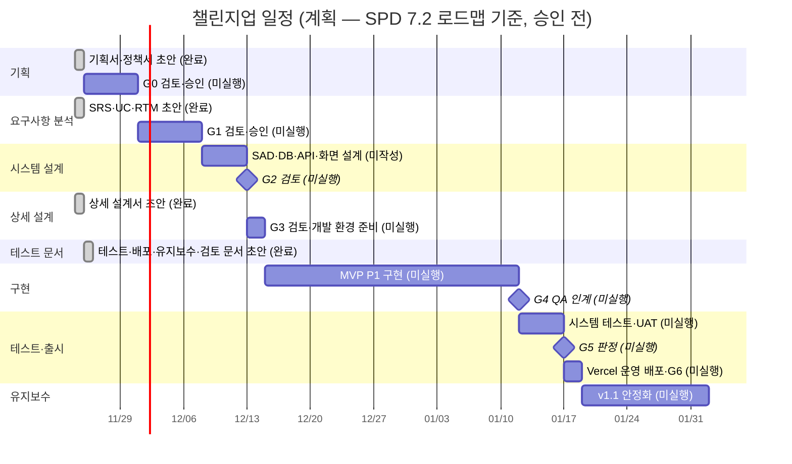
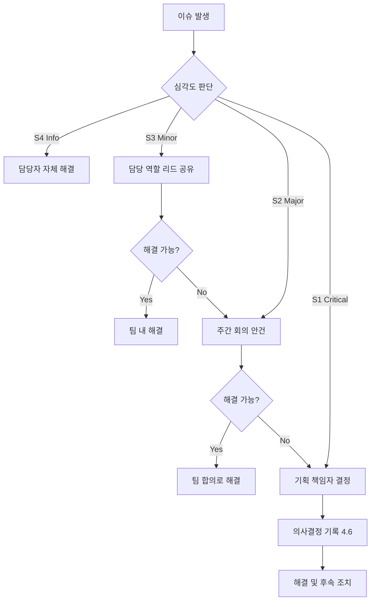
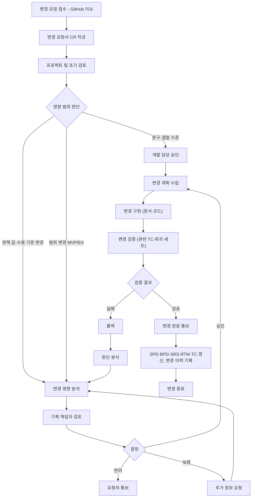

# 프로젝트 관리 산출물 (Project Management Artifacts)

> 일정은 서비스 기획서 7.2 고수준 로드맵(승인 전)을 기준으로 한 계획이며, 확정된 일정이 아니다. 사람 이름은 정해지지 않아 역할로만 적었다. 2026-11-25 현재 끝난 일은 "문서 초안 작성"뿐이고, 검토·승인·구현·테스트·배포는 모두 미실행이다.

> **프로젝트명:** 챌린지업 (ChallengeUp) — 온라인 강의 챌린지 플랫폼 (문서 ID: WBS·RSK·CHG-CHUP-v0.1 통합본)
> **문서 버전:** v0.1 (초안)
> **작성일:** 2026-11-25
> **작성자:** Claude Code (초안)
> **승인자:** 미정 (서비스 기획서 DEC-001)

---

## 목차

1. [WBS (Work Breakdown Structure)](#1-wbs-work-breakdown-structure)
2. [위험 관리 대장 (Risk Register)](#2-위험-관리-대장-risk-register)
3. [커뮤니케이션 계획](#3-커뮤니케이션-계획)
4. [변경 관리 계획](#4-변경-관리-계획)
5. [프로젝트 완료 보고서](#5-프로젝트-완료-보고서)

---

## 1. WBS (Work Breakdown Structure)

### 1.1 WBS 작성 원칙

| 원칙 | 설명 |
|------|------|
| 100% Rule | WBS는 프로젝트 범위(MVP-001~020)의 100%를 포함해야 한다 |
| 상호 배타성 | 각 작업 패키지(Work Package)는 중복되지 않아야 한다 |
| 결과물 기반 | 활동이 아닌 결과물(Deliverable) 중심으로 분해한다 |
| 8/80 Rule | 각 작업 패키지는 8시간 이상, 80시간 이하로 추정 가능해야 한다 (구현 패키지는 SPD 5.2 공수 기준) |
| 3단계 이상 분해 | 구현 단계는 착수 전에 MVP 항목 단위로 더 나눈다 |

### 1.2 워터폴 프로젝트 일정 (Gantt Chart)

서비스 기획서 7.2 로드맵(기획 7일 → 요구사항 7일 → 설계 7일 → 구현 28일 → 테스트·출시 7일)을 그대로 옮긴 **계획**이다. 실제로 끝난 것은 2026-11-24~25 문서 초안 작성뿐이다. G0 승인이 늦어지면 뒤 일정이 모두 밀린다.



### 1.3 WBS 상세 테이블

상태 값은 템플릿 값 대신 아래를 쓴다: **문서 초안 작성 완료**(파일이 있고 검토 전) / **미작성** / **미실행**(작업 자체를 하지 않음). 날짜는 실제 완료한 초안 작성일만 적는다.

| WBS-ID | 작업명 | 시작일 | 종료일 | 기간(일) | 담당자 | 상태 | 산출물 |
|--------|--------|--------|--------|:--------:|--------|------|--------|
| **0** | **00 기획** | | | | | | |
| 0.1 | 서비스 기획서·비즈니스 정책서 작성 | 2026-11-24 | 2026-11-24 | 1 | Claude Code (초안) | 문서 초안 작성 완료 | SPD-CHUP-v0.2, BPD-CHUP-v0.2 |
| 0.2 | 사용자 인터뷰 (학생 10, 강사 5) | 미정 | 미정 | 미정 | 기획 담당 (미정) | 미실행 | 인터뷰 기록 (DEC-003) |
| 0.3 | G0 검토·승인 | 미정 | 미정 | - | 승인자 미정 (DEC-001) | 미실행 | 검토 체크리스트 G0 |
| **1** | **01 요구사항 분석** | | | | | | |
| 1.1 | SRS 작성 | 2026-11-24 | 2026-11-24 | 1 | Claude Code (초안) | 문서 초안 작성 완료 | SRS-CHUP-v0.1 |
| 1.2 | 유스케이스 명세 | 2026-11-24 | 2026-11-24 | 1 | Claude Code (초안) | 문서 초안 작성 완료 | UCS-CHUP-v0.1 |
| 1.3 | RTM 작성·TC 연결 | 2026-11-24 | 2026-11-25 | 2 | Claude Code (초안) | 문서 초안 작성 완료 | RTM-CHUP-v0.2 |
| 1.4 | G1 검토·승인 | 미정 | 미정 | - | 미정 | 미실행 | 검토 체크리스트 G1 |
| **2** | **02 시스템 설계** | | | | | | |
| 2.1 | 아키텍처 설계 (SAD) | 미정 | 미정 | 미정 | 설계 담당 (미정) | 미작성 | SAD (ASM-01~10 확정, Vercel ADR) |
| 2.2 | DB 설계 | 미정 | 미정 | 미정 | 설계 담당 (미정) | 미작성 | DB 설계서 |
| 2.3 | API 설계 | 미정 | 미정 | 미정 | 설계 담당 (미정) | 미작성 | API 설계서 (Server Action·RPC) |
| 2.4 | 화면 설계 | 미정 | 미정 | 미정 | 설계 담당 (미정) | 미작성 | 화면 설계서 (UX 검토서 문구 반영) |
| 2.5 | G2 설계 검토 | 미정 | 미정 | - | 미정 | 미실행 (차단) | 검토 체크리스트 G2 |
| **3** | **03 상세 설계** | | | | | | |
| 3.1 | 상세 설계서 작성 | 2026-11-24 | 2026-11-24 | 1 | Claude Code (초안) | 문서 초안 작성 완료 | DDS-CHUP-v0.1 |
| 3.2 | 개발 환경 준비 (로컬 Supabase, Vercel 프로젝트, CI) | 미정 | 미정 | 미정 | 개발 담당 (미정) | 미실행 | 배포 계획서 2.2 |
| 3.3 | G3 검토·승인 | 미정 | 미정 | - | 미정 | 미실행 | 검토 체크리스트 G3 |
| **4** | **04 구현** | | | | | | |
| 4.1 | MVP-001~013 (P1) 구현 | 미정 | 미정 | 약 29 (SPD 5.2) | 개발 담당 (미정) | 미실행 | 소스 코드 |
| 4.2 | MVP-014~020 (P2·P3) 구현 | 미정 | 미정 | DEC-004 결정 후 | 개발 담당 (미정) | 미실행 | 소스 코드 |
| 4.3 | 단위·통합 테스트 작성 (Vitest·pgTAP) | 미정 | 미정 | 구현과 병행 | 개발 담당 (미정) | 미실행 | 테스트 코드 |
| 4.4 | 구현·테스트 인계서, G4 | 미정 | 미정 | - | 개발 담당 (미정) | 미작성 | 구현-테스트-인계서 |
| **5** | **05 테스트** | | | | | | |
| 5.1 | 테스트 계획서 | 2026-11-25 | 2026-11-25 | 1 | Claude Code (초안) | 문서 초안 작성 완료 | TPL-CHUP-v0.1 |
| 5.2 | 테스트 케이스 (153건) | 2026-11-25 | 2026-11-25 | 1 | Claude Code (초안) | 문서 초안 작성 완료 | TCS-CHUP-v0.1 |
| 5.3 | 테스트 결과 보고서 양식 | 2026-11-25 | 2026-11-25 | 1 | Claude Code (초안) | 문서 초안 작성 완료 (판정 불가 — 미실행) | TRP-CHUP-v0.1 |
| 5.4 | 시스템·성능·보안 테스트 실행 | 미정 | 미정 | 미정 | QA 담당 (미정) | 미실행 | 결과 보고서 갱신 |
| 5.5 | UAT | 미정 | 미정 | 미정 | 기획 책임자 (미정) | 미실행 | UAT 기록 |
| 5.6 | G5 판정 | 미정 | 미정 | - | 미정 | 미실행 | 검토 체크리스트 G5 |
| **6** | **06 배포** | | | | | | |
| 6.1 | 배포 계획서 (Vercel 결정 포함) | 2026-11-25 | 2026-11-25 | 1 | Claude Code (초안) | 문서 초안 작성 완료 | DPP-CHUP-v0.1 |
| 6.2 | 운영 가이드 | 2026-11-25 | 2026-11-25 | 1 | Claude Code (초안) | 문서 초안 작성 완료 | OPG-CHUP-v0.1 |
| 6.3 | Vercel·Supabase 운영 환경 구성 | 미정 | 미정 | 미정 | 개발 담당 (미정) | 미실행 | 배포 계획서 2.2 |
| 6.4 | 운영 배포·스모크 테스트 | 미정 | 미정 | 미정 | 개발 담당 (미정) | 미실행 | 릴리스 노트, G6 기록 |
| **7** | **07 유지보수** | | | | | | |
| 7.1 | 유지보수 계획서 | 2026-11-25 | 2026-11-25 | 1 | Claude Code (초안) | 문서 초안 작성 완료 | MTP-CHUP-v0.1 |
| 7.2 | 운영 인수·v1.1 안정화 | 미정 | 미정 | 14 (SPD 7.2) | 운영 담당 (미정) | 미실행 | 유지보수 보고서 |
| **8** | **08 공통 프로젝트 관리** | | | | | | |
| 8.1 | 단계별 검토 체크리스트 | 2026-11-25 | 2026-11-25 | 1 | Claude Code (초안) | 문서 초안 작성 완료 (검토는 미실행) | 단계별검토-체크리스트 |
| 8.2 | UX 검토서 (문구 검토) | 2026-11-25 | 2026-11-25 | 1 | Claude Code (초안) | 문서 초안 작성 완료 (문서 기반 문구 검토만 수행) | UX검토서 |
| 8.3 | 프로젝트 관리 산출물 | 2026-11-25 | 2026-11-25 | 1 | Claude Code (초안) | 문서 초안 작성 완료 | 본 문서 |
| 8.4 | 킥오프·주간 보고 | 미정 | 미정 | 전체 | 기획 책임자 (미정) | 미실행 | 회의록 |
| 8.5 | 위험·변경 관리 운영 | 2026-11-25 | 진행 | 전체 | 미정 | 대장 작성 완료, 정기 검토 미실행 | 2장, 4장 |
| 8.6 | 프로젝트 종료 | 미정 | 미정 | - | 미정 | 미실행 | 완료 보고서 (5장) |

> **상태 값:** 문서 초안 작성 완료 / 미작성 / 미실행 (참고: 템플릿의 Not Started·In Progress·Completed 대신 사용)

---

## 2. 위험 관리 대장 (Risk Register)

### 2.1 위험 식별 카테고리

| 카테고리 | 설명 | 예시 |
|----------|------|------|
| 기술 (Technical) | 기술 스택, 아키텍처, 성능 관련 위험 | 시간 경계 오판, RLS 누락, 정기 작업 실패 |
| 일정 (Schedule) | 마감일, 마일스톤 지연 관련 위험 | P1 공수가 4주를 넘음 |
| 리소스 (Resource) | 인력, 예산, 장비 관련 위험 | 인원·승인자 미정, 무료 요금제 한도 |
| 외부 (External) | 외부 의존성, 규제, 시장 관련 위험 | Supabase·Vercel 정책 변경, 개인정보 법령 |
| 비즈니스 (Business) | 비즈니스 요구사항, 이해관계자 관련 위험 | 사용자 문제가 가정 상태, 수익 모델 변경 |

### 2.2 위험 평가 매트릭스

**확률 (Probability)**

| 등급 | 수치 | 설명 |
|------|:----:|------|
| 매우 낮음 | 1 | 발생 가능성 10% 미만 |
| 낮음 | 2 | 발생 가능성 10~30% |
| 보통 | 3 | 발생 가능성 30~50% |
| 높음 | 4 | 발생 가능성 50~70% |
| 매우 높음 | 5 | 발생 가능성 70% 초과 |

**영향 (Impact)**

| 등급 | 수치 | 설명 |
|------|:----:|------|
| 매우 낮음 | 1 | 프로젝트에 미미한 영향 |
| 낮음 | 2 | 일부 작업에 경미한 지연 |
| 보통 | 3 | 마일스톤 지연 또는 예산 초과 |
| 높음 | 4 | 주요 목표 달성 위험 |
| 매우 높음 | 5 | 프로젝트 실패 가능성 |

**위험도 = 확률 x 영향**

|  | 영향 1 | 영향 2 | 영향 3 | 영향 4 | 영향 5 |
|:-:|:------:|:------:|:------:|:------:|:------:|
| **확률 5** | 5 | 10 | 15 | 20 | **25** |
| **확률 4** | 4 | 8 | 12 | 16 | **20** |
| **확률 3** | 3 | 6 | 9 | 12 | 15 |
| **확률 2** | 2 | 4 | 6 | 8 | 10 |
| **확률 1** | 1 | 2 | 3 | 4 | 5 |

> **위험도 등급:** 낮음(1~4) / 보통(5~9) / 높음(10~15) / 매우 높음(16~25)

확률·영향 점수는 작성자의 판단이며 근거 데이터가 없다. G0 검토 때 다시 매긴다.

### 2.3 위험 대응 전략

| 전략 | 설명 | 적용 시점 |
|------|------|-----------|
| 회피 (Avoid) | 위험 원인을 제거하여 발생 자체를 방지 | 위험도가 매우 높고 대응 가능 시 |
| 완화 (Mitigate) | 위험 발생 확률 또는 영향을 줄이는 조치 | 대부분의 위험에 적용 |
| 전가 (Transfer) | 위험을 제3자(보험, 외주 등)에게 이전 | 전문성 부족, 재무적 위험 |
| 수용 (Accept) | 위험을 인지하되 별도 조치 없이 감수 | 위험도가 낮거나 대응 비용이 과도 |

### 2.4 위험 관리 테이블

대응 계획은 모두 아직 실행하지 않았다 (상태 Open).

| RISK-ID | 카테고리 | 위험 설명 | 확률 | 영향 | 위험도 | 대응 전략 | 대응 계획 | 담당자 | 상태 |
|---------|----------|-----------|:----:|:----:|:------:|-----------|-----------|--------|------|
| RSK-001 | 리소스 | 승인자·인원 미정으로 모든 게이트가 멈춤 (DEC-001) | 5 | 5 | 25 | 회피 | 2026-11-28까지 승인자 지정 | 프로젝트 팀 | Open |
| RSK-002 | 일정 | P1 공수 약 29일이 4주(1인 20일)를 넘음 (DEC-004) | 4 | 4 | 16 | 완화 | G0에서 P2·P3 제외 범위 확정, 인원 확정 | 기획·개발 담당 | Open |
| RSK-003 | 비즈니스 | 사용자 문제(OBJ-001~003)가 가정 상태 (DEC-003) | 3 | 4 | 12 | 완화 | 학생 10·강사 5 인터뷰 (2026-12-05) | 기획 담당 | Open |
| RSK-004 | 기술 | 02-시스템설계 미작성으로 DDS 가정(ASM)이 바뀌어 재작업 (ISSUE-06) | 4 | 3 | 12 | 완화 | G2 전에 02 문서 작성, ASM 변경 시 DDS·TC 영향 분석 | 설계 담당 | Open |
| RSK-005 | 기술 | 마감·모집·열림 경계 오판 (NFR-012) | 3 | 5 | 15 | 완화 | 배타적 비교 규칙, TS·SQL 일치 테스트(TC-FN-TIME-001), 시각 주입 방식 결정 | 개발 담당 | Open |
| RSK-006 | 기술 | RLS 누락으로 참여자 전용 데이터·비공개 사진 노출 | 3 | 5 | 15 | 완화 | TC-SEC-RLS-010 접근 표 전수 테스트를 마이그레이션 PR 필수 점검으로 | 개발 담당 | Open |
| RSK-007 | 기술 | 정기 작업(00:00·00:10) 실패로 상태 전환·판정 지연 | 2 | 4 | 8 | 완화 | 멱등 설계, 03:10까지 재시도, 오류 로그 알림 (운영 가이드 3.3) | 개발 담당 | Open |
| RSK-008 | 리소스 | Supabase·Vercel 무료 한도(메일, pg_cron, 백업, 일시 정지) 초과 (ISSUE-04) | 3 | 3 | 9 | 완화 | 설계 착수 전 요금제 결정 | 개발 담당 | Open |
| RSK-009 | 외부 | 개인정보 보관 기간·파기 절차 미확정 (ISSUE-05) | 3 | 4 | 12 | 완화 | 출시 전 법률 검토 | 기획 책임자 | Open |
| RSK-010 | 기술 | 공개 저장소에 비밀 키·개인정보 커밋 | 2 | 5 | 10 | 회피 | 환경 변수는 Vercel에만, 비밀 정보 검사 (TC-SEC-KEY-002) | 개발 담당 | Open |
| RSK-011 | 비즈니스 | 수익 모델 변경(2026-11-24, CHG-001)이 MVP 범위로 번짐 | 2 | 3 | 6 | 회피 | MVP는 무료 고정, 운영 방식·배분율 필드 미생성 (SRS 3.25) | 기획 책임자 | Open |
| RSK-012 | 일정 | 테스트 1주에 결함 수정 여유 부족 | 3 | 3 | 9 | 완화 | 단위·통합 테스트를 구현 기간에 병행 (테스트 계획서 R-03) | QA·개발 담당 | Open |

> **상태:** Open / In Progress / Mitigated / Closed / Occurred

---

## 3. 커뮤니케이션 계획

### 3.1 이해관계자 분석 매트릭스

이해관계자를 **관심도(Interest)** 와 **영향력(Influence)** 에 따라 분류한다. 학생 프로젝트로 사람은 정해지지 않았고 역할만 적었다.

```
                높은 영향력
                    |
    B: 만족 유지     |     A: 핵심 관리
    (Keep Satisfied) |     (Manage Closely)
                    |
  ──────────────────┼──────────────────
                    |
    D: 모니터링      |     C: 정보 제공
    (Monitor)       |     (Keep Informed)
                    |
                낮은 영향력

    낮은 관심도 ←─────────────→ 높은 관심도
```

| 이해관계자 | 역할 | 관심도 | 영향력 | 분류 | 커뮤니케이션 전략 |
|-----------|------|:------:|:------:|------|------------------|
| 기획 책임자 (미정, DEC-001) | 게이트 승인, 범위·정책 결정 | 높음 | 높음 | A | 게이트마다 검토 회의, 주간 보고 |
| 프로젝트 팀 (인원 미정) | 기획·설계·구현·테스트 | 높음 | 높음 | A | 주간 회의, GitHub 이슈·PR |
| 과정 담당 (비교과 과정 운영) | 수업 결과물 확인 | 보통 | 보통 | B | 과정 일정에 맞춰 결과 공유 (방식 미정) |
| 강사 (MVP 참여 예정, 인원 미정) | 챌린지 개설·운영, 인터뷰 대상 | 높음 | 보통 | C | 인터뷰(DEC-003), 출시 전 안내, UAT |
| 학생 (초기 사용자) | 신청·인증, 인터뷰·UAT 대상 | 높음 | 낮음 | C | 인터뷰, 사용성 테스트 |
| 관리자 (운영 담당 겸임 예상) | 검수·강사 승인·신고 처리 | 높음 | 보통 | C | 운영 가이드, 출시 전 교육 |
| Vercel·Supabase (외부 사업자) | 인프라 제공 | 낮음 | 보통 | D | 상태 페이지·변경 공지 확인 |

### 3.2 커뮤니케이션 매트릭스

| 대상 | 빈도 | 방법 | 주요 내용 | 담당자 |
|------|------|------|-----------|--------|
| 기획 책임자 | 게이트마다 + 주 1회 | 검토 회의, 주간 보고 | 게이트 판정, 미결 결정(DEC·ISSUE), 위험 | 프로젝트 팀 |
| 프로젝트 팀 | 주 1회 (요일 미정) | 회의 + 팀 채널 | 진척, 블로커, 다음 주 계획 | 미정 |
| 개발·QA | PR마다 | GitHub PR 리뷰, Preview 배포 링크 | 변경, 테스트 결과 | 개발 담당 |
| 결함·변경 요청 | 발생 시 | GitHub Issues (`bug`, `change-request`) | 결함, CR | 발견자 |
| 강사·학생 | 인터뷰·UAT·출시 시 | 개별 연락 (서비스 밖) | 일정, 안내 | 기획 담당 |
| 과정 담당 | 과정 일정 | 미정 | 결과물 공유 | 미정 |

공개 저장소이므로 GitHub 이슈·PR에는 개인정보·연락처·키를 쓰지 않는다. 연락처는 비공개 팀 문서에 둔다.

### 3.3 회의 체계

모든 회의는 아직 열리지 않았다 (미실행).

#### 일일 스탠드업 (Daily Standup)

| 항목 | 내용 |
|------|------|
| 참석자 | 구현 기간의 개발·QA 담당 |
| 시간 | 구현 기간 매일 (시간 미정, 15분) — 소규모 팀이면 팀 채널 비동기 공유로 대체 가능 |
| 형식 | 어제 완료, 오늘 예정, 블로커 |
| 기록 | 팀 채널 요약 |

#### 주간 진척 보고 (Weekly Status Meeting)

| 항목 | 내용 |
|------|------|
| 참석자 | 기획 책임자, 프로젝트 팀 |
| 시간 | 주 1회 (요일·시각 미정, 1시간) |
| 안건 | 진척(WBS), 위험(2장), 미결 결정(4.6), 다음 주 계획 |
| 산출물 | 주간 보고 (형식은 CLAUDE.md 5.3 개발 진행 보고서) |

#### 월간 운영위 (Monthly Steering Committee)

| 항목 | 내용 |
|------|------|
| 참석자 | 해당 없음 — 소규모 학생 프로젝트라 별도 운영위를 두지 않음 (안) |
| 시간 | - |
| 안건 | 게이트 검토 회의가 대신함 |
| 산출물 | 단계별 검토 체크리스트 |

### 3.4 에스컬레이션 경로



**에스컬레이션 기한:** (제안값, 승인 전)

| 심각도 | 최초 보고 | 에스컬레이션 기한 | 대상 |
|--------|-----------|------------------|------|
| S1 Critical | 즉시 | 발생 즉시 | 담당자 → 기획 책임자 |
| S2 Major | 당일 | 다음 주간 회의 전 | 담당자 → 프로젝트 팀 |
| S3 Minor | 주간 회의 | - | 담당자 |
| S4 Info | 주간 보고 시 | - | - |

---

## 4. 변경 관리 계획

승인된 기준선(G0·G1 이후)의 범위·정책·요구사항이 바뀌면 이 절차를 따른다. 정책 변경은 비즈니스 정책서 17장 절차와 확인 항목을 함께 쓴다. 운영 중 변경 요청은 [유지보수 계획서](../07-유지보수/유지보수계획서.md) 2장과 같은 CR 양식을 쓴다. **현재는 승인된 기준선이 없어 공식 CR은 없다.** 초안 단계에서 있었던 큰 변경은 4.5에 기록했다.

### 4.1 변경 요청 프로세스



### 4.2 변경 요청서 (CR: Change Request) 템플릿

| 항목 | 내용 |
|------|------|
| **CR-ID** | CR-YYYY-NNNN (GitHub 이슈 번호 병기) |
| **요청일** | YYYY-MM-DD |
| **요청자** | 역할 |
| **변경 유형** | [ ] 요구사항 변경 / [ ] 설계 변경 / [ ] 범위 변경 / [ ] 일정 변경 / [ ] 정책 변경 / [ ] 기타 |
| **우선순위** | [ ] 긴급 / [ ] 높음 / [ ] 보통 / [ ] 낮음 |

**변경 내용:**

| 항목 | 상세 |
|------|------|
| 변경 제목 | 한 줄 요약 |
| 현재 상태 (As-Is) | 현재 규칙·범위 |
| 요청 사항 (To-Be) | 바꿀 내용 |
| 변경 사유 | 근거 (KPI, 피드백, 법규 등) |
| 영향 받는 산출물 | SPD, BPD, SRS, UCS, RTM, DDS, TC, 코드 |
| 관련 기획·정책·요구사항 ID | MVP·EX·BP·FR·NFR·DEC ID |
| 변경 전·후 승인 기준선 | 문서 버전 / 승인 기록 |
| RTM 갱신 위치·재검증 대상 | RTM 행, 재실행할 TC |
| 재검토 단계 | Gate / 승인자 / 재검토 기록 |

**승인 정보:**

| 단계 | 승인자 | 승인일 | 결과 | 비고 |
|------|--------|--------|------|------|
| 프로젝트 팀 검토 | 역할 | YYYY-MM-DD | 승인 / 반려 / 기획 책임자 회부 | |
| 기획 책임자 결정 | 역할 | YYYY-MM-DD | 승인 / 반려 / 보류 | |

### 4.3 변경 영향 분석 템플릿

| 분석 항목 | 내용 |
|-----------|------|
| **CR-ID** | CR-YYYY-NNNN |
| **분석 담당자** | 역할 |
| **분석 완료일** | YYYY-MM-DD |

**영향 범위 분석:**

| 영역 | 영향 유무 | 영향 상세 | 예상 공수 |
|------|:---------:|-----------|-----------|
| 서비스 기획서·정책서 | Yes / No | MVP·EX·BP 변경 | 인일 |
| 요구사항 명세·유스케이스 | Yes / No | FR·AC·UC 변경 | 인일 |
| 시스템 설계 (SAD·DB·API·화면) | Yes / No | | 인일 |
| 상세 설계 (DDS) | Yes / No | | 인일 |
| DB 마이그레이션·RLS·RPC | Yes / No | 되돌림 SQL 필요 여부 | 인일 |
| 화면·문구 | Yes / No | UX 검토서 원칙 적용 | 인일 |
| 테스트 케이스 | Yes / No | TC 추가·수정, RTM | 인일 |
| 진행 중 챌린지·기존 포인트 로그 | Yes / No | 소급 여부 (BPD 17.2) | 인일 |
| 배포·운영 | Yes / No | 환경 변수, 정기 작업 | 인일 |

**일정 영향:**

| 항목 | 기존 | 변경 후 | 차이 |
|------|------|---------|------|
| 개발 완료일 | 미정 | 미정 | +N일 |
| 테스트 완료일 | 미정 | 미정 | +N일 |
| 릴리스일 | 미정 | 미정 | +N일 |

**비용 영향:**

| 항목 | 추가 비용 | 비고 |
|------|-----------|------|
| 인건비 | 해당 없음 (학생 프로젝트) 또는 인일 | |
| 인프라 비용 | Vercel·Supabase 요금제 변경 여부 | ISSUE-04 |
| 라이선스 비용 | 해당 없음 예상 | |
| **합계** | 분석 시 기록 | |

**위험 평가:**

| 위험 | 확률 | 영향 | 위험도 | 대응 방안 |
|------|:----:|:----:|:------:|-----------|
| 분석 시 기록 | 1~5 | 1~5 | 곱 | 2.3 전략 |

### 4.4 CCB (변경통제위원회) 구성 및 역할

소규모 팀이라 별도 위원회 대신 기획 책임자가 최종 결정한다 (안).

**CCB 구성:**

| 역할 | 담당자 | 책임 |
|------|--------|------|
| CCB 의장 (최종 결정) | 기획 책임자 (미정, DEC-001) | 결정, 기준선 승인 |
| 기술 대표 | 개발 담당 (미정) | 기술·DB 영향 평가 |
| 품질 대표 | QA 담당 (미정) | TC·회귀 영향 평가 |
| 비즈니스 대표 | 기획 담당 (미정) | 정책·KPI 영향 |
| 인프라 대표 | 개발 담당 겸임 | Vercel·Supabase 영향 (해당 시) |

**CCB 운영 규칙:**

| 항목 | 규칙 |
|------|------|
| 소집 기준 | 정책 값·수용 기준·범위 변경 |
| 정기 회의 | 주간 회의 안건으로 처리 |
| 긴급 회의 | S1 결함·보안 관련 변경 시 즉시 (팀 채널) |
| 의결 기준 | 기획 책임자 결정 (팀 의견 기록) |
| 기록 | 4.5 변경 이력과 4.6 의사결정 로그에 기록 |

### 4.5 변경 이력

| CHG-ID | 일자 | 변경 내용 | 변경 전 | 변경 후 | 영향 받은 문서 | 근거·결정 | 승인 |
|--------|------|-----------|---------|---------|----------------|-----------|------|
| CHG-001 | 2026-11-24 | 수익화 모델 변경 (v2 적용, MVP는 무료 유지) | 플랫폼 단일 수수료 10~15% | 두 운영 방식: **강사 직접 운영형 — 플랫폼 20% / 강사 80%**, **플랫폼 기획 지원형 — 플랫폼 50% / 강사 50%** | SPD v0.1→v0.2 (4장, EX-013, H-006, DEC-006·010), BPD v0.1→v0.2 (BP-PAY-005·006), SRS v0.1 (FR-024, 3.25), RTM (FR-024 행) | 수익화 전략 변경 (SPD 변경 이력 v0.2, BPD 17.3). 배분율은 2026-11-24 결정으로 기록됨 (DEC-006 상태란) | 미정 — 공식 승인 미실행 (기준선 승인 전 초안 단계 변경) |
| CHG-002 | 2026-11-25 | RTM에 TC ID 연결 | 테스트 케이스 "미작성" | TCS-CHUP-v0.1 TC ID 연결, 테스트 매핑률 35/35 | RTM v0.1→v0.2 | 테스트 케이스 문서 작성 | 미정 (초안) |

CHG-001 후속 확인 사항 (미결): SPD 4.1의 "강사가 두 방식 중 하나를 고른다"와 BPD-PAY-006-2 "기획 지원형은 강사 신청 + 관리자 승인으로만 지정"의 표현 차이를 G0에서 정리한다. PG 수수료 부담 주체(DEC-006), 기획 지원형 선정 기준·계약서(DEC-010)는 미결이다.

### 4.6 의사결정 로그

기존 문서의 결정·미결 ID를 한곳에 모았다. 상태는 각 원문을 따른다.

| ID | 결정 사항 | 출처 | 상태 | 담당·기한 | 관련 |
|----|-----------|------|------|-----------|------|
| DEC-001 | 기획 승인자(G0) 지정 | SPD 7.3 | 미결 | 프로젝트 팀 / 2026-11-28 | 모든 게이트, RSK-001 |
| DEC-002 | 서비스 이름 확정 ("챌린지업"은 임시) | SPD 7.3 | 미결 | 기획 담당 / 출시 2주 전 | DEP-DEC-05 도메인 |
| DEC-003 | 학생·강사 인터뷰로 사용자 문제 확인 | SPD 7.3 | 미결 | 기획 담당 / 2026-12-05 | RSK-003 |
| DEC-004 | 인원·기간에 맞춘 MVP 포함 범위 | SPD 7.3, SRS ISSUE-03 | 미결 | 기획·개발 담당 / G0 | RSK-002 |
| DEC-005 | 늦은 신청 시 완주 기준 | SPD 7.3 | 미결 (MVP는 늦은 신청 불가로 결정) | 기획 담당 / v2 | EX-005 |
| DEC-006 | PG 수수료 부담 주체 | SPD 7.3 | 미결 (배분율 20%/50%는 2026-11-24 결정) | 기획 책임자 / v2 | CHG-001 |
| DEC-007 | 유료·보증금형 환불 규칙과 법령 검토 | SPD 7.3 | 미결 | 기획 책임자 + 법률 자문 / v2 개발 전 | EX-001·002 |
| DEC-008 | 포인트 범위 (리더보드 챌린지별, 레벨 전체) | SPD 7.3 | 제안안 작성, 승인 대기 | 기획 담당 / G0 | BP-POINT, DDS 5.8 동점 근사 |
| DEC-009 | 부정 인증 대응 | SPD 7.3 | 미결 (MVP는 신고로 대응) | 기획 담당 / v1.1 | FR-023 |
| DEC-010 | 기획 지원형 선정 기준·월 지원 건수·계약서 | SPD 7.3 | 미결 | 기획 책임자 / Phase 0 시범 운영 전 | CHG-001 |
| ISSUE-01 | 가입 시 이메일 인증 여부 | SRS 부록 C | 미결 (SRS는 켜는 것으로 작성) | 기획 담당 / G0 | TC-FN-AUTH-001 |
| ISSUE-02 | 자체 계정 잠금 필요 여부 | SRS 부록 C | 미결 (Supabase 기본 제한) | 개발 담당 / G1 | BP-AUTH-002-2 |
| ISSUE-03 | P2·P3 포함 범위 | SRS 부록 C | 미결 | 기획·개발 / G0 | DEC-004 |
| ISSUE-04 | Supabase 요금제 | SRS 부록 C | 미결 | 개발 담당 / 설계 착수 전 | RSK-008, NFR-008 |
| ISSUE-05 | 개인정보 보관 기간·파기 절차 | SRS 부록 C | 미결 | 기획 책임자 / 출시 전 | RSK-009, NFR-014 |
| ISSUE-06 | 02-시스템설계 문서 작성 | SRS 부록 C | 미작성 | 설계 담당 / G2 전 | RSK-004 |
| DEP-DEC-01 | 배포 플랫폼 Vercel (Cloudflare 대신) | 배포 계획서 1.4 | 결정됨 (SPD 5.5와 일치, 공식 승인은 미실행) | - | SAD ADR로 옮길 것 |
| DEP-DEC-02 | 정기 작업은 Supabase pg_cron | 배포 계획서 1.4, DDS ASM-05 | 결정됨 (SPD 5.5 "또는 Vercel Cron" 문구와 불일치 — 정리 필요) | - | FR-008, FR-020 |
| DEP-DEC-03 | 비운영 DB: 별도 프로젝트 vs Supabase 브랜칭 | 배포 계획서 1.4 | 미결 | 개발 담당 / G3 | 테스트 계획서 4.1 |
| DEP-DEC-04 | Supabase 연결: Vercel Marketplace 통합 vs 수동 | 배포 계획서 1.4 | 미결 | 개발 담당 / G3 | 환경 변수 |
| DEP-DEC-05 | 운영 도메인 | 배포 계획서 1.4 | 미결 | DEC-002 후 | - |
| UX-DEC-01 | 문구 기준을 해요체 + 토스 UX 라이팅 원칙으로 할지 | UX 검토서 6.7.3 | 미결 (제안) | 기획 책임자 / G0 | UX-001 |

---

## 5. 프로젝트 완료 보고서

> 프로젝트가 끝나지 않았다. 아래 표는 종료 시 채울 양식이며 현재 값은 모두 "해당 없음(진행 전)" 또는 "미정"이다.

### 5.1 프로젝트 개요

| 항목 | 내용 |
|------|------|
| 프로젝트명 | 챌린지업 (ChallengeUp) — 온라인 강의 챌린지 플랫폼 |
| 프로젝트 기간 | 2026-11-24 ~ 미정 |
| 프로젝트 목표 | 기간이 정해진 챌린지에서 매일 인증과 피드가 있으면 학생이 완주한다는 가설 검증 (H-001 완주율 60%, H-002 일일 인증률 70%) |
| 총 투입 인원 | 미정 |
| 총 투입 공수 | 미정 |
| 총 예산 | 미정 (Supabase·Vercel 무료 요금제 가정, SPD 7.3) |

### 5.2 주요 성과 (계획 vs 실적)

**일정 현황:**

| 마일스톤 | 계획일 | 실적일 | 차이 | 사유 |
|----------|--------|--------|------|------|
| 요구사항 확정 (G1) | SPD 7.2 기준 계획만 있음 | 없음 | - | 미실행 |
| 설계 완료 (G2·G3) | 계획만 있음 | 없음 | - | 미실행 (02 미작성) |
| 개발 완료 (G4) | 계획만 있음 | 없음 | - | 미실행 |
| 테스트 완료 (G5) | 계획만 있음 | 없음 | - | 미실행 |
| 릴리스 (G6) | 계획만 있음 | 없음 | - | 미실행 |

**일정 준수율:** 산정 불가 (완료된 마일스톤 없음)

**예산 현황:**

| 항목 | 계획 (원) | 실적 (원) | 차이 (원) | 비율 |
|------|-----------|-----------|-----------|------|
| 인건비 | 해당 없음 | - | - | - |
| 인프라 | 미정 (무료 요금제 가정) | - | - | - |
| 라이선스 | 해당 없음 | - | - | - |
| 교육/컨설팅 | 해당 없음 | - | - | - |
| 기타 (도메인) | 미정 | - | - | - |
| **합계** | **미정** | **-** | **-** | **-** |

**예산 준수율:** 산정 불가

### 5.3 품질 지표

| 지표 | 목표 | 실적 | 충족 여부 |
|------|------|------|-----------|
| 결함 밀도 | 미정 | 측정 전 | - |
| S1·S2 미해결 결함 | 0건 | 측정 전 (테스트 미실행) | - |
| 도메인 규칙 테스트 (NFR-013) | 100% | 측정 전 | - |
| P1 TC 통과율 | 100% (초안) | 측정 전 (0/153 실행) | - |
| 성능 목표 (NFR-001·003) | 100% | 측정 전 | - |
| 접근성 (NFR-011) | S1·S2 0건 | 측정 전 | - |
| 보안 취약점 (High 이상) | 0건 | 측정 전 | - |

### 5.4 범위 달성 현황

| 요구사항 분류 | 계획 수 | 완료 수 | 이월 수 | 취소 수 | 달성률 |
|--------------|:-------:|:-------:|:-------:|:-------:|:------:|
| 기능 요구사항 (FR-001~023) | 23 | 0 | - | - | 0% (구현 전) |
| 비기능 요구사항 (NFR, 검증 대상) | 13 | 0 | - | - | 0% (검증 전) |
| **합계** | **36** | **0** | **-** | **-** | **0%** |

### 5.5 교훈 (Lessons Learned)

프로젝트 종료 후 작성한다. 초안 단계에서 보인 점만 미리 적는다.

| # | 분류 | 내용 | 원인 | 개선방안 |
|---|------|------|------|----------|
| 1 | 요구사항 | 문서 간 표현 차이(경계 시각, 조기 인증, 스트릭 정의)가 생김 | 같은 규칙을 여러 문서에 다시 씀 | 규칙은 BPD 한 곳에, 다른 문서는 ID만 참조 |
| 2 | 설계 | 02 문서 없이 03을 먼저 씀 | 일정 압박 | G2를 건너뛰지 않기 |
| 3 | 개발 | 종료 후 작성 | - | - |
| 4 | 테스트 | 시각 주입 방식이 설계에 없어 경계 TC 실행 수단이 없음 | 테스트 용이성을 설계 단계에서 검토하지 않음 | DDS 리뷰 체크리스트에 "테스트 시각 고정" 추가 |
| 5 | 배포 | 종료 후 작성 | - | - |
| 6 | 커뮤니케이션 | 승인자 미정으로 모든 결정이 미결 | DEC-001 지연 | 킥오프에서 승인자부터 지정 |
| 7 | 위험 관리 | 종료 후 작성 | - | - |
| 8 | 도구/프로세스 | 종료 후 작성 | - | - |

### 5.6 잔여 위험 및 권고사항

**잔여 위험:** 종료 시 작성. 현재 위험은 2.4 표 참고.

| # | 위험 설명 | 위험도 | 대응 권고 | 담당 |
|---|----------|:------:|-----------|------|
| 1 | 종료 시 작성 (현재는 2.4 RSK-001~012) | - | - | - |

**권고사항:** 종료 시 작성.

| # | 분류 | 권고 내용 | 우선순위 | 대상 |
|---|------|-----------|:--------:|------|
| 1 | 기술 부채 | 종료 시 작성 (현재 후보는 유지보수 계획서 4.3) | - | - |
| 2 | 성능 개선 | 종료 시 작성 | - | - |
| 3 | 운영 | 종료 시 작성 | - | - |
| 4 | 보안 | 종료 시 작성 | - | - |
| 5 | 프로세스 | 종료 시 작성 | - | - |

### 5.7 프로젝트 종료 승인

| 역할 | 이름 | 서명 | 일자 |
|------|------|------|------|
| 기획 책임자 | 미정 (DEC-001) | | |
| 개발 담당 | 미정 | | |
| QA 담당 | 미정 | | |
| 운영 담당 | 미정 | | |

---

*프로젝트 완료 보고서는 프로젝트 종료 후 작성하여 이해관계자에게 공유한다.*
